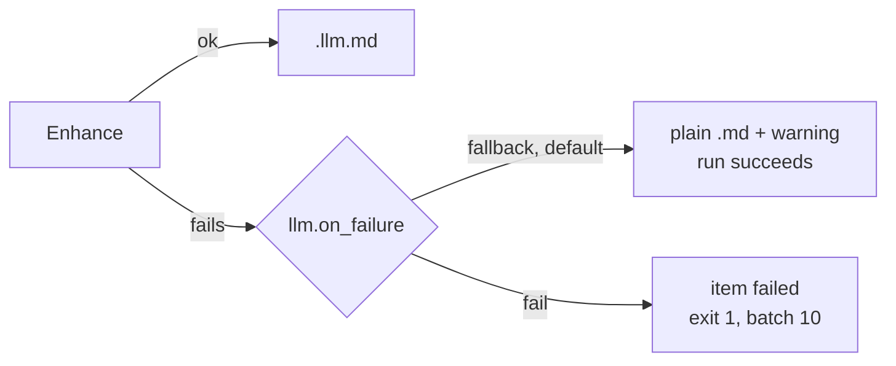
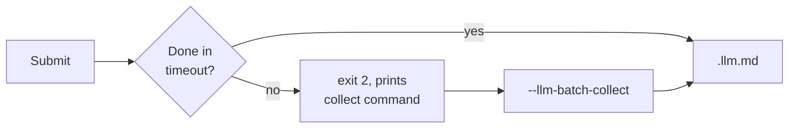
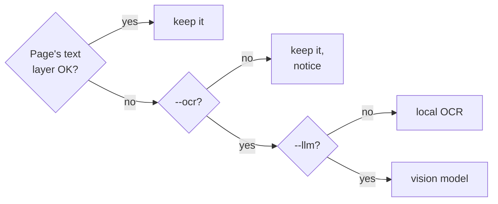

# CLI Reference

```bash
markitai <input> [options]
```

The input is a file, a directory, a `.urls` list, a URL or a `.numbers` package. `mkai` is a short alias for `markitai`; `markitai --help` and `markitai <command> --help` list everything below.

## Conversion options

| Option | Effect |
|--------|--------|
| `--llm` | LLM cleanup and frontmatter; writes only `.llm.md` |
| `--keep-base` | With `--llm`, also write the plain `.md` |
| `-p, --preset <name>` | `minimal`, `standard`, `rich` or your own ([Presets](#preset)) |
| `--profile <name>` | `rag`, `obsidian` or `okf` ([Profiles](#profile)) |
| `--alt` | Image alt text. Needs `--llm` |
| `--desc` | Image descriptions in `images.json`. Needs `--llm` |
| `--screenshot` | Page images of PDFs and Office files, or a whole web page, as JPEG |
| `--screenshot-only` | Screenshots as the content source |
| `--ocr` | Read scanned PDFs and images |
| `--pure` | No generated frontmatter; with `--llm` the model only cleans the text |
| `--text-only` | Pictures and PDFs: only the recognised text, without frontmatter, title, picture links or descriptions |
| `--no-compress` | Keep images at their original size and format |

Each switch has an opposite that undoes a preset or config file: `--no-llm`, `--no-alt`, `--no-desc`, `--no-screenshot`, `--no-screenshot-only`, `--no-ocr`, `--no-pure`, `--no-text-only`, `--compress` (`--preset rich --no-desc`). The last of a pair wins.

### `--llm` {#llm}

A document too long for one call is enhanced in chunks. When enhancement fails (bad key, provider error, timeout, refusal), [`llm.on_failure`](/guide/configuration#llm-requests) decides:



The warning goes to stderr and the item's `warnings`. Keys are checked before anything is converted:

- Each `llm.model_list` model needs a key in its entry (`api_key`, literal or `env:VAR_NAME`) or the provider's variable (`DEEPSEEK_API_KEY`, `OPENAI_API_KEY`, ...). A model without one is left out, with a warning naming the variable; with no model left, the run exits `1` and sends nothing (`--dry-run` warns).
- A model with its own `api_base` (a local server, a gateway) is always tried.
- A key the provider refuses is reported once, naming its variable; when every key has been refused, the run sends no more requests.

#### Batch API

`--llm-batch` enhances a directory batch through the OpenAI or Anthropic Batch API, at about half the list price. A wait that times out or is stopped leaves the batch running:

```bash
markitai docs/ --llm --llm-batch -o out/         # waits up to --llm-batch-timeout (3600 s)
markitai --llm-batch-collect <batch-id> -o out/  # finish a handed-off batch later
```



- Needs `--llm`, a directory input and one OpenAI or Anthropic model; `--llm-batch-timeout` is at least 60 s.
- Text only: not with `--pure`, `--ocr`, `--screenshot`, `--alt` or `--desc`, nor for a document that needs more than one request.
- After collection a failed item fails as usual (batch exit `10`); a batch still pending exits `2` and prints its collect command, even under `--quiet` or `--json`.
- `--llm-batch --resume -o out/` continues the unfinished batch in that folder; a plain `--resume` refuses a folder whose batch is not collected, so nothing is paid twice.

### Presets {#preset}

| Preset | LLM | alt | desc | screenshot | OCR |
|--------|:---:|:---:|:----:|:----------:|:---:|
| `minimal` | – | – | – | – | – |
| `standard` | ✓ | ✓ | ✓ | – | – |
| `rich` | ✓ | ✓ | ✓ | ✓ | – |

No preset turns on OCR. Flags after a preset still apply. Define your own, or redefine these, in the [config file](/guide/configuration#presets).

### Profiles {#profile}

A preset picks which features run, a profile what the files look like (see [Output Profiles](./output-profiles.md)):

| Profile | Effect |
|---------|--------|
| `rag` | Visible `assets/`, `<!-- page: N -->` markers for PDFs, pipe-table column checks |
| `obsidian` | Visible `assets/`, optional wikilink image references |
| `okf` | [Open Knowledge Format](https://github.com/GoogleCloudPlatform/knowledge-catalog) frontmatter |

`--page-markers` keeps the plain `<!-- Page number: N -->` and `<!-- Slide number: N -->` comments in any output (off by default, `output.page_markers`; `--no-page-markers` drops them again).

### Screenshots

Screenshots go to `.markitai/screenshots/`: PDF pages, Office pages and slides (`deck.pptx.page0001.jpg`), and for a URL the page as Chrome rendered it, in tiles for a long page (`name.full.jpg`, `name.full--1.jpg`, ...).

| Needs | When |
|-------|------|
| Chrome or Chromium | URLs (`markitai doctor --fix` installs Chrome's headless shell) |
| LibreOffice | Word, Excel and PowerPoint pages; without it the text converts with a warning |

| Input | `--screenshot-only` | `--llm --screenshot-only` |
|-------|---------------------|---------------------------|
| URL | Screenshots, no `.md` | `.llm.md` read from the screenshots |
| PDF, Office | Screenshots + the extracted `.md` | The model reads the screenshots, not the text layer |

`--llm --screenshot-only` rescues pages whose text extraction fails (heavy JavaScript, canvas apps). A URL whose capture fails, or an Office file without LibreOffice, is a failed item.

### `--ocr` {#ocr}



- Local OCR runs PaddleOCR models inside markitai; the first `--ocr` downloads them (about 45 MB), or prepare them with `markitai doctor --fix`. On macOS, `MARKITAI_OCR_BACKEND=vision` uses the system's Vision instead; on macOS 15, Vision may read Japanese with its Chinese recognizer, so set `ocr.lang: ja` for Japanese there.
- With `--llm` the pages go to the vision model; `MARKITAI_NO_VLM_OCR=1` OCRs locally and sends only the text.
- Good pages keep their text (headings, lists, tables, images). An unreadable file fails; a blank image converts with a notice. A picture on its own needs `--ocr` or `--llm`, else it is skipped (exit `0`).

#### PDF text layers that read wrong

markitai checks each page's extracted text for private-use or `(cid:NN)` codes, UTF-8 read as Windows-1252 (`café`), reversed right-to-left Hebrew or Arabic, and fonts whose codes stand for other letters.

- Without `--ocr`, such pages join the scanned-page notice: `PDF pages 7–8 (2 of 40): native text was not recovered (…); OCR is required to read them. Run again with --ocr.`
- With `--ocr` they are OCR'd. A text layer that passes is also compared with what its glyphs draw: two short crops per font per document, at most four per page.
- Normal pages (Chinese, Japanese, English, code, tables) keep their text layer.

Each PDF result lists `page_sources` (`--json`, [Python API](/guide/python-api#conversionoutput), serve), such as `{"page": 7, "source": "ocr", "reason": "text layer failed the script check: …"}`. `source` is `text`, `ocr` or `mixed` (text layer plus OCR'd pictures, or the vision model beside it).

Web pages need no model for mathematics: MathJax, KaTeX and MathML become `$...$` and `$$...$$`.

## Output options

| Option | Effect |
|--------|--------|
| `-o, --output <path>` | A directory, or a `.md` file for a single input. Without it a single input prints to stdout; a batch uses `output.dir` |
| `--json` | One JSON result on stdout, no progress. Needs `-o` |
| `-f, --format <name>` | `markdown` (default, also `md`) or `json` |
| `--page-markers` | Keep page and slide number comments ([Profiles](#profile)) |
| `--dry-run` | List inputs and their final output names; convert nothing |
| `--resume` | Continue an interrupted batch |
| `--record-history` | Show the run in the web workspace's history |

### `--json` {#json}

```bash
markitai ./docs -o out --json | jq '.items[] | select(.status == "failed")'
```

| Field | Content |
|-------|---------|
| `items[]` | `source`, `kind`, `status`, `output`, `error`, `warnings`, `skip_reason`, `images`, `screenshots`, `cost_usd`, `duration_s`, `fetch_strategy`, `llm_usage`, `pricing`, `page_sources`, `earlier_run`, cache hits |
| `error` | Run-level failure, else `null` |
| `batch` | After an `--llm-batch` handoff `{id, status, collect_command}`, else `null` |
| `totals` | `total` and counts by status, `cost_usd`, `this_run_cost_usd`, `duration_s` |
| `ok` | `false` if an item failed or is pending, or `error` is set |

The top level also has `version`.

- `status` is `completed`, `failed`, `skipped` or `pending` (an `--llm-batch` item still in the batch, its base `.md` written).
- `warnings` holds what did not fail the item: an image analysis or screenshot that failed, scanned pages, hidden text.
- An unpriced model counts in `pricing.unpriced_requests` (and per model in `llm_usage`), and `cost_usd` covers priced requests only: unknown, not zero.
- After `--resume`, earlier runs' items come first with `earlier_run: true` and their recorded cost; `totals.cost_usd` is the whole batch, `this_run_cost_usd` this run.

A partial batch exits `10` while printing JSON: check `ok` too. Usage errors go to stderr without JSON. Not with `--dry-run` or `--llm-batch-collect`.

### `-f, --format <markdown|json>` {#format}

`json` also writes each document as one versioned JSON object, for scripts that should not parse Markdown (`schema_version` `1.0`; every key present, `null` when it does not apply).

```bash
markitai report.pdf -f json                    # the document on stdout
markitai report.pdf -f json -o out/            # out/report.pdf.json beside out/report.pdf.md
markitai report.pdf -f json -o out/result.json # out/result.json and out/result.md
markitai ./docs -f json -o out/                # one JSON per file + out/markitai.index.json
```

- The Markdown stays (resume, reports and history use it); pictures point at the same `.markitai/assets/`.
- `markitai.index.json` lists every item (`source`, `status`, `document`, `markdown`, `error`, `skip_reason`); a later run into the folder keeps the items it did not convert.
- With `--json`: `-f json --json -o out/`. `markitai serve` keeps the document per item (`GET /api/jobs/{job_id}/items/{item_id}/document`).

::: details The document's keys
`schema_version`, `tool`, `source` (`kind`, `path`, `url` without credentials or secret path and query values, `name`, `type`, `size`, `sha256`), `status`, `skip_reason`, `title`, `properties` (frontmatter), `markdown` (`base`, `llm`), `text`, `pages[]` (`number`, `text`, `markdown`, `images`, `screenshot`), `images[]` (`path`, `alt`, `description`, `text`, `page`), `tables[]` (`page`, `header`, `rows`), `notices[]` (`code`, `level`, `message`, `items`), `usage`, `timings`, `outputs`.
:::

### `--resume` {#resume}

```bash
markitai ./docs -o ./output --resume
```

- Skips completed items, retries failed and interrupted ones, adds new files. Directories and `.urls` lists only (a single file or URL exits `1`); Ctrl-C saves progress.
- A retried item overwrites its own output (no `.v2`); one with no recorded name follows `output.on_conflict`, so it never overwrites a file the batch did not write.
- Run the same command again. With other feature switches (`--llm`, `--ocr`, `--screenshot`, `--alt`, `--desc`) or other output settings (`--profile`, `--keep-base` or `--pure` (with or without `--llm`), `--screenshot-only`, `-s`, `-f json`, `--text-only`, page markers, wikilinks) the saved state is not found: the run starts a fresh batch and converts everything again (existing files follow `output.on_conflict`). Going back to the original options finds the progress again.
- Resume does not notice a new model or prompt: use a new output folder to redo everything.

### `--record-history` {#record-history}

Adds the run to the [web workspace](/guide/serve#history) history (kept seven days). Precedence: `--record-history` / `--no-record-history`, `MARKITAI_RECORD_HISTORY`, `history.record`, off. Stdout mode is not recorded; a failed recording never fails the run.

## Batch options

| Option | Default | Effect |
|--------|---------|--------|
| `-j, --batch-concurrency <n>` | 10 | Files at once |
| `--url-concurrency <n>` | 5 | URLs at once, in their own pool |
| `--llm-concurrency <n>` | 10 | LLM requests at once |
| `-g, --glob <pattern>` | — | Only matching relative paths; repeatable, `!` excludes |
| `--max-depth <n>` | 5 | Directory scan depth; `0` = top only |
| `--llm-batch` | off | Use the [Batch API](#batch-api) |
| `--llm-batch-timeout <s>` | 3600 | Wait before handing off (min 60) |
| `--llm-batch-collect <id>` | — | Collect a batch; `-o` is the original output, no input |

A partially successful batch keeps its results and exits `10`.

These options stop any other run before it converts anything, so pass them only where they apply:

| Option | Applies to | Otherwise |
|--------|------------|-----------|
| `--resume` | A directory or `.urls` batch | exit `1` |
| `-g, --glob`, `--max-depth` | A directory (not a `.urls` list) | exit `2` |
| `--llm-batch` | A directory | exit `2` |
| `--llm-batch-timeout` | A run with `--llm-batch` | exit `2` |
| `--llm-batch-collect` | A run without an input argument | exit `2` |

```bash
markitai ./docs -o ./output -j 4 -g "*.pdf" -g '!drafts/**'   # single-quote ! patterns
```

Dot-files, dot-folders (`.git`, `.venv`), `node_modules`, symbolic links and Office lock files (`~$report.docx`) are not converted, unless a pattern names them (`-g '.notes/**/*.md'`), you point markitai at that folder, or `output.allow_symlinks` is on.

### `.urls` files

A `.urls` file is a URL batch, also inside a directory batch: one URL per line, an optional output name after a space, `#` for comments. A JSON array of strings or `{"url", "output_name"}` objects works too.

```text
https://example.com/page1
https://example.com/page2 custom_name
```

Each line is its own item, for `--resume` too.

## Cache options

| Option | Effect |
|--------|--------|
| `--no-cache` | Ignore cached LLM results and pages (still writes them); `--cache` undoes a config file |
| `--no-cache-for <patterns>` | Skip the cache for matching files, URLs or globs (comma-separated) |

A URL pattern matches the full URL, the URL without scheme, the host or the last path segment: `"https://example.com/*"`, `"example.com/docs/*"`, `"*.example.com"`, `"*.pdf"`.

## Fetching and backends

| Option | Effect |
|--------|--------|
| `-s, --strategy <name>` | How URLs are fetched (below; order on [Fetch Policy](/guide/fetch-policy)) |
| `-b, --backend <name>` | Files: `native` (default) or `cloudflare` (Workers AI `toMarkdown` in your Cloudflare account; the file is uploaded) |
| `--no-remote-fetch` | Never send URLs to Defuddle, Jina or Cloudflare (`MARKITAI_NO_REMOTE_FETCH=1`) |

| Strategy | What it does |
|----------|--------------|
| `auto` (default) | Static, then the local browser; remote readers only after you [opt in](/guide/fetch-policy#remote-readers-and-local-only-urls) |
| `static` | Plain HTTP; no JavaScript, stays local |
| `playwright` | Renders the page in a local Chrome or Chromium |
| `defuddle` | Defuddle API, free, no key |
| `jina` | Jina Reader; `JINA_API_KEY` optional (higher rate limit) |
| `cloudflare` | Browser Rendering, needs `CLOUDFLARE_API_TOKEN` and `CLOUDFLARE_ACCOUNT_ID` ([setup](/guide/configuration#cloudflare-settings)) |

`--no-remote-fetch` keeps URLs away from extraction services; markitai still fetches the URL itself and sends enabled LLM requests.

### Removed per-backend flags

Removed in 1.0 and still refused (exit `2`), with the replacement named:

| Removed flag | Use instead |
|--------------|-------------|
| `--playwright` | `-s playwright` |
| `--defuddle` | `-s defuddle` |
| `--static` | `-s static` |
| `--jina` | `-s jina` |
| `--cloudflare` | `-s cloudflare` (and `-b cloudflare` for files) |
| `--kreuzberg` | nothing; `.rtf` converts natively |

## Other options

| Option | Effect |
|--------|--------|
| `-q, --quiet` | Errors only: no written path, warnings, progress or summary |
| `-v, --verbose` | Details such as the report path; single inputs are otherwise quiet |
| `--log-level <level>` | Log file level, `DEBUG` … `CRITICAL`; needs `log.dir` |
| `-c, --config <path>` | Use this config file; it must exist |
| `--config-json <json>` | Overrides merged over the config file; flags still win |
| `-I, --interactive` | Guided conversion in a terminal; not with `--json` or a subcommand |
| `-V, --version` | Version |
| `-h, --help` | Help, per command too (`markitai config -h`); `--help` ends with the build's version, commit and date |

`-c` and `--config-json` go before or after a subcommand (`markitai -c ./my.json config set llm.enabled true`); `config set` and `config edit` create a missing `-c` file and refuse `--config-json`.

## Exit codes

| Code | Meaning |
|------|---------|
| `0` | Success, `--dry-run` and skipped items included |
| `1` | A single item failed, a runtime error, or an input rejected up front (missing or unsupported file, no usable model for `--llm`) |
| `2` | Usage error, or a Batch API handoff that needs `--llm-batch-collect`; wins over `10` |
| `10` | Batch with partial failures; successes kept |
| `130` | Interrupted (Ctrl-C; Ctrl-Break on Windows) |
| `143` | Terminated (SIGTERM; closing the console on Windows) |

## Terminal output

Marks: `✓` success, `!` warning, `✗` error, `•` information, `→` next step, `○` skipped on purpose. Piped output and `NO_COLOR` drop the colour, not the marks; `FORCE_COLOR` keeps colour in a pipe. The ASCII set (`+ ! x - > o`) replaces them where they would not show.

Messages are in English or Chinese: `MARKITAI_LANG=zh` (anything else: English), otherwise `LC_ALL`, `LC_MESSAGES`, `LANG`, and on Windows the display language.

::: details When ASCII is used, and Windows PowerShell 5.1
ASCII is used with `TERM=dumb`, a non-UTF-8 locale, a Windows console without escape sequences (before Windows 10 1511, or "Use legacy console"), and on Windows for pipes and files while the console code page is not UTF-8 (65001). Windows Terminal, VS Code, SSH, today's console host and mintty (Git Bash) show Unicode.

PowerShell 5.1 decodes piped output with the console code page. Before capturing output (cmd: `chcp 65001`):

```powershell
[Console]::OutputEncoding = [Text.Encoding]::UTF8
markitai doctor | Out-File -Encoding utf8 doctor.txt
```
:::

## Commands

### `markitai init`

Writes a config file with the models it detects: API key variables, `MODEL`, and the subscriptions signed in here (Claude Code, Copilot, Codex). It sends no request, saves no key and leaves LLM off.

| Command | Effect |
|---------|--------|
| `init` | Interactive: where to write, what to do with an existing file |
| `init --yes` (`-y`) | No prompts; adds newly detected models to an existing file |
| `init --local` | Write `./markitai.json`, not `~/.markitai/config.json` |
| `init -o <path>` | Write this file, or `markitai.json` inside this directory |

### `markitai config`

| Command | Effect |
|---------|--------|
| `config list` | Effective config, secrets redacted; `-f, --format` `json` (default), `yaml` or `table` |
| `config get <key>` | One value, or a section as JSON (`config get llm.enabled`) |
| `config set <key> <value>` | Validate and write one value; an unknown key is refused |
| `config path` | Which config file is in use |
| `config edit` | Terminal editor: browse, search with `/`, each value checked and saved at once |
| `config validate [file]` | Check a config file; warns about keys that have no effect |

`list`, `get` and `set` take `--show-secrets`.

::: warning
`--show-secrets` is for local inspection only: never paste its output into an issue, chat or CI log.
:::

### `markitai cache`

| Command | Effect |
|---------|--------|
| `cache stats` | Entries and size of the LLM cache and URL cache; `--json`; `-v, --verbose` recent LLM entries per model, `--limit <n>` (20) |
| `cache clear` | Empty both; `-y, --yes`; `--include-spa-domains` |
| `cache spa-domains` | [Learned browser domains](/guide/fetch-policy#spa-learning); `--json`, `--clear` |

### `markitai doctor`

Checks optional backends (OCR, Chrome, LibreOffice), LLM setup and sign-ins. It sends no model request and opens no page.

| Command | Effect |
|---------|--------|
| `doctor` | Ends with `Ready` (and what is unavailable) or `Not ready` (and what to fix) |
| `doctor --fix` | Install Chrome's headless shell when no browser is found; install or repair the local OCR models |
| `doctor --json` | Machine-readable, `unused_api_keys` included (not with `--fix`) |
| `doctor --suggest-extras` | Refused: there are no Python extras in 2.0 |

It exits `1` only when the configuration asks for something this machine cannot do: a model with no key, a configured browser workflow that cannot launch, a subscription runtime that is missing, or a failed `--fix`. Missing optional backends are only reported.

### `markitai auth`

`markitai auth` alone shows every subscription.

| Command | Effect |
|---------|--------|
| `auth claude status`, `auth claude login` | Claude Code (runs `claude auth login`) |
| `auth copilot status`, `auth copilot login` | Copilot CLI (runs `copilot login`) |
| `auth chatgpt status`, `auth chatgpt login` | ChatGPT through the Codex CLI (runs `codex login`) |

`status` takes `--json`. See [Claude and Copilot](/guide/subscriptions) and [ChatGPT](/guide/subscription-chatgpt).

### `markitai serve`

The [web workspace](/guide/serve) at `http://127.0.0.1:3600`, opened in the browser with its access token.

| Flag | Default | Effect |
|------|---------|--------|
| `--host <interface>` | `127.0.0.1` | `0.0.0.0` for other devices (they need the printed token) |
| `--port <n>` | `3600` | Port |
| `--no-open` | off | Do not open the browser |
| `--no-auth` | off | No token; other machines cannot submit URLs or change settings |
| `--allowed-host <hostname>` | — | Accept this DNS name (repeatable) |

### `markitai mcp`

The [MCP server](/guide/mcp) over stdio; `markitai-mcp` is the same.

### `markitai update`

Checks for a newer release. A setup-script install is replaced in place: the archive is checked against the release's `SHA256SUMS` and started once first, and a failure puts everything back. Other installs (uv, pipx, pip, cargo, a package manager) get the command that updates them. A running `markitai serve` is offered a restart; it finishes its conversions first.

| Command | Effect |
|---------|--------|
| `update` | Install the latest release |
| `update --check` | Only check |
| `update --json` | One JSON object on stdout |
| `update --version <X.Y.Z>` | Install this release; an older one asks first (`--yes` without a terminal) |

It exits `0` up to date or updated, `10` when a newer release exists but is not installed here, `1` on a failure, `2` for an older release without `--yes` and no terminal to ask, `130` on Ctrl-C.

After a command on a terminal (`-h` and `-V` included), a newer release found by the last check is named on stderr once a day: `• New version 2.3.2 (current 2.3.1): markitai update`; `serve` names it in its startup lines. The check runs in the background at most daily, no command waits for it, and never for JSON output, `config get`, `-q`, CI or MCP. Turn it off with `markitai config set update.check false` or `MARKITAI_NO_UPDATE_CHECK=1` (a manual check still works).
