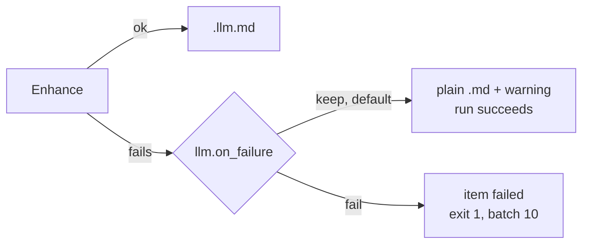
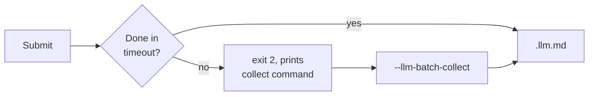
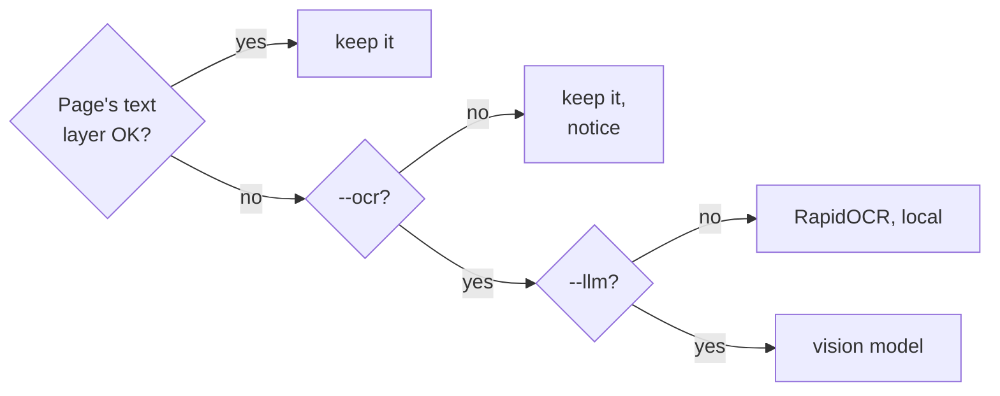

# CLI Reference

```bash
markitai <input> [options]
```

The input is a file, a directory, a `.urls` list or a URL. `mkai` is a short alias for `markitai`.

## Conversion options

| Option | Effect |
|--------|--------|
| `--llm` | LLM cleanup and frontmatter; writes only `.llm.md` |
| `--keep-base` | With `--llm`, also write the plain `.md` |
| `-p, --preset <name>` | `minimal`, `standard`, `rich` or your own ([Presets](#preset)) |
| `--profile <name>` | `rag`, `obsidian` or `okf` ([Profiles](#profile)) |
| `--alt` | Image alt text. Needs `--llm` |
| `--desc` | Image descriptions in `images.json`. Needs `--llm` |
| `--screenshot` | PDF pages, PPTX slides or a whole web page as JPEG |
| `--screenshot-only` | Screenshots as the content source |
| `--ocr` | Read scanned PDFs and images |
| `--pure` | No frontmatter; with `--llm` the model only cleans the text |
| `--no-compress` | Keep images at their original size and format |

Each switch has an opposite that undoes a preset or config file: `--no-llm`, `--no-alt`, `--no-desc`, `--no-screenshot`, `--no-screenshot-only`, `--no-ocr`, `--no-pure`, `--compress` (`--preset rich --no-desc`).

::: warning
`--pure` overrides `--alt`, `--desc` and `--screenshot`, with a warning.
:::

### `--llm` {#llm}

A document too long for one call is enhanced in chunks. Social posts (X/Twitter and similar) keep their body verbatim; the LLM only writes the frontmatter.

When enhancement fails (bad key, provider error, timeout, refusal, unenhanced result), [`llm.on_failure`](/guide/configuration#router-settings) decides:



The warning goes to stderr and the item's `warnings`; with `"fail"`, `--json` reports `ok: false`. The plain `.md` is written either way.

Keys are checked before anything is converted:

- Each `llm.model_list` model needs a key in its entry (`api_key`, literal or `env:VAR_NAME`) or the provider's variable (`DEEPSEEK_API_KEY`, `OPENAI_API_KEY`, ...). A model without one is left out, with a warning naming the variable; with no model left, the run exits `1` and sends nothing.
- A DeepSeek or OpenRouter model with its own `api_base` (local server, gateway) is never held back.
- A key the provider refuses (HTTP 401) is reported once, naming its variable. When every key has been refused, the run sends no more requests.

#### Batch API

`--llm-batch` enhances a directory batch through the provider's Batch API at half the list price. A wait that times out, loses contact or is stopped with Ctrl-C leaves the batch running:

```bash
markitai docs/ --llm --llm-batch -o out/         # waits up to --llm-batch-timeout (3600 s)
markitai --llm-batch-collect <batch-id> -o out/  # finish a handed-off batch later
```



- Needs one OpenAI or Anthropic model (checked before conversion), with its `api_key` and `api_base` from `llm.model_list` (`env:` included) or the provider's variables. Only files this run converted are submitted.
- Pass the same `-c` config to `--llm-batch-collect`; image answers follow the submitting run's `--alt`/`--desc`.
- Image analysis and screenshots ride the same batch, also for a document too long for one request (its text is enhanced live). Images the cache answers are not sent again but still written.
- Not with `--ocr` (yet) or `-f json`. A `--screenshot-only` URL has nothing to enhance: it is kept, with a warning.
- A failed submission leaves nothing to collect: items keep their base `.md` with a warning, or with `llm.on_failure = "fail"` the run exits `1`. After submission, any error that stops markitai fails the run: the batch is paid for.
- The collect command is printed even under `--quiet` or `--json`; the exit stays `2` when items also failed (shown in `--json` and on stderr).
- `--resume` skips documents still in an uncollected batch (no double payment) and prints its collect command; a batch that ended without results (failed, expired, cancelled) releases them.
- An image the batch could not analyze keeps its alt text, with a warning. Collecting twice changes nothing.

### Presets {#preset}

| Preset | LLM | alt | desc | screenshot | OCR |
|--------|:---:|:---:|:----:|:----------:|:---:|
| `minimal` | – | – | – | – | – |
| `standard` | ✓ | ✓ | ✓ | – | – |
| `rich` | ✓ | ✓ | ✓ | ✓ | – |

No preset turns on OCR. Define your own in the [config file](/guide/configuration#presets).

### Profiles {#profile}

A preset picks which features run, a profile what the files look like (see [Output Profiles](./output-profiles.md)):

| Profile | Effect |
|---------|--------|
| `rag` | Visible `assets/`, `<!-- page: N -->` markers for PDFs, pipe-table column checks |
| `obsidian` | Visible `assets/`, optional wikilink image references |
| `okf` | [Open Knowledge Format](https://github.com/GoogleCloudPlatform/knowledge-catalog) frontmatter |

### Screenshots

Screenshots go to `.markitai/screenshots/`. For a URL, `--screenshot` switches to `playwright` when needed and captures the page as rendered, in tiles for a long page (`name.full.jpg`, `name.full--1.jpg`, ...); URLs differing only in their query string get separate files. When no screenshot can be taken (no Playwright or Chromium, a site refusing headless browsers), the Markdown is still written, with a warning.

| Input | `--screenshot-only` | `--llm --screenshot-only` |
|-------|---------------------|---------------------------|
| URL | Screenshots, no `.md` | `.llm.md` read from the screenshots |
| PDF, PPTX | Screenshots + the extracted `.md` | The model reads the screenshots, not the text layer |

`--llm --screenshot-only` rescues pages whose text extraction fails (heavy JavaScript, canvas apps). A URL whose capture fails is a failed item.

### `--ocr` {#ocr}



- Local OCR needs `markitai[ocr]`. With `--llm` the pages go to the vision model instead; `MARKITAI_NO_VLM_OCR=1` forces the local path.
- Good pages keep their text (headings, lists, tables, images); OCR also reads the pictures on them. PPTX text comes from the file, OCR reads its pictures.
- An unreadable file fails; a blank image converts with a notice. A single image needs `--ocr` or `--llm`, else exit `1`.

#### PDF text layers that read wrong

markitai checks each page's extracted text for private-use or `(cid:NN)` codes, UTF-8 read as Windows-1252 (`café`), reversed right-to-left Hebrew or Arabic, and legacy fonts whose codes stand for other letters.

- Without `--ocr`, such pages join the scanned-page notice: `[PDF] plan.pdf: 2 of 40 pages look scanned/garbled (pages 7–8); consider re-running with --ocr`.
- With `--ocr` they are OCR'd. First, short crops of each font are read to catch plausible-looking wrong letters: two per font per document, at most four per page.
- Normal pages (Chinese, Japanese, English, code, tables, math) keep their text layer.
- A script the configured [`ocr.lang`](/guide/configuration#ocr-configuration) cannot read keeps its layer; the notice names a language that would (`… ocr.lang set to ar`). No OCR language reads Hebrew.

Each PDF result lists `page_sources` (`--json`, [Python API](/guide/python-api#conversionoutput), serve), such as `{"page": 7, "source": "ocr", "reason": "text layer failed the script check: …"}`. `source` is `text`, `ocr` or `mixed` (text layer plus OCR'd pictures, or the vision model beside it); `reason` is a note such as `text layer trusted` or `OCR forced by --ocr (ocr.per_page_routing is off)`. `--verbose` logs pages not plainly trusted.

#### Mathematics in PDFs

| Run | A formula becomes |
|-----|-------------------|
| `--ocr --llm` | Inline math as `$...$` LaTeX |
| `--alt` or `--desc` | A display equation is an image; its LaTeX is in `images.json` |
| Neither | Display equations stay images, inline math stays noise |

Web pages need no model: MathJax and MathML become `$...$` and `$$...$$`.

## Output options

| Option | Effect |
|--------|--------|
| `-o, --output <path>` | A directory (required for batches), or a `.md` file for a single input. Without it a single input prints to stdout |
| `--json` | One JSON result on stdout, no progress. Needs `-o` |
| `-f, --format <name>` | `markdown` (default, also `md`) or `json` |
| `--resume` | Continue an interrupted batch |
| `--record-history` | Show the run in the web workspace's history |

### `--json` {#json}

```bash
markitai ./docs -o out --json | jq '.items[] | select(.status == "failed")'
```

| Field | Content |
|-------|---------|
| `items[]` | `source`, `status`, `output`, `error`, `warnings`, `cost_usd`, `duration_s`, `fetch_strategy`, `screenshots`, `llm_usage`, `page_sources` |
| `error` | Run-level failure, else `null` |
| `batch` | After an `--llm-batch` handoff `{id, status, collect_command}`, else `null` |
| `totals` | Counts by status, `cost_usd`, `this_run_cost_usd`, `duration_s` |
| `ok` | `false` if an item failed or is pending, or `error` is set |

The top level also has `version`.

- `status` is `completed`, `failed`, `skipped` or `pending`: `pending` is an `--llm-batch` item still in the batch, its base `.md` written.
- `warnings` holds what did not fail the item: an image analysis or screenshot that failed, the stderr notices (scanned pages, hidden text).
- An unpriced model counts `unpriced_requests` in `llm_usage`, and `cost_usd` covers priced requests only: unknown, not zero.
- After `--resume` (not with `--llm-batch`), earlier runs' items come first with `earlier_run: true` and their recorded cost, usage and duration; `totals.cost_usd` is the whole batch, `this_run_cost_usd` this run.

A partial batch exits `10` while printing JSON: check `ok` too. Usage errors go to stderr without JSON. Not with `--dry-run` or `--llm-batch-collect`.

### `-f, --format <markdown|json>` {#format}

`json` also writes each document as one versioned JSON object, for scripts that should not parse Markdown. It is markitai-rust's document (`schema_version` `1.0`; every key present, `null` when it does not apply).

```bash
markitai report.pdf -f json                    # the document on stdout
markitai report.pdf -f json -o out/            # out/report.pdf.json beside out/report.pdf.md
markitai report.pdf -f json -o out/result.json # out/result.json and out/result.md
markitai ./docs -f json -o out/                # one JSON per file + out/markitai.index.json
```

- The Markdown stays (resume, reports and history use it); pictures point at the same `.markitai/assets/`. Under `on_conflict: rename` an existing JSON takes the name too.
- `markitai.index.json` lists every item (`source`, `status`, `document`, `markdown`, `error`, `skip_reason`); a later run into the folder keeps the items it did not convert.
- Not with `--llm-batch`. With `--json`: `-f json --json -o out/`. `markitai serve` keeps the document per item (`GET /api/jobs/{job_id}/items/{item_id}/document`).

::: details The document's keys
`schema_version`, `tool`, `source` (`kind`, `path`, `url` without credentials, `name`, `type`, `size`, `sha256`), `status`, `skip_reason`, `title`, `properties` (frontmatter), `markdown` (`base`, `llm`), `text`, `pages[]` (`number`, `text`, `markdown`, `images`, `screenshot`), `images[]` (`path`, `alt`, `description`, `text`, `page`), `tables[]` (`page`, `header`, `rows`), `notices[]` (`code`, `level`, `message`, `items`), `usage`, `timings`, `outputs`.
:::

### `--resume` {#resume}

```bash
markitai ./docs -o ./output --resume
```

- Skips completed items, retries failed and interrupted ones, adds new files. Directories and `.urls` lists; Ctrl-C saves progress.
- A retried item overwrites its own output (no `.v2`). One with no recorded name follows `output.on_conflict`, so it never overwrites a file the batch did not write.
- Absolute paths are recorded: resume from any directory (`markitai ../docs -o ../output --resume`).
- Other settings (`--llm`, `--ocr`, `--screenshot`, `--alt`, `--desc`, `--pure`, `--keep-base`, `--screenshot-only`, `output.profile`, `-s`) keep their own state.

::: details Costs after a resume
The state keeps each item's cost, so the summary shows the batch and this run (`Done: 9 files, 2 URLs (1:23, $0.094 total, $0.067 this run)`). In `.markitai/reports/*.report.json`, earlier items carry `earlier_run: true` and, for a directory batch, their run's `started_at`, `completed_at`, `duration`, `cost_usd` and `llm_usage`. `llm_usage` totals the batch, with a `this_run` block after a resume. `summary` counts cover the batch; `summary.duration` and `started_at` are this run's; `summary.processing_time` sums every item. A state from an older version has no costs: `llm_usage.usage_unknown_items` counts those items, their `cost_usd` is `null`, and the summary says `cost of earlier runs unknown`. An item cut off by Ctrl-C is converted again and counted once.
:::

### `--record-history` {#record-history}

Adds the run to the [web workspace](/guide/serve#history) history (CLI badge, kept seven days). Precedence: `--record-history` / `--no-record-history`, `MARKITAI_RECORD_HISTORY`, `history.record`, off. Stdout mode is not recorded; a failed recording never fails the run.

## Batch options

| Option | Default | Effect |
|--------|---------|--------|
| `-j, --batch-concurrency <n>` | 10 | Files at once |
| `--url-concurrency <n>` | 5 | URLs at once, in their own pool |
| `--llm-concurrency <n>` | 10 | LLM requests at once |
| `-g, --glob <pattern>` | — | Only matching relative paths; repeatable, `!` excludes |
| `--max-depth <n>` | 5 | Directory scan depth; `0` = top only |
| `--llm-batch` | off | Use the [Batch API](#batch-api) |
| `--llm-batch-timeout <s>` | 3600 | Wait before handing off (min 60) |
| `--llm-batch-collect <id>` | — | Collect a batch; `-o` is the original output, no input |

A partially successful batch keeps its results and exits `10`.

```bash
markitai ./docs -o ./output -j 4 -g "*.pdf" -g '!drafts/**'   # single-quote ! patterns
```

Dot-files, dot-folders (`.git`, `.venv`), `node_modules` and Office lock files (`~$report.docx`) are never converted, unless a pattern names them (`-g '.notes/**/*.md'`) or you point markitai at that folder.

### `.urls` files

A `.urls` file is a URL batch, also inside a directory batch: one URL per line, an optional output name after a space, `#` for comments. A JSON array of strings or `{"url", "output_name"}` objects works too.

```text
https://example.com/page1
https://example.com/page2 custom_name
```

Each line is its own item, for `--resume` too; a repeated URL *and* name is skipped with a warning.

## Cache options

| Option | Effect |
|--------|--------|
| `--no-cache` | Ignore cached LLM results and pages (still writes them); `--cache` undoes a config file |
| `--no-cache-for <patterns>` | Skip the cache for matching files, URLs or globs (comma-separated) |

A URL pattern matches the full URL, the URL without scheme, the host or the last path segment: `"https://example.com/*"`, `"example.com/docs/*"`, `"*.example.com"`, `"*.pdf"`.

## Fetching and backends

| Option | Effect |
|--------|--------|
| `-s, --strategy <name>` | How URLs are fetched (below; order on [Fetch Policy](/guide/fetch-policy)) |
| `-b, --backend <name>` | Files: `native` (default) or `cloudflare` (Workers AI `toMarkdown`, needs Cloudflare credentials) |
| `--no-remote-fetch` | Never send URLs to Defuddle, Jina or Cloudflare (`MARKITAI_NO_REMOTE_FETCH=1`) |

| Strategy | What it does |
|----------|--------------|
| `auto` (default) | Policy order, local first |
| `static` | Plain HTTP; no JavaScript, stays local |
| `playwright` | Browser rendering; needs `markitai[browser]` |
| `defuddle` | Defuddle API, free, no key |
| `jina` | Jina Reader, needs `JINA_API_KEY` |
| `cloudflare` | Browser Rendering, needs `CLOUDFLARE_API_TOKEN` and `CLOUDFLARE_ACCOUNT_ID` ([setup](/guide/configuration#cloudflare-settings)) |

`-b cloudflare` warns when the native converter does that format better. `--quiet` silences the consent prompt, so under `fetch.remote_consent=ask` a quiet run skips remote services and says so ([Fetch Policy](/guide/fetch-policy#remote-fallback-and-local-only-urls)).

### Removed per-backend flags

Removed in 1.0.0; passing one is a usage error that names the replacement:

| Removed flag | Use instead |
|--------------|-------------|
| `--playwright` | `-s playwright` |
| `--defuddle` | `-s defuddle` |
| `--static` | `-s static` |
| `--jina` | `-s jina` |
| `--cloudflare` | `-s cloudflare` (and `-b cloudflare` for files) |
| `--kreuzberg` | nothing; `.rtf` converts natively |

## Other options

| Option | Effect |
|--------|--------|
| `-q, --quiet` | Only errors, stdout Markdown and the remote-fetch notice. Single conversions are quiet anyway |
| `-v, --verbose` | Progress and diagnostics, single conversions too (not with stdout output) |
| `--log-level <level>` | Log file level, `DEBUG` … `CRITICAL`; needs `log.dir` |
| `--dry-run` | Show what would be converted |
| `-c, --config <path>` | Use this config file; it must exist |
| `--config-json <json>` | Overrides merged over the config file; flags still win |
| `-I, --interactive` | Guided conversion |
| `-V, --version` | Version |
| `-h, --help` | Help, per command too (`markitai config -h`) |

`-c` before a subcommand applies to it; `config set` and `config edit` create a missing file (`markitai -c ./my.json config set llm.enabled true`). `--config-json` also reaches `config list`/`get`/`path`, `cache` and `doctor`; `config set` and `config edit` refuse it.

## Exit codes

| Code | Meaning |
|------|---------|
| `0` | Success, `--dry-run` included |
| `1` | A single item failed, a runtime error, or an input rejected up front (missing or unsupported file, `--llm-batch` without `--llm`) |
| `2` | Usage error, or a Batch API handoff that needs `--llm-batch-collect`; wins over `10` |
| `10` | Batch with partial failures; successes kept |

## Terminal output

Marks: `✓` success, `!` warning, `✗` error, `•` information, `→` next step, `○` skipped on purpose. Piped output and `NO_COLOR` drop the colour, not the marks. The ASCII set (`+ ! x - > o`) replaces them where they would not show; one run uses one set throughout.

::: details When ASCII is used, and Windows PowerShell 5.1
ASCII is used with `TERM=dumb`, an encoding that cannot write the marks (non-UTF-8 locale, `PYTHONIOENCODING=ascii`), a Windows console without escape sequences (before Windows 10 1511, or "Use legacy console"), and on Windows for pipes and files while the console code page is not UTF-8 (65001). Windows Terminal, VS Code, SSH, today's console host, mintty (Git Bash) and output with no console show Unicode.

PowerShell 5.1 decodes piped output with the console code page (437 on English Windows), turning `✓` into `Γ£ô`. Before capturing output (cmd: `chcp 65001`):

```powershell
[Console]::OutputEncoding = [Text.Encoding]::UTF8
markitai doctor | Out-File -Encoding utf8 doctor.txt
```
:::

## Commands

### `markitai init`

Guided setup: checks dependencies, detects providers, writes a config file.

| Command | Effect |
|---------|--------|
| `init` | Interactive |
| `init --yes` (`-y`) | Defaults, no prompts |
| `init --local` | Write `./markitai.json`, not `~/.markitai/config.json` |
| `init -o <path>` | Write to this path |

### `markitai config`

| Command | Effect |
|---------|--------|
| `config list` | Effective config, secrets redacted; `-f, --format` `json` (default), `table` or `yaml` (needs PyYAML) |
| `config get <key>` | One value (`config get llm.enabled`) |
| `config set <key> <value>` | Write one value |
| `config path` | Config file locations and precedence |
| `config edit` | Guided menu |
| `config validate [file]` | Check the config file |

`list`, `get` and `set` take `--show-secrets`.

::: warning
`--show-secrets` is for local inspection only: never paste its output into an issue, chat or CI log.
:::

### `markitai cache`

| Command | Effect |
|---------|--------|
| `cache stats` | Size of the LLM cache (`cache.db`) and URL cache (`fetch_cache.db`); `--json`; `-v, --verbose` by model, `--limit <n>` (20) |
| `cache clear` | Empty both; `-y, --yes`; `--include-spa-domains` |
| `cache spa-domains` | [Learned SPA domains](/guide/fetch-policy#spa-learning); `--json`, `--clear` |

### `markitai doctor`

Checks the install, optional capabilities, LLM setup and sign-ins; missing optional tools are warnings.

| Command | Effect |
|---------|--------|
| `doctor --fix` | Install Chromium when Playwright is present; never a Python package (without Playwright it says to reinstall with `markitai[browser]`) |
| `doctor --json` | Machine-readable (not with `--fix`) |
| `doctor --suggest-extras` | Extras this machine could use |
| `doctor --timings` | Start-up and check times on stderr (any command: `MARKITAI_TIMINGS=1`) |

- Exits non-zero when something configured cannot work: a Playwright strategy that cannot launch, a model with no key (entry or variable, such as `DEEPSEEK_API_KEY`), a provider not signed in.
- Ends with `Ready` (and what is unavailable) or `Not ready` (and what to fix). Hints are commands for this machine; keys set but unused are listed under LLM.
- Checks run in parallel; a terminal line names those still running. A Chromium that launched is remembered for a week (same Chromium, Playwright, Python); `--fix` always launches it.

### `markitai auth`

`markitai auth` alone shows an overview.

| Command | Effect |
|---------|--------|
| `auth claude status` / `login` | Claude Code (runs `claude auth login`) |
| `auth copilot status` / `login` | Copilot CLI (runs `copilot login`) |
| `auth chatgpt status` / `login` | ChatGPT, device-code sign-in |

`status` takes `--json`. Gemini has no sign-in: use a key or OpenRouter ([Model Naming](/guide/configuration#model-naming)).

### `markitai serve`

The [web workspace](/guide/serve) at `http://127.0.0.1:3600`, opened in the browser. Needs `markitai[serve]`.

| Flag | Default | Effect |
|------|---------|--------|
| `--host <interface>` | `127.0.0.1` | `0.0.0.0` for other devices (they need the printed token) |
| `--port <n>` | `3600` | Port |
| `--no-open` | off | Do not open the browser |
| `--no-auth` | off | No token; other machines cannot submit URLs or change LLM settings |
| `--allowed-host <hostname>` | — | Accept this DNS name (repeatable) |

### `markitai mcp`

The [MCP server](/guide/mcp) over stdio. Needs `markitai[mcp]`.
