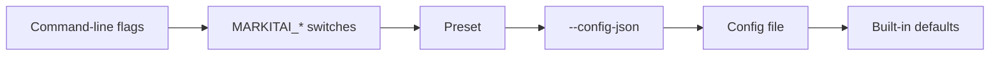
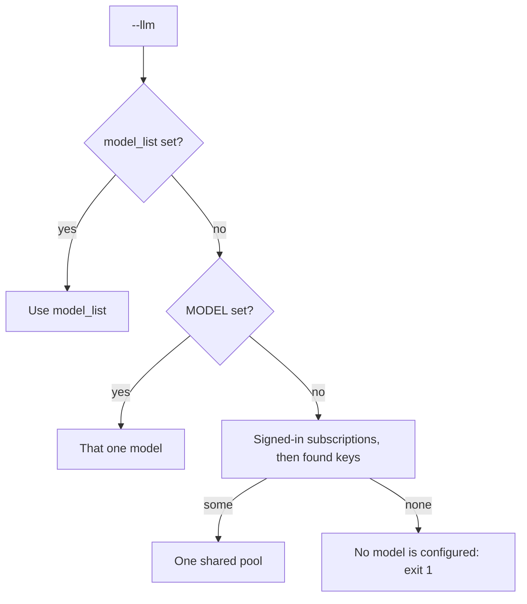
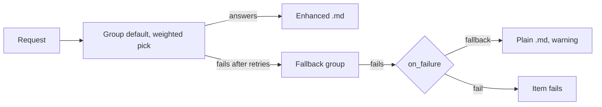
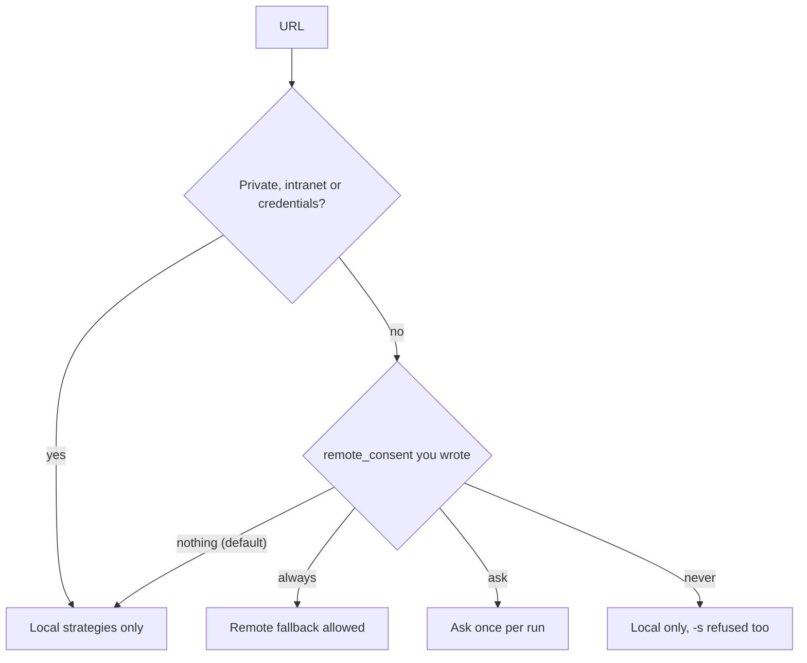

# Configuration

Every setting, where it comes from and its default. `markitai config list` prints the values in effect; the CLI, `markitai serve`, the MCP server and the Python API read the same file.

## Configuration Priority

The first source that sets a value wins:



A preset sets only the LLM, OCR, alt, desc and screenshot switches. Variables that supply a value the file leaves unset:

| Variable | Rule |
|----------|------|
| Provider keys (`OPENAI_API_KEY`, ...), `<PREFIX>_API_BASE` | Used when a model entry has no `api_key` / `api_base` |
| `JINA_API_KEY`, `CLOUDFLARE_API_TOKEN`, `CLOUDFLARE_ACCOUNT_ID` | Used only when the config file leaves the value unset |
| `MODEL` | Used only when `llm.model_list` is empty |
| `MARKITAI_RECORD_HISTORY`, `MARKITAI_LOG_DIR`, `MARKITAI_LOG_FORMAT` | Override the file; a flag still wins |
| `MARKITAI_PURE=1` | Turns pure mode on over the file (an off value is ignored); `--pure` / `--no-pure` still win |
| `MARKITAI_NO_REMOTE_FETCH=1` | Blocks every remote fetch service, even an explicit `-s` |

## Configuration File

markitai reads one file, the first it finds:

1. `--config <path>` (must exist; `config set` and `config edit` create it)
2. `MARKITAI_CONFIG` (a missing file: a warning and the defaults)
3. `./markitai.json` in the current directory
4. `~/.markitai/config.json` (`MARKITAI_HOME/config.json`)

::: warning A markitai.json found in the current folder
It may come from a download or a cloned repository. A model there whose `api_base` is not its provider's own address uses only a key written in the entry: no key variable, and `env:` becomes `markitai-no-key`, with a warning. `markitai doctor` and `--verbose` say where the file was found.
:::

```bash
markitai init                         # write a config with the detected models (--yes, --local)
markitai config list                  # effective settings, secrets redacted (-f table, -f yaml)
markitai config get llm.enabled
markitai config set llm.enabled true  # validated; an unknown key is refused
markitai config edit                  # terminal editor
markitai config validate              # also warns about keys that have no effect
```

Redaction covers keys, tokens, passwords, cookies and every HTTP header value. Credentials and addresses can reference an environment variable as `env:VAR_NAME`.

### Full Configuration Example

Every setting with its default, as `markitai config list` prints it:

:::: details markitai.json with all defaults

```json
{
  "batch": {
    "concurrency": 10,
    "heavy_task_limit": 0,
    "scan_max_depth": 5,
    "scan_max_files": 10000,
    "state_flush_interval_seconds": 10,
    "url_concurrency": 5
  },
  "cache": {
    "enabled": true,
    "fetch_ttl_seconds": 86400,
    "global_dir": "~/.markitai",
    "max_size_bytes": 536870912,
    "no_cache": false,
    "no_cache_patterns": []
  },
  "fetch": {
    "cloudflare": {
      "api_token": null,
      "account_id": null,
      "cache_ttl": 0,
      "convert_enabled": false,
      "timeout": 30000,
      "wait_until": "networkidle0"
    },
    "defuddle": {
      "rpm": 20,
      "timeout": 30
    },
    "domain_profiles": {},
    "fallback_patterns": ["twitter.com", "x.com", "instagram.com", "facebook.com", "linkedin.com", "threads.net"],
    "jina": {
      "api_key": null,
      "no_cache": false,
      "rpm": 20,
      "timeout": 30
    },
    "playwright": {
      "cookies": null,
      "extra_wait_ms": 3000,
      "session_mode": "isolated",
      "session_ttl_seconds": 600,
      "timeout": 30000,
      "wait_for": "domcontentloaded"
    },
    "policy": {
      "enabled": true,
      "inherit_no_proxy": true,
      "local_only_patterns": [],
      "max_strategy_hops": 5
    },
    "remote_consent": "always",
    "strategy": "auto"
  },
  "history": {
    "record": false
  },
  "image": {
    "alt_enabled": false,
    "compress": true,
    "desc_enabled": false,
    "filter": {
      "deduplicate": true,
      "min_area": 5000,
      "min_height": 50,
      "min_width": 50
    },
    "format": "jpeg",
    "max_height": 99999,
    "max_width": 1920,
    "quality": 75,
    "stdout_fetch_external": false,
    "stdout_persist": true,
    "stdout_persist_dir": "~/.markitai/assets"
  },
  "llm": {
    "concurrency": 10,
    "enabled": false,
    "keep_base": false,
    "max_cost_per_document_usd": 0,
    "max_requests_per_document": 50,
    "max_vision_pages_per_document": 0,
    "model_list": [],
    "on_failure": "fallback",
    "providers": [],
    "pure": false,
    "router_settings": {
      "fallbacks": [],
      "num_retries": 2,
      "routing_strategy": "simple-shuffle",
      "timeout": 120
    }
  },
  "log": {
    "dir": null,
    "format": "text",
    "level": "INFO",
    "retention": "7 days",
    "rotation": "10 MB"
  },
  "ocr": {
    "enabled": false,
    "lang": "en",
    "per_page_routing": true
  },
  "office": {
    "macos_fallback": true
  },
  "output": {
    "allow_symlinks": false,
    "dir": null,
    "format": "markdown",
    "on_conflict": "rename",
    "page_markers": false,
    "profile": null,
    "report": null,
    "text_only": false,
    "wikilinks": false
  },
  "presets": {},
  "prompts": {
    "dir": "~/.markitai/prompts"
  },
  "screenshot": {
    "enabled": false,
    "max_height": 10000,
    "quality": 75,
    "screenshot_only": false,
    "tile_height": 2000,
    "viewport_height": 1080,
    "viewport_width": 1920
  },
  "security": {
    "pdf_sanitize": "warn"
  }
}
```

::::

`llm.model_list` starts empty and fills itself with `--llm` ([how](#how-markitai-picks-models)); `markitai init` writes entries, the web workspace writes `llm.providers`. `~/.markitai` paths follow `MARKITAI_HOME`.

## Environment Variables

### API Keys

| Variable | Service |
|----------|---------|
| `OPENAI_API_KEY` | OpenAI |
| `ANTHROPIC_API_KEY` (or `ANTHROPIC_AUTH_TOKEN`, sent as a Bearer token) | Anthropic |
| `GEMINI_API_KEY` (or `GOOGLE_API_KEY`, which wins) | Google Gemini |
| `DEEPSEEK_API_KEY` | DeepSeek |
| `OPENROUTER_API_KEY` (or `OR_API_KEY`) | OpenRouter |
| `AZURE_API_KEY`, `GROQ_API_KEY`, `MISTRAL_API_KEY`, `XAI_API_KEY`, ... | The other prefixes ([Providers](#supported-providers)); used only for a model you name |
| `JINA_API_KEY` | Jina Reader (optional) |
| `CLOUDFLARE_API_TOKEN`, `CLOUDFLARE_ACCOUNT_ID` | Cloudflare |

### Markitai Settings

Switches are on with `1`, `true`, `yes` or `on`.

| Variable | Effect |
|----------|--------|
| `MARKITAI_HOME` | Instead of `~/.markitai`: config, `.env`, caches, browser, OCR models, history (process environment only) |
| `MODEL` | Model when `model_list` is not set |
| `MARKITAI_CONFIG` | Config file path |
| `MARKITAI_LOG_DIR`, `MARKITAI_LOG_FORMAT` | Log directory; `text` or `json` |
| `MARKITAI_LANG` | Terminal language: `zh…` Chinese, anything else English |
| `MARKITAI_PURE` | Pure mode on (it cannot turn it off) |
| `MARKITAI_RECORD_HISTORY` | Record CLI runs in the web workspace history |
| `MARKITAI_NO_REMOTE_FETCH` | No remote fetch services, even with `-s` |
| `MARKITAI_NO_VLM_OCR` | `--ocr --llm` OCRs locally and sends only the text |
| `MARKITAI_OCR_BACKEND` | `paddle` (default) or, on macOS, `vision` |
| `MARKITAI_BROWSER_EXECUTABLE`, `PLAYWRIGHT_BROWSERS_PATH` | The Chrome/Chromium to use; extra browser folders to search |
| `MARKITAI_SERVE_TOKEN` | Fixed `markitai serve` access token (process environment only) |
| `COPILOT_CLI_PATH`, `CLAUDE_CLI_PATH`, `CODEX_CLI_PATH` | Where the subscription CLIs are ([Subscriptions](/guide/subscriptions)) |
| `HTTPS_PROXY`, `HTTP_PROXY`, `ALL_PROXY`, `NO_PROXY` | [Proxies](#proxies) |

The [setup script](/guide/getting-started#install) reads its own: `MARKITAI_VERSION`, `MARKITAI_INSTALL_DIR`, `MARKITAI_INSTALL_OPTIONAL`, `MARKITAI_DOWNLOAD_URL`, `MARKITAI_UNINSTALL`.

### `.env` File Loading

markitai loads `./.env`, then `~/.markitai/.env`. The environment wins over both, and `./.env` over `~/.markitai/.env`.

A folder's `.env` may not be yours (a download, a cloned repository), so `./.env` may set keys and options but not programs, paths, endpoints, proxies, home folders or credential files. One warning lists what it ignored; set those in the environment or `~/.markitai/.env`.

::: details Names ./.env may not set
`*_PATH` (also `*_CLI_PATH`, `PATH`), `*_EXECUTABLE`, `LD_*`, `DYLD_*`, `NODE_OPTIONS`, `PYTHON*`, `*_API_BASE`, `*_BASE_URL`, `*_ENDPOINT`, `HTTP_PROXY`, `HTTPS_PROXY`, `ALL_PROXY`, `NO_PROXY` (any case), `HOME`, `*_HOME`, `*_CONFIG_DIR`, `XDG_*`, `TMPDIR`, `TMP`, `TEMP`, `AWS_*_FILE`, `GOOGLE_APPLICATION_CREDENTIALS`, `CLOUDSDK_CONFIG`, `MARKITAI_CONFIG`, `MARKITAI_HOME`, `MARKITAI_LOG_DIR` and the certificate-bundle variables.
:::

## LLM Configuration

### Supported Providers

markitai speaks each provider's API itself. A model is `prefix/model`:

| Prefixes | Reached through |
|----------|-----------------|
| `openai/`, `anthropic/`, `gemini/`, `deepseek/`, `openrouter/`, `azure/` | The provider's own API, with its key variable |
| `groq/`, `mistral/`, `xai/`, `together_ai/`, `fireworks_ai/`, `moonshot/`, `perplexity/`, ... | OpenAI-compatible endpoints (about 90 prefixes in all) |
| `ollama/`, `lm_studio/`, `hosted_vllm/` | A server of your own, no key |
| `bedrock/`, `vertex_ai/` | AWS and Google Cloud credentials of this machine |
| `claude-agent/`, `copilot/`, `chatgpt/` | A subscription, through its official CLI |
| `kimi_code/` | A Kimi Code membership key (`KIMI_API_KEY`), at Kimi's Messages API |

The full list with key and address variables is in [`docs/llm.md`](https://github.com/Ynewtime/markitai/blob/main/docs/llm.md#providers-and-request-parameters); the web workspace's **Add models** offers every one. Another prefix fails with the route to use instead: `openai/<model>` with an `api_base`.

**Kimi keys belong to a service and a region.** A Kimi open platform key is `moonshot/<model>` with `MOONSHOT_API_KEY`: one from platform.kimi.ai works at the default `https://api.moonshot.ai/v1`, one from the China platform (platform.kimi.com) needs `api_base: https://api.moonshot.cn/v1` or `MOONSHOT_API_BASE`. A Kimi Code membership key is `kimi_code/<model>` (kimi.com; a kimi.ai key needs `https://api.kimi.ai/coding/v1`). In the web workspace you only paste the key: if the default address refuses it, the other region is tried and its address saved. Kimi asks that the membership serve interactive use, so batch conversions belong on an open platform key.

| Subscription | Prefix | Needs | Sign in |
|--------------|--------|-------|---------|
| Claude Code | `claude-agent/` | Claude Code 2.1.284+ | `markitai auth claude login` |
| GitHub Copilot | `copilot/` | Copilot CLI 1.0.90-2+ | `markitai auth copilot login` |
| ChatGPT | `chatgpt/` | Codex CLI 0.159.0+ | `markitai auth chatgpt login` |

Install commands: [Claude and Copilot](/guide/subscriptions), [ChatGPT](/guide/subscription-chatgpt). Gemini has no subscription: use `gemini/` with a key or `openrouter/google/...`.

### Model Naming

`provider/model`, such as `anthropic/claude-sonnet-5-5`, `ollama/llama3.2` or `copilot/claude-haiku-5.5`, plus the defaults below.

#### Defaults markitai picks for you

`markitai init` and key detection pick each provider's cheap, fast tier:

| Provider | Default model |
|---|---|
| Claude Code | `claude-agent/haiku` |
| GitHub Copilot | `copilot/auto` |
| ChatGPT | the lightest model Codex lists (`chatgpt/gpt-6-luna` today) |
| Anthropic | `anthropic/claude-haiku-5-5` |
| OpenAI | `openai/gpt-6-luna` |
| Gemini | `gemini/gemini-flash-lite-latest` |
| DeepSeek | `deepseek/deepseek-flash` |
| OpenRouter | `openrouter/google/gemini-3.5-flash-lite` |

`copilot/auto` is Copilot's Auto selection (the only choice on Free and Student plans), billed as the model it picks; paid plans can pin one (`copilot/claude-haiku-5.5`).

#### How markitai picks models

With `--llm` and an empty `llm.model_list`:



- The pool mixes vendors, even within one document; stderr says so at startup (`--quiet` hides it).
- `markitai init` leaves out the Anthropic key beside a signed-in Claude Code (both are Claude Haiku).
- `markitai doctor` shows sign-in status and keys no model uses.

Image analysis (`--alt`, `--desc`) needs a vision model; a model counts as one unless its entry says `"model_info": {"supports_vision": false}`.

### Custom API Endpoint

`api_base` points a provider at a self-hosted server, regional proxy or gateway; it accepts `env:VAR_NAME`:

```json
{
  "llm": {
    "model_list": [
      {
        "model_name": "default",
        "litellm_params": {
          "model": "openai/your-model-name",
          "api_key": "env:YOUR_API_KEY",
          "api_base": "https://your-api-endpoint.com/v1"
        }
      }
    ]
  }
}
```

```json
// Local Ollama: no key, http://localhost:11434/v1 unless api_base says otherwise
{ "model": "ollama/llama3.2" }

// Azure OpenAI: the model is your deployment name, not a model ID
{
  "model": "azure/your-deployment-name",
  "api_key": "env:AZURE_API_KEY",
  "api_base": "https://your-resource.openai.azure.com",
  "api_version": "2025-02-01-preview"
}
```

- Without `api_key`, an entry sends the provider's key variable (`OPENAI_API_KEY` for `openai/`) to its `api_base`: give a foreign endpoint its own key.
- `markitai serve` saves keyless connections as `"api_key": "markitai-no-key"` (no credential), so the server's key never reaches an address a settings caller chose. Delete it here to use the environment's key.
- Subscriptions take no `api_key`, `api_base`, `max_tokens` or `reasoning_effort`.

### Model Settings

| Field | Default | Description |
|-------|---------|-------------|
| `litellm_params.max_tokens` | `null` | Max output tokens per request (else `model_info.max_tokens`, else the provider's limit) |
| `litellm_params.reasoning_effort` | `null` | `none`, `minimal`, `low`, `medium`, `high`, `xhigh` or `max`. Unset: thinking off for DeepSeek, OpenAI models that accept `none` and Claude Haiku 5.5; the model's default elsewhere |
| `litellm_params.weight` | `1` | `10` ten times as likely, `0` disabled |
| `model_info.max_input_tokens` | `null` | Context window; long documents are split to fit it |
| `model_info.supports_vision` | — | `false` keeps the model out of image analysis |

`temperature`, `top_p` and `top_k` are not settings and are never sent.

### LLM Requests

Requests enter the model group `default` (an entry's `model_name`); with no `fallbacks`, every model is in it.



| Setting | Default | Description |
|---------|---------|-------------|
| `llm.enabled` | `false` | `--llm` |
| `llm.router_settings.routing_strategy` | `simple-shuffle` | Or `least-busy`, `usage-based-routing`, `latency-based-routing` |
| `llm.router_settings.num_retries` | `2` | Retries per request; a timeout after sending is resent once at most |
| `llm.router_settings.timeout` | `120` | Request timeout (s); Copilot stretches it with the prompt's size, up to 600 s |
| `llm.router_settings.fallbacks` | `[]` | e.g. `[{"default": ["backup"]}]`; other groups then get traffic only through fallback |
| `llm.concurrency` | `10` | Concurrent LLM requests (`--llm-concurrency`) |
| `llm.max_requests_per_document` | `50` | Then keep the plain output. `0` = no limit |
| `llm.max_cost_per_document_usd` | `0` | Spend cap per document; with a cap, unpriced models and subscriptions are refused ([Prices](/guide/pricing)). `0` = no limit |
| `llm.max_vision_pages_per_document` | `0` | Page images per document; a larger PDF sends none. `0` = no limit |
| `llm.on_failure` | `fallback` | `fallback`: keep the plain `.md`, warn. `fail`: fail the item (exit `1`, batch `10`) |
| `llm.pure` | `false` | `--pure` |
| `llm.keep_base` | `false` | `--keep-base` |

## Image Configuration

| Setting | Default | Description |
|---------|---------|-------------|
| `image.alt_enabled` | `false` | Alt text via LLM (`--alt`) |
| `image.desc_enabled` | `false` | Image descriptions (`--desc`) |
| `image.compress` | `true` | Compress extracted images |
| `image.quality` | `75` | JPEG/WebP quality (1–100) |
| `image.format` | `jpeg` | `jpeg`, `png` or `webp` |
| `image.max_width` | `1920` | Max width in pixels |
| `image.max_height` | `99999` | Max height in pixels |
| `image.filter.min_width` | `50` | Skip narrower images |
| `image.filter.min_height` | `50` | Skip shorter images |
| `image.filter.min_area` | `5000` | Skip smaller images |
| `image.filter.deduplicate` | `true` | Store a repeated picture once |
| `image.stdout_persist` | `true` | Stdout mode: keep pictures in a store, linked as `file://` |
| `image.stdout_persist_dir` | `~/.markitai/assets` | That store (files under `blobs/`) |

## Screenshot Configuration

PDF pages, Office pages and slides as JPEG, URLs as full-page captures, in `.markitai/screenshots/`.

| Setting | Default | Description |
|---------|---------|-------------|
| `screenshot.enabled` | `false` | `--screenshot` |
| `screenshot.screenshot_only` | `false` | `--screenshot-only` |
| `screenshot.viewport_width` | `1920` | Browser viewport for URLs |
| `screenshot.viewport_height` | `1080` | Browser viewport for URLs |
| `screenshot.quality` | `75` | JPEG quality (1–100) |
| `screenshot.tile_height` | `2000` | Tile height for tall URL captures (for vision models) |
| `screenshot.max_height` | `10000` | Height cap when `tile_height` is `0` |

## Presets

Besides `minimal`, `standard` and `rich`, define your own (each key defaults to `false`; names are case-insensitive, and a built-in name can be redefined) and run `markitai document.pdf --preset my-preset`:

```json
{
  "presets": {
    "my-preset": { "llm": true, "ocr": false, "alt": true, "desc": false, "screenshot": true }
  }
}
```

## OCR Configuration

Local OCR is built in: PaddleOCR models run inside markitai on every system. They download once (about 45 MB) on the first `--ocr`, or ahead of time with the setup script's optional parts or `markitai doctor --fix`. On macOS, `MARKITAI_OCR_BACKEND=vision` uses the system's Vision instead. `--ocr --llm` with a vision model needs neither: the model reads the pages.

| Setting | Default | Description |
|---------|---------|-------------|
| `ocr.enabled` | `false` | `--ocr` |
| `ocr.lang` | `en` | A value below; anything else is an error |
| `ocr.per_page_routing` | `true` | OCR only pages whose text layer fails the checks ([details](/guide/cli#pdf-text-layers-that-read-wrong)); `false` OCRs every page |

| `ocr.lang` | Reads |
|--------|-------|
| `en` | The multilingual model (Latin scripts, Chinese, Japanese), retrying Korean when that reads better |
| `zh`, `zh_tw`, `ja`, `fr`, `de`, `es`, `it`, `pt`, `nl`, `pl`, `tr`, `vi`, ... | The multilingual model, with this language |
| `latin` | Latin script only |
| `ko`, `ar`, `th`, `el`, `ta`, `te` | Korean, Arabic, Thai, Greek, Tamil, Telugu |
| `ru` (or `uk`, `be`) | Russian, Ukrainian, Belarusian |
| `cyrillic` | Other Cyrillic languages |
| `hi` (or `mr`, `ne`), `devanagari` | Hindi, Marathi, Nepali |

A region suffix is accepted (`pt-BR`). Vision takes single languages (`en-US`, `zh`, `ja`, `ko`, ...), not `latin` or `cyrillic`. On macOS 15, Vision under the default language may read Japanese with its Chinese recognizer: set `ocr.lang: ja` for Japanese there.

## Batch Configuration

| Setting | Default | Description |
|---------|---------|-------------|
| `batch.concurrency` | `10` | Concurrent files (`-j`) |
| `batch.url_concurrency` | `5` | Concurrent URLs, counted apart from files |
| `batch.scan_max_depth` | `5` | Directory scan depth |
| `batch.scan_max_files` | `10000` | Max files per run |
| `batch.state_flush_interval_seconds` | `10` | How often `--resume` state is saved |

## URL Fetch Configuration

### Fetch Strategies

| `fetch.strategy` | Description |
|----------|-------------|
| `auto` (default) | Static, then the local browser; remote readers once you opt in ([Fetch Policy](/guide/fetch-policy)) |
| `static` | Plain HTTP, built-in extractor, no JavaScript |
| `playwright` | A local Chrome or Chromium renders the page |
| `defuddle` | Defuddle API, free, no key |
| `jina` | Jina Reader API |
| `cloudflare` | Cloudflare Browser Rendering, extracted locally |

Credentials can stay in the environment or be referenced:

```json
{
  "fetch": {
    "jina": { "api_key": "env:JINA_API_KEY" },
    "cloudflare": { "api_token": "env:CLOUDFLARE_API_TOKEN", "account_id": "env:CLOUDFLARE_ACCOUNT_ID" }
  }
}
```

### Remote Fetch Consent

`fetch.remote_consent` decides whether `auto` may send a public URL to Defuddle, Jina or Cloudflare when local fetching fails:



| Setting | Default | Description |
|---------|---------|-------------|
| `fetch.strategy` | `auto` | `-s` |
| `fetch.remote_consent` | `always` | Shown as `always`, but only an `always` you write enables the fallback; `ask` asks on a terminal; `never` also refuses `-s` remote readers |

`markitai config set fetch.remote_consent always` turns the fallback on. Details: [Fetch Policy](/guide/fetch-policy#remote-readers-and-local-only-urls).

### Browser Settings

markitai drives Chrome or Chromium itself; the keys keep their 1.x name `playwright`.

| Setting | Default | Description |
|---------|---------|-------------|
| `fetch.playwright.timeout` | `30000` | Load timeout (ms), also bounding work on the loaded page |
| `fetch.playwright.wait_for` | `domcontentloaded` | `load`, `domcontentloaded` or `networkidle` |
| `fetch.playwright.extra_wait_ms` | `3000` | Max wait for JavaScript; ends once nothing loads or changes for 0.5 s |
| `fetch.playwright.session_mode` | `isolated` | Or `domain_persistent` (reuse per domain within one run) |
| `fetch.playwright.session_ttl_seconds` | `600` | Persistent session lifetime |
| `fetch.playwright.wait_for_selector` | `null` | CSS selector to wait for |
| `fetch.playwright.cookies` | `null` | `[{name, value, domain, path}]` (or `url`) |
| `fetch.playwright.reject_resource_patterns` | `null` | Block requests, e.g. `["**/*.css"]` |
| `fetch.playwright.extra_http_headers` | `null` | e.g. `{"Accept-Language": "zh-CN"}`; initial origin only |
| `fetch.playwright.user_agent` | `null` | Custom User-Agent |
| `fetch.playwright.http_credentials` | `null` | `{username, password}` |

### Jina Settings

| Setting | Default | Description |
|---------|---------|-------------|
| `fetch.jina.api_key` | `null` | API key (`env:` works); optional, raises the rate limit |
| `fetch.jina.timeout` | `30` | Seconds |
| `fetch.jina.rpm` | `20` | Requests per minute |
| `fetch.jina.no_cache` | `false` | Bypass Jina's cache |
| `fetch.jina.target_selector` | `null` | CSS selector to extract |
| `fetch.jina.wait_for_selector` | `null` | CSS selector to wait for |

### Defuddle Settings

[Defuddle](https://defuddle.md) returns the article body as Markdown with frontmatter. Free, no key.

| Setting | Default | Description |
|---------|---------|-------------|
| `fetch.defuddle.timeout` | `30` | Seconds |
| `fetch.defuddle.rpm` | `20` | Requests per minute |

### Cloudflare Settings

**Browser Rendering** (`-s cloudflare`) fetches rendered HTML; **Workers AI toMarkdown** (`-b cloudflare`) converts files in your account, replacing the native readers for the formats it takes.

| Setting | Default | Description |
|---------|---------|-------------|
| `fetch.cloudflare.api_token` | `null` | Token (`env:` works) |
| `fetch.cloudflare.account_id` | `null` | Account ID (`env:` works) |
| `fetch.cloudflare.timeout` | `30000` | Browser Rendering timeout (ms) |
| `fetch.cloudflare.wait_until` | `networkidle0` | `load`, `domcontentloaded` or `networkidle0` |
| `fetch.cloudflare.cache_ttl` | `0` | Browser Rendering cache TTL (s) |
| `fetch.cloudflare.convert_enabled` | `false` | Enable toMarkdown for files |

`reject_resource_patterns` (regexes; unset blocks style sheets and fonts), `user_agent`, `cookies` (with a `url`), `wait_for_selector` and `http_credentials` work as for the browser.

Set-up: the account ID is in the [dashboard](https://dash.cloudflare.com/) URL; create a custom [API token](https://dash.cloudflare.com/profile/api-tokens) with *Browser Rendering: Edit* and *Workers AI: Read*; enable *Workers & Pages → Browser Rendering* (Free plan included).

```bash
export CLOUDFLARE_API_TOKEN="your-api-token"
export CLOUDFLARE_ACCOUNT_ID="your-account-id"
```

### Fetch Policy, Domain Profiles and Fallback Patterns {#fetch-policy-domain-profiles}

The policy engine orders strategies per domain and learns which need a browser: options, profile fields and built-in profiles are in [Fetch Policy](/guide/fetch-policy#configuration). A `domain_profiles` entry overrides only the fields you set. Domains in a `fallback_patterns` list you write start with the browser; the built-in list has no effect.

### Proxies

`HTTPS_PROXY`, `HTTP_PROXY`, `ALL_PROXY` and `NO_PROXY` apply (lower-case names too). Without them markitai uses the system proxy. A SOCKS proxy works only for the browser. `SSL_CERT_FILE` / `SSL_CERT_DIR` replace the system certificates.

## Cache Configuration

| File | Holds | Reuse |
|------|-------|-------|
| `cache.db` | LLM results, image analyses included | Converting again costs nothing |
| `fetch_cache.db` | Fetched HTML and text pages | With `ETag`/`Last-Modified`: revalidated every run. Otherwise: `fetch_ttl_seconds` |

| Setting | Default | Description |
|---------|---------|-------------|
| `cache.enabled` | `true` | Cache LLM results and pages |
| `cache.no_cache` | `false` | Skip reads, keep writing (`--no-cache`) |
| `cache.no_cache_patterns` | `[]` | Globs on paths and URLs that bypass it (`--no-cache-for`) |
| `cache.fetch_ttl_seconds` | `86400` | Reuse time for pages without validators; `0` = refetch |
| `cache.max_size_bytes` | `536870912` | Per cache file (512 MB) |
| `cache.global_dir` | `~/.markitai` | Cache directory |

Models served by Claude Code or Copilot are not cached.

```bash
markitai cache stats --verbose         # LLM entries by model, plus fetched pages
markitai cache clear                   # empties cache.db and fetch_cache.db
markitai document.pdf --no-cache       # bypass for one run
markitai ./docs --no-cache-for "*.pdf"
```

## Output Configuration

| Setting | Default | Description |
|---------|---------|-------------|
| `output.dir` | `null` | Output directory for folders and `.urls` lists without `-o` (a single file still prints) |
| `output.on_conflict` | `rename` | Or `overwrite`, `skip` |
| `output.allow_symlinks` | `false` | Follow symbolic links in batches and output paths |
| `output.report` | `null` | JSON report: `true`, `false`, `null` = batch runs only |
| `output.profile` | `null` | `rag`, `obsidian` or `okf` ([Output profiles](./output-profiles.md)) |
| `output.wikilinks` | `false` | With `obsidian`: `![[assets/x.jpg]]` image links |
| `output.format` | `markdown` | `json` also writes the document JSON ([`-f json`](/guide/cli#format)) |
| `output.page_markers` | `false` | Keep `<!-- Page number: N -->` and slide-number comments (`--page-markers`) |
| `output.text_only` | `false` | Pictures and PDFs: only the recognised text (`--text-only`) |

## Log Configuration

Logs go to files only when `log.dir` is set.

| Setting | Default | Description |
|---------|---------|-------------|
| `log.level` | `INFO` | `DEBUG`, `INFO`, `WARNING`, `ERROR`, `CRITICAL` |
| `log.format` | `text` | Or `json`, one record per line |
| `log.dir` | `null` | Log directory |
| `log.rotation` | `10 MB` | Start the next file at a size (`10 MB`, `1.5 KiB`), after an interval (`1 week`, `10 hours`), at a local time (`00:00`, `monday at 12:00`, `sunday`) or `hourly`/`daily`/`weekly`/`monthly`/`yearly` |
| `log.retention` | `7 days` | Delete older logs; a duration such as `7 days`, `1 month` or `1 week, 3 days` |

`markitai config validate` refuses any other form. Logs never hold document text, full model requests or keys.

## Security Configuration

| Setting | Default | Description |
|---------|---------|-------------|
| `security.pdf_sanitize` | `warn` | Text a reader cannot see in a PDF (transparent, 1 pt or smaller, white on white) could reach the Markdown and LLM prompts. `warn` removes it and quotes it in a notice, `remove` also removes white text whose background cannot be checked, `off` keeps it without notices |

A searchable scan's OCR layer (invisible text over a picture covering the page) does not count.

## History

| Setting | Default | Description |
|---------|---------|-------------|
| `history.record` | `false` | Record CLI runs in the web workspace history (`--record-history`) |

## Settings Without Effect

Accepted for 1.x files; `markitai config validate` warns when you set them:

| Setting | Instead |
|---------|---------|
| `office.macos_fallback` | Office page images always come from LibreOffice |
| `batch.heavy_task_limit` | `-j` / `batch.concurrency` |
| `image.stdout_fetch_external` | No terminal images; pictures on stdout are kept as files |

## Custom Prompts

Each LLM task has a system prompt (role, rules) and a user prompt (content template). Override one with a file of its name in `prompts.dir` (`~/.markitai/prompts/`), or point a setting at a file:

```json
{
  "prompts": {
    "dir": "~/.markitai/prompts",
    "cleaner_system": "/path/to/my-cleaner-system.md"
  }
}
```

| Prompt | Task |
|--------|------|
| `cleaner` | Document cleaning |
| `url_enhance` | Web page cleaning |
| `image_caption` | Alt text |
| `image_description` | Image descriptions |
| `image_analysis` | Caption, description and image text in one request |
| `document_process` | Document processing |
| `document_vision` | Document processing with page images |
| `screenshot_extract` | `--screenshot-only` extraction (file only, no setting) |

Each comes as `_system` and `_user`: file `cleaner_system.md`, setting `cleaner_system`.
