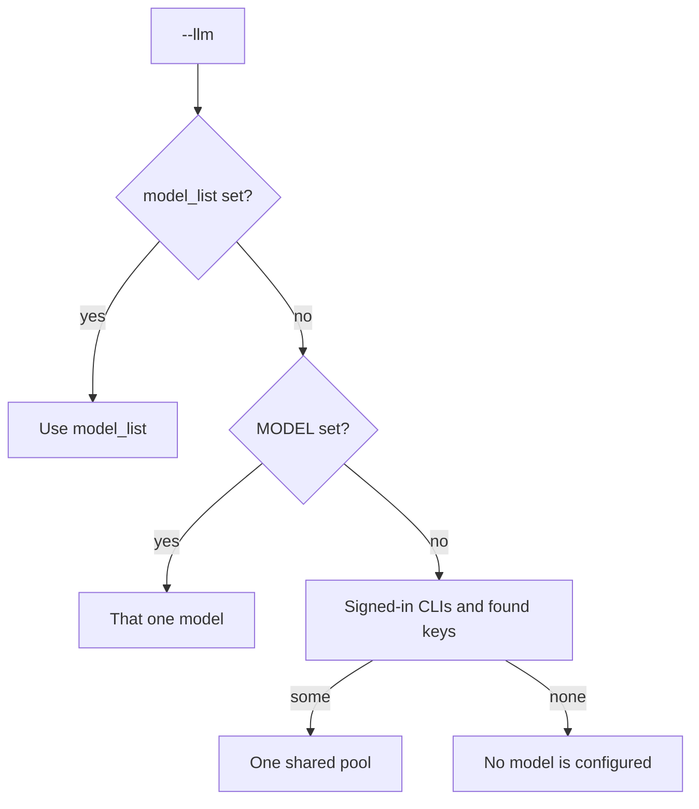
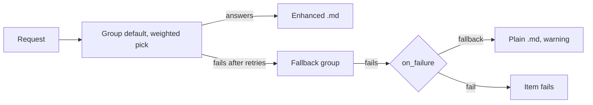
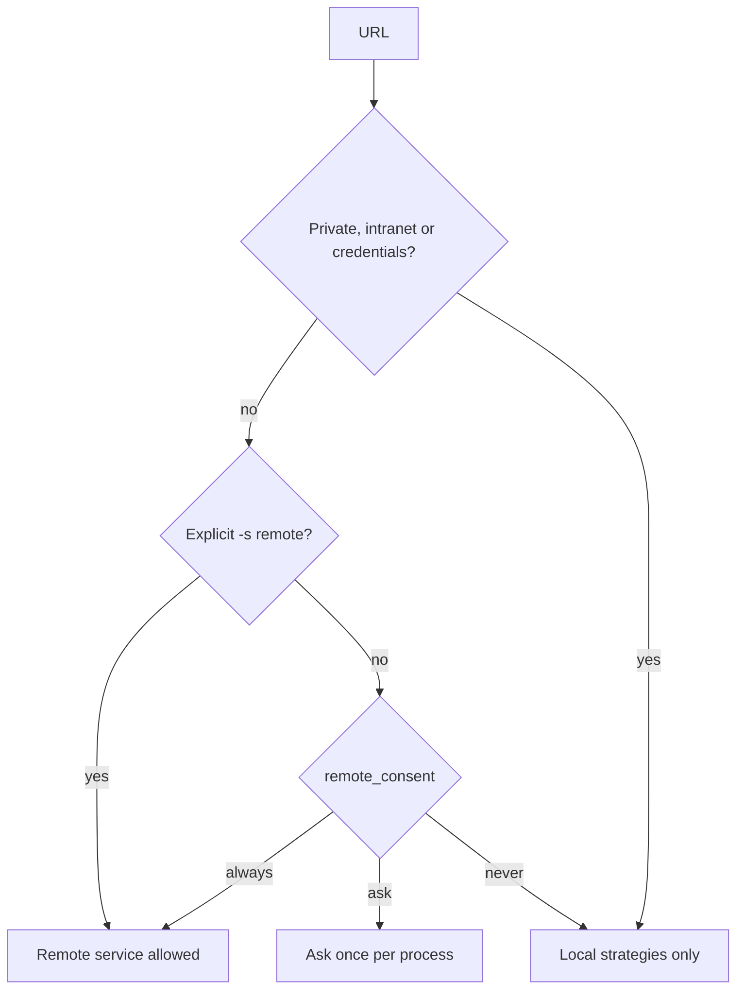

# Configuration

Every setting, where it comes from and its default. `markitai config list` prints the values in effect.

## Configuration Priority

The first source that sets a value wins:


Exceptions:

| Variable | Rule |
|----------|------|
| `JINA_API_KEY`, `CLOUDFLARE_API_TOKEN`, `CLOUDFLARE_ACCOUNT_ID` | Used only when the config file leaves the value unset |
| `MODEL` | Used only when `llm.model_list` is empty |
| `MARKITAI_RECORD_HISTORY` (`1`/`0`) | Overrides `history.record`; a flag still wins |
| `MARKITAI_PURE=1` | Pure mode (CLI only); a flag still wins |
| `MARKITAI_NO_REMOTE_FETCH=1` | Blocks every remote fetch service, even an explicit `-s` |

## Configuration File

markitai reads the first config file it finds:

1. `--config <path>` (must exist; `config set` and `config edit` create it)
2. `MARKITAI_CONFIG`
3. `./markitai.json` in the current directory
4. `~/.markitai/config.json`

::: warning A markitai.json found in the current folder
It may come from a download or a cloned repository. A model whose `api_base` is not its provider's own address uses only a key written in the entry (no key variable; `env:` becomes `markitai-no-key`, with a warning); a Vertex AI, watsonx or GigaChat model at its own address is dropped (it would sign with this machine's cloud login). `markitai doctor` and `--verbose` say where the file was found.
:::

```bash
markitai init                         # guided setup (--yes: defaults, --local: write ./markitai.json)
markitai config list                  # effective settings, secrets redacted (--show-secrets prints them)
markitai config get llm.enabled
markitai config set llm.enabled true
markitai config edit                  # guided menu
markitai config validate
```

Redaction covers nested keys, tokens, cookies and headers. Any string value can reference an environment variable as `env:VAR_NAME`.

### Full Configuration Example

Every setting with its default, from [`config.py`](https://github.com/Ynewtime/markitai/blob/python/packages/markitai/src/markitai/config.py).

:::: details markitai.json with all defaults

```json
{
  "llm": {
    "enabled": false,
    "model_list": [],
    "providers": [],
    "router_settings": {
      "routing_strategy": "simple-shuffle",
      "num_retries": 2,
      "timeout": 120,
      "fallbacks": []
    },
    "concurrency": 10,
    "max_requests_per_document": 50,
    "max_cost_per_document_usd": 0,
    "max_vision_pages_per_document": 0,
    "pure": false,
    "keep_base": false,
    "on_failure": "fallback"
  },
  "image": {
    "alt_enabled": false,
    "desc_enabled": false,
    "compress": true,
    "quality": 75,
    "format": "jpeg",
    "max_width": 1920,
    "max_height": 99999,
    "filter": {
      "min_width": 50,
      "min_height": 50,
      "min_area": 5000,
      "deduplicate": true
    },
    "stdout_persist": true,
    "stdout_persist_dir": "~/.markitai/assets",
    "stdout_fetch_external": false
  },
  "ocr": {
    "enabled": false,
    "lang": "en",
    "per_page_routing": true
  },
  "office": {
    "macos_fallback": true
  },
  "screenshot": {
    "enabled": false,
    "screenshot_only": false,
    "viewport_width": 1920,
    "viewport_height": 1080,
    "quality": 75,
    "tile_height": 2000,
    "max_height": 10000
  },
  "cache": {
    "enabled": true,
    "no_cache": false,
    "no_cache_patterns": [],
    "fetch_ttl_seconds": 86400,
    "max_size_bytes": 536870912,
    "global_dir": "~/.markitai"
  },
  "batch": {
    "concurrency": 10,
    "url_concurrency": 5,
    "scan_max_depth": 5,
    "scan_max_files": 10000,
    "state_flush_interval_seconds": 10,
    "heavy_task_limit": 0
  },
  "fetch": {
    "strategy": "auto",
    "remote_consent": "always",
    "defuddle": {
      "timeout": 30,
      "rpm": 20
    },
    "playwright": {
      "timeout": 30000,
      "wait_for": "domcontentloaded",
      "extra_wait_ms": 3000,
      "wait_for_selector": null,
      "cookies": null,
      "reject_resource_patterns": null,
      "extra_http_headers": null,
      "user_agent": null,
      "http_credentials": null,
      "session_mode": "isolated",
      "session_ttl_seconds": 600
    },
    "jina": {
      "api_key": null,
      "timeout": 30,
      "rpm": 20,
      "no_cache": false,
      "target_selector": null,
      "wait_for_selector": null
    },
    "cloudflare": {
      "api_token": null,
      "account_id": null,
      "timeout": 30000,
      "wait_until": "networkidle0",
      "cache_ttl": 0,
      "reject_resource_patterns": null,
      "convert_enabled": false,
      "user_agent": null,
      "cookies": null,
      "wait_for_selector": null,
      "http_credentials": null
    },
    "policy": {
      "enabled": true,
      "max_strategy_hops": 5,
      "strategy_priority": null,
      "local_only_patterns": [],
      "inherit_no_proxy": true
    },
    "domain_profiles": {},
    "fallback_patterns": ["twitter.com", "x.com", "instagram.com", "facebook.com", "linkedin.com", "threads.net"]
  },
  "output": {
    "dir": null,
    "on_conflict": "rename",
    "allow_symlinks": false,
    "report": null,
    "profile": null,
    "wikilinks": false,
    "format": "markdown"
  },
  "log": {
    "level": "INFO",
    "format": "text",
    "dir": null,
    "rotation": "10 MB",
    "retention": "7 days"
  },
  "security": {
    "pdf_sanitize": "warn"
  },
  "history": {
    "record": false
  },
  "presets": {},
  "prompts": {
    "dir": "~/.markitai/prompts"
  }
}
```

::::

`llm.model_list` starts empty and fills itself with `--llm` ([how](#how-markitai-picks-models)); `markitai init` writes an entry, the web workspace writes `llm.providers`.

## Environment Variables

### API Keys

| Variable | Service |
|----------|---------|
| `OPENAI_API_KEY` | OpenAI |
| `ANTHROPIC_API_KEY` (or `ANTHROPIC_AUTH_TOKEN`) | Anthropic |
| `GEMINI_API_KEY` (or `GOOGLE_API_KEY`, which wins) | Google Gemini |
| `DEEPSEEK_API_KEY` | DeepSeek |
| `OPENROUTER_API_KEY` (or `OR_API_KEY`) | OpenRouter |
| `JINA_API_KEY` | Jina Reader |
| `CLOUDFLARE_API_TOKEN`, `CLOUDFLARE_ACCOUNT_ID` | Cloudflare |

### Markitai Settings

Switches are on with `1`, `true` or `yes` (`MARKITAI_RECORD_HISTORY` and `MARKITAI_TIMINGS` also `on`).

| Variable | Effect |
|----------|--------|
| `MODEL` | Model when `model_list` is not set |
| `MARKITAI_CONFIG` | Config file path |
| `MARKITAI_LOG_DIR` | Log directory |
| `MARKITAI_LOG_FORMAT` | `text` or `json` |
| `MARKITAI_LANG` | CLI language, `en` or `zh` |
| `MARKITAI_PURE` | Pure mode |
| `MARKITAI_RECORD_HISTORY` | Record CLI runs in the web workspace history |
| `MARKITAI_NO_REMOTE_FETCH` | No remote fetch services, even with `-s` |
| `MARKITAI_NO_VLM_OCR` | `--ocr --llm` OCRs locally, not with the vision model (screenshots still go to it) |
| `MARKITAI_STATIC_HTTP` | Static fetch client: `httpx` (default) or `curl_cffi` |
| `MARKITAI_PDF_WORKERS` | PDF extraction and scanned-page OCR processes; `0`/`1` = in-process. Default and cap: one per usable core, at most 12, within a quarter of free memory (~450 MB each) |
| `MARKITAI_SERVE_TOKEN` | Fixed `markitai serve` access token |
| `MARKITAI_TIMINGS` | Print where a command's time went to stderr |

The [setup script](/guide/getting-started) reads its own:

| Variable | Effect |
|----------|--------|
| `MARKITAI_INSTALL_OPTIONAL` | Install optional parts without a terminal |
| `MARKITAI_VERSION` | Version to install |
| `MARKITAI_USE_MIRROR` | `1` offers package mirrors without testing PyPI, `0` never asks |
| `MARKITAI_SETUP_LOG` | Where a failure's full log goes |
| `MARKITAI_SETUP_TIMINGS` | List every step's duration |

### `.env` File Loading

markitai loads `./.env`, then `~/.markitai/.env`. The environment wins over both, and `./.env` over `~/.markitai/.env`.

A folder's `.env` may not be yours (a download, a cloned repository), so `./.env` may set keys and options but not programs, paths, endpoints, proxies, home folders or credential files. One warning lists what it ignored; set those in the environment or `~/.markitai/.env`.

::: details Names ./.env may not set
`*_PATH` (also `*_CLI_PATH`, `PATH`, `PATHEXT`), `*_EXECUTABLE`, `LD_*`, `DYLD_*`, `NODE_OPTIONS`, `BASH_ENV`, `ENV`, `PYTHON*`, `*_API_BASE`, `*_BASE_URL`, `*_ENDPOINT`, `HTTP_PROXY`, `HTTPS_PROXY`, `ALL_PROXY`, `NO_PROXY` (any case), `HOME`, `USERPROFILE`, `HOMEDRIVE`, `HOMEPATH`, `*_HOME`, `*_CONFIG_DIR`, `XDG_*`, `TMPDIR`, `TMP`, `TEMP`, `AWS_*_FILE`, `GOOGLE_APPLICATION_CREDENTIALS`, `CLOUDSDK_CONFIG`, `MARKITAI_CONFIG`, `MARKITAI_HOME`, `MARKITAI_LOG_DIR`, `SSL_CERT_FILE`, `SSL_CERT_DIR`, `REQUESTS_CA_BUNDLE`, `CURL_CA_BUNDLE`, `AWS_CA_BUNDLE`.
:::

## LLM Configuration

### Supported Providers

Any [LiteLLM](https://docs.litellm.ai/) provider works with an API key. Three subscriptions sign in instead:

| Provider | Prefix | Sign-in | Extra |
|----------|--------|---------|-------|
| Claude Code | `claude-agent/` | `markitai auth claude login` | `markitai[claude-agent]` |
| GitHub Copilot | `copilot/` | `markitai auth copilot login` | `markitai[copilot]` |
| ChatGPT | `chatgpt/` | OAuth device code on first use | — |

Claude Code and Copilot also need the vendor's CLI: the setup script installs it with the extra if you answer yes (default no); manual commands: [Claude and Copilot](/guide/subscriptions). Gemini has no subscription: use `gemini/` with a key or `openrouter/google/...`.

### Model Naming

LiteLLM's `provider/model` form, such as `anthropic/claude-sonnet-5-5`, `ollama/llama3.2` or `copilot/claude-haiku-5.5`, plus the defaults below.

#### Defaults markitai picks for you

`markitai init` and key detection pick each provider's cheap, fast tier:

| Provider | Default model |
|---|---|
| Claude Code | `claude-agent/haiku` |
| GitHub Copilot | `copilot/auto` |
| ChatGPT | `chatgpt/gpt-6-luna` |
| Anthropic | `anthropic/claude-haiku-5-5` |
| OpenAI | `openai/gpt-6-luna` |
| Gemini | `gemini/gemini-flash-lite-latest` |
| DeepSeek | `deepseek/deepseek-flash` |
| OpenRouter | `openrouter/~anthropic/claude-haiku-latest` |

- `copilot/auto` is Copilot's Auto selection (the only choice on Free and Student plans), billed as the model it picks; paid plans can pin one (`copilot/claude-haiku-5.5`).
- `openrouter/~anthropic/claude-haiku-latest` is OpenRouter's alias for its newest Claude Haiku, billed as the model that answers; pin one with `openrouter/anthropic/claude-haiku-5.5`.
- A retired model only gets a startup warning; markitai never rewrites your choice.

#### How markitai picks models

With `--llm` and an empty `llm.model_list`:



- The pool mixes vendors, even within one document; stderr lists its models at startup (`--quiet` hides it).
- `markitai init` skips, and names, keys whose default another route serves: the Anthropic and OpenRouter keys beside a Claude Code subscription (all three are Claude Haiku), the OpenRouter key beside an Anthropic key.
- Claude Code bills a set `ANTHROPIC_API_KEY` instead of the subscription, so markitai hides that variable from it; Claude Code signed in with only that key is not offered (`anthropic/claude-haiku-5-5` uses the key directly).
- `markitai doctor` shows sign-in status and keys no model uses.

Image analysis (`--alt`, `--desc`) needs a vision model; the subscriptions support it through attachments.

| Error | Fix |
|-------|-----|
| "SDK not installed" | `markitai[copilot]` or `markitai[claude-agent]` |
| "CLI not found" | The [Copilot CLI](https://docs.github.com/en/copilot/how-tos/set-up/install-copilot-cli) or [Claude Code](https://claude.ai/code) |
| "Not authenticated" | `markitai auth copilot login` / `markitai auth claude login` |
| "Rate limit" | Wait, or check your quota |

### Custom API Endpoint

`api_base` points a provider at a self-hosted server, regional proxy or gateway; it accepts `env:VAR_NAME`:

```json
{
  "llm": {
    "model_list": [
      {
        "model_name": "default",
        "litellm_params": {
          "model": "openai/your-model-name",
          "api_key": "env:YOUR_API_KEY",
          "api_base": "https://your-api-endpoint.com/v1"
        }
      }
    ]
  }
}
```

```json
// Local Ollama
{ "model": "ollama/llama3.2", "api_base": "http://localhost:11434" }

// Azure OpenAI: the model is your deployment name, not a model ID
{
  "model": "azure/your-deployment-name",
  "api_key": "env:AZURE_API_KEY",
  "api_base": "https://your-resource.openai.azure.com",
  "api_version": "2025-02-01-preview"
}
```

- Without `api_key`, an entry sends the provider's key variable (`OPENAI_API_KEY` for `openai/`) to its `api_base`: give a foreign endpoint its own key.
- `markitai serve` saves keyless connections as `"api_key": "markitai-no-key"` (no credential), so the server's key never reaches an address a settings caller chose. Delete it here to use the environment's key.
- The settings page won't pair an `env:` key with a custom endpoint ([LLM Settings](/guide/serve#llm-settings)); write that pair here.
- Subscriptions ignore `api_base`; Claude Code honours `ANTHROPIC_BASE_URL`.

### Vision Models

Vision support comes from LiteLLM; override it per entry:

```json
{
  "model_name": "default",
  "litellm_params": { "model": "gemini/gemini-flash-lite-latest", "api_key": "env:GEMINI_API_KEY" },
  "model_info": { "supports_vision": true }
}
```

### Model Token Limits

| Field | Default | Description |
|-------|---------|-------------|
| `litellm_params.max_tokens` | `null` | Max output tokens requested per call |
| `model_info.max_tokens` | `null` | Max output tokens (from LiteLLM if omitted) |
| `model_info.max_input_tokens` | `null` | Max context tokens (from LiteLLM if omitted) |

### Router Settings

Requests enter the model group `default` (an entry's `model_name`); with no `fallbacks`, every model is in it.



| Setting | Default | Description |
|---------|---------|-------------|
| `router_settings.routing_strategy` | `simple-shuffle` | Or `least-busy`, `usage-based-routing`, `latency-based-routing`; subscriptions always use weighted random |
| `router_settings.num_retries` | `2` | Retries per request. A timeout after sending is resent once at most, and the document's cost is marked incomplete |
| `router_settings.timeout` | `120` | Request timeout (s) |
| `router_settings.fallbacks` | `[]` | e.g. `[{"default": ["backup"]}]`; other groups then get traffic only through fallback. Subscription models can't be targets; vision balances over all vision models |
| `concurrency` | `10` | Concurrent LLM requests |
| `max_requests_per_document` | `50` | Then keep the plain output; a chunked document needing more than is left is not enhanced at all. `0` = no limit |
| `max_cost_per_document_usd` | `0` | Spend cap per document. `0` = no limit |
| `max_vision_pages_per_document` | `0` | Page images per document; larger documents skip vision. `0` = no limit |
| `on_failure` | `fallback` | `fallback`: keep the plain `.md`, warn. `fail`: fail the item (exit `1`, batch `10`). The plain `.md` is written either way |

The last five sit directly under `llm`.

#### Model Weight

`litellm_params.weight`: `1` normal, `10` ten times as likely, `0` disabled. At least one model needs a weight above zero (checked at first use, not by `config validate`).

```json
{
  "model_name": "default",
  "litellm_params": { "model": "gemini/gemini-flash-lite-latest", "api_key": "env:GEMINI_API_KEY", "weight": 10 }
}
```

### Adaptive Timeout

Copilot scales its timeout between 60 and 600 s with prompt length, images and expected output; the Claude Agent SDK manages its own.

### Prompt Caching (Claude Agent)

Claude Code caches long system prompts itself; `markitai cache stats --verbose` shows the numbers.

## Image Configuration

| Setting | Default | Description |
|---------|---------|-------------|
| `alt_enabled` | `false` | Alt text via LLM |
| `desc_enabled` | `false` | Image descriptions |
| `compress` | `true` | Compress extracted images |
| `quality` | `75` | JPEG/WebP quality (1–100) |
| `format` | `jpeg` | `jpeg`, `png` or `webp` |
| `max_width` / `max_height` | `1920` / `99999` | Max size in pixels |
| `filter.min_width` / `min_height` / `min_area` | `50` / `50` / `5000` | Skip smaller images |
| `filter.deduplicate` | `true` | Drop duplicates |
| `stdout_persist` | `true` | Stdout mode: keep images in a store |
| `stdout_persist_dir` | `~/.markitai/assets` | That store |
| `stdout_fetch_external` | `false` | Stdout mode: download external images |

## Screenshot Configuration

PDF pages and PPTX slides as JPEG, URLs as full-page Playwright captures, in `.markitai/screenshots/`.

| Setting | Default | Description |
|---------|---------|-------------|
| `enabled` | `false` | `--screenshot` |
| `screenshot_only` | `false` | `--screenshot-only` |
| `viewport_width` / `viewport_height` | `1920` / `1080` | Browser viewport for URLs |
| `quality` | `75` | JPEG quality (1–100) |
| `tile_height` | `2000` | Tile height for tall URL captures (for vision models) |
| `max_height` | `10000` | Height cap when `tile_height` is `0` |

## Presets

Besides `minimal`, `standard` and `rich`, define your own (each key defaults to `false`) and run `markitai document.pdf --preset my-preset`:

```json
{
  "presets": {
    "my-preset": { "llm": true, "ocr": false, "alt": true, "desc": false, "screenshot": true }
  }
}
```

## OCR Configuration

Local OCR is [RapidOCR](https://github.com/RapidAI/RapidOCR), the `ocr` extra (~150 MB). The setup script installs it if you answer yes to its OCR question (the default); run it again to add OCR later:

<!--@include: ../snippets/setup.md-->

::: details Manual install
```bash
uv tool install "markitai[ocr]" --force
```
:::

`--ocr --llm` with a vision model needs no extra: the model reads the pages. `MARKITAI_NO_VLM_OCR=1` forces local OCR.

| Setting | Default | Description |
|---------|---------|-------------|
| `enabled` | `false` | `--ocr` |
| `lang` | `en` | A value below; anything else is an error |
| `per_page_routing` | `true` | OCR only pages whose text layer fails the checks ([details](/guide/cli#pdf-text-layers-that-read-wrong)); `false` OCRs every page |

| `lang` | Reads |
|--------|-------|
| `en`, `zh`, `zh_tw`, `ja` | English, Simplified/Traditional Chinese, Japanese |
| `fr`, `de`, `es`, `it`, `pt`, `nl`, `pl`, `tr`, `vi`, ... | The multilingual model's languages |
| `latin` | Latin script only |
| `ko`, `ar`, `th`, `el`, `ta`, `te` | Korean, Arabic, Thai, Greek, Tamil, Telugu |
| `ru` (or `uk`, `be`) | Russian, Ukrainian, Belarusian |
| `cyrillic` | Other Cyrillic languages |
| `hi` (or `mr`, `ne`), `devanagari` | Hindi, Marathi, Nepali |

## Office Configuration

| Setting | Default | Description |
|---------|---------|-------------|
| `macos_fallback` | `true` | Mac without LibreOffice: render PPTX with PowerPoint (a one-time permission dialog; set `false` on headless Macs) |

## Batch Configuration

| Setting | Default | Description |
|---------|---------|-------------|
| `concurrency` | `10` | Concurrent files |
| `url_concurrency` | `5` | Concurrent URLs, counted apart from files |
| `scan_max_depth` | `5` | Directory scan depth |
| `scan_max_files` | `10000` | Max files per run |
| `state_flush_interval_seconds` | `10` | How often `--resume` state is saved |
| `heavy_task_limit` | `0` | CPU-heavy task cap; `0` = from RAM |

## URL Fetch Configuration

### Fetch Strategies

| `fetch.strategy` | Description |
|----------|-------------|
| `auto` (default) | Static, Playwright, then Defuddle, Jina, Cloudflare; JS-heavy domains start with Playwright ([Fetch Policy](/guide/fetch-policy)) |
| `static` | Plain HTTP, built-in extractor, no JavaScript |
| `playwright` | Browser rendering |
| `defuddle` | Defuddle API, free, no key |
| `jina` | Jina Reader API |
| `cloudflare` | Cloudflare Browser Rendering, extracted locally |

Credentials can stay in the environment or be referenced:

```json
{
  "fetch": {
    "jina": { "api_key": "env:JINA_API_KEY" },
    "cloudflare": { "api_token": "env:CLOUDFLARE_API_TOKEN", "account_id": "env:CLOUDFLARE_ACCOUNT_ID" }
  }
}
```

### Remote Fetch Consent

`fetch.remote_consent` (`always` default, `ask`, `never`) decides whether a public URL may go to Defuddle, Jina or Cloudflare:



`always` notes it once per user on stderr; `ask` without a terminal uses no remote service. `MARKITAI_NO_REMOTE_FETCH=1` blocks everything, `-s` included. `fetch.policy.local_only_patterns` and `NO_PROXY` keep `auto` local (an explicit `-s` still applies). X/Twitter enrichment (FxTwitter, oEmbed) follows the same decision. Details: [Fetch Policy](/guide/fetch-policy).

### Playwright Settings

| Setting | Default | Description |
|---------|---------|-------------|
| `timeout` | `30000` | Load timeout (ms), also bounding work on the loaded page (a looping script fails instead of hanging) |
| `wait_for` | `domcontentloaded` | `load`, `domcontentloaded` or `networkidle` |
| `extra_wait_ms` | `3000` | Max wait for JavaScript; ends once nothing loads or changes for 0.5 s |
| `session_mode` | `isolated` | Or `domain_persistent` (reuse per domain) |
| `session_ttl_seconds` | `600` | Persistent session lifetime |
| `wait_for_selector` | `null` | CSS selector to wait for |
| `cookies` | `null` | `[{name, value, domain, path}]` |
| `reject_resource_patterns` | `null` | Block requests, e.g. `["**/*.css"]` |
| `extra_http_headers` | `null` | e.g. `{"Accept-Language": "zh-CN"}`; initial origin only, never cross-origin or redirect targets |
| `user_agent` | `null` | Custom User-Agent |
| `http_credentials` | `null` | `{username, password}` |

### Jina Settings

| Setting | Default | Description |
|---------|---------|-------------|
| `api_key` | `null` | API key (`env:` works) |
| `timeout` | `30` | Seconds |
| `rpm` | `20` | Requests per minute |
| `no_cache` | `false` | Bypass Jina's cache |
| `target_selector` | `null` | CSS selector to extract |
| `wait_for_selector` | `null` | CSS selector to wait for |

### Defuddle Settings

[Defuddle](https://defuddle.md) returns the article body as Markdown with frontmatter. Free, no key.

| Setting | Default | Description |
|---------|---------|-------------|
| `timeout` | `30` | Seconds |
| `rpm` | `20` | Requests per minute |

### Cloudflare Settings

**Browser Rendering** (`-s cloudflare`) fetches rendered HTML; **Workers AI toMarkdown** (`-b cloudflare`) converts files.

| Setting | Default | Description |
|---------|---------|-------------|
| `api_token` / `account_id` | `null` | Credentials (`env:` works) |
| `timeout` | `30000` | Browser Rendering timeout (ms) |
| `wait_until` | `networkidle0` | `load`, `domcontentloaded` or `networkidle0` |
| `cache_ttl` | `0` | Browser Rendering cache TTL (s) |
| `reject_resource_patterns`, `user_agent`, `cookies`, `wait_for_selector`, `http_credentials` | `null` | As for Playwright, but patterns are regexes (`["/\\.css$/"]`) and cookies take a `url` (`[{"name": "k", "value": "v", "url": "..."}]`) |
| `convert_enabled` | `false` | Enable toMarkdown for files |

Set-up: the account ID is in the [dashboard](https://dash.cloudflare.com/) URL; create a custom [API token](https://dash.cloudflare.com/profile/api-tokens) with *Browser Rendering: Edit* and *Workers AI: Read*; enable *Workers & Pages → Browser Rendering* (Free plan included).

```bash
export CLOUDFLARE_API_TOKEN="your-api-token"
export CLOUDFLARE_ACCOUNT_ID="your-account-id"
```

The Free plan allows two browser sessions (markitai serializes and retries). Strict anti-bot sites (x.com) may fail: use `-s playwright` or `-s jina`. toMarkdown is for formats markitai cannot convert itself.

### Fetch Policy, Domain Profiles and Fallback Patterns {#fetch-policy-domain-profiles}

The policy engine orders strategies per domain and learns which need a browser: options, profile fields and built-in profiles are in [Fetch Policy](/guide/fetch-policy#configuration). A `domain_profiles` entry overrides only the fields you set; domains in `fallback_patterns` start with the browser.

### Proxies

`HTTPS_PROXY`, `HTTP_PROXY`, `ALL_PROXY` and `NO_PROXY` apply. Without them markitai uses the system proxy (Windows, macOS, or a GNOME/KDE manual HTTP proxy); PAC, SOCKS-only and authenticated desktop proxies need the variables.

## Cache Configuration

| File | Holds | Reuse |
|------|-------|-------|
| `cache.db` | LLM results | Converting again costs nothing |
| `fetch_cache.db` | Fetched pages | With `ETag`/`Last-Modified`: revalidated every run, and a challenge page or JS shell never replaces a good entry. Otherwise: `fetch_ttl_seconds` |

| Setting | Default | Description |
|---------|---------|-------------|
| `enabled` | `true` | Cache LLM results and pages |
| `no_cache` | `false` | Skip reads, keep writing (`--no-cache`) |
| `no_cache_patterns` | `[]` | Globs on paths and URLs that bypass it (`--no-cache-for`) |
| `fetch_ttl_seconds` | `86400` | Reuse time for pages without validators; `0` = refetch |
| `max_size_bytes` | `536870912` | Per cache file (512 MB) |
| `global_dir` | `~/.markitai` | Cache directory |

```bash
markitai cache stats --verbose         # LLM entries by model, plus fetched pages
markitai cache clear                   # empties cache.db and fetch_cache.db
markitai document.pdf --no-cache       # bypass for one run
markitai ./docs --no-cache-for "*.pdf"
markitai urls.urls --no-cache-for "news.example.com"
```

## Output Configuration

| Setting | Default | Description |
|---------|---------|-------------|
| `dir` | `null` | Output directory |
| `on_conflict` | `rename` | Or `overwrite`, `skip` |
| `allow_symlinks` | `false` | Allow symlinks in output paths |
| `report` | `null` | JSON report: `true`, `false`, `null` = batch runs only |
| `profile` | `null` | `rag`, `obsidian` or `okf` ([Output profiles](./output-profiles.md)) |
| `wikilinks` | `false` | With `obsidian`: `![[assets/x.png]]` image links |
| `format` | `markdown` | `json` also writes the document JSON ([`-f json`](/guide/cli#format)) |

## Log Configuration

Logs go to files only when `dir` is set.

| Setting | Default | Description |
|---------|---------|-------------|
| `level` | `INFO` | `DEBUG`, `INFO`, `WARNING`, `ERROR`, `CRITICAL` |
| `format` | `text` | Or `json` |
| `dir` | `null` | Log directory |
| `rotation` | `10 MB` | Start the next file at a size (`10 MB`, `1.5 KiB`), after an interval (`1 week`, `10 hours`), at a local time (`00:00`, `monday at 12:00`, `sunday`) or `hourly`/`daily`/`weekly`/`monthly`/`yearly` |
| `retention` | `7 days` | Delete older logs; a duration such as `7 days`, `1 month` or `1 week, 3 days` |

These are the forms Python markitai accepts. `markitai config validate` refuses any other value.

## Security Configuration

| Setting | Default | Description |
|---------|---------|-------------|
| `pdf_sanitize` | `warn` | Invisible PDF text (white on white, zero size, off page) would reach the Markdown and LLM prompts. `warn` names the pages, `remove` strips it, `off` skips the check |

A searchable scan's OCR layer (invisible text over a picture covering most of the page, or on a page with no other text) does not count; over a logo or small picture on a text page it does.

## Custom Prompts

Each LLM task has a system prompt (role, rules) and a user prompt (content template). Override one with a file of its name in `prompts.dir` (`~/.markitai/prompts/`), or point a setting at a file:

```json
{
  "prompts": {
    "dir": "~/.markitai/prompts",
    "cleaner_system": "/path/to/my-cleaner-system.md"
  }
}
```

| Prompt | Task |
|--------|------|
| `cleaner` | Document cleaning |
| `image_caption` | Alt text |
| `image_description` | Image descriptions |
| `image_analysis` | Caption, description and image text in one request |
| `document_process` | Document processing |
| `document_vision` | Document processing with page images |
| `screenshot_extract` | `--screenshot-only` extraction (file only, no setting) |

Each comes as `_system` and `_user`: file `cleaner_system.md`, setting `cleaner_system`.
