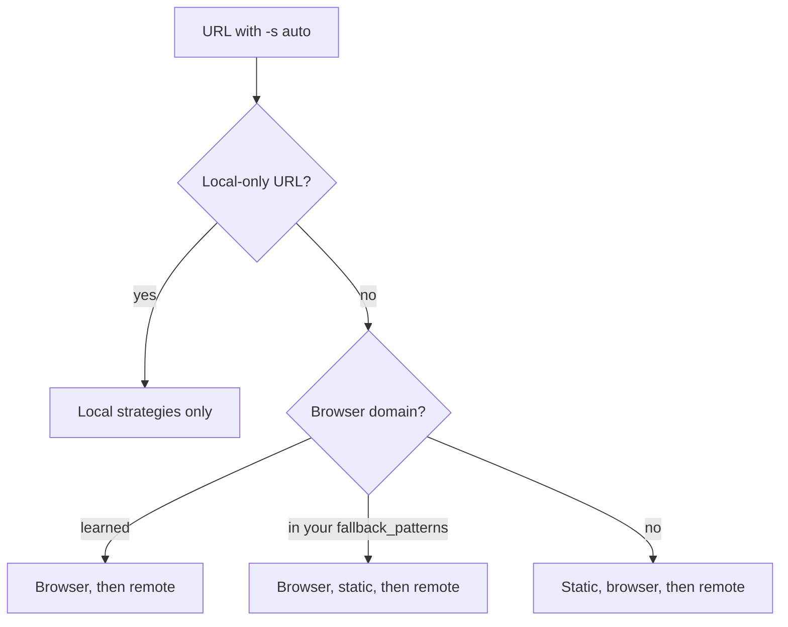
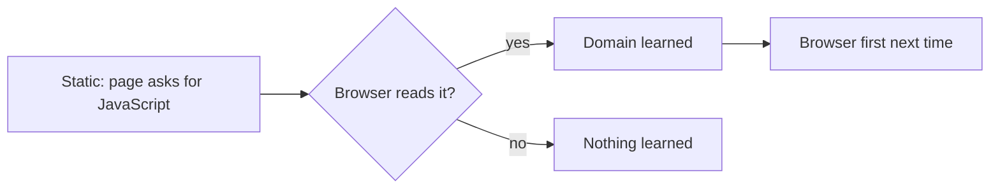

# Fetch Policy Engine

For a URL, markitai tries fetch strategies one at a time, local first, until one returns usable content. A URL leaves your machine for a remote reader only when you choose one or opt in.

## Browser

Pages that need JavaScript and web screenshots use a local Chrome, Chromium or Edge, which markitai drives itself. The setup script offers to install one when none is found (the optional parts, default yes):

<!--@include: ../snippets/setup.md-->

::: details Without the setup script
`markitai doctor --fix` downloads Google's Chrome for Testing headless shell into `~/.markitai/browsers/native` (not on Windows ARM64). markitai looks for a browser in this order: `MARKITAI_BROWSER_EXECUTABLE`, its own install, `PATH`, the usual macOS and Windows locations (Edge included), then Playwright's browser folder (`PLAYWRIGHT_BROWSERS_PATH`, else its default cache).
:::

## Strategy Selection Logic

- **`-s <strategy>`** (`static`, `playwright`, `defuddle`, `jina`, `cloudflare`): that one strategy. A chosen remote reader that is refused or fails does not end the conversion: the page is read locally (static, then the browser), and no other remote service is asked.
- **Custom order**: a domain profile's `strategy_priority` or `prefer_strategy`, or the global `fetch.policy.strategy_priority`.
- **`auto`** (default): one of the orders below, up to `max_strategy_hops` strategies; the first result that passes [validation](#result-validation) wins:



A local-only URL is private, carries credentials, or matches `local_only_patterns` or `NO_PROXY` ([below](#remote-readers-and-local-only-urls)); this also wins over a custom order.

### Default Order

The built-in static fetcher reads most articles without a browser and sends the URL nowhere:

<StrategyChain />

### Browser-first Orders

Domains in a `fetch.fallback_patterns` list you write yourself (and their subdomains) start with the browser:

<StrategyChain mode="listed" />

Domains markitai [learned](#spa-learning) need JavaScript skip the static try:

<StrategyChain mode="learned" />

The built-in `fallback_patterns` list that `markitai config list` shows has no effect; X posts read faster from the static page.

::: details X/Twitter posts
`auto` reads a post from X's own static page with a post reader, usually in one or two seconds. Mirror addresses (fxtwitter.com, vxtwitter.com, fixupx.com, ...) are read as the `x.com` post, and `t.co` links are resolved with one request each. No X address is sent to another service.
:::

### Remote Readers and Local-only URLs

The remote readers are defuddle.md, Jina Reader and Cloudflare Browser Rendering (your account). markitai tries them one at a time, so a URL reaches only the one being tried.

| `fetch.remote_consent` | `auto` falls back to them | `-s defuddle/jina/cloudflare` |
|------------------------|---------------------------|-------------------------------|
| not written (`config list` shows `always`) | never; a failure they might fix says how to allow them | runs |
| `always`, written by you | yes; one line on stderr the first time | runs |
| `ask` | asks once per run on a terminal; without one (or with `--quiet`) skipped, with a note | runs |
| `never`, or `--no-remote-fetch` | never | refused, then read locally |

```bash
markitai config set fetch.remote_consent always   # the remote fallback 1.x had by default
```

Always local, whatever the strategy or setting:

- localhost, private IPs and intranet names (`.local`, `.internal`, `.lan`, `.home`, `.corp`, single-label hosts), and hosts that resolve to them
- URLs with credentials: userinfo, tokens, signatures, passwords, API keys, authorization codes
- everything under `MARKITAI_NO_REMOTE_FETCH=1`

`fetch.policy.local_only_patterns` and `NO_PROXY` keep matching domains local too; `-s` for one run overrides them for a public URL. In `markitai serve` only a written `always` enables the fallback, and a [user token](/guide/serve-reference#user-tokens)'s jobs never use a remote reader; MCP and the bindings never fall back to one.

## Configuration

In `markitai.json`:

```json
{
  "fetch": {
    "remote_consent": "always",
    "policy": { "max_strategy_hops": 5, "local_only_patterns": ["*.corp.example"] },
    "domain_profiles": {
      "app.example.com": { "wait_for": "networkidle", "extra_wait_ms": 2000 },
      "docs.example.com": { "prefer_strategy": "static" }
    }
  }
}
```

### Policy Options

| `fetch.policy` | Default | Description |
|--------|---------|-------------|
| `enabled` | `true` | Strategy ordering on or off |
| `max_strategy_hops` | `5` | Strategies to try (1–6) |
| `strategy_priority` | `null` | Global strategy order |
| `local_only_patterns` | `[]` | Local-only domains and IPs (`NO_PROXY` syntax) |
| `inherit_no_proxy` | `true` | Treat `NO_PROXY` entries as local-only too |

### Domain Profiles

A profile applies to its exact `host[:port]`, not to subdomains.

| `fetch.domain_profiles.<domain>` | Default | Description |
|--------|---------|-------------|
| `wait_for_selector` | `null` | CSS selector to wait for |
| `wait_for` | `null` | `load`, `domcontentloaded` or `networkidle`; unset inherits `fetch.playwright.wait_for` |
| `extra_wait_ms` | `null` | Longest extra wait, ends once the page settles; unset inherits `fetch.playwright.extra_wait_ms` |
| `prefer_strategy` | `null` | Strategy to try first |
| `strategy_priority` | `null` | Full order (overrides the global order and `prefer_strategy`) |
| `skip_auto_scroll` | `false` | No auto-scroll on single-content pages |
| `reject_resource_patterns` | `null` | Block matching browser requests, e.g. `["**/analytics/**"]` |

Built-in profiles cover `github.com`, `x.com` and `twitter.com` (with their `www.` and `mobile.` hosts); yours overrides only the fields you set.

### Browser Sessions

| `fetch.playwright` | Default | Description |
|--------|---------|-------------|
| `session_mode` | `"isolated"` | `isolated`: a new browser context per page; `domain_persistent`: reuse cookies and storage per domain within one run (one CLI run, one serve job, one MCP connection) |
| `session_ttl_seconds` | `600` | Persistent session lifetime (60–7200) |

Nothing is kept between runs. Sign-in cookies go in `fetch.playwright.cookies` ([Configuration](/guide/configuration#browser-settings)).

## Static Fetching

- It identifies as `markitai/<version> (+https://github.com/Ynewtime/markitai)`, which sites such as Wikipedia serve where they refuse library agents. A 401 or 403 is retried once with desktop-browser headers; a connection cut before the request was sent is retried twice. Timeouts are not retried.
- A PDF response goes through the PDF reader; another document type is converted by the URL's file extension.
- Up to 10 redirects and `<meta refresh>` are followed; a response may be up to 500 MiB.

::: details Character encodings and links
Decoding follows browsers: byte-order mark, `Content-Type` charset, `<meta charset>` in the first 1024 bytes, then detection. Legacy labels map as browsers do (`gb2312`/`gbk` → GB18030, `shift_jis` → Windows-31J, `iso-8859-1` → Windows-1252). Relative links and images resolve against the URL after redirects.
:::

## How It Works

### Result validation

Empty or too-short content, login walls, verification pages (WeChat, Zhihu and others) and anti-bot or CAPTCHA pages (Cloudflare, Turnstile, reCAPTCHA, hCaptcha, Geetest, DataDome, PerimeterX, Incapsula, AWS WAF) fail and fall through to the next strategy. The error then says what the site did and what to try.

### SPA learning



Only this signal teaches the cache (not CAPTCHAs, login walls or network errors), and only HTML pages are checked. A domain leaves after 30 days without a hit; `markitai cache spa-domains` shows or clears them (at most 4,096).

### Page cache

Fetched HTML and text pages are cached for `cache.fetch_ttl_seconds` (24 hours); a page with `ETag` or `Last-Modified` is revalidated on every run. `--no-cache` skips the reads, and also asks Jina not to use its cache.
