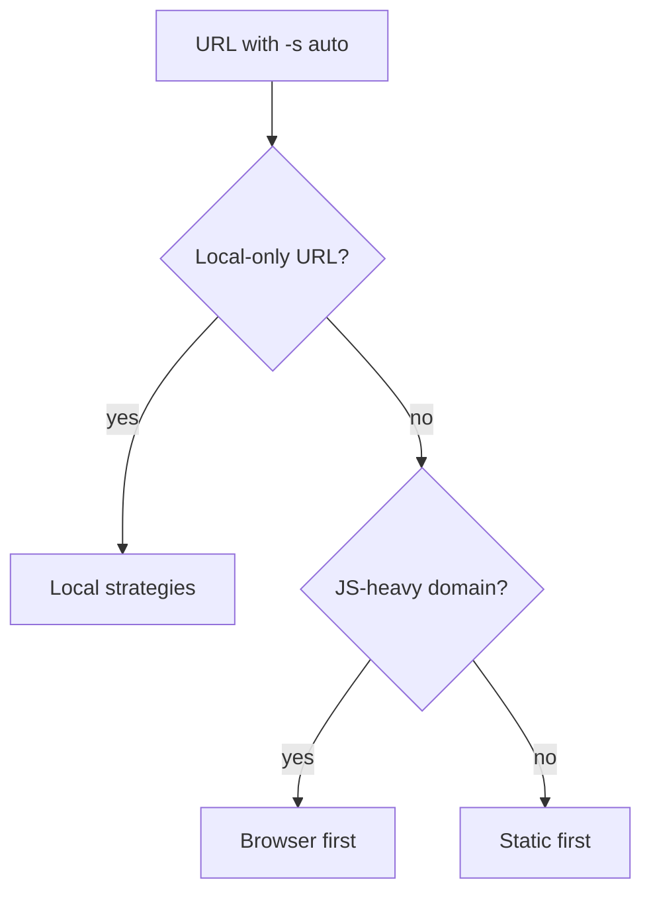
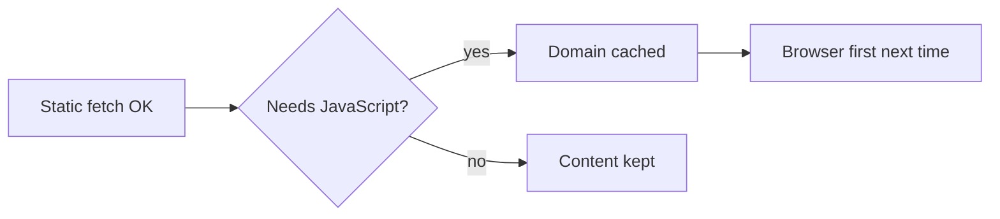

# Fetch Policy Engine

For a URL, markitai tries fetch strategies one at a time, cheapest first, until one returns usable content.

## Install

The browser strategy and the curl-cffi client are optional. The setup script asks for the Playwright browser (default yes) and installs Chromium, with its system libraries on Linux; an interactive install also brings the `browser` and `extra-fetch` extras.

<!--@include: ../snippets/setup.md-->

::: details Manual install
```bash
uv tool install "markitai[browser,extra-fetch]" --force
markitai doctor --fix     # installs Chromium for the Playwright package
```
:::

## Strategy Selection Logic

- **`-s <strategy>`** (`static`, `playwright`, `defuddle`, `jina`, `cloudflare`): that one strategy. If a remote service refuses (rate limit, auth), markitai falls back to the `auto` chain, asking first on a terminal. `-s` is consent for that service only; the others still follow `remote_consent`.
- **Custom order**: a domain profile's `strategy_priority` or `prefer_strategy`, or the global `fetch.policy.strategy_priority`.
- **`auto`** (default): one of the orders below, up to `max_strategy_hops` strategies; the first result that passes [validation](#result-validation) wins:



A local-only URL is private, carries credentials, or matches `local_only_patterns` or `NO_PROXY` ([below](#remote-fallback-and-local-only-urls)); this also wins over a custom order.

### Default Order (Standard Domains)

Local first: the built-in static fetcher matches the remote readers on quality and sends the URL nowhere.

<StrategyChain />

### SPA/Heavy-JS Order

For `fetch.fallback_patterns` (by default `twitter.com`, `x.com`, `instagram.com`, `facebook.com`, `linkedin.com`, `threads.net`) and [learned](#spa-learning) domains:

<StrategyChain mode="spa" />

A private or local-only URL keeps the local part: static then Playwright, or the reverse on a JavaScript-heavy domain.

::: details X/Twitter posts
With remote use allowed, Playwright tries FxTwitter, then Twitter oEmbed, before launching Chromium for an anonymous post; on success the label is `playwright(fxtwitter)` or `playwright(oembed)` and no defuddle request follows. Cookies, custom headers, credentials, persistent sessions, screenshots or a failed network extraction still open the browser. A navigation that returns an HTTP error skips the waits and tries this enrichment at once; if it fails or is off, the error is reported and `auto` moves on.
:::

### Remote Fallback and Local-only URLs

The remote services are defuddle.md, Jina, Cloudflare, and for X/Twitter posts FxTwitter and Twitter oEmbed. markitai tries them one at a time, so a URL reaches only the one being tried. The first use prints one line on stderr and notes it under `~/.markitai/notices/remote-fetch` (VLM OCR does the same).

Always local, whatever the strategy:

- localhost, private IPs and common intranet hostnames
- URLs with credentials: userinfo, tokens, signatures, passwords, API keys, authorization codes

| Setting | Effect | `-s` overrides? |
|---------|--------|-----------------|
| `remote_consent: always` (default) | Remote fallback for public URLs, noted on stderr | — |
| `remote_consent: ask` | One prompt per process for all remote services; no terminal: none are used | — |
| `remote_consent: never` | Automatic and configured strategies stay local | Yes |
| `local_only_patterns`, `NO_PROXY` | Matching domains stay local in `auto` | Yes |
| Private, intranet or credential URL | Local | **No** |
| `MARKITAI_NO_REMOTE_FETCH=1` | Local | **No** |

A remote `fetch.strategy` in the config file is not an opt-in: `remote_consent` still applies.

::: details Proxies that return Fake-IP addresses
When a proxy such as Clash answers with Fake-IP addresses (`198.18.0.0/15`, `2001:2::/48`), remote extraction checks the hostname's public A and AAAA records through [Cloudflare DNS over HTTPS](https://developers.cloudflare.com/1.1.1.1/encryption/dns-over-https/make-api-requests/dns-json/), only after consent, and DNS sees the hostname alone. A failed check or a non-public answer blocks remote extraction. Private IP literals and local connection checks, including unauthenticated `serve` requests, stay blocked.
:::

## Configuration

In `markitai.json`:

```json
{
  "fetch": {
    "policy": { "max_strategy_hops": 5, "local_only_patterns": ["*.corp.example"] },
    "domain_profiles": {
      "app.example.com": { "wait_for": "networkidle", "extra_wait_ms": 2000 },
      "docs.example.com": { "prefer_strategy": "static" }
    },
    "playwright": { "session_mode": "domain_persistent", "session_ttl_seconds": 600 }
  }
}
```

### Policy Options

| `fetch.policy` | Default | Description |
|--------|---------|-------------|
| `enabled` | `true` | Strategy ordering on or off |
| `max_strategy_hops` | `5` | Strategies to try (1–6) |
| `strategy_priority` | `null` | Global strategy order |
| `local_only_patterns` | `[]` | Local-only domains and IPs (`NO_PROXY` syntax) |
| `inherit_no_proxy` | `true` | Treat `NO_PROXY` entries as local-only too |

### Domain Profiles

| `fetch.domain_profiles.<domain>` | Default | Description |
|--------|---------|-------------|
| `wait_for_selector` | `null` | CSS selector to wait for |
| `wait_for` | `null` | `load`, `domcontentloaded` or `networkidle`; unset inherits `fetch.playwright.wait_for` |
| `extra_wait_ms` | `null` | Longest extra wait, ends once the page settles; unset inherits `fetch.playwright.extra_wait_ms` |
| `prefer_strategy` | `null` | Strategy to try first |
| `strategy_priority` | `null` | Full order (overrides the global order and `prefer_strategy`) |
| `skip_auto_scroll` | `false` | No auto-scroll on single-content pages |
| `reject_resource_patterns` | `null` | Block matching browser requests, e.g. `["**/analytics/**"]` |

Built-in profiles cover `x.com`, `twitter.com` and `github.com`; yours overrides only the fields you set (`skip_auto_scroll: false` restores scrolling, `reject_resource_patterns: []` clears filters, `null` inherits the global setting).

### Playwright Session Persistence

| `fetch.playwright` | Default | Description |
|--------|---------|-------------|
| `session_mode` | `"isolated"` | `isolated`: new context per request; `domain_persistent`: reuse cookies and storage per domain (faster repeats) |
| `session_ttl_seconds` | `600` | Persistent session lifetime (60–7200) |

## Static HTTP Adapters

The static strategy uses httpx:

- It identifies as `markitai/<version> (+https://github.com/Ynewtime/markitai)`, which sites such as Wikipedia serve where they refuse library agents. A 401 or 403 is retried once with desktop-browser headers.
- A TLS-fingerprint block (403 or empty content) sends `auto` to Playwright or Cloudflare. To pass it without a browser, use curl-cffi (`extra-fetch`), which sends the impersonated Chrome's User-Agent; if it is missing, httpx is used silently:

  ```bash
  export MARKITAI_STATIC_HTTP=curl_cffi
  ```

- A non-HTML response is converted by its `Content-Type` (or `Content-Disposition` name) like a local file.

::: details Character encodings and links
Decoding follows browsers: byte-order mark, `Content-Type` charset, `<meta charset>` in the first 1024 bytes, then detection. Legacy labels map to browser supersets (`gb2312`/`gbk` → GB18030, `shift_jis` → Windows-31J, `iso-8859-1` → Windows-1252). Relative links and images resolve against the URL after redirects.
:::

## How It Works

### Result validation

Empty or too-short content, login walls and anti-bot or CAPTCHA pages (Geetest, Cloudflare, reCAPTCHA, hCaptcha) fail and fall through to the next strategy.

### SPA learning



Only this signal teaches the cache (not CAPTCHAs, login walls or network errors), and only HTML pages are checked. A domain leaves after 30 days without a hit; `markitai cache spa-domains` shows or clears the cache.
