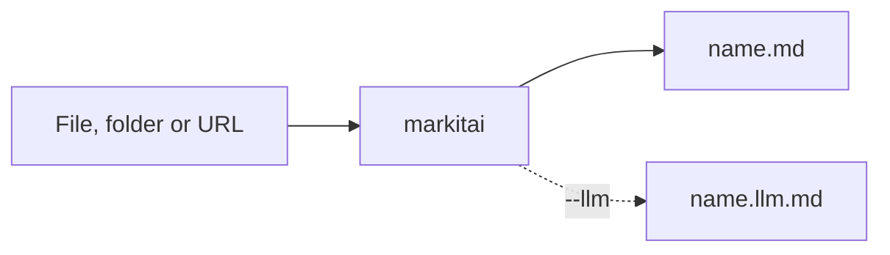

# Getting Started

## Install

One command installs uv, Python 3.13 (when no 3.11 to 3.13 is found) and markitai, then asks about the optional parts:

<!--@include: ../snippets/setup.md-->

| Part | Enables | Default |
|------|---------|---------|
| markitai with the `browser`, `extra-fetch`, `svg`, `heif`, `legacy` and `mcp` extras | the core and the small extras | always |
| Web workspace (`serve`) | [`markitai serve`](/guide/serve) | yes |
| Local OCR (`ocr`, about 150 MB) | `--ocr` on scans and images | yes |
| Playwright Chromium, plus its system libraries on Linux | JavaScript pages, URL screenshots | yes |
| Claude Code CLI and the `claude-agent` extra | a [Claude subscription](/guide/subscriptions) | no |
| Copilot CLI and the `copilot` extra | a [Copilot subscription](/guide/subscriptions) | no |

It then writes a default config (`markitai init --yes`) if there is none and loads the libraries conversions use, so the first conversion does not wait. Run it again to add a part you declined: the extras already installed are kept.

Without a terminal (CI, Dockerfile) it installs only the core. Environment variables:

| Variable | Effect |
|----------|--------|
| `MARKITAI_INSTALL_OPTIONAL=1` | install every optional part without asking (both CLIs included) |
| `MARKITAI_VERSION=X.Y.Z` | pin a markitai release |
| `MARKITAI_USE_MIRROR=1` / `0` | always pick / never offer a PyPI mirror (offered only when PyPI answers slowly) |
| `MARKITAI_SETUP_LOG=PATH` | where the full log of a failure goes |
| `NO_COLOR=1` | no colours |

::: details Manual install
With Python 3.11 to 3.13 already installed:

```bash
uv tool install markitai                 # recommended
uv tool install "markitai[all]" --force  # with every extra
pipx install markitai
uv pip install markitai                  # into the active virtual environment
```

Add one extra later with `uv tool install "markitai[ocr]" --force`; the extras are `markitai[browser]`, `markitai[ocr]`, `markitai[serve]`, `markitai[mcp]`, `markitai[claude-agent]`, `markitai[copilot]`, `markitai[legacy]`, `markitai[heif]`, `markitai[svg]`, `markitai[extra-fetch]` and `markitai[all]`. After the browser extra, `markitai doctor --fix` installs Chromium.

After installing, upgrading or adding an extra, run `markitai doctor` once: it loads the libraries for the first time (seconds on macOS, up to a minute with OCR, while the system checks each new library). Otherwise the first conversion waits for it and says so; `markitai serve` does it in the background at start.

markitai 1.3.0 requires `litellm>=1.83.0,!=1.92.0,<1.105` and `anthropic>=1.0.0,<2`: newer LiteLLM releases change model prices and OpenRouter limits markitai relies on, and Anthropic SDK 2 sends the API key as a Bearer token, which gateways that read `X-Api-Key` refuse for `--llm-batch`. An environment that needs newer versions of either package is not supported.
:::

## Your First Conversion

Convert a real page, this very guide:

```bash
mkai https://markitai.dev/guide/getting-started --pure
```

`mkai` is a short alias for `markitai`; `--pure` prints plain Markdown. To write files, give an output directory:

```bash
markitai document.docx -o output/
markitai https://example.com/article -o output/
markitai ./docs -o output/                # a batch, with --resume after an interruption
```



### Turning on LLM enhancement

Export an API key for any supported provider and add `--llm`:

```bash
export GEMINI_API_KEY=...    # or OPENAI_ / ANTHROPIC_ / DEEPSEEK_ / OPENROUTER_API_KEY
markitai report.pdf -o output/ --llm
```

markitai picks a model from the key it finds; `MODEL=provider/model` chooses one. For a config file, a subscription (ChatGPT, Claude Code, Copilot) or several models with fallback, run the guided setup, then check it:

```bash
markitai init
markitai doctor     # what is installed and configured
```

**Presets** bundle the common flags: `minimal` converts, `standard` adds LLM cleanup and image analysis, `rich` adds page screenshots. Turn a part off with `--no-*`, for example `--preset rich --no-desc`.

**URLs** are fetched on your machine first. When that fails on a public page, markitai may fall back to a remote reader (Defuddle, Jina or Cloudflare) and says so once on stderr; private, intranet and credential-bearing URLs never leave your machine, and `MARKITAI_NO_REMOTE_FETCH=1` keeps everything local ([Fetch Policy](/guide/fetch-policy)). `-s jina` reads `JINA_API_KEY`; `-s cloudflare` reads `CLOUDFLARE_API_TOKEN` and `CLOUDFLARE_ACCOUNT_ID`.

## Output Structure

```text
output/
├── document.pdf.md          # Markdown (with --llm, only .llm.md is written unless --keep-base)
├── document.pdf.llm.md      # LLM-enhanced version
└── .markitai/
    ├── assets/              # images from the source, plus images.json descriptions
    ├── screenshots/         # page, slide or full-page screenshots (--screenshot)
    ├── reports/             # JSON reports for batch runs
    └── states/              # batch state for --resume
```

The output name is the full input name plus `.md`, so `report.pdf` and `report.docx` never collide.

## Supported Formats

| Format | Extensions |
|--------|------------|
| Office | `.docx`, `.doc`, `.pptx`, `.ppt`, `.xlsx`, `.xls`, `.odt`, `.ods`, `.numbers` (needs `-b cloudflare`) |
| PDF | `.pdf` |
| Text and markup | `.txt`, `.md`, `.markdown`, `.html`, `.htm`, `.xhtml`, `.xml`, `.csv`, `.tsv`, `.rtf`, `.rst`, `.org`, `.tex` |
| Images | `.jpg`, `.jpeg`, `.png`, `.webp`, `.svg`, `.gif`, `.bmp`, `.tiff`, `.tif`, `.heic`, `.heif`, `.avif` (last three need `markitai[heif]`) |
| Other documents | `.epub`, `.eml`, `.msg`, `.ipynb` |
| URLs | `http://`, `https://` |

Legacy `.doc` and `.ppt` need `markitai[legacy]` and no Office install.

## Platform Notes

Everything works on Windows, Linux and macOS, except:

| Platform | Note |
|----------|------|
| EMF/WMF images | convert only on Windows (the format is Windows-only) |
| PPTX slide screenshots | need a renderer: Office or LibreOffice on Windows, LibreOffice on Linux (`apt-get install libreoffice`); see below for macOS |
| Windows on Arm | markitai runs on an emulated x64 Python, which the setup script picks or installs; slower than on an x64 PC |

::: details macOS slide screenshots
macOS prefers LibreOffice (`brew install --cask libreoffice`) and otherwise drives an installed PowerPoint, which asks for permission once and needs a desktop session. Recent macOS versions refuse the terminal's writes to PowerPoint's container (`Operation not permitted`, no dialog): give the terminal app Full Disk Access in System Settings → Privacy & Security, or install LibreOffice. On a headless Mac set `"office": { "macos_fallback": false }`.
:::

::: details Windows on Arm
Some libraries markitai needs have no ARM64 build: pymupdf-layout, used for every PDF, has none, and the LLM library needs packages that would have to be compiled with Rust. `setup.ps1` picks an x64 Python or installs one with uv, and says so. With uv directly, ask for one: `uv tool install markitai --python cpython-3.13-windows-x86_64`. On a native ARM64 Python the install stops with `pymupdf-layout ... has no wheels with a matching platform tag (e.g., win_arm64)`.
:::

## Next Steps

- [Configuration](/guide/configuration) for LLM providers and every setting
- [CLI Reference](/guide/cli) for every command and flag
