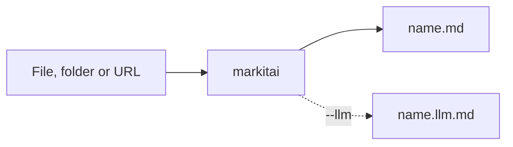

# Getting Started

## Install

One command installs markitai, a single native program with no Python, Node.js or other runtime to set up:

<!--@include: ../snippets/setup.md-->

The script downloads the release archive for your machine, checks it against the release's `SHA256SUMS` and installs `markitai` with its short alias `mkai` and `markitai-mcp` (for [MCP clients](/guide/mcp)). No root or administrator rights are needed.

| What | Where |
|------|-------|
| Commands | `~/.local/bin`; on Windows `%LOCALAPPDATA%\Programs\markitai`, added to your user Path |
| Licence notices, offline guides | `~/.local/share/markitai/current`; on Windows beside the commands |
| Your settings and caches | `~/.markitai` (`%USERPROFILE%\.markitai`) |

With a terminal it then offers the optional parts, `markitai doctor --fix`: local OCR models (about 45 MB) and, when no Chrome or Chromium is found, Chrome's headless shell (about 280 MB). Running it again asks again only if a part is missing; it keeps no answer, so use `MARKITAI_INSTALL_OPTIONAL` to answer without asking. A first install also runs `markitai init --yes`, which saves the models of the API keys and subscriptions it finds (never a key; LLM stays off). Coming from markitai 1.x? It replaces a uv-installed 1.x: see [Upgrading from 1.x](/guide/upgrading).

| Variable | Effect |
|----------|--------|
| `MARKITAI_VERSION=X.Y.Z` | Install this release instead of the latest |
| `MARKITAI_INSTALL_DIR=DIR` | Another folder; later updates and uninstalls reuse it. On Windows use an empty or dedicated folder: setup refuses one that already holds files of the names it installs |
| `MARKITAI_INSTALL_OPTIONAL=1` / `0` | Prepare the optional parts without asking / never |
| `MARKITAI_DOWNLOAD_URL=URL` | Download from a mirror of the GitHub Releases |
| `NO_COLOR=1` | No colours |

Run `markitai update` to update (running the install command again also works). Setup keeps a receipt of the files it installed: an update replaces and an uninstall removes only those, and on Windows the user Path entry goes only if setup added it. The new release is staged before anything is replaced, so a failed Windows update leaves the previous one in place. To uninstall (your `~/.markitai` stays):

::: code-group
```bash [Linux/macOS]
curl -fsSL https://markitai.dev/setup.sh | sh -s -- --uninstall
```

```powershell [Windows]
& ([scriptblock]::Create((irm https://markitai.dev/setup.ps1))) -Uninstall
```
:::

::: details Other ways to install
**Release archives.** Each [GitHub Release](https://github.com/Ynewtime/markitai/releases) has one archive per platform, `SHA256SUMS` and build provenance:

| Platform | Archive |
|----------|---------|
| macOS, Apple silicon | `markitai-v<version>-aarch64-apple-darwin.tar.gz` |
| macOS, Intel | `markitai-v<version>-x86_64-apple-darwin.tar.gz` |
| Linux x86-64 | `markitai-v<version>-x86_64-unknown-linux-gnu.tar.gz` |
| Linux ARM64 | `markitai-v<version>-aarch64-unknown-linux-gnu.tar.gz` |
| Windows x64 | `markitai-v<version>-x86_64-pc-windows-msvc.zip` |
| Windows ARM64 | `markitai-v<version>-aarch64-pc-windows-msvc.zip` |

Unpack it into a new folder, keep its files together and put the folder on your `PATH`. Check a download with `sha256sum -c SHA256SUMS --ignore-missing` (macOS: `grep <archive> SHA256SUMS | shasum -a 256 -c`), its origin with `gh attestation verify <archive> --repo Ynewtime/markitai`.

**pip or uv.** The `markitai` package on PyPI carries the same program and installs the same three commands (Python 3.10 or later; the [Python API](/guide/python-api) comes with it). PyPI has wheels for the same six platforms only, and no 1.x any more: anywhere else pip has nothing to install and leaves an installed 1.x as it is ([1.x from its tag](/guide/upgrading#going-back-to-1x)).

```bash
uv tool install markitai     # or: pipx install markitai, pip install markitai
```

**From source.** Rust 1.92 or later and a C/C++ toolchain:

```bash
git clone https://github.com/Ynewtime/markitai && cd markitai
cargo build --release --locked -p markitai-cli   # target/release/markitai and mkai
```

The release's source archive, `markitai-<version>.tar.gz`, builds the Python package with Rust installed on a platform without a wheel: `pip install markitai-<version>.tar.gz`.
:::

## Your First Conversion

Convert a real page, this very guide:

```bash
mkai https://markitai.dev/guide/getting-started --pure
```

`--pure` prints plain Markdown, without the generated frontmatter. To write files, give an output directory:

```bash
markitai document.docx -o output/
markitai https://example.com/article -o output/
markitai ./docs -o output/                # a batch, with --resume after an interruption
```



### Turning on LLM enhancement

Export an API key for a provider and add `--llm`:

```bash
export GEMINI_API_KEY=...    # or OPENAI_ / ANTHROPIC_ / DEEPSEEK_ / OPENROUTER_API_KEY
markitai report.pdf -o output/ --llm
```

markitai picks a model from the keys and signed-in subscriptions it finds; `MODEL=provider/model` chooses one. For a config file or several models, run:

```bash
markitai init       # writes ~/.markitai/config.json with what it detects
markitai doctor     # what is installed, configured and ready
```

**Presets** bundle the common flags: `minimal` converts, `standard` adds LLM cleanup and image analysis, `rich` adds page screenshots. Turn a part off with `--no-*`, for example `--preset rich --no-desc`.

**URLs** are read on your machine: plain HTTP first, then a local Chrome or Chromium for pages that need JavaScript. Remote readers (Defuddle, Jina, Cloudflare) are used only when you choose one with `-s` or opt in ([Fetch Policy](/guide/fetch-policy)).

## Output Structure

```text
output/
├── document.pdf.md          # Markdown (with --llm only .llm.md, unless --keep-base)
├── document.pdf.llm.md      # LLM-enhanced version
└── .markitai/
    ├── assets/              # pictures, named by their content; images.json with --alt/--desc
    ├── screenshots/         # page and slide images (--screenshot)
    ├── reports/             # JSON report of a batch
    ├── states/              # batch state for --resume
    └── ownership/           # which files markitai wrote (internal)
```

- The output name is the full input name plus `.md`, so `report.pdf` and `report.docx` never collide. Converting again writes `report.pdf.v2.md` (`output.on_conflict`: `rename`, `overwrite` or `skip`).
- Without `-o`, Markdown goes to stdout and its pictures to `~/.markitai/assets/blobs/`, linked as `file://` URLs.
- A picture on its own needs `--ocr` or `--llm`; without them it is skipped (exit `0`).

## Supported Formats

| Format | Extensions |
|--------|------------|
| Word, OpenDocument text, RTF | `.docx`, `.docm`, `.dotx`, `.dotm`, `.doc`, `.dot`, `.odt`, `.ott`, `.rtf` |
| Presentations | `.pptx`, `.pptm`, `.ppsx`, `.ppsm`, `.potx`, `.potm`, `.ppt`, `.pps`, `.pot`, `.odp`, `.otp` |
| Spreadsheets | `.xlsx`, `.xlsm`, `.xlsb`, `.xltx`, `.xltm`, `.xls`, `.xlt`, `.ods`, `.ots`, `.numbers`, `.csv`, `.tsv` |
| PDF | `.pdf` |
| Web and markup | `.html`, `.htm`, `.xhtml`, `.xml`, `.md`, `.markdown`, `.txt`, `.json`, `.ipynb`, `.rst`, `.org`, `.tex`, `.latex` |
| Images | `.jpg`, `.jpeg`, `.png`, `.webp`, `.gif`, `.bmp`, `.tif`, `.tiff`, `.svg`, `.heic`, `.heif`, `.avif` |
| E-books and e-mail | `.epub`, `.eml`, `.msg` |
| URLs | `http://`, `https://`, and `.urls` lists |

Every reader is built in, legacy `.doc`, `.ppt` and `.xls` included. Three things use another program on your machine:

| Needs | For |
|-------|-----|
| Chrome or Chromium (`markitai doctor --fix` installs Chrome's headless shell) | JavaScript pages, web screenshots |
| LibreOffice | Page and slide images of Office files (`--screenshot`, OCR of slides), EMF/WMF pictures |
| OCR models (`markitai doctor --fix`, or the first `--ocr`) | Local OCR of scans and pictures |

## Platform Notes

| Platform | Note |
|----------|------|
| macOS | 11 or later, Apple silicon or Intel. Local OCR can use the system's Vision engine (`MARKITAI_OCR_BACKEND=vision`) |
| Linux | x86-64 or ARM64 with glibc 2.28 or later (RHEL 8, Debian 10, Ubuntu 18.10 and newer); musl (Alpine) is not supported |
| Windows | x64 or ARM64, both native builds |

::: details macOS: "Apple cannot verify" a download
The builds are not code-signed or notarized. The setup script and `curl` downloads are not affected; a file your browser downloaded is. Once you trust it, clear its quarantine mark: `xattr -d com.apple.quarantine markitai-v<version>-aarch64-apple-darwin.tar.gz`.
:::

## Next Steps

- [Configuration](/guide/configuration) for LLM providers and every setting
- [CLI Reference](/guide/cli) for every command and flag
- [Upgrading from 1.x](/guide/upgrading) if you used the Python markitai
