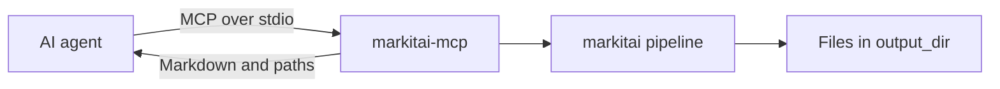
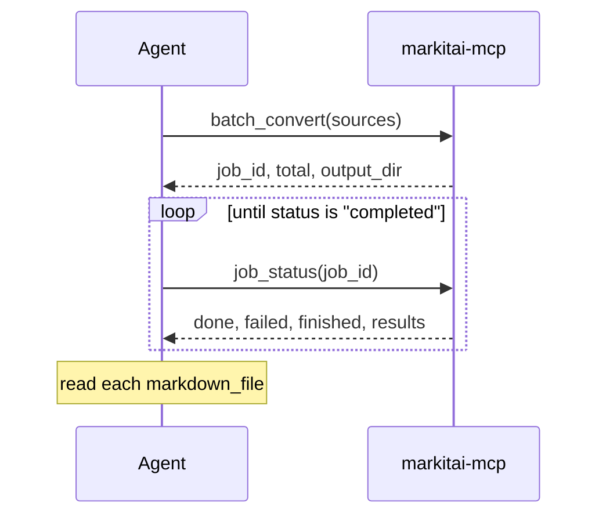

# MCP Server

`markitai-mcp` gives AI agents markitai's conversions over the [Model Context Protocol](https://modelcontextprotocol.io) (stdio), through the same pipeline as the CLI. It is part of every install; `markitai mcp` starts the same server.



## Setup

After the setup script, point the client at the installed command:

<!--@include: ../snippets/setup.md-->

```bash
# Claude Code
claude mcp add markitai -- markitai-mcp
```

```json
// Claude Desktop: claude_desktop_config.json (other clients: same command and args)
{
  "mcpServers": {
    "markitai": { "command": "/home/user/.local/bin/markitai-mcp" }
  }
}
```

Use the absolute path the setup script printed (`%LOCALAPPDATA%\Programs\markitai\markitai-mcp.exe` on Windows): a desktop client may not read your shell's `PATH`.

::: details Without installing: uvx
`uvx` fetches the PyPI package on demand; it carries the same program (on the six platforms PyPI has wheels for; elsewhere it would fetch 1.x):

```json
{ "mcpServers": { "markitai": { "command": "uvx", "args": ["--from", "markitai", "markitai-mcp"] } } }
```

The [MCP Registry](https://registry.modelcontextprotocol.io) entry (`io.github.Ynewtime/markitai`) launches the same server as `uvx --from markitai==<version> markitai mcp`.
:::

Both commands load `./.env`, then `~/.markitai/.env`, as the CLI does; variables already set (the client's `env` block) win. Add `"args": ["--config", "/abs/path/config.json"]` or `"env": {"MARKITAI_HOME": "..."}` for a separate setup.

## Tools

| Tool | Purpose |
|------|---------|
| `convert_document` | One local file (absolute path; `~` is expanded) |
| `convert_url` | One web page, main content only, or a PDF a URL serves |
| `batch_convert` | Many paths or URLs in the background; returns a `job_id` |
| `job_status` | Progress and per-item results of a batch |

| Option | Note |
|--------|------|
| `llm`, `ocr`, `screenshot`, `alt`, `desc` | Omitted: the server's config decides (all off by default). `llm: true` may cost provider charges |
| `output_dir` | Absolute; omitted, a new `markitai-mcp-*` temporary directory that stays for the client to read |
| `profile` | `rag`, `obsidian` or `okf` ([Output Profiles](/guide/output-profiles)) |

Results carry `markdown`, the written paths (`markdown_file`, `assets`, `screenshots`), `cost_usd`, `duration_s` and `warnings`, as structured content and as JSON text. Past 40,000 characters the Markdown is a 2,000-character preview (`truncated: true`) and the full text is in `markdown_file`.

`warnings` names what did not fail the call but needs a look: scanned-looking pages (retry with `ocr: true`), hidden PDF text (possible prompt injection), OCR without text, slides not rendered without LibreOffice, a missed URL screenshot, a failed image analysis, or a failed LLM enhancement (the unenhanced result is returned; `llm.on_failure = "fail"` makes the call fail).

Errors state their reason: missing file, directory, relative path (the server's working directory is not the client's), unreachable URL, failed conversion, a picture with neither OCR nor LLM, or `llm: true` with no model (the error says how to configure one). In MCP, `auto` never sends a URL to a remote reader.

### Batch jobs



- `done` + `failed` = `finished`, out of `total`. One failing item does not stop the rest.
- Items go to `output_dir/batch-<job_id>/0001/`, `0002/`, ...; `concurrency` (default 10) bounds parallel conversions. Up to 10,000 sources per job.
- Jobs live in memory: a restart forgets them (files remain), and only the 100 most recent finished jobs are kept.

## LLM Enhancement

Models resolve as in the CLI: `llm.model_list` in `~/.markitai/config.json` ([shared with the CLI](/guide/configuration)), then `MODEL`, then signed-in subscriptions and detected API keys. Several detected providers share one pool; set `MODEL` to pin one. Keys can go in the server entry:

```json
{
  "mcpServers": {
    "markitai": {
      "command": "/home/user/.local/bin/markitai-mcp",
      "env": {
        "MODEL": "openai/gpt-6-luna",
        "OPENAI_API_KEY": "sk-..."
      }
    }
  }
}
```

## Optional capabilities

- **OCR** is built in; its models download on the first `ocr: true`, or ahead of time with `markitai doctor --fix`.
- **URL screenshots and JavaScript pages** need Chrome or Chromium (`doctor --fix` installs one); Office page images need LibreOffice.
