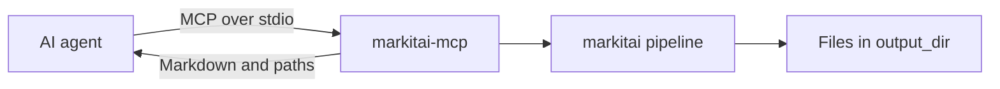
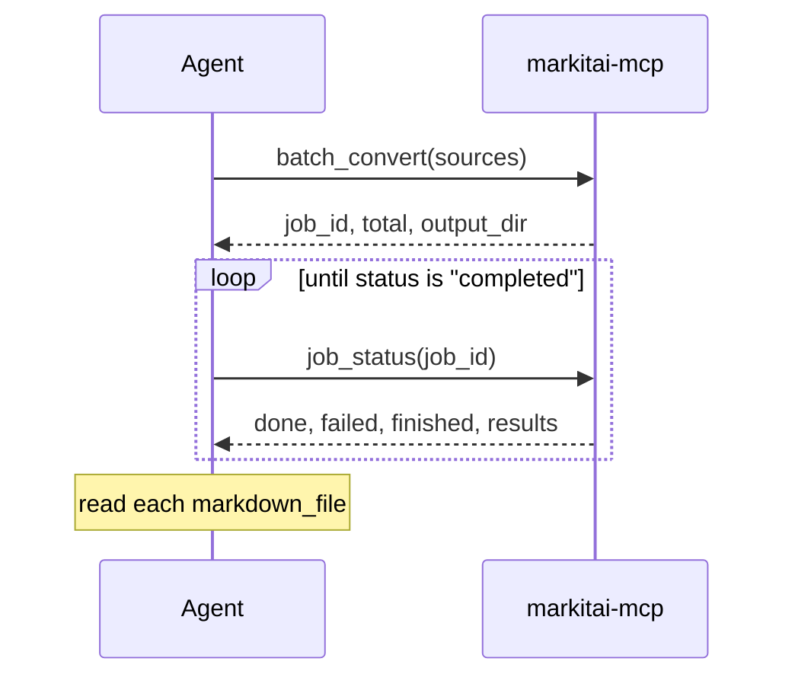

# MCP Server

`markitai-mcp` gives AI agents markitai's conversions over the [Model Context Protocol](https://modelcontextprotocol.io) (stdio), through the same pipeline as the CLI.



## Setup

Clients can start it with `uvx`, which fetches markitai on demand; nothing to install first.

```bash
# Claude Code
claude mcp add markitai -- uvx --from "markitai[mcp]" markitai-mcp
```

```json
// Claude Desktop: claude_desktop_config.json (other clients: same command and args)
{
  "mcpServers": {
    "markitai": { "command": "uvx", "args": ["--from", "markitai[mcp]", "markitai-mcp"] }
  }
}
```

To keep markitai installed instead, an interactive run of the setup script includes the `mcp` extra (and OCR and the browser); then use `markitai-mcp` as the client's command:

<!--@include: ../snippets/setup.md-->

::: details Manual install
```bash
uv tool install "markitai[mcp]"   # or: pip install "markitai[mcp]"
```

`markitai mcp` starts the same server; the [MCP Registry](https://registry.modelcontextprotocol.io) entry uses that form.
:::

Both commands load `./.env`, then `~/.markitai/.env`, as the CLI does. Variables already set (the client's `env` block) win; a folder's `.env` cannot set programs, paths, endpoints, proxies or credential files.

## Tools

| Tool | Purpose |
|------|---------|
| `convert_document` | One local file (absolute path) |
| `convert_url` | One web page, main content only |
| `batch_convert` | Many paths or URLs in the background; returns a `job_id` |
| `job_status` | Progress and per-item results of a batch |

| Option | Note |
|--------|------|
| `llm` | Omitted: the server's config decides (`llm.enabled`, off by default). `true` may cost provider charges |
| `output_dir` | Absolute; omitted, a fresh temporary directory |
| `profile` | `rag`, `obsidian` or `okf` ([Output Profiles](/guide/output-profiles)) |

Results carry the written paths (`markdown_file`, `assets`, `screenshots`), `cost_usd` and `warnings`. Past about 40,000 characters the Markdown is a preview (`truncated: true`) and the full text is in `markdown_file`.

`warnings` names what did not fail the call but needs a look: scanned-looking pages (retry with `ocr: true`), hidden PDF text (possible prompt injection), OCR without text, a missed URL screenshot, a failed image analysis, or a failed LLM enhancement (the unenhanced result is returned; `llm.on_failure = "fail"` makes the call fail).

Errors state their reason: missing file, directory, relative path (the server's working directory is not the client's), unreachable URL, failed conversion, or `llm: true` with no model (the error carries the setup below).

### Batch jobs



- `done` + `failed` = `finished`, out of `total`. One failing item does not stop the rest.
- Items go to `output_dir/batch-<job_id>/<item_number>/`; `concurrency` (default 10) bounds parallel conversions.
- Jobs live in memory: a restart forgets them (files remain), and a finished job is dropped after 100 newer ones finish.

## LLM Enhancement

Models resolve as in the CLI: `llm.model_list` in `~/.markitai/config.json` ([shared with the CLI](/guide/configuration)), then `MODEL`, then detected API keys (such as those `markitai init` writes to `~/.markitai/.env`) and signed-in subscriptions. Several detected providers share one pool; set `MODEL` to pin one. Keys can go in the server entry:

```json
{
  "mcpServers": {
    "markitai": {
      "command": "uvx",
      "args": ["--from", "markitai[mcp]", "markitai-mcp"],
      "env": {
        "MODEL": "openai/gpt-6-luna",
        "OPENAI_API_KEY": "sk-..."
      }
    }
  }
}
```

## Optional capabilities

- OCR: `ocr` extra; URL screenshots: `browser` extra. With uvx: `"args": ["--from", "markitai[mcp]", "--with", "markitai[ocr]", "markitai-mcp"]`.
