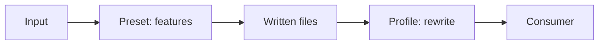

# Output Profiles

A [preset](./configuration.md#presets) picks which features run; a profile reshapes the written files for one consumer. Without a profile nothing is rewritten.



| Profile | Changes |
|---|---|
| `rag` | images to visible `assets/`, `<!-- page: N -->` markers, table check |
| `obsidian` | images to visible `assets/`, optional wikilinks |
| `okf` | frontmatter in OKF fields |

## Enabling a profile

```bash
# CLI
markitai document.pdf --profile rag -o out/
```

```json
// markitai.json
{ "output": { "profile": "rag" } }
```

```python
# Python API
import markitai

out = markitai.convert("document.pdf", output_dir="out/", profile="rag")
```

## `rag` — retrieval pipelines

Ingestors such as LlamaIndex `SimpleDirectoryReader` skip hidden paths like the default `.markitai/assets/`. `rag`:

- **Visible assets**: images move to `assets/`, references follow.
- **Page markers**: `<!-- page: N -->` at real PDF page boundaries (instead of `<!-- Page number: N -->`).
- **Table checks**: warns on rows whose column count differs from the header; with `--llm` the prompt asks for equal counts.

```text
out/
├── document.pdf.md          # refs like 
└── assets/
    ├── document.pdf-0001-10.jpg
    └── images.json          # with --llm --desc
```

Page screenshots stay in `.markitai/screenshots/`, out of the corpus.

## `obsidian` — vault imports

- **Visible assets**, as in `rag`: no hidden folder in the vault.
- **Wikilinks** with `output.wikilinks: true`: `![[assets/x.png]]`, alt text kept as display text.
- markitai's frontmatter (`title`, `source`, `tags`) shows as Obsidian Properties.

```bash
markitai note.docx --profile obsidian -o vault/inbox/
markitai note.docx --profile obsidian --config-json '{"output":{"wikilinks":true}}' -o vault/inbox/
```

## `okf` — Open Knowledge Format

Maps the frontmatter to the [Open Knowledge Format](https://github.com/GoogleCloudPlatform/knowledge-catalog/blob/main/okf/SPEC.md) spec (v0.2); assets stay where they are.

| markitai field | OKF field |
|---|---|
| — | `type: Document` (OKF's only required field; added to every file) |
| `source` | `resource` |
| `markitai_processed` | `generated: {by: markitai/<version>, at: <UTC timestamp>}` |
| `title`, `description`, `tags`, all others | unchanged (OKF readers accept unknown fields) |

```yaml
---
type: Document
title: Quarterly report
resource: report.pdf
generated:
  by: markitai/1.3.0
  at: '2026-08-25T01:42:13Z'
---
```

## images.json schema (frozen)

With `--llm --desc`, each assets directory gets an `images.json`. The schema is frozen at version 1.0.

Top level:

| Field | Type | Description |
|---|---|---|
| `version` | string | `"1.0"` |
| `created` | string | ISO 8601, first write (kept on merge) |
| `updated` | string | ISO 8601, last write |
| `images` | array | One entry per image |

Each entry in `images`:

| Field | Type | Description |
|---|---|---|
| `path` | string | Absolute image path |
| `alt` | string | Short caption (alt text) |
| `desc` | string | Detailed description |
| `text` | string | Text in the image (may be empty) |
| `created` | string | ISO 8601, analysis time |
| `source` | string | Absolute source document path |

## Recipe: LlamaIndex ingestion

With `rag` the Markdown and its images both reach the corpus:

```python
import markitai
from llama_index.core import SimpleDirectoryReader

out = markitai.convert("report.pdf", output_dir="corpus/", profile="rag")
print(out.frontmatter["title"])  # ready as metadata
print([p.name for p in out.assets])  # images now under corpus/assets/

# The reader sees every file: markdown, images, images.json
documents = SimpleDirectoryReader("corpus/").load_data()
print(len(documents))
```

## Notes

- A profile rewrites only its own run's files: don't mix profiled and plain runs in one directory.
- Stdout mode (no `-o`) writes no files, so profiles do nothing there.
- Batch reports and `--resume` state stay under `.markitai/`; nested batches get one `assets/` per subdirectory.
