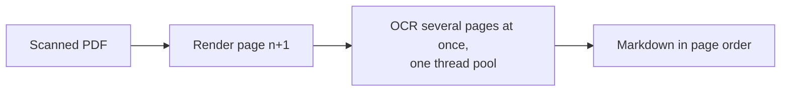
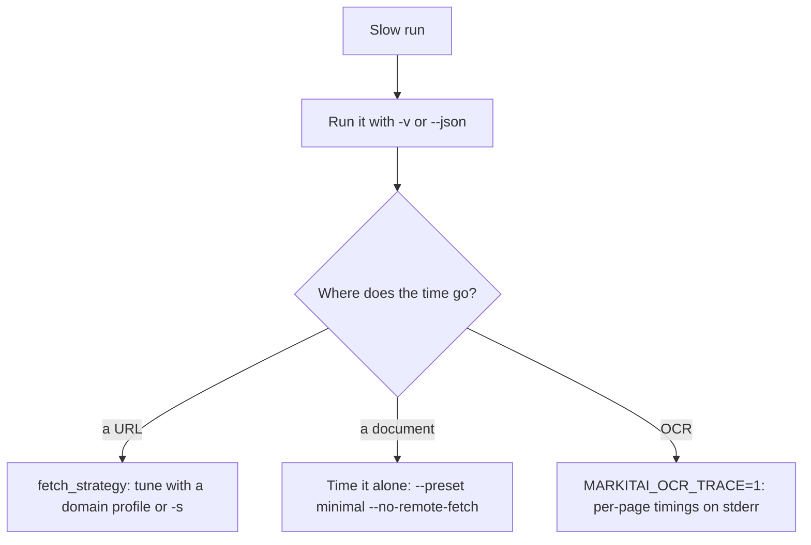

# Conversion performance

## What keeps a run fast

- **One native program**: no interpreter to start and no worker processes; readers, OCR and the browser driver run inside markitai (Chrome, when a page needs it, runs beside it).
- **URLs run local-first**: most articles finish in the static strategy, without a browser; X posts read from X's static page in a second or two ([Fetch Policy](./fetch-policy)).
- **Three separate limits**, so slow model calls never starve file conversion:

| Limit | Default | Set with |
|-------|---------|----------|
| Files converted at once | 10 | `-j`, `batch.concurrency` |
| URLs converted at once | 5 | `--url-concurrency`, `batch.url_concurrency` |
| LLM requests in flight | 10 | `--llm-concurrency`, `llm.concurrency` |

- **Caches** answer repeats: model answers (image analyses included) in `cache.db`, fetched pages in `fetch_cache.db`, and [learned browser domains](./fetch-policy#spa-learning) skip the static try.

| Work | How it runs |
|------|-------------|
| PDF parsing | Files of 256 KiB or more on one thread per core; smaller ones on one thread |
| Local OCR | One thread pool the size of the usable cores (`MARKITAI_OCR_THREADS` sets it); a scan's pages are recognised two to four at a time while the next one renders |
| OCR memory | At most two pages in text detection (the memory-heavy step) at once |
| First OCR | Loads the models once; `markitai serve` loads them at start when they are installed, so its first job does not wait |
| macOS Vision | Its first use compiles the system models (about 20 s) |

The OCR engine gives the same text on one thread or many.

## Understanding a slow run

- `--json` reports each item's `duration_s` and the `fetch_strategy` that won; the Markdown's frontmatter names the strategy too.
- The first `--ocr` downloads its models and the first browser page starts Chrome: time the second run.
- `--no-cache` skips markitai's caches and asks Jina to skip its own; defuddle.md may still answer from a reading up to five minutes old.
- Judge your real workflow with your usual enhancement and OCR options on.
