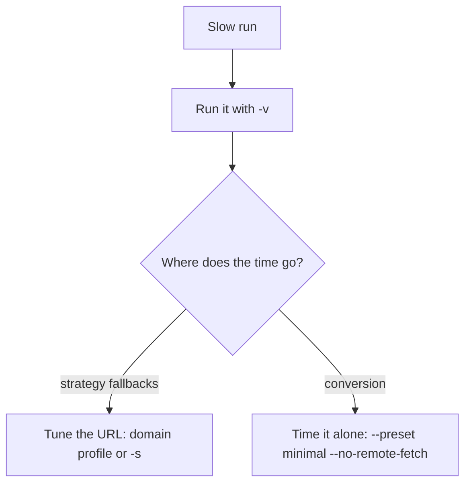

# Conversion performance

## What keeps a run fast

- **URLs run local-first**: short articles and CJK prose usually finish in the static strategy, without a browser ([Fetch Policy](./fetch-policy)).
- **Files load only their format's backend**: plain Office documents take dedicated paths; rich content, equations and ambiguous spreadsheet values keep fallback readers.
- **Long PDFs go to worker processes** (CLI, `markitai serve`, MCP server; a Python script opts in with [`enable_worker_processes()`](./python-api#parallel-pdf-extraction)).
- **LLM batches overlap**: a converted file hands its conversion slot to the next one while it waits on the model.

| PDF workers | Rule |
| --- | --- |
| Count | One per usable core, at most 12, within a quarter of free memory (~450 MB each) |
| `MARKITAI_PDF_WORKERS` | Sets the count (same maximum); `0` or `1` stays in-process |
| Used for | PDFs of 12+ pages, or PDFs converted at the same time |
| Queue | One task per worker plus one waiting: a second PDF waits for a task, not a document |
| OCR | One scanned page per worker, from 4 pages; models load once per worker; pages in flight within half of free memory (~400 MB each) |
| Screenshots | Rendered in the workers (PyMuPDF holds the GIL) |

The output is identical to extracting in one process.

## Recorded results

### Speedup audit (14 September 2026)

macOS, Python 3.12.14, against a frozen pre-optimization snapshot: **6.01×** composite (geometric mean of three equally weighted groups, 49 fixed cases, three fresh processes each; model enrichment, remote fetching and cache off).

| Workload | Speedup |
| --- | ---: |
| Five URL pages over loopback HTTP | 5.83× |
| DOCX, XLSX, PPTX and PDF cold CLI runs | 5.61× |
| 30-file TXT/HTML/DOCX batch | 6.64× |

Output stayed identical: 40 converter and API snapshots, 23 complex tables, 208 web fixtures. These are cold CLI aggregates, not a per-document figure; URL timings exclude internet latency and remote caches, and the baseline already had the Fake-IP and CJK fixes (it is not a released version). Record: [`2026-09-14.json`](https://github.com/Ynewtime/markitai/blob/python/scripts/benchmarks/results/2026-09-14.json); reproduce: [benchmark guide](https://github.com/Ynewtime/markitai/blob/python/scripts/benchmarks/README.md).

### PDF workers and LLM batches (25 September 2026)

Workers run the layout model on one thread each; a page takes about a third of the CPU time. Cold CLI against 1.1.0, 18-core Mac, median of three interleaved runs, cache off:

| Workload | 1.1.0 | 1.2.0 | Speedup |
| --- | ---: | ---: | ---: |
| One 300-page text PDF | 16.6 s | 4.0 s | 4.1× |
| 40 PDFs (5 pages each) | 12.1 s | 2.9 s | 4.1× |
| 240 mixed files (PDF, DOCX, PPTX, XLSX, HTML, CSV) | 12.9 s | 3.9 s | 3.3× |
| 30 documents with `--llm --alt`, 0.5 s model latency | 7.0 s | 4.7 s | 1.5× |

`markitai serve`: the 240 files in one job (up to 1000 items; 1.1.0 needed five) 12.8 s → 4.0 s; thirty documents with `standard` 6.2 s → 3.7 s; API p95 during a 300-page PDF 295 ms → 3 ms. Single small files, OCR and URL batches were unchanged; the gain grows with cores and pages.

### Scanned PDFs with OCR (15 October 2026)

The recognizer takes over 80 % of a page and gains little from many cores, hence one page per worker. An invented 490-page scanned book (Chinese with English and code, six blank pages), `--preset minimal --ocr`, 18-core machine kept busy by other work (load 18–42):

| Run | Before | Now |
| --- | ---: | ---: |
| Workbench job | 497 s | 294 s |
| CLI | 510 s | 288 s |
| CLI CPU time | 6,655 s | about 2,600 s |
| Memory | 2.1 GB | about 6 GB (12 workers) |

The workbench figure includes a Markdown-cleanup fix (50 s on the finished book, holding the server). Pages render at 150 dpi: 120 and 200 dpi read no better, and resolution only affects the small detector step.

### PDF extraction on every core (20 October 2026)

Workers used to be the CPU count minus two (two cores on a 4-core machine). Invented PDFs, cold CLI, 4-core Linux machine shared with other work (interleaved runs; first row at raised priority):

| Workload | Before | Now |
| --- | ---: | ---: |
| 409-page text PDF | 53–55 s | 29–32 s |
| Its CPU time | about 100 s | about 103 s |
| Its peak memory (all processes, PSS) | 0.8 GB | 1.3 GB |
| A 5-page PDF started 3 s into it | 55–65 s | 1.4–4.7 s |
| 166-page PDF with pictures, `--screenshot`: main-process CPU | 6.3 s | 1.0 s |

In one process (onnxruntime over every core) the 409 pages take 101 s and 276 s of CPU. Machines with 14+ cores already had 12 workers. Output is byte-identical.

## Understanding a slow run

- `-v` prints the chosen strategy and why each fallback happened.
- `--no-cache` cannot reach a remote service's cache: a warm remote reader against a fresh local process compares different work.
- Judge your real workflow with your usual enhancement and OCR options on.
