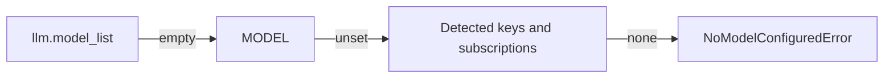

# Python API

`markitai.convert()` and its async twin `markitai.aconvert()` run the CLI's pipeline, LLM enhancement included, and return a typed result. The package is the Rust engine itself, loaded in your Python process: no other dependency, no second process.

::: warning API stability
The Python API is provisional: signatures and fields can change in minor releases. Pin an exact version; the CLI is the stable interface.
:::

Add it to your project (Python 3.10 or later; wheels for macOS 11+, Linux with glibc 2.28+ and Windows, x86-64 and ARM64 each; elsewhere PyPI has nothing to install, not even 1.x, and the release's `markitai-<version>.tar.gz` builds 2.0 with Rust). The [setup script](/guide/getting-started) installs a command, not an importable library:

```bash
uv add markitai   # or: pip install markitai
```

The package also installs the `markitai`, `mkai` and `markitai-mcp` commands.

## Basic Conversion

```python
import markitai

# In memory: get the Markdown string back
out = markitai.convert("report.pdf")
print(out.markdown)

# Write outputs and extracted images to a directory
out = markitai.convert("report.pdf", output_dir="out/")
print(out.output_path)  # out/report.pdf.md
print(out.assets)  # images under out/.markitai/assets/

# URLs work the same way
out = markitai.convert("https://example.com/article")
```

- Without `output_dir` nothing is written: Markdown in memory, `output_path` `None`, `assets` empty, image links left as `.markitai/assets/...`.
- One call converts one file or URL; directories raise `IsADirectoryError` (batches stay with the CLI).
- `stdout` stays clean; notices come back in `out.warnings`.

## LLM-Enhanced Conversion

`llm=True` adds cleanup and frontmatter and returns both variants:

```python
import os
import markitai

os.environ["MODEL"] = "openai/gpt-6-luna"  # or configure llm.model_list

out = markitai.convert("report.pdf", output_dir="out/", llm=True)
print(out.llm_markdown)  # enhanced body
print(out.frontmatter["title"])  # parsed YAML frontmatter
print(out.usage.cost_usd)  # LLM spend for this conversion
```



The model is chosen as in the CLI ([configuration](/guide/configuration), then [detected](/guide/configuration#defaults-markitai-picks-for-you) API keys and signed-in subscriptions); `./.env` and `~/.markitai/.env` are read as the CLI reads them. The CLI's config files are loaded unless you pass a config:

```python
from markitai import MarkitaiConfig

cfg = MarkitaiConfig()  # pure defaults, ignores config files (so does config={})
cfg.llm.pure = True  # raw LLM cleanup, no frontmatter
out = markitai.convert("notes.docx", config=cfg, llm=True)
```

The keywords `llm`, `ocr`, `screenshot`, `alt`, `desc` and `profile` ([Output Profiles](./output-profiles.md)) mirror the CLI flags; `None` keeps the configured value. `config` also takes a plain `dict` in the shape of `markitai.json`. `MarkitaiConfig` checks values when you convert and raises `ValueError` for a bad one.

## Async Usage

Inside an event loop use `aconvert`; the conversion runs in a thread, outside the GIL:

```python
import asyncio
import markitai


async def main() -> None:
    results = await asyncio.gather(
        markitai.aconvert("a.pdf", output_dir="out/"),
        markitai.aconvert("https://example.com/b", output_dir="out/"),
    )
    for out in results:
        print(out.source, "->", out.output_path or len(out.markdown))


asyncio.run(main())
```

- The sync `convert()` raises `RuntimeError` inside a running loop.
- Cancelling an `aconvert` stops the wait; a conversion already running still finishes.

## ConversionOutput

| Field | Type | Description |
|-------|------|-------------|
| `source` | `str` | Input as given |
| `markdown` | `str` | Base body, no frontmatter |
| `llm_markdown` | `str \| None` | Enhanced body, or `None` |
| `frontmatter` | `dict` | Parsed frontmatter |
| `output_path` | `Path \| None` | Written base `.md` file |
| `llm_output_path` | `Path \| None` | Written `.llm.md` file |
| `assets` | `list[Path]` | Extracted images |
| `screenshots` | `list[Path]` | Screenshot files |
| `images` | `list[dict]` | Per-image LLM analysis |
| `usage` | `ConversionUsage` | `cost_usd`, `requests`, tokens, `by_model` |
| `skip_reason` | `str \| None` | `"exists"` when skipped |
| `duration` | `float` | Wall-clock seconds |
| `warnings` | `list[str]` | Notices (below) |
| `page_sources` | `list[dict]` | PDF page text origin (below) |

`warnings`: scanned-looking pages (retry with `ocr=True`), hidden PDF text (possible prompt injection), OCR without text, unrendered slides, a missed URL screenshot, a failed image analysis, or a failed LLM enhancement (`llm_markdown` is `None`; `llm.on_failure = "fail"` raises `ConversionError`).

`page_sources`: one `{"page", "source", "reason"}` per page; `source` is `"text"`, `"ocr"` or `"mixed"`, `reason` a short note such as `"no text layer"`.

### Errors

Failures raise; the markitai ones import from `markitai`. Each carries `.usage` (what the failed call already spent, or `None`):

| Exception | When |
|-----------|------|
| `ConversionError` | Conversion failed, unsupported format (`.code` says which) |
| `FetchError` | URL unreachable |
| `NoModelConfiguredError` | LLM on, no usable model (a `ValueError`; nothing sent) |
| `ConfigFileError` | Invalid config (a `ValueError`) |
| `FileNotFoundError`, `IsADirectoryError` | Bad path |

## Other languages

The same engine is available to Node.js and Go, and to anything that calls C. These bindings are built from a source checkout (Rust 1.92+ and a C toolchain); they are not on npm or the Go module proxy yet.

| Language | Needs | Build | Call |
|----------|-------|-------|------|
| Node.js | 18+ | `npm --prefix bindings/node run build`, then `npm pack` | `const { convert } = require('markitai'); const out = await convert('report.pdf', { llm: false })` |
| Go | 1.23+, cgo; macOS and Linux | `cargo build --release --locked -p markitai-ffi`, then a `replace` to `bindings/go` | `out, err := markitai.Convert("report.pdf", &markitai.Options{LLM: markitai.Bool(false)})` |
| C | a C compiler | `cargo build --release --locked -p markitai-ffi` | `markitai_convert_json()` with the JSON request, then `markitai_buffer_free()` (`bindings/c/markitai.h`) |

Results have the fields above (snake_case in Node.js, typed structs in Go); failures are a `ConversionError` with a `code`. Details: [`docs/bindings.md`](https://github.com/Ynewtime/markitai/blob/main/docs/bindings.md).
