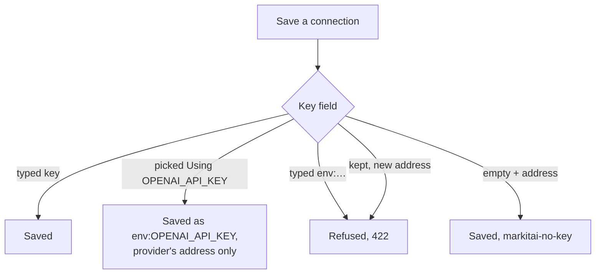
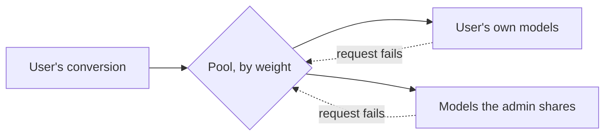

# Web Workspace Reference

The details behind the [web workspace guide](/guide/serve): access rules, user tokens and their models, the settings pages and the API.

## Access Tokens

| Caller | Converts | Sees | Settings |
|--------|----------|------|----------|
| Server (admin) token | files and URLs | every conversion | all |
| User token | files and public URLs, no remote services | its own conversions | Appearance, its own Models and their Edit config |
| No token, this machine included | nothing (401) | nothing | none |
| This machine, `--no-auth` | files and URLs | every conversion | all |
| Other device, `--no-auth` | files only, no URLs | every conversion | none |

- **This machine needs the token too**: any local program, or a page on another `localhost` port, also connects from this machine. Under `--no-auth` a direct connection from this machine (no proxy headers) gets everything, and other devices never reach the settings and token routes; a request whose client address the server can't see counts as another device.
- **A tab without the token** asks for it where it is needed; **Settings → Access token** holds it for that tab. **Sign out of this tab** forgets it there only.
- **Downloads** opened by the browser use a single-use `?ticket=` link that expires after a minute, so the token never appears in a URL, the browser history or the download list.
- **Regenerate token…** (**Settings → Access token**) replaces the token: every other tab and device, this machine included, signs in again, and unused download links stop working. The new token is shown once, with its sign-in link and a QR code, and lasts until the server stops, like the startup token. `MARKITAI_SERVE_TOKEN` keeps one token across restarts instead.
- **Another web origin** cannot change anything: state-changing requests from one are refused, so a random web page cannot drive the server through your browser.

## User Tokens

**Settings → Access token → User tokens** gives another person or device a token of its own: name it and **Create token**. It is shown once, with Copy, its sign-in link and a QR code, then listed by its last characters with when it was last used.

- **Converts** files and URLs, public addresses only: its URLs, and the pictures its documents link to, are never fetched from the server's own network.
- **Never uses a remote service**, whatever `fetch.remote_consent` says: not defuddle.md, Jina Reader or Cloudflare (it cannot choose them as strategy or backend, and they are not its fallback). A remote default strategy of the server runs as `auto` for it, and the item says when a remote fallback was skipped.
- **Sees, downloads, stops, retries and deletes** only its own conversions. The admin sees everyone's.
- **Settings**: Models, Access token and Edit config need the server's token. A tab signed in with a user token says so there and shows Appearance and its [own models](#users-models-and-shared-models), with their Edit config.
- **Revoke** signs it out at once, with its download links and live progress.
- **Storage**: only a SHA-256 digest of each user token is kept, in `~/.markitai/serve/access.json` (readable by your user only, never the config file), so user tokens survive restarts and a regenerated admin token. The server's log names a token by its label, never the token.

## Workspace Details

**Build line.** The sidebar's foot names the server's build: the version beside **Docs**, the commit beside **GitHub** (`-dirty` when built with uncommitted changes), and under them `Build: 20261017 19:54` in your time zone (hover for the full time). On a phone, **Docs** and **GitHub** are the two icons at the right of the top bar, and the Settings page ends with one line: `2.0.1 · b73d56f7 · 20261024 18:38` (version, commit, build time).

**Convert.** Files are staged with upload progress until **Convert**, and may share one submission with URLs. **Upload**'s menu also picks a folder. URLs are checked before anything is sent.

**Options.** They start from the server's defaults: `config.json` over the built-in defaults, for the keys the command line reads too:

`llm.enabled`, `ocr.enabled`, `image.alt_enabled`, `image.desc_enabled`, `screenshot.enabled`, `screenshot.screenshot_only`, `llm.pure`, `cache.no_cache`, `image.compress`, `output.profile`, `fetch.strategy`, `output.format`, `ocr.lang`, `ocr.per_page_routing`, `output.page_markers`

- **Options** opens them in a dialog: the preset, then one row per group with its current value (Enhance, Images, Output with **JSON** for the [document JSON](/guide/cli#format), and under Advanced: URL, Files, Pages, Other). A row opens its choices in place; they apply at once. The local OCR language is under Enhance while OCR runs without LLM.
- A value in full colour, and a dot on **Options**, mean the choices differ from the defaults. The dialog's foot has the command line, **Reset to defaults** and **Save as default**.
- The admin's saved choice goes to `config.json` and applies to the next conversion; a user token's is kept in its own file (**Use the server's defaults** undoes it). Cloudflare is never a default.

**Conversions.** Submissions are named after the folder or `.urls` list they came from. **New conversion** leads back to Convert. To delete several items, check them with the box at the left of a row or a submission's header (the box at the start of the filter row checks everything listed), then **Delete** in the bar that appears and confirm; items still converting cannot be checked.

| Key | In the list |
|-----|-------------|
| Space | Check the focused row |
| Shift | Extend the selection |
| Ctrl/⌘+A | Check every listed row |
| Escape | Clear the selection |

On a phone, tap **Select** first; **Stop remaining** sits in the header of the full-screen window. Stopped items can be retried; the ones already converting finish. A notification fires when a submission finishes in a background tab.

**Conversion window.** Click an item or press Enter on it.

- The header's arrows or ↑/↓ move between items; the expand button (or **F**) fills the browser and back, remembered per browser.
- The header has **Download** (the Markdown; its caret offers JSON, all files as a .zip, or Choose files…) and, when it is the fix, **Retry**, **Add a model** or **Enable OCR and retry**; "⋯" holds **Enhance with LLM**, **Run again**, **Re-convert**, **Retry without LLM** and Delete.
- **Show request options** (under the status line; your browser remembers whether it is open) shows the options as the equivalent command line, with a copy button, and the settings no flag sets (`image.format webp`) as chips: only what differs from the defaults, the server's configuration included. A conversion with LLM also saves the Markdown before LLM, so its command line carries `--keep-base` and reproduces the same files. Jobs from before 2.0.1 show the options their request named.
- Details also shows how long the item is kept and the start of the result, **Rendered** or as **Source** (its first 12 lines, numbered, with the result's line count); clicking it opens Preview in the same view. A failed action shows an error that stays until you close it; a failed rerun that kept the earlier result says so in Details.

**Preview.** "⋯" adds Copy and Export PDF with an optional header and footer. **Files** lists the original, then every result file, each with its own download, and **Download all (.zip)** of the result with its original.

- Pictures at absolute `https://` addresses are drawn without a referrer; other addresses show a labelled placeholder.
- A video written as a linked poster (``; `.mp4`, `.m4v`, `.webm`, `.mov`, `.ogv`) plays in place. Nothing loads until you play it, and one that cannot play turns back into its link.
- A table row broken by a line break left in a cell is put back together (Source keeps the text as written). Large tables show 500 rows first (**Show all rows** adds the rest); code blocks are highlighted.

**Compare.** The original next to the Markdown:

| Original | Shown as |
|----------|----------|
| PDF | Its pages; hovering a heading or table in the Markdown outlines it on the page |
| Image, HTML, text | The document itself |
| Office file | The page screenshots the conversion saved |
| Web page | The page as the server fetched it, in a sandboxed frame, beside its screenshot when one was saved |
| Anything else | **Download the original** |

A web page in Compare:

- shows the site's own pictures, style sheets and fonts (your browser loads them from the site over HTTPS), runs none of its scripts, and opens links in a new tab;
- outlines the counterpart of a hovered heading, paragraph, list item, table or picture on either side, on the page and on its screenshot alike;
- keeps a screenshot whenever the browser loaded it, even if none was asked for: a compare copy, never part of the output, never sent to a model;
- says so and offers to open the page when the site answered with a verification check or a blank page;
- is not kept when it came through Jina, Defuddle or the fetch cache: its screenshot stands in.

**Notices.** Counted on the item and listed in Details; each item gets only its own, and they stay with the job in history. Repeats are grouped and page lists read as ranges (`pages 3–5, 9`). They cover:

- pages that look scanned: a PDF whose pages are at least nine in ten without readable text says "This PDF is scanned: turn on OCR and convert again"; otherwise the pages are named ("Pages 3–5, 9 (4 of 120) have no readable text…");
- hidden PDF text that may be a prompt injection, OCR that found no text;
- slides that couldn't be rendered, a URL screenshot that wasn't captured;
- image analysis that failed and kept the original alt text, an LLM enhancement that failed and left the unenhanced result;
- a model answer that left out or changed too much of the document (the converted Markdown is kept).

A model answer that was requested again and then used is not a notice: nothing is missing, and the cost counts both requests.

**Downloads.** A single file, a submission's zip, or everything with **Download all** in the Conversions "⋯".

## LLM Settings Rules

**Provider picker.** Search by name or model prefix; common providers are tiles, the others sit under filters (Clouds, Inference, Gateways, Local, Subscriptions, Model makers). Each provider shows the address it uses and the key variable it reads. Where a provider publishes no model list, type model IDs.

**Keys from the environment.** A provider key variable set on the server (`OPENAI_API_KEY`, `DEEPSEEK_API_KEY`, `GROQ_API_KEY`, `MOONSHOT_API_KEY`, ... any provider the picker offers) is listed beside the saved connections ("Using OPENAI_API_KEY").

- A connection already using that variable at the provider's own endpoint (a model written into the config without a key, say) stands for it: one row per provider, and its tile reads **Added**.
- Its models are listed with that key from the provider's own endpoint. A model added from it is saved as the reference `env:OPENAI_API_KEY`, never the key; that saved connection then replaces the card.
- The key only goes to its provider's endpoint. For another address, connect the provider with a key you enter.

**Test results.** The API answers with the same category as `reason`, and for a missing key the variable's name as `key_variable`. The provider's own words are under "Provider's message".

| `reason` | Meaning |
|----------|---------|
| `no_key` | The key variable is not set on the server; nothing is sent. Set it where `markitai serve` runs and restart, or add a key to the connection |
| `key_rejected` | HTTP 401/403 |
| `model_not_found` | The provider does not offer the model |
| `rate_limited` | Limiting requests or out of quota |
| `network` | Could not be reached |
| `timeout` | Did not answer in time |
| `provider_error` | Another error |

**Editing a saved key or address.** A key shows masked (`sk…7890`; an `env:` reference as it is): leave the field to keep it, type a new key to replace it, clear it to remove it. A saved API base shows without its credentials (`https://…@proxy.example/v1?api_key=…`): left as shown it keeps the saved address; to change it, type the whole address.

**A key stays with its address**, so the page never sends a key you didn't type to a server you picked:

- To use a refused pairing, enter the key itself with the new address, or write the pair in the config file (`markitai config edit`, or by hand; see [Custom API Endpoint](/guide/configuration#custom-api-endpoint)). Pairs already in the config file keep working from the settings page.
- **`markitai-no-key`** is a placeholder no server accepts as a credential. Without it, markitai would send the server's own key variable (`OPENAI_API_KEY`, `GROQ_API_KEY`, ...) to that address. Servers that check no key (LM Studio, vLLM, llama.cpp) work with it; the page shows such a connection as having no key.
- A connection with a key cannot become one without a key at another address (422): add a new connection for that server.
- Entries you write in the config file yourself are unchanged: one without `api_key` still reads the provider's key variable.

**Cloud logins.** Vertex AI signs in with the server's own Google login (`gcloud auth application-default login`, `GOOGLE_APPLICATION_CREDENTIALS`), which would go to whatever address an entry names, so the page saves and tests it only at Google's own endpoint (422 with an address). **Add models** shows it without an address field; a private endpoint goes in the config file. Amazon Bedrock may take an address: without a key it sends the placeholder there, never the server's AWS credentials.

## Users' Models and Shared Models

**A user's own models.** A user token manages them under **Settings → Models**: the same page without the config file line and detected models, with Add models, Test, Edit, Delete and weights.

- **Weights** are edited in place on every saved row (the admin's too): click, type a whole number from 0 to 100, Enter or leave the field to save, Escape to cancel.
- **Storage**: `~/.markitai/serve/user-models/<token id>.json`, readable by your user only and never the config file, so Edit config and the CLI never see them. Only that user's conversions use them; keys show masked only.
- **Allowed**: a model with the user's own API key, or the address of a server that takes none (stored with `markitai-no-key`); 50 models at most.
- **Refused**: providers that sign in with the server's account or cloud login (Claude Code, Copilot and ChatGPT subscriptions, Vertex AI, Bedrock without a key), `env:` references, and addresses on the server's own machine (`localhost`, `127.0.0.1`, `::1`, `0.0.0.0`; Ollama or LM Studio need an address of the user's own).
- **Public addresses only**: every request for a user's own model (conversions, model discovery, tests) resolves the name when it connects and refuses an address outside the public internet (loopback, private, link-local such as cloud metadata, unique-local), so a name pointing at the server's machine or network fails too. No redirect is followed and no proxy is used. Models the admin shares are not restricted.

**Shared models.** The admin's saved models are **Private** by default; **Shared** lets every user's conversions use one (saved as `"model_info": {"share": "shared"}`). Turning one private applies to the next request.

- Users see a shared model under **Shared by the admin** as model ID, provider and weight only. Its key and address stay on the server, and no failure a user sees names where it is served.
- A user's conversions route over one pool of its own and the shared models by weight; a failed request moves on to another model of the pool. The job shows which model ran and what it cost.
- A user with neither has no LLM options, and a request for one is refused (`llm_unavailable`): the server's environment keys and detected models never serve a user.
- **A user's weight** for a shared row applies to that user's conversions only: 0 turns it off for them, and **Use the admin's N** follows the admin's weight again (kept in the user's file as `shared_weights`).
- **Test** on a shared row runs on the server with the admin's key and address and says only whether it passed and, if not, to tell the admin which model failed, never the provider's words, the address or the key. Because the admin's key pays, a user runs one such test at a time, six a minute at most.

**A user's Edit config** edits its own models as text, with the same masking, check, review and conflict flow as the [admin's page](#edit-config):

- one JSON document: `models` and `providers` (as `llm.model_list` and `llm.providers` would hold them) and `shared` (each shared model with the user's weight);
- the server's configuration file is never shown to or changed by a user, and the rules above apply to what a user saves;
- **Settings → Access token** shows how many models each user has; revoking a token deletes them with their keys (a server stopped meanwhile deletes them at its next start).

## Edit Config

**Settings → Edit config** shows the configuration file the server reads (the one `markitai config` edits) as text.

- **Secrets are masked** as `markitai config list` redacts them: API keys, tokens, passwords, cookies and other values under a secret-sounding key, and every HTTP header value, read `sk…7890`; an `env:` reference shows as it is; a saved address shows without its credentials. A masked value left in place keeps the stored secret; to change one, type the whole new value or an `env:` reference.
- **Saving**: the JSON is checked as you type (with line and column), **Review changes** shows a line diff, and **Save config** writes exactly the reviewed text, keeping layout, key order and line endings (a file written on Windows stays CRLF; the page says so).
- **Conflicts**: if the file changed since the page read it, the save is refused and **Load current file** reads it again.
- Models and connections apply at once; the page says when other changes need a restart.

## API

Errors are JSON `{"detail", "code", "reason"}`: `detail` is an English sentence, `reason` a stable cause such as `llm_unavailable` or `file_too_large`. The OpenAPI document is `GET /api/openapi.json`, behind the same token as the rest.

| Code | When |
|------|------|
| 400 `host_not_allowed` | A `Host` the server does not answer to (add `--allowed-host`) |
| 401 `token_required` | No valid token: none at all, or a revoked or regenerated one |
| 401 `ticket_invalid` | A download ticket that is invalid, expired or already used |
| 422 `invalid_options` | An unknown job option or a value of the wrong type (`invalid_retry_body` on a retry) |
| 422 `invalid_url`, `unsupported_url_scheme` | A URL refused when it is submitted |
| 403 `remote_processing_forbidden` | A user token choosing `jina`, `defuddle` or `cloudflare`; Cloudflare for anyone but the admin |
| 403 `remote_url_forbidden` | A URL from another machine under `--no-auth` |
| 403 `settings_forbidden` | A user token, or another device under `--no-auth`, on the settings and token routes |
| 403 `origin_not_allowed` | A state-changing request from another web origin |
| 403 `user_token_required` | Anyone but a user token on `/api/me/…` |
| 404 `job_not_found` | An unknown or expired job, or one the user token did not create |
| 409 `token_disabled` | A token route under `--no-auth` |
| 409 `batch_pending` | Retrying or enhancing an item still in an `--llm-batch` |
| 413 `file_too_large` | A file over 100 MB |
| 422 `llm_unavailable` | A job asking for LLM processing without a usable model (409 when enhancing an item) |

Cloudflare processing (`strategy` or `backend` `"cloudflare"`) also needs `"remote_processing": "cloudflare"` in the same request's options, as the workbench sends after you confirm; it bills the server's account, so only the admin may use it. `GET /api/capabilities` says who is asking (`access.role`: `admin` or `user`).

| Endpoint | Description |
|----------|-------------|
| `GET /api/capabilities` | Server version and build (`build: {version, commit, built_at, dirty}`), presets, supported features, OCR languages, limits and who is asking |
| `POST /api/jobs` | Create a job (multipart form: `files`, `urls` JSON array, `options` JSON, optional `label`). A `.urls` file becomes URL items. Asking for LLM processing without a usable model is refused (`llm_unavailable`) |
| `GET /api/jobs/{job_id}` | Job status and items (each with its `warnings`, `error_code`, `page_sources` (where each PDF page's text came from; empty for other items) and, when a model ran, `pricing`) |
| `GET /api/jobs/{job_id}/events` | Live progress stream (SSE) |
| `POST /api/jobs/{job_id}/cancel` | Stop the items still waiting to start |
| `POST /api/jobs/{job_id}/items/{item_id}/retry` | Retry an item (JSON body optional: `operation`, `options`; without `options` it reruns with the item's own), or LLM-enhance it with `operation: "enhance"`, which turns the LLM on unless `options` say `"llm": false` |
| `DELETE /api/jobs/{job_id}/items/{item_id}` | Permanently remove an item with its upload, outputs, images and screenshots |
| `GET /api/jobs/{job_id}/items/{item_id}/result` | Item result (`?max_bytes=N` for an excerpt: N is at least 1024, otherwise 422 `invalid_max_bytes`; at most N bytes, cut at a line end when one is near, with `truncated` and the full `markdown_bytes`; a whole result over 64 MiB is 413 `result_too_large`); sibling assets via `GET /api/jobs/{job_id}/files/{path}` |
| `GET /api/jobs/{job_id}/items/{item_id}/document` | The item's [document JSON](/guide/cli#format), kept for every finished item whatever `format` the job asked for (404 `result_unavailable` for an item that failed, was skipped or is not finished). A job with `"format": "json"` also gets `<name>.json` beside the item's Markdown, listed among its files |
| `GET /api/jobs/{job_id}/items/{item_id}/assets/{path}` | One of the item's own extracted images (PNG, JPEG, GIF, WebP, AVIF), inline, for display |
| `GET /api/jobs/{job_id}/items/{item_id}/archive` | Download one item as a zip: its result's files and its original |
| `GET /api/jobs/{job_id}/items/{item_id}/original` | What can be shown of the item's original (for a web page also how usable its copy and screenshot were, `capture`); `/original/file`, `/original/view`, `/original/pages/{n}?width=`, `/original/pages/{n}/text`, `/original/outline` (a PDF's bookmarks) and `/original/blocks` (where a web page's blocks are on its screenshots) serve it |
| `GET /api/jobs/{job_id}/archive` | Download the job as a zip |
| `POST /api/download-tickets` | A single-use, one-minute `?ticket=` link for one download |
| `GET /api/history` | List history entries (`?include=items` adds every item) |
| `GET /api/history/archive` | Download all of history as one zip |
| `DELETE /api/history/{job_id}` | Delete one history entry |
| `POST /api/history/delete` | Delete several jobs and items in one request (`{"jobs": [...], "items": [{"job_id", "item_id"}]}`, up to 1000), each as its single route would; every outcome in the answer |
| `/api/settings/llm*` | LLM provider, model and deployment management |
| `GET`/`PUT /api/convert-defaults` | The options the composer starts from (every caller; `PUT` `{"expected_revision", "defaults"}`: the admin's go to `config.json`, a user token's to its own file, `null` removes them) |
| `GET`/`PUT /api/settings/config` | The config file as text, secrets masked; saved as sent against its `revision` |
| `POST /api/access-token/regenerate` | Replace the server token (admin only) |
| `GET`/`POST /api/access-tokens`, `DELETE /api/access-tokens/{id}` | User tokens (admin only; the list says each one's `model_count`) |
| `/api/me/models*` | A user token's own models, with the suffixes and rules of `/api/settings/llm*`; `PATCH /api/me/models/shared/{id}` sets its weight for a shared model, `POST /api/me/models/test` with `{"shared_id"}` tests one |
| `GET`/`PUT /api/me/config` | A user token's own models as one masked JSON document (`models`, `providers`, `shared`), saved against the Models page's `revision` |
