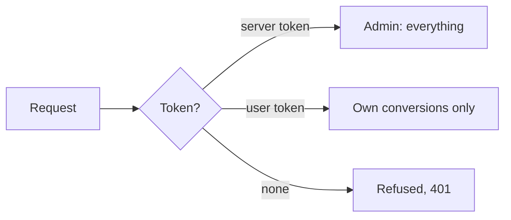
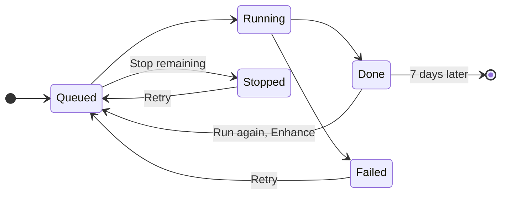

# Web Workspace

`markitai serve` opens a web workbench on your machine: drop in files or a folder, paste links, watch progress, compare each result with its original and download everything. It speaks English, Chinese and Japanese and works on a phone.

Jobs and history stay on disk. Nothing leaves the machine except what goes to the fetch strategies and LLM providers you configure.

{.light-only}
{.dark-only}

## Starting the Server

The workbench is built into `markitai`: nothing else to install.

<!--@include: ../snippets/setup.md-->

```bash
markitai serve
```

The browser opens `http://127.0.0.1:3600` with the access token.

| Flag | Default | Description |
|------|---------|-------------|
| `--host` | `127.0.0.1` | Interface to bind. `0.0.0.0` lets other devices in |
| `--port` | `3600` | Port to listen on (`0`: any free port) |
| `--no-open` | off | Do not open the browser |
| `--no-auth` | off | Disable the access token |
| `--allowed-host <hostname>` | — | Extra hostname to accept when you browse to a DNS name instead of an IP (repeatable) |
| `-c, --config <path>` | — | Another config file, as for conversions |
| `--config-json <json>` | — | Overrides merged over the config file |

One server runs per `~/.markitai`; it prints its address and the folder where jobs are kept.

## Access Token

At startup the server prints a URL ending in `#token=…`; the browser it opens uses it. Every client needs the token, this machine included: open that URL, and have scripts send `Authorization: Bearer <token>`.



- **`MARKITAI_SERVE_TOKEN`** keeps the same token across restarts (set it in the environment, not in `.env`).
- **`--no-auth`** drops the token: this machine gets everything; other devices may upload, download and use history, but submit no URL and reach no settings.
- **Settings → Access token** regenerates the token, signs a tab out, and creates **user tokens** for other people: they convert files and public URLs, see only their own conversions and can bring their own models.

Downloads use single-use links that expire after a minute, so the token never lands in the browser history. Details: [access tokens](/guide/serve-reference#access-tokens) and [user tokens](/guide/serve-reference#user-tokens).

## Accessing from Other Devices

Bind every interface, then open the printed token URL on the phone or laptop:

```bash
markitai serve --host 0.0.0.0
```

Reaching it through a DNS name rather than an IP? Add `--allowed-host convert.example.com`. Unknown hostnames are refused, which blocks DNS-rebinding attacks from web pages.

::: warning
The token URL is a credential. Whoever holds it can run conversions with your LLM providers and read, download or delete history. Share it only with devices you trust.
:::

## The Workspace

| Place | What it does |
|-------|--------------|
| **Convert** | Paste URLs (one per line), drop files or a folder, or **Upload**. Nothing is sent before **Convert**. A `.urls` file is a list of URLs, as on the command line |
| **Options** | Preset, Enhance (LLM, OCR and its language, image analysis), Output (profile, [document JSON](/guide/cli#format)), Advanced (fetch strategy, backend, cache, text only, page markers, OCR on every page), and the equivalent command line to copy. **Save as default** stores your choice |
| **Conversions** | Every item, grouped by submission, live. Filter by name, Failed or Notices; check rows to delete or **Re-convert** several; **Stop remaining** stops what has not started; "⋯" has **Retry failed** and **Download all** |
| **Conversion window** | Click an item: **Preview** (Rendered with tables, math and diagrams, Source, Files, Diff), **Compare** (the original beside the Markdown, with matching parts outlined), **Details** (status, sizes, models, cost, notices) |
| **Settings** | Appearance and language, Models, Access token, Edit config |

In the window, ↑/↓ moves between items, **C** opens Compare, **F** fills the browser and Escape closes it. On a phone the places move to a bottom bar and the window fills the screen.

- **Cost** is shown only when it is known: an unpriced model reads "unknown", never `$0`, and a partly priced item "at least" its amount.
- **Notices** flag what did not fail but deserves a look: pages that look scanned, hidden PDF text, OCR that found nothing, slides that could not be rendered, an LLM step that failed and kept the plain result.
- **Limits**: 1000 items per job, 100 MB per file, 5 GB per upload.

More on each place: [workspace details](/guide/serve-reference#workspace-details).

### Presets, Overrides and Commands

Presets match the CLI:

| Preset | LLM | alt | desc | screenshot | OCR |
|--------|:---:|:---:|:----:|:----------:|:---:|
| `minimal` | – | – | – | – | – |
| `standard` | ✓ | ✓ | ✓ | – | – |
| `rich` | ✓ | ✓ | ✓ | ✓ | – |

No preset turns on OCR: you pick it yourself. Picking a preset resets those five switches; changing one keeps the rest and shows **Custom**.

## LLM Settings

**Settings → Models** edits the same configuration as `markitai config`, for web jobs and later CLI runs alike. **Add models** opens a picker of about 95 providers: enter a key (and an address for a server of your own), then pick models from the provider's list or type their IDs. A key variable set on the server (`OPENAI_API_KEY`, ...) shows up as a ready connection. Stored keys are only ever shown masked (`sk…7890`).

**Test** says why a model failed: no key, key rejected, unknown model, rate-limited, unreachable, timed out, or another provider error, with the provider's own message.

The settings page never sends a key to an address you did not save it with, and never sends the server's own logins anywhere: see [key and address rules](/guide/serve-reference#llm-settings-rules). Subscriptions run through their CLIs on the server's machine; the picker names the command that installs or signs in a missing one ([Claude and Copilot](/guide/subscriptions), [ChatGPT](/guide/subscription-chatgpt)).

**Settings → Edit config** edits the configuration file as text, secrets masked, with a line diff before saving: see [Edit config](/guide/serve-reference#edit-config).

## History



- Finished jobs stay in **Conversions** for 7 days (Details shows the date), through reloads and restarts, under `~/.markitai/serve/jobs/`. Expired files are deleted within the hour.
- CLI runs started with [`--record-history`](/guide/cli#record-history) appear too; Details says "Recorded by: the command line". Their URL items can be retried or enhanced; their file items cannot, because the CLI keeps only the outputs.
- An `--llm-batch` run that stopped waiting lists its pending items as skipped (pending batch). Collect them with the `markitai --llm-batch-collect` command the run printed; the workbench refuses to retry them, which would pay twice.

## API

The workbench runs on a REST + SSE API that scripts call with the same token: `POST /api/jobs` to submit, `GET /api/jobs/{job_id}/events` for progress, `GET /api/jobs/{job_id}/archive` for the zip. The OpenAPI document is `GET /api/openapi.json`. Routes and the main error codes: [API reference](/guide/serve-reference#api).

```bash
curl -H "Authorization: Bearer $MARKITAI_SERVE_TOKEN" \
  -F files=@note.txt -F 'options={}' http://127.0.0.1:3600/api/jobs
```
