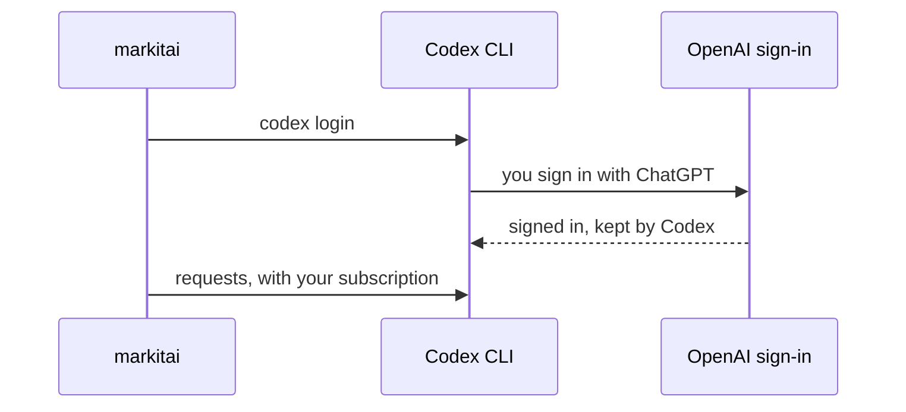

# ChatGPT subscription

markitai can send requests through your ChatGPT subscription instead of an API key, using OpenAI's official Codex CLI. Models are named `chatgpt/<model>`, for example `chatgpt/gpt-6-luna`.

## Install {#install}

Run this on the machine where markitai (or `markitai serve`) runs:

```sh
npm install -g @openai/codex@0.159.0   # Codex CLI 0.159.0 or later
```

## Sign in {#sign-in}

```sh
markitai auth chatgpt login            # runs Codex's own sign-in
```



Codex keeps the sign-in; markitai never reads or copies it, and a 1.x ChatGPT login is not reused. `markitai auth chatgpt status` shows the account (`--json` for scripts); reload the model list in the workbench afterwards. An API-key login of Codex does not count. `CODEX_CLI_PATH` points at another Codex.

| | |
|---|---|
| Models | Any model the installed Codex lists (`codex debug models`); another is refused before any request |
| Default | The lightest model Codex lists: `chatgpt/gpt-6-luna` today |
| Cost | Tokens are counted, the price is unknown; a positive `llm.max_cost_per_document_usd` refuses this route |
| Limits | A rate limit or server error is retried; your plan's usage limit stops the run |

## If it still fails {#troubleshooting}

If the workbench says ChatGPT "is not signed in" after you did sign in, the sign-in expired: run the login again. `markitai auth chatgpt status` shows the Codex release it found and the account; an older Codex than the one under [Install](#install) is refused, and one outside `PATH` needs `CODEX_CLI_PATH`.
