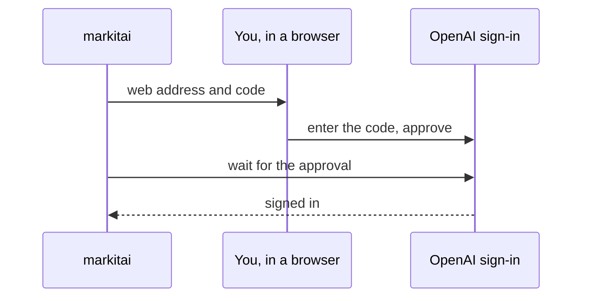

# ChatGPT subscription

markitai can send requests through your ChatGPT subscription (Codex sign-in) instead of an API key. Models are named `chatgpt/<model>`, for example `chatgpt/gpt-6-luna`. There is nothing to install: markitai signs in itself.

Run this on the machine where markitai (or `markitai serve`) runs:

```sh
markitai auth chatgpt login
```



It prints a web address and a code (the OAuth device code flow): open the address in any browser, enter the code, and approve. The first `chatgpt/` request also starts the sign-in if you have not done it. `markitai auth chatgpt status` shows the account; reload the model list in the workbench afterwards.

If the workbench says ChatGPT "is not signed in" after you did sign in, the sign-in expired: run the command again.
