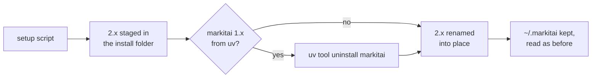

# Upgrading from 1.x

markitai 2.0 is the Python markitai 1.x rewritten in Rust: one native program, no Python to install. The commands (`markitai`, `mkai`, `markitai-mcp`), the configuration file and its keys, and the output layout stay; this page lists what you notice.

## Replace 1.x

Run the setup script. It stages 2.0 first, then removes a Python markitai that uv installed, puts 2.0 in its place and keeps `~/.markitai` (configuration, `.env`, caches, history) as it is:

<!--@include: ../snippets/setup.md-->



| 1.x installed with | Upgrade |
|--------------------|---------|
| The 1.x setup script, `uv tool install` | Run the setup script (above) |
| `pipx install` | `pipx upgrade markitai`, or `pipx uninstall markitai` and the setup script |
| `pip` / `uv add` in a project | `pip install -U markitai`: the 2.0 wheel carries the CLI and the [Python API](/guide/python-api) |

pip, pipx and uv find 2.0 only on the six platforms PyPI has wheels for (macOS 11+, Linux with glibc 2.28+, Windows; x86-64 and ARM64); elsewhere they keep 1.x. If the new files cannot be staged (an unwritable or full folder), the uv-installed 1.x stays.

### Going back to 1.x

[Uninstall](/guide/getting-started#install) 2.0, then install the 1.2.0 release from its tag, with the PDF library version it was released with (a plain `markitai==1.2.0` now resolves pymupdf4llm 2, which breaks its PDF support):

```bash
uv tool install "git+https://github.com/Ynewtime/markitai@v1.2.0#subdirectory=packages/markitai" --with "pymupdf4llm<2"
```

The setup script prints the same command when `MARKITAI_VERSION` names a 1.x release. 1.x history is on the [changelog](/changelog#python-1x).

## What changed

| | 1.x | 2.0 |
|---|---|---|
| Runtime | Python 3.11–3.13 with extras | One executable; the wheel needs Python 3.10+ and nothing else |
| Extras | `ocr`, `serve`, `mcp`, `browser`, ... | Built in; `markitai[serve]` and the others still install, adding nothing |
| Local OCR | RapidOCR (`markitai[ocr]`) | Built in: PaddleOCR models (`markitai doctor --fix` fetches them), or macOS Vision |
| Browser | Playwright and its Chromium | markitai drives Chrome or Chromium itself; `doctor --fix` installs Chrome's headless shell |
| PDF engine | PyMuPDF (AGPL-3.0 or commercial) | Native Rust readers; no AGPL component left ([NOTICE](https://github.com/Ynewtime/markitai/blob/main/NOTICE)) |
| Office page images | LibreOffice, Microsoft Office or PowerPoint | LibreOffice only, on every system |
| ChatGPT subscription | markitai's own device-code sign-in | The official Codex CLI ([ChatGPT](/guide/subscription-chatgpt)); sign in again |
| Windows on ARM | Emulated x64 Python | Native ARM64 build |

### Command line

| Situation | 1.x | 2.0 |
|-----------|-----|-----|
| Usage error (unknown option, missing value) | exit `0` or `1` | exit `2` |
| A picture without `--ocr` or `--llm` | fails, exit `1` | skipped with a warning, exit `0` |
| `--llm` with no usable model | base Markdown, exit `0` | stops before converting, exit `1` (`--dry-run` warns) |
| The `✓ Wrote out/a.md` line | stdout | stderr: stdout holds only the document |
| `doctor --timings`, `doctor --suggest-extras` | available | gone (`--suggest-extras` is refused) |
| `--resume`, `-g`, `--max-depth`, `--llm-batch-timeout` where they do not apply (a single file; `-g`/`--max-depth` on a `.urls` list; `--llm-batch-timeout` without `--llm-batch`) | ignored | the run stops before converting: exit `1` for `--resume`, `2` for the others ([batch options](/guide/cli#batch-options)) |
| `--llm-batch` on anything but a directory | exit `1` | exit `2` |

New: `--text-only` (only the recognised text of pictures and PDFs) and `--page-markers`.

### Output

| | 1.x | 2.0 |
|---|---|---|
| `<!-- Page number: N -->`, `<!-- Slide number: N -->` | always written | off; `--page-markers` or `output.page_markers` keeps them |
| Picture names | `report.docx.0001.png` | by content: `.markitai/assets/510f5d9476ab159c03ccda77.jpg`; PNG and HEIC become `.jpg` while `image.compress` is on |
| Slide images | `deck.pptx.slide0001.jpg` | `deck.pptx.page0001.jpg` |
| Symbolic links in a folder batch | followed | skipped (`skip_reason: "symlink"`); `output.allow_symlinks: true` follows them |
| `.markitai/ownership/` | — | new: records which files markitai wrote, so a rerun never replaces yours |

Read picture names from the Markdown, `images.json` or `-f json` rather than guessing them. The `rag` profile's `<!-- page: N -->` markers are unchanged.

### Configuration

The same `~/.markitai/config.json`, `./markitai.json` and keys. These behave differently (`markitai config validate` warns about the three that have no effect):

| Setting | In 2.0 |
|---------|--------|
| `fetch.remote_consent` | The built-in `always` no longer sends a URL to Defuddle, Jina or Cloudflare when local fetching fails. To keep 1.x's fallback, write it yourself: `markitai config set fetch.remote_consent always` |
| `fetch.fallback_patterns` | The built-in list (x.com, instagram.com, ...) has no effect; a list you write still sends those domains to the browser first |
| `office.macos_fallback`, `batch.heavy_task_limit`, `image.stdout_fetch_external` | No effect; use `-j` / `batch.concurrency` for the second |
| `MARKITAI_PDF_WORKERS`, `MARKITAI_STATIC_HTTP` | Not read: PDFs are read in process, with one HTTP client |
| `MARKITAI_USE_MIRROR`, `MARKITAI_SETUP_LOG`, `MARKITAI_SETUP_MODE` | Gone from the setup script; `MARKITAI_DOWNLOAD_URL` takes a mirror of the releases |

### Web workspace, MCP and Python API

- **`markitai serve`** needs its access token from every client, this machine included (1.x let local scripts in without one). Scripts send `Authorization: Bearer <token>`; `MARKITAI_SERVE_TOKEN` keeps one across restarts ([Web Workspace](/guide/serve#access-token)).
- **MCP clients** launch `uvx --from markitai markitai-mcp`, or the installed `markitai-mcp` ([MCP Server](/guide/mcp)).
- **Python**: `convert()`, `aconvert()`, `ConversionOutput` and the exceptions keep their names and fields. `MarkitaiConfig` is no longer a Pydantic model (a bad value raises `ValueError`); `enable_worker_processes()` and the shutdown helpers remain and do nothing; markitai no longer logs through loguru, its notices are in `warnings` ([Python API](/guide/python-api)).
