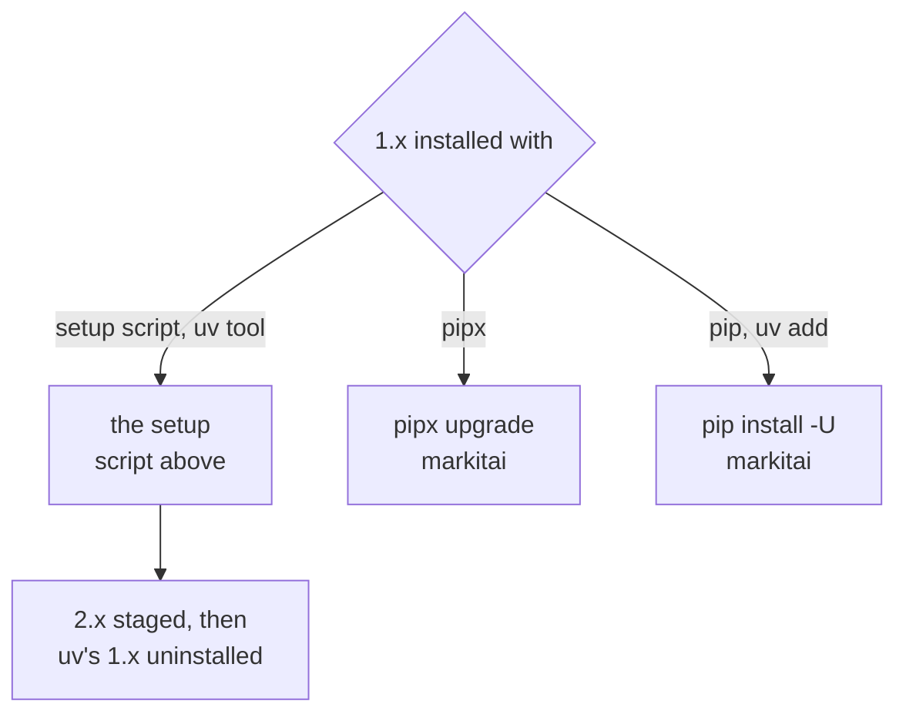

# Upgrading from 1.x

markitai 2.0 is 1.x rewritten in Rust: one native program, no Python, no extras. The commands, `~/.markitai` (configuration, `.env`, caches, history) and the output layout stay.

## Replace 1.x

<!--@include: ../snippets/setup.md-->



pip, pipx and uv get 2.0 only on the platforms with [wheels](/guide/getting-started#install); elsewhere they find nothing (PyPI no longer has 1.x) and leave an installed 1.x as it is.

### Going back to 1.x {#going-back-to-1x}

[Uninstall](/guide/getting-started#install) 2.0, then install 1.2.0 from its Git tag, as setup suggests for a 1.x `MARKITAI_VERSION` (pymupdf4llm 2 breaks its PDFs):

```bash
uv tool install "git+https://github.com/Ynewtime/markitai@v1.2.0#subdirectory=packages/markitai" --with "pymupdf4llm<2"
```

## What to check

### Components

- The extras are built in (`markitai[ocr]` and the others install and add nothing). `markitai doctor --fix` fetches the OCR models (PaddleOCR, not RapidOCR) and, without Chrome or Chromium, Chrome's headless shell (not Playwright).
- PyMuPDF and its AGPL licence are gone ([NOTICE](https://github.com/Ynewtime/markitai/blob/main/NOTICE)); Office page images come from LibreOffice only.
- ChatGPT subscription: sign in again with the Codex CLI ([ChatGPT](/guide/subscription-chatgpt)).

### Command line

- Usage errors exit `2`, as does `--llm-batch` on anything but a directory ([exit codes](/guide/cli#exit-codes)).
- `--resume`, `-g`, `--max-depth`, `--llm-batch-timeout` where they do not apply stop the run instead of being ignored: exit `1` for `--resume`, `2` for the others ([batch options](/guide/cli#batch-options)).
- `--llm` with no usable model stops (exit `1`); a picture without `--ocr` or `--llm` is skipped (exit `0`).
- `✓ Wrote out/a.md` goes to stderr: stdout holds only the document.
- Removed: `doctor --timings`, `doctor --suggest-extras`. New: `--text-only`, `--page-markers`.

### Output

- Page and slide number comments are off; `--page-markers` keeps them (the `rag` profile's `<!-- page: N -->` stay).
- Pictures are named by content (`.markitai/assets/<hash>.jpg`), slides `deck.pptx.page0001.jpg`: take names from the Markdown, `images.json` or `-f json`.
- Folder batches skip symbolic links unless `output.allow_symlinks: true`.
- New: `.markitai/ownership/` keeps a rerun from replacing files markitai did not write.

### Configuration

- `fetch.remote_consent`: a failed local fetch goes to Defuddle, Jina or Cloudflare only after `markitai config set fetch.remote_consent always`.
- `fetch.fallback_patterns`: only a list you write has an effect.
- [No effect](/guide/configuration#settings-without-effect) (`markitai config validate` warns): `office.macos_fallback`, `batch.heavy_task_limit`, `image.stdout_fetch_external`.
- Not read: `MARKITAI_PDF_WORKERS`, `MARKITAI_STATIC_HTTP`, and in the setup script `MARKITAI_USE_MIRROR` (use `MARKITAI_DOWNLOAD_URL`), `MARKITAI_SETUP_LOG`, `MARKITAI_SETUP_MODE`.

### Web workspace, MCP, Python

- `markitai serve` wants its [access token](/guide/serve#access-token) from every client, local scripts too (`Authorization: Bearer <token>`).
- MCP clients launch `uvx --from markitai markitai-mcp` or the installed `markitai-mcp`.
- [Python](/guide/python-api): `convert()`, `aconvert()`, `ConversionOutput` and the exceptions stay. `MarkitaiConfig` is not Pydantic (bad values raise `ValueError`); `enable_worker_processes()` and the shutdown helpers do nothing; notices go to `warnings`, not loguru.
