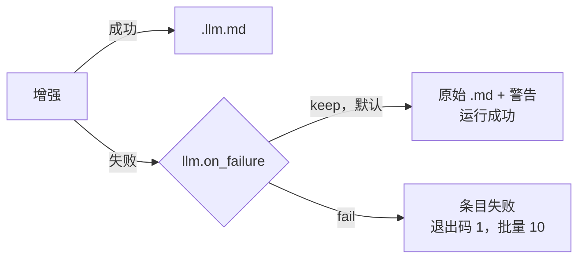
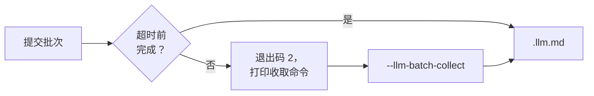
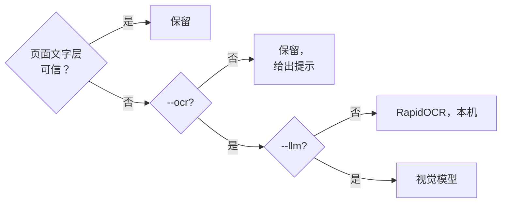

# CLI 命令参考

```bash
markitai <input> [options]
```

输入可以是文件、目录、`.urls` 列表或 URL。`mkai` 是 `markitai` 的短别名。

## 转换选项

| 选项 | 作用 |
|------|------|
| `--llm` | 用 LLM 清洗并生成 frontmatter；只写 `.llm.md` |
| `--keep-base` | 配合 `--llm`，同时写出原始 `.md` |
| `-p, --preset <name>` | `minimal`、`standard`、`rich` 或自定义预设（[预设](#preset)） |
| `--profile <name>` | `rag`、`obsidian` 或 `okf`（[Profile](#profile)） |
| `--alt` | 为图片生成 alt 文本。需要 `--llm` |
| `--desc` | 图片描述写入 `images.json`。需要 `--llm` |
| `--screenshot` | PDF 页面、PPTX 幻灯片或整个网页截成 JPEG |
| `--screenshot-only` | 以截图作为内容来源 |
| `--ocr` | 识别扫描版 PDF 和图片 |
| `--pure` | 不写 frontmatter；带 `--llm` 时模型只清洗文本 |
| `--no-compress` | 图片保持原始尺寸和格式 |

每个开关都有反向写法，用来撤销预设或配置文件打开的功能：`--no-llm`、`--no-alt`、`--no-desc`、`--no-screenshot`、`--no-screenshot-only`、`--no-ocr`、`--no-pure`、`--compress`（`--preset rich --no-desc`）。

::: warning
`--pure` 会覆盖 `--alt`、`--desc` 和 `--screenshot`，并给出警告。
:::

### `--llm` {#llm}

一次调用装不下的长文档会分块增强。社交帖子（X/Twitter 等）正文原样保留，LLM 只写 frontmatter。

增强失败时（key 无效、服务端报错、超时、拒答、结果未增强），由 [`llm.on_failure`](/zh/guide/configuration#路由设置) 决定：



警告写在 stderr 和条目的 `warnings` 里；设为 `"fail"` 时，`--json` 给出 `ok: false`。两种设置下都会写出原始 `.md`。

转换开始前先检查 key：

- `llm.model_list` 中每个模型需要条目里的 key（`api_key`，明文或 `env:VAR_NAME`）或提供商的变量（`DEEPSEEK_API_KEY`、`OPENAI_API_KEY` 等）。没有 key 的模型不参与，警告写明要设的变量；一个模型都不剩时以 `1` 退出，不发任何请求。
- 自带 `api_base` 的 DeepSeek 或 OpenRouter 模型（本地服务、网关）不受此限。
- 提供商拒绝的 key（HTTP 401）只报一次，写明变量名。所有 key 都被拒绝后，本次运行不再发请求。

#### Batch API

`--llm-batch` 把目录批量的增强交给提供商的 Batch API，价格是标价的一半。等待超时、与 API 失联或按 Ctrl-C 时，批次继续在服务端运行：

```bash
markitai docs/ --llm --llm-batch -o out/         # 最多等 --llm-batch-timeout（3600 秒）
markitai --llm-batch-collect <batch-id> -o out/  # 稍后收取转为后台的批次
```



- 需要单个 OpenAI 或 Anthropic 模型（转换前检查），使用它在 `llm.model_list` 里的 `api_key` 和 `api_base`（支持 `env:`），否则用提供商的变量。只提交这次运行转换的文件。
- `--llm-batch-collect` 请传同一个 `-c` 配置；图片结果按提交那次的 `--alt`/`--desc` 写入。
- 图片分析和截图走同一个批次，一次请求装不下的长文档也一样（正文改为实时增强）。缓存已有答案的图片不再发送，但照常写出。
- 不能与 `--ocr`（暂不支持）或 `-f json` 一起用。`--screenshot-only` 的 URL 没有可增强的内容：原样保留，并给出警告。
- 提交失败时没有要收取的东西：条目保留基础 `.md` 并给出警告，`llm.on_failure = "fail"` 时以 `1` 退出。提交成功后，任何让 markitai 无法完成的错误都会让运行失败：批次已经付费。
- `--quiet` 或 `--json` 下也会打印收取命令；同时有条目失败时退出码仍是 `2`（在 `--json` 和 stderr 中报出）。
- `--resume` 跳过仍在未收取批次里的文档（避免重复付费）并打印收取命令；没有结果就结束的批次（failed、expired、cancelled）会释放它们。
- 批次没能分析的图片保留原来的 alt 文本，并给出警告。重复收取不会改动输出。

### 预设 {#preset}

| 预设 | LLM | alt | desc | screenshot | OCR |
|------|:---:|:---:|:----:|:----------:|:---:|
| `minimal` | – | – | – | – | – |
| `standard` | ✓ | ✓ | ✓ | – | – |
| `rich` | ✓ | ✓ | ✓ | ✓ | – |

没有预设会开 OCR。自己的预设写在[配置文件](/zh/guide/configuration#预设)里。

### Profile {#profile}

预设决定跑哪些功能，profile 决定文件长什么样（见[输出 Profile](./output-profiles.md)）：

| Profile | 效果 |
|---------|------|
| `rag` | 可见的 `assets/`，PDF 带 `<!-- page: N -->` 标记，管道表格列数检查 |
| `obsidian` | 可见的 `assets/`，可选的 wikilink 图片引用 |
| `okf` | [Open Knowledge Format](https://github.com/GoogleCloudPlatform/knowledge-catalog) frontmatter |

### 截图

截图放在 `.markitai/screenshots/`。对 URL，`--screenshot` 在需要时切到 `playwright`，按渲染后的样子截图，长页面切成多块（`name.full.jpg`、`name.full--1.jpg`……）；只有查询串不同的 URL 各有各的文件。拍不到截图时（没有 Playwright 或 Chromium、站点拒绝无头浏览器），Markdown 照常写出，并给出警告。

| 输入 | `--screenshot-only` | `--llm --screenshot-only` |
|------|---------------------|---------------------------|
| URL | 只有截图，没有 `.md` | 从截图读出的 `.llm.md` |
| PDF、PPTX | 截图 + 正常抽取的 `.md` | 模型读截图，而不是文字层 |

文本抽取失败的页面（重 JavaScript、canvas 应用）可以用 `--llm --screenshot-only` 兜底。截图失败的 URL 算失败条目。

### `--ocr` {#ocr}



- 本机 OCR 需要 `markitai[ocr]`。带 `--llm` 时页面改发给视觉模型；`MARKITAI_NO_VLM_OCR=1` 强制走本机。
- 正常页面保留文字（标题、列表、表格、图片），OCR 也读其中的图片。PPTX 文字取自文件，OCR 读幻灯片里的图片。
- 读不了的文件直接失败；空白图片照常转换并提示。单张图片需要 `--ocr` 或 `--llm`，否则以 `1` 退出。

#### 读错的 PDF 文字层

markitai 逐页检查提取出的文字：私用区或 `(cid:NN)` 编码、被当成 Windows-1252 读出的 UTF-8（`café`）、顺序颠倒的希伯来文或阿拉伯文，以及编码代表其他字母的旧式字体。

- 不带 `--ocr` 时，这些页面写进扫描页提示：`[PDF] plan.pdf: 2 of 40 pages look scanned/garbled (pages 7–8); consider re-running with --ocr`。
- 带 `--ocr` 时改走 OCR。在此之前先裁出每种字体的几小段交给识别器，揪出看似合理却不对的字母：每个文档每种字体两段，每页最多四段。
- 正常页面（中文、日文、英文、代码、表格、公式）保留文字层。
- 所配 [`ocr.lang`](/zh/guide/configuration#ocr-配置) 读不了的文字保留文字层，提示里写明能读的语言（`… ocr.lang set to ar`）。没有哪种 OCR 语言能读希伯来文。

每个 PDF 结果都带 `page_sources`（`--json`、[Python API](/zh/guide/python-api#conversionoutput)、serve），如 `{"page": 7, "source": "ocr", "reason": "text layer failed the script check: …"}`。`source` 是 `text`、`ocr` 或 `mixed`（文字层加 OCR 过的图片，或视觉模型对照文字层读页面）；`reason` 是简短的英文说明，如 `text layer trusted` 或 `OCR forced by --ocr (ocr.per_page_routing is off)`。`--verbose` 在日志里列出没被直接信任的页面。

#### PDF 里的数学公式

| 运行方式 | 公式变成 |
|----------|----------|
| `--ocr --llm` | 行内公式成为 `$...$` LaTeX |
| `--alt` 或 `--desc` | 独立公式是图片，LaTeX 进 `images.json` |
| 都不带 | 独立公式保持图片，行内公式留作噪声 |

网页不需要模型：MathJax 和 MathML 直接转成 `$...$` 和 `$$...$$`。

## 输出选项

| 选项 | 作用 |
|------|------|
| `-o, --output <path>` | 目录（批量必须用目录），单个输入也可以是 `.md` 文件。不带时单个输入打印到 stdout |
| `--json` | 在 stdout 打印一份 JSON 结果，不显示进度。需要 `-o` |
| `-f, --format <name>` | `markdown`（默认，也可写 `md`）或 `json` |
| `--resume` | 继续被中断的批量 |
| `--record-history` | 把这次运行记入网页工作台的历史 |

### `--json` {#json}

```bash
markitai ./docs -o out --json | jq '.items[] | select(.status == "failed")'
```

| 字段 | 内容 |
|------|------|
| `items[]` | `source`、`status`、`output`、`error`、`warnings`、`cost_usd`、`duration_s`、`fetch_strategy`、`screenshots`、`llm_usage`、`page_sources` |
| `error` | 运行级错误，否则为 `null` |
| `batch` | `--llm-batch` 转为后台后为 `{id, status, collect_command}`，否则为 `null` |
| `totals` | 按状态计数、`cost_usd`、`this_run_cost_usd`、`duration_s` |
| `ok` | 有条目失败或 pending，或设了 `error` 时为 `false` |

顶层还有 `version`。

- `status` 是 `completed`、`failed`、`skipped` 或 `pending`：`pending` 是仍在批次里的 `--llm-batch` 条目，基础 `.md` 已写出。
- `warnings` 列出没让条目失败的问题：图片分析或截图失败，以及 stderr 上的提示（疑似扫描页、隐藏文字）。
- 没有价格的模型在 `llm_usage` 里记 `unpriced_requests`，`cost_usd` 只含有价格的请求：费用未知，不是零。
- `--resume` 之后（`--llm-batch` 除外），之前完成的条目排在前面，带 `earlier_run: true` 和当时记下的费用、用量与耗时；`totals.cost_usd` 是整个批量，`this_run_cost_usd` 是这次运行。

部分失败的批量以 `10` 退出并照常打印 JSON：也要看 `ok`。用法错误只在 stderr 报，不输出 JSON。不能与 `--dry-run` 或 `--llm-batch-collect` 一起用。

### `-f, --format <markdown|json>` {#format}

`json` 另把每个文档写成一个带版本号的 JSON 对象，供不想解析 Markdown 的脚本使用。它与 markitai-rust 写出的文档相同（`schema_version` 为 `1.0`；每个键都在，不适用时为 `null`）。

```bash
markitai report.pdf -f json                    # 文档输出到 stdout
markitai report.pdf -f json -o out/            # out/report.pdf.json，写在 out/report.pdf.md 旁
markitai report.pdf -f json -o out/result.json # out/result.json 和 out/result.md
markitai ./docs -f json -o out/                # 每个文件一个 JSON，另写 out/markitai.index.json
```

- Markdown 照常写出（续跑、报告和历史都用它）；图片指向同一批 `.markitai/assets/`。`on_conflict: rename` 时，已存在的 JSON 也算占用文件名。
- `markitai.index.json` 列出每个条目（`source`、`status`、`document`、`markdown`、`error`、`skip_reason`）；之后写入同一目录的运行保留它没转换的条目。
- 不能与 `--llm-batch` 一起用。与 `--json` 可同用：`-f json --json -o out/`。`markitai serve` 为每个条目保留这份文档（`GET /api/jobs/{job_id}/items/{item_id}/document`）。

::: details 文档的键
`schema_version`、`tool`、`source`（`kind`、`path`、去掉凭据的 `url`、`name`、`type`、`size`、`sha256`）、`status`、`skip_reason`、`title`、`properties`（frontmatter）、`markdown`（`base`、`llm`）、`text`、`pages[]`（`number`、`text`、`markdown`、`images`、`screenshot`）、`images[]`（`path`、`alt`、`description`、`text`、`page`）、`tables[]`（`page`、`header`、`rows`）、`notices[]`（`code`、`level`、`message`、`items`）、`usage`、`timings`、`outputs`。
:::

### `--resume` {#resume}

```bash
markitai ./docs -o ./output --resume
```

- 跳过已完成的条目，重试失败和中断的，捡起新文件。适用于目录和 `.urls` 列表；Ctrl-C 时也会保存进度。
- 重试的条目覆盖自己的输出（不再多出 `.v2`）。没记下输出名的条目按 `output.on_conflict` 处理，不会覆盖不是这次批量写的文件。
- 状态记的是绝对路径：换个目录也能继续（`markitai ../docs -o ../output --resume`）。
- 设置不同的运行（`--llm`、`--ocr`、`--screenshot`、`--alt`、`--desc`、`--pure`、`--keep-base`、`--screenshot-only`、`output.profile`、`-s`）各有自己的状态。

::: details 续跑后的费用
状态记下每个条目的费用，摘要行同时给出整个批量和这次运行（`Done: 9 files, 2 URLs (1:23, $0.094 total, $0.067 this run)`）。`.markitai/reports/*.report.json` 里，之前完成的条目带 `earlier_run: true`，目录批量还保留那次运行的 `started_at`、`completed_at`、`duration`、`cost_usd` 和 `llm_usage`。`llm_usage` 是整个批量的合计，续跑后另有 `this_run` 块。`summary` 计数覆盖整个批量；`summary.duration` 和 `started_at` 是这次运行的；`summary.processing_time` 是所有条目耗时之和。旧版本写的状态没有费用：`llm_usage.usage_unknown_items` 统计这些条目，它们的 `cost_usd` 为 `null`，摘要写 `cost of earlier runs unknown`。被 Ctrl-C 打断的条目会重新转换，只算一次。
:::

### `--record-history` {#record-history}

把这次运行记入[网页工作台](/zh/guide/serve#历史记录)的历史（带 CLI 徽标，保留七天）。优先级：`--record-history` / `--no-record-history`、`MARKITAI_RECORD_HISTORY`、`history.record`、默认关闭。stdout 模式不记录；记录失败不影响转换。

## 批量选项

| 选项 | 默认 | 作用 |
|------|------|------|
| `-j, --batch-concurrency <n>` | 10 | 同时转换的文件数 |
| `--url-concurrency <n>` | 5 | 同时抓取的 URL 数，独立的并发池 |
| `--llm-concurrency <n>` | 10 | 同时发出的 LLM 请求数 |
| `-g, --glob <pattern>` | — | 只转换匹配的相对路径；可重复，`!` 表示排除 |
| `--max-depth <n>` | 5 | 目录扫描深度；`0` 只扫顶层 |
| `--llm-batch` | 关闭 | 使用 [Batch API](#batch-api) |
| `--llm-batch-timeout <s>` | 3600 | 转为后台前的等待秒数（至少 60） |
| `--llm-batch-collect <id>` | — | 收取批次；`-o` 指向原输出目录，不需要输入 |

部分成功的批量保留成功的结果，以 `10` 退出。

```bash
markitai ./docs -o ./output -j 4 -g "*.pdf" -g '!drafts/**'   # ! 模式用单引号
```

点文件、点目录（`.git`、`.venv`）、`node_modules` 和 Office 锁文件（`~$report.docx`）永远不转换，除非模式写出了它们（`-g '.notes/**/*.md'`），或直接对该目录运行。

### `.urls` 文件

`.urls` 文件是一个 URL 批量，在目录批量里也会被捡起：一行一个 URL，空格后可跟输出名，`#` 开头为注释。也可以是元素为字符串或 `{"url", "output_name"}` 对象的 JSON 数组。

```text
https://example.com/page1
https://example.com/page2 custom_name
```

每行都是独立条目，`--resume` 也按行记录；URL 和输出名都重复的行会被跳过并给出警告。

## 缓存选项

| 选项 | 作用 |
|------|------|
| `--no-cache` | 不读缓存的 LLM 结果和页面（仍会写入）；`--cache` 撤销配置文件的设置 |
| `--no-cache-for <patterns>` | 对匹配的文件、URL 或 glob 跳过缓存（逗号分隔） |

URL 模式依次匹配完整 URL、去掉协议的 URL、主机名和最后一段路径：`"https://example.com/*"`、`"example.com/docs/*"`、`"*.example.com"`、`"*.pdf"`。

## 抓取与后端

| 选项 | 作用 |
|------|------|
| `-s, --strategy <name>` | 怎么抓 URL（见下表；顺序见[抓取策略](/zh/guide/fetch-policy)） |
| `-b, --backend <name>` | 文件：`native`（默认）或 `cloudflare`（Workers AI `toMarkdown`，需要 Cloudflare 凭据） |
| `--no-remote-fetch` | 绝不把 URL 发给 Defuddle、Jina 或 Cloudflare（`MARKITAI_NO_REMOTE_FETCH=1`） |

| 策略 | 做什么 |
|------|--------|
| `auto`（默认） | 按策略顺序，本机优先 |
| `static` | 普通 HTTP；不跑 JavaScript，不出本机 |
| `playwright` | 浏览器渲染；需要 `markitai[browser]` |
| `defuddle` | Defuddle API，免费，无需 key |
| `jina` | Jina Reader，需要 `JINA_API_KEY` |
| `cloudflare` | Browser Rendering，需要 `CLOUDFLARE_API_TOKEN` 和 `CLOUDFLARE_ACCOUNT_ID`（[设置](/zh/guide/configuration#cloudflare-设置)） |

内置转换器对某种格式做得更好时，`-b cloudflare` 会提醒。`--quiet` 会压掉同意询问，所以在 `fetch.remote_consent=ask` 下静默运行会跳过远程服务并说明（[抓取策略](/zh/guide/fetch-policy#remote-fallback-and-local-only-urls)）。

### 已移除的旧后端参数

1.0.0 已移除；传入会报用法错误，并写明替代写法：

| 已移除 | 改用 |
|--------|------|
| `--playwright` | `-s playwright` |
| `--defuddle` | `-s defuddle` |
| `--static` | `-s static` |
| `--jina` | `-s jina` |
| `--cloudflare` | `-s cloudflare`（文件再加 `-b cloudflare`） |
| `--kreuzberg` | 无；`.rtf` 已由内置转换器处理 |

## 其他选项

| 选项 | 作用 |
|------|------|
| `-q, --quiet` | 只显示错误、stdout 里的 Markdown 和远程抓取提示。单个文件或 URL 默认就是安静的 |
| `-v, --verbose` | 显示进度和诊断细节，单个转换也显示（输出到 stdout 时无效） |
| `--log-level <level>` | 日志文件级别，`DEBUG` … `CRITICAL`；需要设 `log.dir` |
| `--dry-run` | 只显示会转换什么 |
| `-c, --config <path>` | 使用这个配置文件；文件必须存在 |
| `--config-json <json>` | 合并到配置文件之上的覆盖；显式参数仍优先 |
| `-I, --interactive` | 引导式转换 |
| `-V, --version` | 版本 |
| `-h, --help` | 帮助，子命令也可用（`markitai config -h`） |

`-c` 写在子命令前面时作用于该子命令；`config set` 和 `config edit` 会创建不存在的文件（`markitai -c ./my.json config set llm.enabled true`）。`--config-json` 也作用于 `config list`/`get`/`path`、`cache` 和 `doctor`；`config set` 与 `config edit` 拒绝它。

## 退出码

| 码 | 含义 |
|----|------|
| `0` | 成功，包括 `--dry-run` |
| `1` | 单个条目失败、运行时错误，或输入在开始前被拒绝（文件不存在或不支持、`--llm-batch` 未配 `--llm`） |
| `2` | 用法错误，或 Batch API 转为后台、需要 `--llm-batch-collect`；优先于 `10` |
| `10` | 批量部分失败；成功的条目保留 |

## 终端输出

符号：`✓` 成功、`!` 警告、`✗` 错误、`•` 信息、`→` 下一步、`○` 有意跳过。管道输出和 `NO_COLOR` 去掉颜色，保留符号。显示不了时改用 ASCII 符号（`+ ! x - > o`）；一次运行始终只用一套。

::: details 何时用 ASCII，以及 Windows PowerShell 5.1
以下情况用 ASCII：`TERM=dumb`；输出编码写不出这些符号（非 UTF-8 的 locale、`PYTHONIOENCODING=ascii`）；不能处理转义序列的 Windows 控制台（Windows 10 1511 之前，或开启了“使用旧版控制台”）；以及 Windows 上控制台代码页不是 UTF-8（65001）时的管道和文件。Windows Terminal、VS Code、SSH、当前的控制台主机、mintty（Git Bash）和没有控制台的输出都显示 Unicode。

PowerShell 5.1 按控制台代码页（英文系统为 437）解码管道输出，`✓` 会变成 `Γ£ô`。捕获输出前先执行（cmd 用 `chcp 65001`）：

```powershell
[Console]::OutputEncoding = [Text.Encoding]::UTF8
markitai doctor | Out-File -Encoding utf8 doctor.txt
```
:::

## 命令

### `markitai init`

引导式配置：检查依赖、检测提供商、写出配置文件。

| 命令 | 作用 |
|------|------|
| `init` | 交互式 |
| `init --yes`（`-y`） | 全用默认值，不询问 |
| `init --local` | 写 `./markitai.json`，而不是 `~/.markitai/config.json` |
| `init -o <path>` | 写到这个路径 |

### `markitai config`

| 命令 | 作用 |
|------|------|
| `config list` | 生效的配置，密钥已打码；`-f, --format` 为 `json`（默认）、`table` 或 `yaml`（需要 PyYAML） |
| `config get <key>` | 读一个值（`config get llm.enabled`） |
| `config set <key> <value>` | 写一个值 |
| `config path` | 配置文件的位置和优先级 |
| `config edit` | 引导菜单 |
| `config validate [file]` | 校验配置文件 |

`list`、`get` 和 `set` 接受 `--show-secrets`。

::: warning
`--show-secrets` 只用于本机查看：不要把它的输出贴到 issue、聊天或 CI 日志里。
:::

### `markitai cache`

| 命令 | 作用 |
|------|------|
| `cache stats` | LLM 缓存（`cache.db`）和 URL 缓存（`fetch_cache.db`）的大小；`--json`；`-v, --verbose` 按模型列出，`--limit <n>`（20） |
| `cache clear` | 清空两者；`-y, --yes`；`--include-spa-domains` |
| `cache spa-domains` | [学到的 SPA 域名](/zh/guide/fetch-policy#spa-学习)；`--json`、`--clear` |

### `markitai doctor`

检查安装、可选能力、LLM 配置和登录状态；缺少可选工具只是警告。

| 命令 | 作用 |
|------|------|
| `doctor --fix` | 已装 Playwright 时安装 Chromium；从不安装 Python 包（缺 Playwright 时提示带 `markitai[browser]` 重装） |
| `doctor --json` | 机器可读（不能与 `--fix` 同用） |
| `doctor --suggest-extras` | 这台机器能用上的 extras |
| `doctor --timings` | 在 stderr 列出启动和各项检查的用时（任何命令：`MARKITAI_TIMINGS=1`） |

- 配置了却跑不起来时以非零退出：无法启动的 Playwright 策略、没有 key 的模型（条目或变量，如 `DEEPSEEK_API_KEY`）、没登录的提供商。
- 最后一行是 `Ready`（列出不可用的能力）或 `Not ready`（列出要修复的项）。提示都是适用于这台机器的命令；已设置但没用到的 key 列在 LLM 一节。
- 各项检查并行；终端里有一行显示仍在进行的检查。成功启动过的 Chromium 记住一周（同一个 Chromium、Playwright、Python）；`--fix` 总会启动它。

### `markitai auth`

单独运行 `markitai auth` 显示总览。

| 命令 | 作用 |
|------|------|
| `auth claude status` / `login` | Claude Code（运行 `claude auth login`） |
| `auth copilot status` / `login` | Copilot CLI（运行 `copilot login`） |
| `auth chatgpt status` / `login` | ChatGPT，设备码登录 |

`status` 接受 `--json`。Gemini 没有登录流程：用 key 或 OpenRouter（[模型命名](/zh/guide/configuration#模型命名)）。

### `markitai serve`

在 `http://127.0.0.1:3600` 启动[网页工作台](/zh/guide/serve)并打开浏览器。需要 `markitai[serve]`。

| 参数 | 默认值 | 作用 |
|------|--------|------|
| `--host <interface>` | `127.0.0.1` | 其他设备访问用 `0.0.0.0`（需要启动时打印的令牌） |
| `--port <n>` | `3600` | 端口 |
| `--no-open` | 关闭 | 不打开浏览器 |
| `--no-auth` | 关闭 | 不用令牌；其他机器不能提交 URL，也不能改 LLM 设置 |
| `--allowed-host <hostname>` | — | 放行这个域名（可重复） |

### `markitai mcp`

通过 stdio 启动 [MCP 服务器](/zh/guide/mcp)。需要 `markitai[mcp]`。
