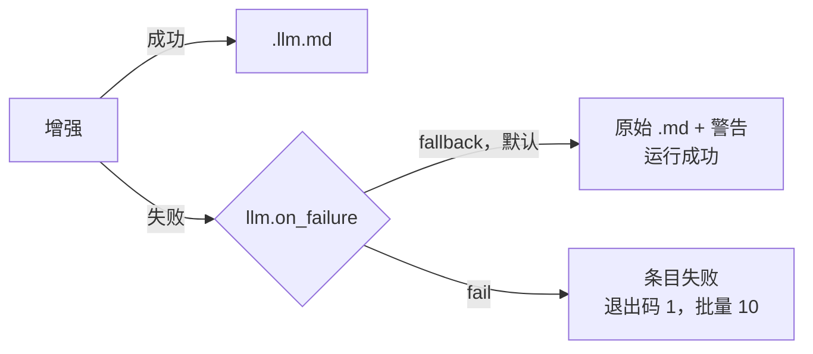
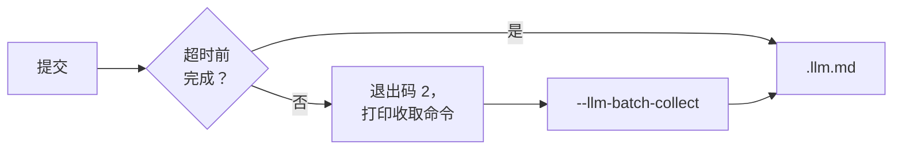
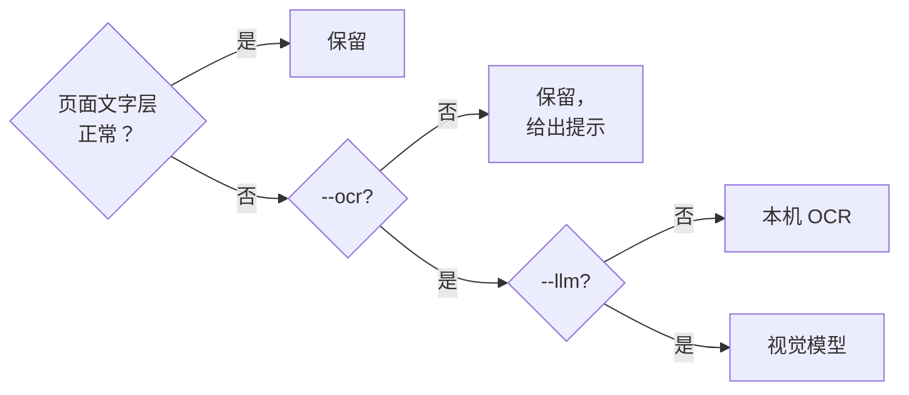

# CLI 命令参考

```bash
markitai <input> [options]
```

输入可以是文件、目录、`.urls` 列表、URL 或 `.numbers` 包。`mkai` 是 `markitai` 的短别名；`markitai --help` 和 `markitai <command> --help` 列出下面的全部内容。

## 转换选项

| 选项 | 作用 |
|------|------|
| `--llm` | 用 LLM 清洗并生成 frontmatter；只写 `.llm.md` |
| `--keep-base` | 配合 `--llm`，同时写出原始 `.md` |
| `-p, --preset <name>` | `minimal`、`standard`、`rich` 或自定义预设（[预设](#preset)） |
| `--profile <name>` | `rag`、`obsidian` 或 `okf`（[Profile](#profile)） |
| `--alt` | 为图片生成 alt 文本。需要 `--llm` |
| `--desc` | 图片描述写入 `images.json`。需要 `--llm` |
| `--screenshot` | PDF 和 Office 文件的页面图片，或整个网页，存为 JPEG |
| `--screenshot-only` | 以截图作为内容来源 |
| `--ocr` | 识别扫描版 PDF 和图片 |
| `--pure` | 不写生成的 frontmatter；带 `--llm` 时模型只清洗文本 |
| `--text-only` | 图片和 PDF：只要识别出的文字，不要 frontmatter、标题、图片链接或描述 |
| `--no-compress` | 图片保持原始尺寸和格式 |

每个开关都有反向写法，用来撤销预设或配置文件打开的功能：`--no-llm`、`--no-alt`、`--no-desc`、`--no-screenshot`、`--no-screenshot-only`、`--no-ocr`、`--no-pure`、`--no-text-only`、`--compress`（`--preset rich --no-desc`）。同一对开关以最后一个为准。

### `--llm` {#llm}

一次调用装不下的长文档会分块增强。增强失败时（key 无效、服务端报错、超时、拒答），由 [`llm.on_failure`](/zh/guide/configuration#llm-requests) 决定：



警告写在 stderr 和条目的 `warnings` 里。转换开始前先检查 key：

- `llm.model_list` 中每个模型需要条目里的 key（`api_key`，明文或 `env:VAR_NAME`）或提供商的变量（`DEEPSEEK_API_KEY`、`OPENAI_API_KEY` 等）。没有 key 的模型不参与，警告写明要设的变量；一个模型都不剩时以 `1` 退出，不发任何请求（`--dry-run` 只警告）。
- 自带 `api_base` 的模型（本地服务、网关）总会尝试。
- 提供商拒绝的 key 只报一次，写明变量名；所有 key 都被拒绝后，本次运行不再发请求。

#### Batch API {#batch-api}

`--llm-batch` 把目录批量的增强交给 OpenAI 或 Anthropic 的 Batch API，价格约为标价的一半。等待超时或被中断时，批次仍在服务端继续运行：

```bash
markitai docs/ --llm --llm-batch -o out/         # 最多等 --llm-batch-timeout（3600 秒）
markitai --llm-batch-collect <batch-id> -o out/  # 稍后收取转为后台的批次
```



- 需要 `--llm`、目录输入和单个 OpenAI 或 Anthropic 模型；`--llm-batch-timeout` 至少 60 秒。
- 只处理文本：不能与 `--pure`、`--ocr`、`--screenshot`、`--alt` 或 `--desc` 一起用，也不用于需要不止一次请求的文档。
- 收取后，失败的条目照常算失败（批量退出码 `10`）；仍未完成的批次以 `2` 退出并打印收取命令，`--quiet` 或 `--json` 下也一样。
- `--llm-batch --resume -o out/` 继续该目录里未完成的批次；普通的 `--resume` 拒绝批次尚未收取的目录，因此不会重复付费。

### 预设 {#preset}

| 预设 | LLM | alt | desc | screenshot | OCR |
|------|:---:|:---:|:----:|:----------:|:---:|
| `minimal` | – | – | – | – | – |
| `standard` | ✓ | ✓ | ✓ | – | – |
| `rich` | ✓ | ✓ | ✓ | ✓ | – |

没有预设会开 OCR。写在预设之后的参数仍然生效。在[配置文件](/zh/guide/configuration#presets)里定义自己的预设，或重新定义这几个。

### Profile {#profile}

预设决定跑哪些功能，profile 决定文件长什么样（见[输出 Profile](./output-profiles.md)）：

| Profile | 效果 |
|---------|------|
| `rag` | 可见的 `assets/`，PDF 带 `<!-- page: N -->` 标记，管道表格列数检查 |
| `obsidian` | 可见的 `assets/`，可选的 wikilink 图片引用 |
| `okf` | [Open Knowledge Format](https://github.com/GoogleCloudPlatform/knowledge-catalog) frontmatter |

`--page-markers` 在任何输出里保留原样的 `<!-- Page number: N -->` 和 `<!-- Slide number: N -->` 注释（默认关闭，即 `output.page_markers`；`--no-page-markers` 再次去掉）。

### 截图

截图放在 `.markitai/screenshots/`：PDF 页面、Office 页面和幻灯片（`deck.pptx.page0001.jpg`）；URL 则是 Chrome 渲染出的页面，长页面切成多块（`name.full.jpg`、`name.full--1.jpg`……）。

| 需要 | 何时 |
|------|------|
| Chrome 或 Chromium | URL（`markitai doctor --fix` 会安装 Chrome 的 headless shell） |
| LibreOffice | Word、Excel 和 PowerPoint 页面；没有它时文字照常转换，并给出警告 |

| 输入 | `--screenshot-only` | `--llm --screenshot-only` |
|------|---------------------|---------------------------|
| URL | 只有截图，没有 `.md` | 从截图读出的 `.llm.md` |
| PDF、Office | 截图 + 抽取出的 `.md` | 模型读截图，而不是文字层 |

文本抽取失败的页面（重 JavaScript、canvas 应用）可以用 `--llm --screenshot-only` 兜底。截图失败的 URL，或没有 LibreOffice 时的 Office 文件，算失败条目。

### `--ocr` {#ocr}



- 本机 OCR 在 markitai 内部运行 PaddleOCR 模型；第一次 `--ocr` 时下载（约 45 MB），也可以用 `markitai doctor --fix` 预先准备。macOS 上 `MARKITAI_OCR_BACKEND=vision` 改用系统的 Vision；在 macOS 15 上，Vision 可能用中文识别器读日文，读日文图片时请设 `ocr.lang: ja`。
- 带 `--llm` 时页面交给视觉模型；`MARKITAI_NO_VLM_OCR=1` 在本机做 OCR，只发送文字。
- 正常页面保留文字（标题、列表、表格、图片）。读不了的文件直接失败；空白图片照常转换并给出提示。单独一张图片需要 `--ocr` 或 `--llm`，否则跳过（退出码 `0`）。

#### 读错的 PDF 文字层 {#pdf-text-layers-that-read-wrong}

markitai 逐页检查提取出的文字：私用区或 `(cid:NN)` 编码、被当成 Windows-1252 读出的 UTF-8（`café`）、顺序颠倒的希伯来文或阿拉伯文，以及编码代表其他字母的字体。

- 不带 `--ocr` 时，这些页面写进扫描页提示：`PDF pages 7–8 (2 of 40): native text was not recovered (…); OCR is required to read them. Run again with --ocr.`
- 带 `--ocr` 时这些页面改走 OCR。通过检查的文字层还会与字形实际画出的内容对照：每个文档每种字体裁两小段，每页最多四段。
- 正常页面（中文、日文、英文、代码、表格）保留文字层。

每个 PDF 结果都带 `page_sources`（`--json`、[Python API](/zh/guide/python-api#conversionoutput)、serve），如 `{"page": 7, "source": "ocr", "reason": "text layer failed the script check: …"}`。`source` 是 `text`、`ocr` 或 `mixed`（文字层加 OCR 过的图片，或视觉模型对照文字层读页面）。

网页里的数学公式不需要模型：MathJax、KaTeX 和 MathML 直接转成 `$...$` 和 `$$...$$`。

## 输出选项

| 选项 | 作用 |
|------|------|
| `-o, --output <path>` | 目录，单个输入也可以是 `.md` 文件。不带时单个输入打印到 stdout；批量用 `output.dir` |
| `--json` | 在 stdout 打印一份 JSON 结果，不显示进度。需要 `-o` |
| `-f, --format <name>` | `markdown`（默认，也可写 `md`）或 `json` |
| `--page-markers` | 保留页码和幻灯片编号注释（[Profile](#profile)） |
| `--dry-run` | 列出输入及其最终输出名；不做转换 |
| `--resume` | 继续被中断的批量 |
| `--record-history` | 把这次运行记入网页工作台的历史 |

### `--json` {#json}

```bash
markitai ./docs -o out --json | jq '.items[] | select(.status == "failed")'
```

| 字段 | 内容 |
|------|------|
| `items[]` | `source`、`kind`、`status`、`output`、`error`、`warnings`、`skip_reason`、`images`、`screenshots`、`cost_usd`、`duration_s`、`fetch_strategy`、`llm_usage`、`pricing`、`page_sources`、`earlier_run`、缓存命中 |
| `error` | 运行级错误，否则为 `null` |
| `batch` | `--llm-batch` 转为后台后为 `{id, status, collect_command}`，否则为 `null` |
| `totals` | `total` 与按状态计数、`cost_usd`、`this_run_cost_usd`、`duration_s` |
| `ok` | 有条目失败或 pending，或设了 `error` 时为 `false` |

顶层还有 `version`。

- `status` 是 `completed`、`failed`、`skipped` 或 `pending`（仍在批次里的 `--llm-batch` 条目，基础 `.md` 已写出）。
- `warnings` 列出没让条目失败的问题：失败的图片分析或截图、扫描页、隐藏文字。
- 没有价格的模型计入 `pricing.unpriced_requests`（按模型也记在 `llm_usage` 里），`cost_usd` 只含有价格的请求：费用未知，不是零。
- `--resume` 之后，之前运行的条目排在前面，带 `earlier_run: true` 和当时记下的费用；`totals.cost_usd` 是整个批量，`this_run_cost_usd` 是这次运行。

部分失败的批量以 `10` 退出并照常打印 JSON：也要看 `ok`。用法错误只在 stderr 报，不输出 JSON。不能与 `--dry-run` 或 `--llm-batch-collect` 一起用。

### `-f, --format <markdown|json>` {#format}

`json` 另把每个文档写成一个带版本号的 JSON 对象，供不想解析 Markdown 的脚本使用（`schema_version` 为 `1.0`；每个键都在，不适用时为 `null`）。

```bash
markitai report.pdf -f json                    # 文档输出到 stdout
markitai report.pdf -f json -o out/            # out/report.pdf.json，写在 out/report.pdf.md 旁
markitai report.pdf -f json -o out/result.json # out/result.json 和 out/result.md
markitai ./docs -f json -o out/                # 每个文件一个 JSON，另写 out/markitai.index.json
```

- Markdown 照常写出（续跑、报告和历史都用它）；图片指向同一批 `.markitai/assets/`。
- `markitai.index.json` 列出每个条目（`source`、`status`、`document`、`markdown`、`error`、`skip_reason`）；之后写入同一目录的运行保留它没转换的条目。
- 与 `--json` 同用：`-f json --json -o out/`。`markitai serve` 为每个条目保留这份文档（`GET /api/jobs/{job_id}/items/{item_id}/document`）。

::: details 文档的键
`schema_version`、`tool`、`source`（`kind`、`path`、去掉凭据、机密路径段和机密查询值的 `url`、`name`、`type`、`size`、`sha256`）、`status`、`skip_reason`、`title`、`properties`（frontmatter）、`markdown`（`base`、`llm`）、`text`、`pages[]`（`number`、`text`、`markdown`、`images`、`screenshot`）、`images[]`（`path`、`alt`、`description`、`text`、`page`）、`tables[]`（`page`、`header`、`rows`）、`notices[]`（`code`、`level`、`message`、`items`）、`usage`、`timings`、`outputs`。
:::

### `--resume` {#resume}

```bash
markitai ./docs -o ./output --resume
```

- 跳过已完成的条目，重试失败和中断的，捡起新文件。只适用于目录和 `.urls` 列表（单个文件或 URL 以退出码 `1` 停止）；按 Ctrl-C 时会保存进度。
- 重试的条目覆盖自己的输出（不会多出 `.v2`）；没记下输出名的条目按 `output.on_conflict` 处理，因此绝不覆盖不是这次批量写的文件。
- 用同一条命令再运行。换了功能开关（`--llm`、`--ocr`、`--screenshot`、`--alt`、`--desc`）或改变输出的设置（`--profile`、`--keep-base` 或 `--pure`（有无 `--llm` 都算）、`--screenshot-only`、`-s`、`-f json`、`--text-only`、页码标记、wikilink）时找不到已保存的状态：运行会开始一个新批次，全部重新转换（已有文件按 `output.on_conflict` 处理）。换回原来的选项，原来的进度仍能找到。
- 续跑察觉不到换了模型或提示词：要全部重做，请换一个新的输出目录。

### `--record-history` {#record-history}

把这次运行记入[网页工作台](/zh/guide/serve#history)的历史（保留七天）。优先级：`--record-history` / `--no-record-history`、`MARKITAI_RECORD_HISTORY`、`history.record`、默认关闭。stdout 模式不记录；记录失败不会让运行失败。

## 批量选项 {#batch-options}

| 选项 | 默认 | 作用 |
|------|------|------|
| `-j, --batch-concurrency <n>` | 10 | 同时转换的文件数 |
| `--url-concurrency <n>` | 5 | 同时抓取的 URL 数，独立的并发池 |
| `--llm-concurrency <n>` | 10 | 同时发出的 LLM 请求数 |
| `-g, --glob <pattern>` | — | 只转换匹配的相对路径；可重复，`!` 表示排除 |
| `--max-depth <n>` | 5 | 目录扫描深度；`0` 只扫顶层 |
| `--llm-batch` | 关闭 | 使用 [Batch API](#batch-api) |
| `--llm-batch-timeout <s>` | 3600 | 转为后台前的等待秒数（至少 60） |
| `--llm-batch-collect <id>` | — | 收取批次；`-o` 指向原输出目录，不需要输入 |

部分成功的批量保留成功的结果，以 `10` 退出。

下面这些选项用在其他运行上时，运行在转换任何内容之前就会停止，所以只在适用的地方传入：

| 选项 | 适用于 | 否则 |
|------|--------|------|
| `--resume` | 目录或 `.urls` 批量 | 退出码 `1` |
| `-g, --glob`、`--max-depth` | 目录（不包括 `.urls` 列表） | 退出码 `2` |
| `--llm-batch` | 目录 | 退出码 `2` |
| `--llm-batch-timeout` | 带 `--llm-batch` 的运行 | 退出码 `2` |
| `--llm-batch-collect` | 不带输入参数的运行 | 退出码 `2` |

```bash
markitai ./docs -o ./output -j 4 -g "*.pdf" -g '!drafts/**'   # ! 模式用单引号
```

点文件、点目录（`.git`、`.venv`）、`node_modules`、符号链接和 Office 锁文件（`~$report.docx`）不转换，除非模式写出了它们（`-g '.notes/**/*.md'`）、直接对该目录运行，或打开了 `output.allow_symlinks`。

### `.urls` 文件

`.urls` 文件是一个 URL 批量，在目录批量里也会被捡起：一行一个 URL，空格后可跟输出名，`#` 开头为注释。也可以是元素为字符串或 `{"url", "output_name"}` 对象的 JSON 数组。

```text
https://example.com/page1
https://example.com/page2 custom_name
```

每行都是独立条目，`--resume` 也按行记录。

## 缓存选项

| 选项 | 作用 |
|------|------|
| `--no-cache` | 不读缓存的 LLM 结果和页面（仍会写入）；`--cache` 撤销配置文件的设置 |
| `--no-cache-for <patterns>` | 对匹配的文件、URL 或 glob 跳过缓存（逗号分隔） |

URL 模式匹配完整 URL、去掉协议的 URL、主机名或最后一段路径：`"https://example.com/*"`、`"example.com/docs/*"`、`"*.example.com"`、`"*.pdf"`。

## 抓取与后端

| 选项 | 作用 |
|------|------|
| `-s, --strategy <name>` | 怎么抓 URL（见下表；顺序见[抓取策略](/zh/guide/fetch-policy)） |
| `-b, --backend <name>` | 文件：`native`（默认）或 `cloudflare`（用你 Cloudflare 账户里的 Workers AI `toMarkdown`；文件会被上传） |
| `--no-remote-fetch` | 绝不把 URL 发给 Defuddle、Jina 或 Cloudflare（`MARKITAI_NO_REMOTE_FETCH=1`） |

| 策略 | 做什么 |
|------|--------|
| `auto`（默认） | 先 static，再本机浏览器；[同意](/zh/guide/fetch-policy#remote-readers-and-local-only-urls)之后才用远程读取服务 |
| `static` | 普通 HTTP；不跑 JavaScript，不出本机 |
| `playwright` | 在本机的 Chrome 或 Chromium 里渲染页面 |
| `defuddle` | Defuddle API，免费，无需 key |
| `jina` | Jina Reader；`JINA_API_KEY` 可选（提高速率上限） |
| `cloudflare` | Browser Rendering，需要 `CLOUDFLARE_API_TOKEN` 和 `CLOUDFLARE_ACCOUNT_ID`（[设置](/zh/guide/configuration#cloudflare-settings)） |

`--no-remote-fetch` 让 URL 不经过抽取服务；markitai 仍会自己抓取 URL，并照常发出已开启的 LLM 请求。

### 已移除的按后端开关

1.0 已移除，现在仍会拒绝（退出码 `2`），并写明替代写法：

| 已移除的参数 | 改用 |
|--------------|------|
| `--playwright` | `-s playwright` |
| `--defuddle` | `-s defuddle` |
| `--static` | `-s static` |
| `--jina` | `-s jina` |
| `--cloudflare` | `-s cloudflare`（文件再加 `-b cloudflare`） |
| `--kreuzberg` | 无；`.rtf` 已由内置转换器处理 |

## 其他选项

| 选项 | 作用 |
|------|------|
| `-q, --quiet` | 只显示错误：不显示写出的路径、警告、进度或摘要 |
| `-v, --verbose` | 显示报告路径等细节；单个输入默认是安静的 |
| `--log-level <level>` | 日志文件级别，`DEBUG` … `CRITICAL`；需要设 `log.dir` |
| `-c, --config <path>` | 使用这个配置文件；文件必须存在 |
| `--config-json <json>` | 合并到配置文件之上的覆盖；参数仍优先 |
| `-I, --interactive` | 在终端里引导式转换；不能与 `--json` 或子命令同用 |
| `-V, --version` | 版本 |
| `-h, --help` | 帮助，子命令也可用（`markitai config -h`）；`--help` 末尾写出这次构建的版本、提交和日期 |

`-c` 和 `--config-json` 可以写在子命令前面或后面（`markitai -c ./my.json config set llm.enabled true`）；`config set` 和 `config edit` 会创建不存在的 `-c` 文件，并拒绝 `--config-json`。

## 退出码 {#exit-codes}

| 码 | 含义 |
|----|------|
| `0` | 成功，包括 `--dry-run` 和跳过的条目 |
| `1` | 单个条目失败、运行时错误，或输入在开始前被拒绝（文件不存在或不支持、`--llm` 没有可用的模型） |
| `2` | 用法错误，或 Batch API 转为后台、需要 `--llm-batch-collect`；优先于 `10` |
| `10` | 批量部分失败；成功的条目保留 |
| `130` | 被中断（Ctrl-C；Windows 上为 Ctrl-Break） |
| `143` | 被终止（SIGTERM；Windows 上为关闭控制台） |

## 终端输出

符号：`✓` 成功、`!` 警告、`✗` 错误、`•` 信息、`→` 下一步、`○` 有意跳过。管道输出和 `NO_COLOR` 去掉颜色，保留符号；`FORCE_COLOR` 在管道里也保留颜色。显示不了这些符号时改用 ASCII 符号（`+ ! x - > o`）。

消息为英文或中文：看 `MARKITAI_LANG=zh`（其他值为英文），没设时依次看 `LC_ALL`、`LC_MESSAGES`、`LANG`，Windows 上再看显示语言。

::: details 何时用 ASCII，以及 Windows PowerShell 5.1
以下情况用 ASCII：`TERM=dumb`；非 UTF-8 的 locale；不能处理转义序列的 Windows 控制台（Windows 10 1511 之前，或开启了“使用旧版控制台”）；以及 Windows 上控制台代码页不是 UTF-8（65001）时的管道和文件。Windows Terminal、VS Code、SSH、当前的控制台主机和 mintty（Git Bash）都显示 Unicode。

PowerShell 5.1 按控制台代码页解码管道输出。捕获输出前先执行（cmd 用 `chcp 65001`）：

```powershell
[Console]::OutputEncoding = [Text.Encoding]::UTF8
markitai doctor | Out-File -Encoding utf8 doctor.txt
```
:::

## 命令

### `markitai init`

写出一个配置文件，填入检测到的模型：API key 变量、`MODEL` 和本机已登录的订阅（Claude Code、Copilot、Codex）。不发请求、不保存 key，LLM 保持关闭。

| 命令 | 作用 |
|------|------|
| `init` | 交互式：写到哪里，已有文件怎么处理 |
| `init --yes`（`-y`） | 不询问；向已有文件添加新检测到的模型 |
| `init --local` | 写 `./markitai.json`，而不是 `~/.markitai/config.json` |
| `init -o <path>` | 写到这个文件，或这个目录里的 `markitai.json` |

### `markitai config`

| 命令 | 作用 |
|------|------|
| `config list` | 生效的配置，密钥已打码；`-f, --format` 为 `json`（默认）、`yaml` 或 `table` |
| `config get <key>` | 读一个值，或以 JSON 读一整节（`config get llm.enabled`） |
| `config set <key> <value>` | 校验并写入一个值；未知的键会被拒绝 |
| `config path` | 正在使用哪个配置文件 |
| `config edit` | 终端编辑器：浏览、按 `/` 搜索，每个值校验后立即保存 |
| `config validate [file]` | 校验配置文件；对不起作用的键给出警告 |

`list`、`get` 和 `set` 接受 `--show-secrets`。

::: warning
`--show-secrets` 只用于本机查看：不要把它的输出贴到 issue、聊天或 CI 日志里。
:::

### `markitai cache`

| 命令 | 作用 |
|------|------|
| `cache stats` | LLM 缓存和 URL 缓存的条目数与大小；`--json`；`-v, --verbose` 按模型列出最近的 LLM 条目，`--limit <n>`（20） |
| `cache clear` | 清空两者；`-y, --yes`；`--include-spa-domains` |
| `cache spa-domains` | [学到的浏览器域名](/zh/guide/fetch-policy#spa-learning)；`--json`、`--clear` |

### `markitai doctor`

检查可选后端（OCR、Chrome、LibreOffice）、LLM 配置和登录状态。不发模型请求，也不打开页面。

| 命令 | 作用 |
|------|------|
| `doctor` | 最后一行是 `Ready`（列出不可用的能力）或 `Not ready`（列出要修复的项） |
| `doctor --fix` | 找不到浏览器时安装 Chrome 的 headless shell；安装或修复本机 OCR 模型 |
| `doctor --json` | 机器可读，含 `unused_api_keys`（不能与 `--fix` 同用） |
| `doctor --suggest-extras` | 拒绝：2.0 没有 Python extras |

只有配置要求这台机器做不到的事时才以 `1` 退出：没有 key 的模型、配置了却无法启动的浏览器流程、缺少订阅的运行时，或 `--fix` 失败。缺少可选后端只做报告。

### `markitai auth`

单独运行 `markitai auth` 显示所有订阅。

| 命令 | 作用 |
|------|------|
| `auth claude status`、`auth claude login` | Claude Code（运行 `claude auth login`） |
| `auth copilot status`、`auth copilot login` | Copilot CLI（运行 `copilot login`） |
| `auth chatgpt status`、`auth chatgpt login` | 经由 Codex CLI 使用 ChatGPT（运行 `codex login`） |

`status` 接受 `--json`。见 [Claude 与 Copilot](/zh/guide/subscriptions) 和 [ChatGPT](/zh/guide/subscription-chatgpt)。

### `markitai serve`

在 `http://127.0.0.1:3600` 启动[网页工作台](/zh/guide/serve)，并带着访问令牌在浏览器中打开。

| 参数 | 默认值 | 作用 |
|------|--------|------|
| `--host <interface>` | `127.0.0.1` | 其他设备访问用 `0.0.0.0`（需要启动时打印的令牌） |
| `--port <n>` | `3600` | 端口 |
| `--no-open` | 关闭 | 不打开浏览器 |
| `--no-auth` | 关闭 | 不用令牌；其他机器不能提交 URL，也不能改设置 |
| `--allowed-host <hostname>` | — | 放行这个 DNS 名称（可重复） |

### `markitai mcp`

通过 stdio 启动 [MCP 服务器](/zh/guide/mcp)；`markitai-mcp` 与它相同。

### `markitai update`

检查新版本。安装脚本装的 markitai 会就地替换：先按发行版的 `SHA256SUMS` 校验归档并试启动一次，任何一步失败都会全部恢复。其他安装方式（uv、pipx、pip、cargo、包管理器）给出更新它们的命令。正在运行的 `markitai serve` 会询问是否重启；它会先完成进行中的转换。

| 命令 | 作用 |
|------|------|
| `update` | 安装最新版本 |
| `update --check` | 只检查 |
| `update --json` | 在 stdout 输出一个 JSON 对象 |
| `update --version <X.Y.Z>` | 安装这个版本；较旧的版本先询问（无终端时加 `--yes`） |

退出码：`0` 已是最新或已更新，`10` 有新版本但没有在这里安装，`1` 失败。

终端上的转换结束后，有新版本时每天最多提示一次：`• 有新版本 2.2.0（当前 2.1.0）：markitai update`。检查在后台进行，每天最多一次；JSON、stdout 输出、`-q`、CI 与 MCP 不检查。用 `markitai config set update.check false` 或 `MARKITAI_NO_UPDATE_CHECK=1` 关闭。
