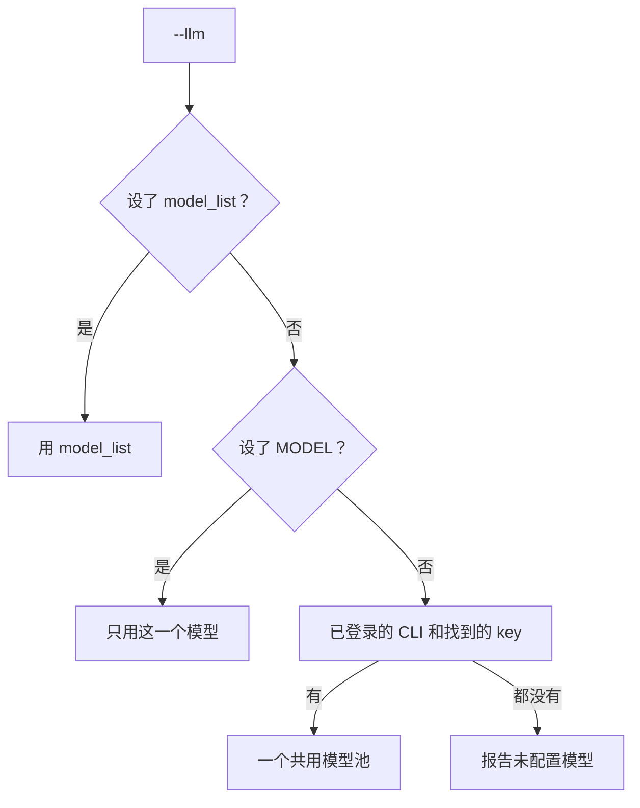
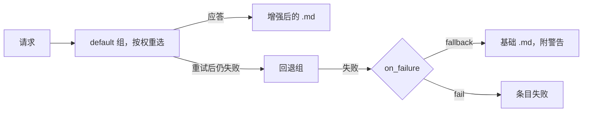
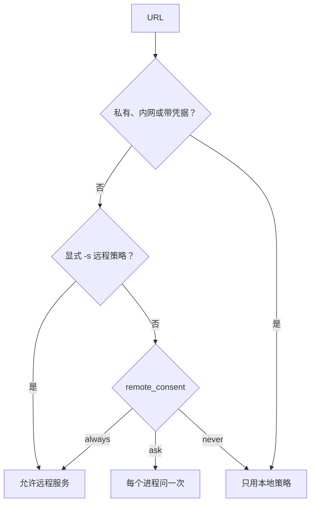

# 配置说明

全部设置、来源和默认值。`markitai config list` 打印实际生效的值。

## 配置优先级

先设置了某个值的来源生效：


例外：

| 变量 | 规则 |
|------|------|
| `JINA_API_KEY`、`CLOUDFLARE_API_TOKEN`、`CLOUDFLARE_ACCOUNT_ID` | 配置文件没设这个值时才用 |
| `MODEL` | 只在 `llm.model_list` 为空时用 |
| `MARKITAI_RECORD_HISTORY`（`1`/`0`） | 覆盖 `history.record`；命令行参数仍优先 |
| `MARKITAI_PURE=1` | 纯净模式（仅 CLI）；命令行参数仍优先 |
| `MARKITAI_NO_REMOTE_FETCH=1` | 禁止所有远程抓取服务，显式 `-s` 也不行 |

## 配置文件

markitai 按下面的顺序找到第一个配置文件就用：

1. `--config <路径>`（必须存在；`config set` 与 `config edit` 会创建它）
2. `MARKITAI_CONFIG`
3. 当前目录的 `./markitai.json`
4. `~/.markitai/config.json`

::: warning 在当前文件夹找到的 markitai.json
它可能来自下载或克隆的仓库。`api_base` 不是服务商自己地址的模型只用条目里写明的密钥（不读密钥变量；`env:` 改为 `markitai-no-key` 并提示）；自带地址的 Vertex AI、watsonx 或 GigaChat 模型会被略过（它会用本机的云登录签名）。`markitai doctor` 和 `--verbose` 会说明文件在哪里找到。
:::

```bash
markitai init                         # 引导式配置（--yes：全用默认值，--local：写 ./markitai.json）
markitai config list                  # 生效的设置，密钥已打码（--show-secrets 显示原值）
markitai config get llm.enabled
markitai config set llm.enabled true
markitai config edit                  # 引导菜单
markitai config validate
```

打码覆盖嵌套的 key、token、cookie 和请求头。任何字符串值都可以写成 `env:VAR_NAME` 引用环境变量。

### 完整配置示例

每个设置及其默认值，取自 [`config.py`](https://github.com/Ynewtime/markitai/blob/python/packages/markitai/src/markitai/config.py)。

:::: details 含全部默认值的 markitai.json

```json
{
  "llm": {
    "enabled": false,
    "model_list": [],
    "providers": [],
    "router_settings": {
      "routing_strategy": "simple-shuffle",
      "num_retries": 2,
      "timeout": 120,
      "fallbacks": []
    },
    "concurrency": 10,
    "max_requests_per_document": 50,
    "max_cost_per_document_usd": 0,
    "max_vision_pages_per_document": 0,
    "pure": false,
    "keep_base": false,
    "on_failure": "fallback"
  },
  "image": {
    "alt_enabled": false,
    "desc_enabled": false,
    "compress": true,
    "quality": 75,
    "format": "jpeg",
    "max_width": 1920,
    "max_height": 99999,
    "filter": {
      "min_width": 50,
      "min_height": 50,
      "min_area": 5000,
      "deduplicate": true
    },
    "stdout_persist": true,
    "stdout_persist_dir": "~/.markitai/assets",
    "stdout_fetch_external": false
  },
  "ocr": {
    "enabled": false,
    "lang": "en",
    "per_page_routing": true
  },
  "office": {
    "macos_fallback": true
  },
  "screenshot": {
    "enabled": false,
    "screenshot_only": false,
    "viewport_width": 1920,
    "viewport_height": 1080,
    "quality": 75,
    "tile_height": 2000,
    "max_height": 10000
  },
  "cache": {
    "enabled": true,
    "no_cache": false,
    "no_cache_patterns": [],
    "fetch_ttl_seconds": 86400,
    "max_size_bytes": 536870912,
    "global_dir": "~/.markitai"
  },
  "batch": {
    "concurrency": 10,
    "url_concurrency": 5,
    "scan_max_depth": 5,
    "scan_max_files": 10000,
    "state_flush_interval_seconds": 10,
    "heavy_task_limit": 0
  },
  "fetch": {
    "strategy": "auto",
    "remote_consent": "always",
    "defuddle": {
      "timeout": 30,
      "rpm": 20
    },
    "playwright": {
      "timeout": 30000,
      "wait_for": "domcontentloaded",
      "extra_wait_ms": 3000,
      "wait_for_selector": null,
      "cookies": null,
      "reject_resource_patterns": null,
      "extra_http_headers": null,
      "user_agent": null,
      "http_credentials": null,
      "session_mode": "isolated",
      "session_ttl_seconds": 600
    },
    "jina": {
      "api_key": null,
      "timeout": 30,
      "rpm": 20,
      "no_cache": false,
      "target_selector": null,
      "wait_for_selector": null
    },
    "cloudflare": {
      "api_token": null,
      "account_id": null,
      "timeout": 30000,
      "wait_until": "networkidle0",
      "cache_ttl": 0,
      "reject_resource_patterns": null,
      "convert_enabled": false,
      "user_agent": null,
      "cookies": null,
      "wait_for_selector": null,
      "http_credentials": null
    },
    "policy": {
      "enabled": true,
      "max_strategy_hops": 5,
      "strategy_priority": null,
      "local_only_patterns": [],
      "inherit_no_proxy": true
    },
    "domain_profiles": {},
    "fallback_patterns": ["twitter.com", "x.com", "instagram.com", "facebook.com", "linkedin.com", "threads.net"]
  },
  "output": {
    "dir": null,
    "on_conflict": "rename",
    "allow_symlinks": false,
    "report": null,
    "profile": null,
    "wikilinks": false,
    "format": "markdown"
  },
  "log": {
    "level": "INFO",
    "format": "text",
    "dir": null,
    "rotation": "10 MB",
    "retention": "7 days"
  },
  "security": {
    "pdf_sanitize": "warn"
  },
  "history": {
    "record": false
  },
  "presets": {},
  "prompts": {
    "dir": "~/.markitai/prompts"
  }
}
```

::::

`llm.model_list` 默认为空，用 `--llm` 时自动填充（[规则](#markitai-如何选用模型)）；`markitai init` 写入一条，网页工作台写入 `llm.providers`。

## 环境变量

### API 密钥

| 变量 | 服务 |
|------|------|
| `OPENAI_API_KEY` | OpenAI |
| `ANTHROPIC_API_KEY`（或 `ANTHROPIC_AUTH_TOKEN`） | Anthropic |
| `GEMINI_API_KEY`（或 `GOOGLE_API_KEY`，后者优先） | Google Gemini |
| `DEEPSEEK_API_KEY` | DeepSeek |
| `OPENROUTER_API_KEY`（或 `OR_API_KEY`） | OpenRouter |
| `JINA_API_KEY` | Jina Reader |
| `CLOUDFLARE_API_TOKEN`、`CLOUDFLARE_ACCOUNT_ID` | Cloudflare |

### Markitai 设置

开关取 `1`、`true` 或 `yes` 即开启（`MARKITAI_RECORD_HISTORY` 和 `MARKITAI_TIMINGS` 也认 `on`）。

| 变量 | 作用 |
|------|------|
| `MODEL` | 没设 `model_list` 时的模型 |
| `MARKITAI_CONFIG` | 配置文件路径 |
| `MARKITAI_LOG_DIR` | 日志目录 |
| `MARKITAI_LOG_FORMAT` | `text` 或 `json` |
| `MARKITAI_LANG` | CLI 语言，`en` 或 `zh` |
| `MARKITAI_PURE` | 纯净模式 |
| `MARKITAI_RECORD_HISTORY` | 把 CLI 运行记入网页工作台历史 |
| `MARKITAI_NO_REMOTE_FETCH` | 不用远程抓取服务，`-s` 也不行 |
| `MARKITAI_NO_VLM_OCR` | `--ocr --llm` 在本地做 OCR，不交给视觉模型（截图仍会发给它） |
| `MARKITAI_STATIC_HTTP` | 静态抓取客户端：`httpx`（默认）或 `curl_cffi` |
| `MARKITAI_PDF_WORKERS` | PDF 提取和扫描页 OCR 的进程数；`0`/`1` 为本进程内。默认值即上限：每个可用核一个，最多 12 个，合计不超过可用内存的四分之一（每个约 450 MB） |
| `MARKITAI_SERVE_TOKEN` | `markitai serve` 的固定访问令牌 |
| `MARKITAI_TIMINGS` | 在 stderr 列出命令的时间花在哪里 |

[安装脚本](/zh/guide/getting-started)读取它自己的变量：

| 变量 | 作用 |
|------|------|
| `MARKITAI_INSTALL_OPTIONAL` | 没有终端时也安装可选组件 |
| `MARKITAI_VERSION` | 要安装的版本 |
| `MARKITAI_USE_MIRROR` | `1` 不测试 PyPI 直接提供镜像，`0` 从不询问 |
| `MARKITAI_SETUP_LOG` | 失败时完整日志的位置 |
| `MARKITAI_SETUP_TIMINGS` | 列出每一步的用时 |

### `.env` 文件加载

markitai 先加载 `./.env`，再加载 `~/.markitai/.env`。环境变量优先于两者，`./.env` 优先于 `~/.markitai/.env`。

文件夹里的 `.env` 可能不是你写的（下载或克隆的仓库），所以 `./.env` 可以设置密钥和选项，但不能设置程序、路径、地址、代理、主目录或凭据文件。被忽略的名称会提示一次；这些值请放在环境变量或 `~/.markitai/.env`。

::: details ./.env 不能设置的名称
`*_PATH`（含 `*_CLI_PATH`、`PATH` 和 `PATHEXT`）、`*_EXECUTABLE`、`LD_*`、`DYLD_*`、`NODE_OPTIONS`、`BASH_ENV`、`ENV`、`PYTHON*`、`*_API_BASE`、`*_BASE_URL`、`*_ENDPOINT`、`HTTP_PROXY`、`HTTPS_PROXY`、`ALL_PROXY`、`NO_PROXY`（大小写均可）、`HOME`、`USERPROFILE`、`HOMEDRIVE`、`HOMEPATH`、`*_HOME`、`*_CONFIG_DIR`、`XDG_*`、`TMPDIR`、`TMP`、`TEMP`、`AWS_*_FILE`、`GOOGLE_APPLICATION_CREDENTIALS`、`CLOUDSDK_CONFIG`、`MARKITAI_CONFIG`、`MARKITAI_HOME`、`MARKITAI_LOG_DIR`、`SSL_CERT_FILE`、`SSL_CERT_DIR`、`REQUESTS_CA_BUNDLE`、`CURL_CA_BUNDLE`、`AWS_CA_BUNDLE`。
:::

## LLM 配置

### 支持的提供商

任何 [LiteLLM](https://docs.litellm.ai/) 提供商都可以用 API key 接入。三家订阅改用登录：

| 提供商 | 前缀 | 登录方式 | Extra |
|--------|------|----------|-------|
| Claude Code | `claude-agent/` | `markitai auth claude login` | `markitai[claude-agent]` |
| GitHub Copilot | `copilot/` | `markitai auth copilot login` | `markitai[copilot]` |
| ChatGPT | `chatgpt/` | 首次使用时走 OAuth 设备码 | — |

Claude Code 和 Copilot 还需要厂商的命令行：安装脚本问到时回答“是”（默认“否”）就连同 extra 一起装好；手动命令见 [Claude 与 Copilot 订阅](/zh/guide/subscriptions)。Gemini 没有订阅：用带 key 的 `gemini/` 或 `openrouter/google/...`。

### 模型命名

按 LiteLLM 的 `provider/model` 命名，如 `anthropic/claude-sonnet-5-5`、`ollama/llama3.2`、`copilot/claude-haiku-5.5`，以及下表的默认模型。

#### markitai 自动选用的默认模型

`markitai init` 和 key 检测会选每个提供商便宜、快速的那一档：

| 提供商 | 默认模型 |
|---|---|
| Claude Code | `claude-agent/haiku` |
| GitHub Copilot | `copilot/auto` |
| ChatGPT | `chatgpt/gpt-6-luna` |
| Anthropic | `anthropic/claude-haiku-5-5` |
| OpenAI | `openai/gpt-6-luna` |
| Gemini | `gemini/gemini-flash-lite-latest` |
| DeepSeek | `deepseek/deepseek-flash` |
| OpenRouter | `openrouter/~anthropic/claude-haiku-latest` |

- `copilot/auto` 是 Copilot 的自动选择（Free 和 Student 套餐唯一的选项），按它选中的模型计费；付费套餐可以固定模型（`copilot/claude-haiku-5.5`）。
- `openrouter/~anthropic/claude-haiku-latest` 是 OpenRouter 指向最新 Claude Haiku 的别名，按实际应答的模型计费；固定模型用 `openrouter/anthropic/claude-haiku-5.5`。
- 已下线的模型只在启动时警告，markitai 不会替你改。

#### markitai 如何选用模型

用了 `--llm` 而 `llm.model_list` 为空时：



- 模型池会混用厂商，同一篇文档也可能如此；启动时 stderr 列出池里的模型（`--quiet` 隐藏）。
- `markitai init` 会略过默认模型已由另一条途径提供的 key 并说明：有 Claude Code 订阅时略过 Anthropic 和 OpenRouter 的 key（三者都是 Claude Haiku），有 Anthropic key 时略过 OpenRouter 的 key。
- 设置了 `ANTHROPIC_API_KEY` 时 Claude Code 会按它计费而不用订阅，所以 markitai 对 Claude Code 隐藏这个变量；只靠这个 key 登录的 Claude Code 不会被选用（`anthropic/claude-haiku-5-5` 直接用这个 key）。
- `markitai doctor` 显示登录状态和没有模型用到的 key。

图片分析（`--alt`、`--desc`）需要视觉模型；订阅通过附件支持。

| 错误 | 处理 |
|------|------|
| "SDK not installed" | `markitai[copilot]` 或 `markitai[claude-agent]` |
| "CLI not found" | [Copilot CLI](https://docs.github.com/en/copilot/how-tos/set-up/install-copilot-cli) 或 [Claude Code](https://claude.ai/code) |
| "Not authenticated" | `markitai auth copilot login` / `markitai auth claude login` |
| "Rate limit" | 稍等，或检查额度 |

### 自定义 API 端点

`api_base` 把提供商指向自建服务、地区代理或网关；支持 `env:VAR_NAME`：

```json
{
  "llm": {
    "model_list": [
      {
        "model_name": "default",
        "litellm_params": {
          "model": "openai/your-model-name",
          "api_key": "env:YOUR_API_KEY",
          "api_base": "https://your-api-endpoint.com/v1"
        }
      }
    ]
  }
}
```

```json
// 本地 Ollama
{ "model": "ollama/llama3.2", "api_base": "http://localhost:11434" }

// Azure OpenAI：model 填你的部署名，不是模型 ID
{
  "model": "azure/your-deployment-name",
  "api_key": "env:AZURE_API_KEY",
  "api_base": "https://your-resource.openai.azure.com",
  "api_version": "2025-02-01-preview"
}
```

- 没有 `api_key` 的条目会把该提供商的 key 变量（`openai/` 读 `OPENAI_API_KEY`）发往它的 `api_base`：别家的端点请配上它自己的 key。
- `markitai serve` 保存无 key 连接时写入 `"api_key": "markitai-no-key"`（不是凭据），服务器的 key 因此不会发到设置调用方指定的地址。在这里删掉它即改用环境变量中的 key。
- 设置页面不允许把 `env:` key 和自定义端点配在一起（[LLM 设置](/zh/guide/serve#llm-设置)）；这一对请写在这里。
- 订阅忽略 `api_base`；Claude Code 认 `ANTHROPIC_BASE_URL`。

### Vision 模型

视觉能力取自 LiteLLM；可按条目覆盖：

```json
{
  "model_name": "default",
  "litellm_params": { "model": "gemini/gemini-flash-lite-latest", "api_key": "env:GEMINI_API_KEY" },
  "model_info": { "supports_vision": true }
}
```

### 模型 Token 上限

| 字段 | 默认值 | 说明 |
|------|--------|------|
| `litellm_params.max_tokens` | `null` | 每次调用请求的最大输出 token |
| `model_info.max_tokens` | `null` | 最大输出 token（省略时取自 LiteLLM） |
| `model_info.max_input_tokens` | `null` | 最大上下文 token（省略时取自 LiteLLM） |

### 路由设置

请求进入模型组 `default`（条目的 `model_name`）；没有 `fallbacks` 时所有模型都在这个组里。



| 设置 | 默认值 | 说明 |
|------|--------|------|
| `router_settings.routing_strategy` | `simple-shuffle` | 或 `least-busy`、`usage-based-routing`、`latency-based-routing`；订阅始终按权重随机 |
| `router_settings.num_retries` | `2` | 每个请求的重试次数。发出后超时的请求最多再发一次，文档费用记为不完整 |
| `router_settings.timeout` | `120` | 请求超时（秒） |
| `router_settings.fallbacks` | `[]` | 如 `[{"default": ["backup"]}]`；这时其他组只通过回退接收流量。订阅模型不能作回退目标；视觉请求在所有视觉模型间分摊 |
| `concurrency` | `10` | 同时发出的 LLM 请求数 |
| `max_requests_per_document` | `50` | 到达后保留基础输出；分块文档所需请求超过剩余额度时整篇不增强。`0` 不限 |
| `max_cost_per_document_usd` | `0` | 每份文档的花费上限。`0` 不限 |
| `max_vision_pages_per_document` | `0` | 每份文档的页面图片数；超出的文档不做视觉增强。`0` 不限 |
| `on_failure` | `fallback` | `fallback`：保留基础 `.md` 并警告。`fail`：条目失败（退出码 `1`，批量 `10`）。两种都会写出基础 `.md` |

后五项直接位于 `llm` 下。

#### 模型权重

`litellm_params.weight`：`1` 正常，`10` 十倍概率，`0` 禁用。至少要有一个模型权重大于零（首次使用时检查，`config validate` 不查）。

```json
{
  "model_name": "default",
  "litellm_params": { "model": "gemini/gemini-flash-lite-latest", "api_key": "env:GEMINI_API_KEY", "weight": 10 }
}
```

### 自适应超时

Copilot 的超时随提示词长度、图片和预期输出在 60 到 600 秒之间伸缩；Claude Agent SDK 自行管理。

### 提示缓存（Claude Agent）

Claude Code 自己缓存较长的系统提示词；`markitai cache stats --verbose` 显示数字。

## 图片配置

| 设置 | 默认值 | 说明 |
|------|--------|------|
| `alt_enabled` | `false` | 用 LLM 生成 alt 文本 |
| `desc_enabled` | `false` | 图片描述 |
| `compress` | `true` | 压缩抽取出的图片 |
| `quality` | `75` | JPEG 质量（1–100） |
| `format` | `jpeg` | `jpeg`、`png` 或 `webp`（质量低于 100 时，不含透明像素的图片写为 JPEG；100 时为无损 WebP） |
| `max_width` / `max_height` | `1920` / `99999` | 最大尺寸（像素） |
| `filter.min_width` / `min_height` / `min_area` | `50` / `50` / `5000` | 跳过更小的图片 |
| `filter.deduplicate` | `true` | 去掉重复图片 |
| `stdout_persist` | `true` | stdout 模式：图片存入持久目录 |
| `stdout_persist_dir` | `~/.markitai/assets` | 该目录 |
| `stdout_fetch_external` | `false` | stdout 模式：下载外部图片 |

## 截图配置

PDF 页面和 PPTX 幻灯片渲染成 JPEG，URL 用 Playwright 截整页，放在 `.markitai/screenshots/`。

| 设置 | 默认值 | 说明 |
|------|--------|------|
| `enabled` | `false` | `--screenshot` |
| `screenshot_only` | `false` | `--screenshot-only` |
| `viewport_width` / `viewport_height` | `1920` / `1080` | URL 截图的浏览器视口 |
| `quality` | `75` | JPEG 质量（1–100） |
| `tile_height` | `2000` | 长 URL 截图的切片高度（供视觉模型读取） |
| `max_height` | `10000` | `tile_height` 为 `0` 时的高度上限 |

## 预设

除了 `minimal`、`standard` 和 `rich`，还可以定义自己的（每个键默认 `false`），用 `markitai document.pdf --preset my-preset` 调用：

```json
{
  "presets": {
    "my-preset": { "llm": true, "ocr": false, "alt": true, "desc": false, "screenshot": true }
  }
}
```

## OCR 配置

本地 OCR 是 [RapidOCR](https://github.com/RapidAI/RapidOCR)，即 `ocr` extra（约 150 MB）。安装脚本问到 OCR 时回答“是”（默认）就会装上；之后要加，再运行一次脚本：

<!--@include: ../../snippets/setup.md-->

::: details 手动安装
```bash
uv tool install "markitai[ocr]" --force
```
:::

`--ocr --llm` 配视觉模型时不需要这个 extra：模型自己读页面。`MARKITAI_NO_VLM_OCR=1` 强制本地 OCR。

| 设置 | 默认值 | 说明 |
|------|--------|------|
| `enabled` | `false` | `--ocr` |
| `lang` | `en` | 下表中的值；其他值报错 |
| `per_page_routing` | `true` | 只对文字层没通过检查的页面做 OCR（[详情](/zh/guide/cli#读错的-pdf-文字层)）；`false` 每页都 OCR |

| `lang` | 识别 |
|--------|------|
| `en`、`zh`、`zh_tw`、`ja` | 英文、简体/繁体中文、日文 |
| `fr`、`de`、`es`、`it`、`pt`、`nl`、`pl`、`tr`、`vi` 等 | 多语言模型的语言 |
| `latin` | 只读拉丁字母 |
| `ko`、`ar`、`th`、`el`、`ta`、`te` | 韩文、阿拉伯文、泰文、希腊文、泰米尔文、泰卢固文 |
| `ru`（也可写 `uk`、`be`） | 俄语、乌克兰语、白俄罗斯语 |
| `cyrillic` | 其他西里尔文语言 |
| `hi`（也可写 `mr`、`ne`）、`devanagari` | 印地语、马拉地语、尼泊尔语 |

## Office 配置

| 设置 | 默认值 | 说明 |
|------|--------|------|
| `macos_fallback` | `true` | 没装 LibreOffice 的 Mac 用 PowerPoint 渲染 PPTX（会弹一次授权对话框；无头 Mac 上设为 `false`） |

## 批处理配置

| 设置 | 默认值 | 说明 |
|------|--------|------|
| `concurrency` | `10` | 同时转换的文件数 |
| `url_concurrency` | `5` | 同时抓取的 URL 数，与文件分开计数 |
| `scan_max_depth` | `5` | 目录扫描深度 |
| `scan_max_files` | `10000` | 每次运行的最大文件数 |
| `state_flush_interval_seconds` | `10` | `--resume` 状态的保存间隔 |
| `heavy_task_limit` | `0` | CPU 密集任务上限；`0` 按内存决定 |

## URL 抓取配置

### 抓取策略

| `fetch.strategy` | 说明 |
|------|------|
| `auto`（默认） | static、Playwright，再 Defuddle、Jina、Cloudflare；重 JS 域名从 Playwright 开始（[抓取策略](/zh/guide/fetch-policy)） |
| `static` | 普通 HTTP 加内置抽取器，不跑 JavaScript |
| `playwright` | 浏览器渲染 |
| `defuddle` | Defuddle API，免费，无需 key |
| `jina` | Jina Reader API |
| `cloudflare` | Cloudflare Browser Rendering，在本地抽取 |

凭据可以留在环境变量里，也可以写成引用：

```json
{
  "fetch": {
    "jina": { "api_key": "env:JINA_API_KEY" },
    "cloudflare": { "api_token": "env:CLOUDFLARE_API_TOKEN", "account_id": "env:CLOUDFLARE_ACCOUNT_ID" }
  }
}
```

### 远程抓取同意

`fetch.remote_consent`（默认 `always`，或 `ask`、`never`）决定公开 URL 能否交给 Defuddle、Jina 或 Cloudflare：



`always` 每位用户只在 stderr 提示一次；`ask` 没有终端时不用远程服务。`MARKITAI_NO_REMOTE_FETCH=1` 拦住一切，`-s` 也不例外。`fetch.policy.local_only_patterns` 和 `NO_PROXY` 让 `auto` 只走本地（显式 `-s` 仍有效）。X/Twitter 补充抓取（FxTwitter、oEmbed）遵循同一个决定。详见[抓取策略](/zh/guide/fetch-policy)。

### Playwright 设置

| 设置 | 默认值 | 说明 |
|------|--------|------|
| `timeout` | `30000` | 加载超时（毫秒），也约束加载后的页面操作（死循环脚本会报错而不是挂住） |
| `wait_for` | `domcontentloaded` | `load`、`domcontentloaded` 或 `networkidle` |
| `extra_wait_ms` | `3000` | 等 JavaScript 的最长时间；0.5 秒内没有加载和变化就结束 |
| `session_mode` | `isolated` | 或 `domain_persistent`（按域名复用） |
| `session_ttl_seconds` | `600` | 持久会话的寿命 |
| `wait_for_selector` | `null` | 等待的 CSS 选择器 |
| `cookies` | `null` | `[{name, value, domain, path}]` |
| `reject_resource_patterns` | `null` | 拦截请求，如 `["**/*.css"]` |
| `extra_http_headers` | `null` | 如 `{"Accept-Language": "zh-CN"}`；只发往初始来源，不发往跨来源或重定向目标 |
| `user_agent` | `null` | 自定义 User-Agent |
| `http_credentials` | `null` | `{username, password}` |

### Jina 设置

| 设置 | 默认值 | 说明 |
|------|--------|------|
| `api_key` | `null` | API key（支持 `env:`） |
| `timeout` | `30` | 秒 |
| `rpm` | `20` | 每分钟请求数 |
| `no_cache` | `false` | 绕过 Jina 的缓存 |
| `target_selector` | `null` | 要抽取的 CSS 选择器 |
| `wait_for_selector` | `null` | 等待的 CSS 选择器 |

### Defuddle 设置

[Defuddle](https://defuddle.md) 返回带 frontmatter 的正文 Markdown。免费，无需 key。

| 设置 | 默认值 | 说明 |
|------|--------|------|
| `timeout` | `30` | 秒 |
| `rpm` | `20` | 每分钟请求数 |

### Cloudflare 设置

**Browser Rendering**（`-s cloudflare`）抓取渲染后的 HTML；**Workers AI toMarkdown**（`-b cloudflare`）转换文件。

| 设置 | 默认值 | 说明 |
|------|--------|------|
| `api_token` / `account_id` | `null` | 凭据（支持 `env:`） |
| `timeout` | `30000` | Browser Rendering 超时（毫秒） |
| `wait_until` | `networkidle0` | `load`、`domcontentloaded` 或 `networkidle0` |
| `cache_ttl` | `0` | Browser Rendering 缓存 TTL（秒） |
| `reject_resource_patterns`、`user_agent`、`cookies`、`wait_for_selector`、`http_credentials` | `null` | 同 Playwright，但模式是正则（`["/\\.css$/"]`），cookie 带 `url`（`[{"name": "k", "value": "v", "url": "..."}]`） |
| `convert_enabled` | `false` | 开启 toMarkdown 文件转换 |

准备：账户 ID 在[控制台](https://dash.cloudflare.com/)的 URL 里；创建自定义 [API token](https://dash.cloudflare.com/profile/api-tokens)，权限 *Browser Rendering: Edit* 和 *Workers AI: Read*；在 *Workers & Pages → Browser Rendering* 下启用（免费套餐包含）。

```bash
export CLOUDFLARE_API_TOKEN="your-api-token"
export CLOUDFLARE_ACCOUNT_ID="your-account-id"
```

免费套餐允许两个浏览器会话（markitai 串行并重试）。反爬严格的站点（x.com）可能失败：改用 `-s playwright` 或 `-s jina`。toMarkdown 用于 markitai 自己转不了的格式。

### 抓取策略、域名配置与回退模式 {#fetch-policy-domain-profiles}

策略引擎按域名排定策略并记住哪些域名需要浏览器：选项、配置字段和内置配置见[抓取策略](/zh/guide/fetch-policy#配置)。`domain_profiles` 条目只覆盖你写的字段；`fallback_patterns` 里的域名从浏览器开始。

### 代理

认 `HTTPS_PROXY`、`HTTP_PROXY`、`ALL_PROXY` 和 `NO_PROXY`。都没设时用系统代理（Windows、macOS，或 GNOME/KDE 的手动 HTTP 代理）；PAC、纯 SOCKS 和带认证的桌面代理需要设环境变量。

## 缓存配置

| 文件 | 内容 | 复用 |
|------|------|------|
| `cache.db` | LLM 结果 | 再转一次不花钱 |
| `fetch_cache.db` | 抓取的页面 | 有 `ETag`/`Last-Modified`：每次运行重新验证，挑战页或 JS 空壳不会覆盖好缓存。否则按 `fetch_ttl_seconds` |

| 设置 | 默认值 | 说明 |
|------|--------|------|
| `enabled` | `true` | 缓存 LLM 结果和页面 |
| `no_cache` | `false` | 跳过读取、照常写入（`--no-cache`） |
| `no_cache_patterns` | `[]` | 匹配路径和 URL、绕过缓存的 glob（`--no-cache-for`） |
| `fetch_ttl_seconds` | `86400` | 没有验证头的页面复用时长；`0` 每次重抓 |
| `max_size_bytes` | `536870912` | 每个缓存文件上限（512 MB） |
| `global_dir` | `~/.markitai` | 缓存目录 |

```bash
markitai cache stats --verbose         # 按模型列出 LLM 条目，外加抓取的页面
markitai cache clear                   # 清空 cache.db 和 fetch_cache.db
markitai document.pdf --no-cache       # 这一次绕过缓存
markitai ./docs --no-cache-for "*.pdf"
markitai urls.urls --no-cache-for "news.example.com"
```

## 输出配置

| 设置 | 默认值 | 说明 |
|------|--------|------|
| `dir` | `null` | 输出目录 |
| `on_conflict` | `rename` | 或 `overwrite`、`skip` |
| `allow_symlinks` | `false` | 允许输出路径里有符号链接 |
| `report` | `null` | JSON 报告：`true`、`false`，`null` 只在批量时写 |
| `profile` | `null` | `rag`、`obsidian` 或 `okf`（[输出 Profile](./output-profiles.md)） |
| `wikilinks` | `false` | 用 `obsidian` 时写 `![[assets/x.png]]` 图片链接 |
| `format` | `markdown` | `json` 另写文档 JSON（[`-f json`](/zh/guide/cli#format)） |

## 日志配置

设了 `dir` 才写日志文件。

| 设置 | 默认值 | 说明 |
|------|--------|------|
| `level` | `INFO` | `DEBUG`、`INFO`、`WARNING`、`ERROR` 或 `CRITICAL` |
| `format` | `text` | 或 `json` |
| `dir` | `null` | 日志目录 |
| `rotation` | `10 MB` | 何时换到下一个文件：按大小（`10 MB`、`1.5 KiB`）、按间隔（`1 week`、`10 hours`）、按本地时间（`00:00`、`monday at 12:00`、`sunday`），或 `hourly`/`daily`/`weekly`/`monthly`/`yearly` |
| `retention` | `7 days` | 删除更早的日志；取值为时长，如 `7 days`、`1 month`、`1 week, 3 days` |

写法与 Python 版 markitai 相同，`markitai config validate` 会拒绝其他取值。

## 安全配置

| 设置 | 默认值 | 说明 |
|------|--------|------|
| `pdf_sanitize` | `warn` | PDF 里看不见的文字（白底白字、零字号、页面之外）会进入 Markdown 和 LLM 提示词。`warn` 指出页面，`remove` 删掉，`off` 不检查 |

可搜索扫描件的 OCR 层（盖在占满大半页的图片上，或页面上没有其他文字）不算；盖在文字页的标志或小图片上的照旧算。

## 自定义提示词

每个 LLM 任务有 system 提示词（角色、规则）和 user 提示词（内容模板）。在 `prompts.dir`（`~/.markitai/prompts/`）放同名文件即可覆盖，也可以让设置指向某个文件：

```json
{
  "prompts": {
    "dir": "~/.markitai/prompts",
    "cleaner_system": "/path/to/my-cleaner-system.md"
  }
}
```

| 提示词 | 任务 |
|--------|------|
| `cleaner` | 文档清洗 |
| `image_caption` | alt 文本 |
| `image_description` | 图片描述 |
| `image_analysis` | 一次请求生成标题、描述和图中文字 |
| `document_process` | 文档处理 |
| `document_vision` | 结合页面图片的文档处理 |
| `screenshot_extract` | `--screenshot-only` 截图抽取（只有文件，没有设置） |

各有 `_system` 和 `_user`：文件 `cleaner_system.md`，设置 `cleaner_system`。

## 中国大陆用户指南

### 安装脚本镜像加速

有终端、没设代理变量（`HTTPS_PROXY` / `HTTP_PROXY` / `ALL_PROXY`）且 3 秒内连不上 PyPI 时，安装脚本会提供国内镜像。`MARKITAI_USE_MIRROR=1` 直接提供，`0` 从不询问。

| 镜像源 | PyPI | npm |
|--------|------|-----|
| **清华 TUNA**（默认） | `pypi.tuna.tsinghua.edu.cn` | `registry.npmmirror.com` |
| **阿里云** | `mirrors.aliyun.com` | `registry.npmmirror.com` |
| **腾讯云** | `mirrors.cloud.tencent.com` | `mirrors.cloud.tencent.com` |
| **华为云** | `repo.huaweicloud.com` | `mirrors.huaweicloud.com` |

Playwright 浏览器统一走 npmmirror CDN（`cdn.npmmirror.com`）。也可以在运行脚本前手动设置（以清华 TUNA 为例）：

::: code-group
```bash [macOS / Linux]
export UV_INDEX_URL="https://pypi.tuna.tsinghua.edu.cn/simple"
export PLAYWRIGHT_DOWNLOAD_HOST="https://cdn.npmmirror.com/binaries/playwright"
export NPM_CONFIG_REGISTRY="https://registry.npmmirror.com"
```

```powershell [Windows]
$env:UV_INDEX_URL = "https://pypi.tuna.tsinghua.edu.cn/simple"
$env:PLAYWRIGHT_DOWNLOAD_HOST = "https://cdn.npmmirror.com/binaries/playwright"
$env:NPM_CONFIG_REGISTRY = "https://registry.npmmirror.com"
```
:::

### LLM API 访问

| 提供商 | 可用性 | 说明 |
|--------|--------|------|
| **DeepSeek** | 直连 | 直接用 `deepseek/deepseek-flash` |
| **Ollama** | 离线 | 本地模型，如 `ollama/llama3.2` |
| **API 中转** | 通过中转 | 用 `api_base` 指向第三方中转服务，写法见[自定义 API 端点](#自定义-api-端点) |
| **OpenAI / Claude / Gemini** | 需代理 | 走代理或 `api_base` 中转 |

### 代理配置

已有代理时，设环境变量即可对所有网络请求生效（规则见[代理](#代理)），安装脚本也会因此跳过镜像配置：

::: code-group
```bash [macOS / Linux]
export HTTPS_PROXY="http://127.0.0.1:7890"
export HTTP_PROXY="http://127.0.0.1:7890"
```

```powershell [Windows]
$env:HTTPS_PROXY = "http://127.0.0.1:7890"
$env:HTTP_PROXY = "http://127.0.0.1:7890"
```
:::
