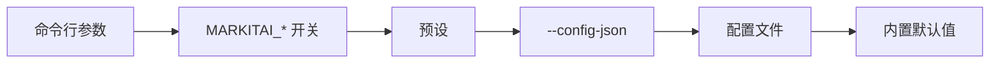
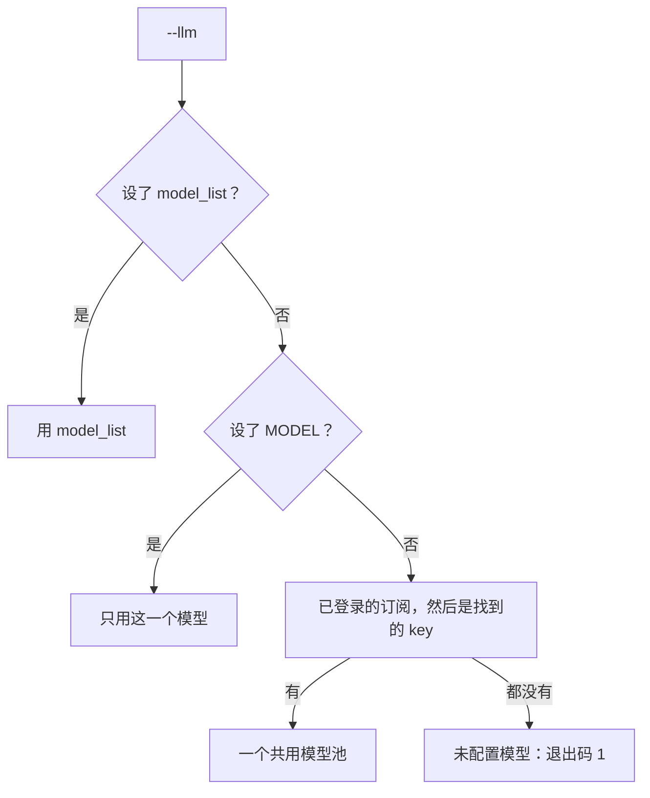
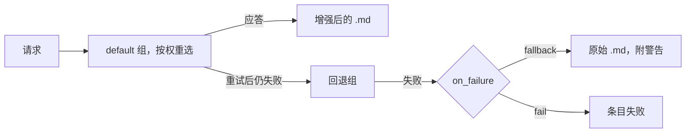
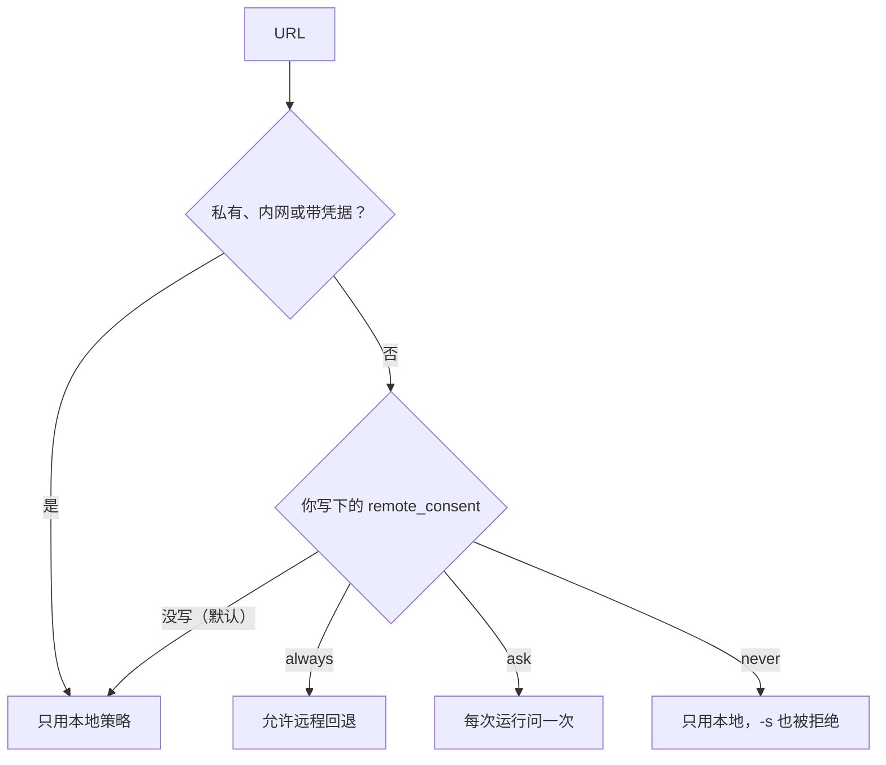

# 配置说明

全部设置、来源和默认值。`markitai config list` 打印实际生效的值；CLI、`markitai serve`、MCP 服务器和 Python API 读取同一个文件。

## 配置优先级

先设置了某个值的来源生效：



预设只设置 LLM、OCR、alt、desc 和截图这几个开关。下列变量提供文件没设的值：

| 变量 | 规则 |
|------|------|
| 提供商 key（`OPENAI_API_KEY` 等）、`<PREFIX>_API_BASE` | 模型条目没有 `api_key` / `api_base` 时使用 |
| `JINA_API_KEY`、`CLOUDFLARE_API_TOKEN`、`CLOUDFLARE_ACCOUNT_ID` | 配置文件没设这个值时才用 |
| `MODEL` | 只在 `llm.model_list` 为空时用 |
| `MARKITAI_RECORD_HISTORY`、`MARKITAI_LOG_DIR`、`MARKITAI_LOG_FORMAT` | 覆盖文件；命令行参数仍优先 |
| `MARKITAI_PURE=1` | 覆盖文件、开启纯净模式（关闭值被忽略）；`--pure` / `--no-pure` 仍优先 |
| `MARKITAI_NO_REMOTE_FETCH=1` | 禁止所有远程抓取服务，显式 `-s` 也不行 |

## 配置文件

markitai 只读一个文件，按下面的顺序找到第一个就用：

1. `--config <path>`（必须存在；`config set` 与 `config edit` 会创建它）
2. `MARKITAI_CONFIG`（文件不存在时：给出警告并使用默认值）
3. 当前目录的 `./markitai.json`
4. `~/.markitai/config.json`（即 `MARKITAI_HOME/config.json`）

::: warning 在当前文件夹找到的 markitai.json
它可能来自下载或克隆的仓库。其中 `api_base` 不是提供商自己地址的模型只用条目里写明的 key：不读 key 变量，`env:` 改为 `markitai-no-key`，并给出警告。`markitai doctor` 和 `--verbose` 会说明文件是在哪里找到的。
:::

```bash
markitai init                         # 写出含检测到的模型的配置（--yes、--local）
markitai config list                  # 生效的设置，密钥已打码（-f table、-f yaml）
markitai config get llm.enabled
markitai config set llm.enabled true  # 先校验；未知的键会被拒绝
markitai config edit                  # 终端编辑器
markitai config validate              # 还会对不起作用的键给出警告
```

打码覆盖 key、token、密码、cookie 和所有 HTTP 请求头的值。凭据和地址可以写成 `env:VAR_NAME` 引用环境变量。

### 完整配置示例

每个设置及其默认值，与 `markitai config list` 打印的一致：

:::: details 含全部默认值的 markitai.json

```json
{
  "batch": {
    "concurrency": 10,
    "heavy_task_limit": 0,
    "scan_max_depth": 5,
    "scan_max_files": 10000,
    "state_flush_interval_seconds": 10,
    "url_concurrency": 5
  },
  "cache": {
    "enabled": true,
    "fetch_ttl_seconds": 86400,
    "global_dir": "~/.markitai",
    "max_size_bytes": 536870912,
    "no_cache": false,
    "no_cache_patterns": []
  },
  "fetch": {
    "cloudflare": {
      "api_token": null,
      "account_id": null,
      "cache_ttl": 0,
      "convert_enabled": false,
      "timeout": 30000,
      "wait_until": "networkidle0"
    },
    "defuddle": {
      "rpm": 20,
      "timeout": 30
    },
    "domain_profiles": {},
    "fallback_patterns": ["twitter.com", "x.com", "instagram.com", "facebook.com", "linkedin.com", "threads.net"],
    "jina": {
      "api_key": null,
      "no_cache": false,
      "rpm": 20,
      "timeout": 30
    },
    "playwright": {
      "cookies": null,
      "extra_wait_ms": 3000,
      "session_mode": "isolated",
      "session_ttl_seconds": 600,
      "timeout": 30000,
      "wait_for": "domcontentloaded"
    },
    "policy": {
      "enabled": true,
      "inherit_no_proxy": true,
      "local_only_patterns": [],
      "max_strategy_hops": 5
    },
    "remote_consent": "always",
    "strategy": "auto"
  },
  "history": {
    "record": false
  },
  "image": {
    "alt_enabled": false,
    "compress": true,
    "desc_enabled": false,
    "filter": {
      "deduplicate": true,
      "min_area": 5000,
      "min_height": 50,
      "min_width": 50
    },
    "format": "jpeg",
    "max_height": 99999,
    "max_width": 1920,
    "quality": 75,
    "stdout_fetch_external": false,
    "stdout_persist": true,
    "stdout_persist_dir": "~/.markitai/assets"
  },
  "llm": {
    "concurrency": 10,
    "enabled": false,
    "keep_base": false,
    "max_cost_per_document_usd": 0,
    "max_requests_per_document": 50,
    "max_vision_pages_per_document": 0,
    "model_list": [],
    "on_failure": "fallback",
    "providers": [],
    "pure": false,
    "router_settings": {
      "fallbacks": [],
      "num_retries": 2,
      "routing_strategy": "simple-shuffle",
      "timeout": 120
    }
  },
  "log": {
    "dir": null,
    "format": "text",
    "level": "INFO",
    "retention": "7 days",
    "rotation": "10 MB"
  },
  "ocr": {
    "enabled": false,
    "lang": "en",
    "per_page_routing": true
  },
  "office": {
    "macos_fallback": true
  },
  "output": {
    "allow_symlinks": false,
    "dir": null,
    "format": "markdown",
    "on_conflict": "rename",
    "page_markers": false,
    "profile": null,
    "report": null,
    "text_only": false,
    "wikilinks": false
  },
  "presets": {},
  "prompts": {
    "dir": "~/.markitai/prompts"
  },
  "screenshot": {
    "enabled": false,
    "max_height": 10000,
    "quality": 75,
    "screenshot_only": false,
    "tile_height": 2000,
    "viewport_height": 1080,
    "viewport_width": 1920
  },
  "security": {
    "pdf_sanitize": "warn"
  },
  "update": {
    "check": true
  }
}
```

::::

`llm.model_list` 默认为空，用 `--llm` 时自动填充（[规则](#how-markitai-picks-models)）；`markitai init` 写入条目，网页工作台写入 `llm.providers`。`~/.markitai` 路径随 `MARKITAI_HOME` 变化。

## 环境变量

### API 密钥

| 变量 | 服务 |
|------|------|
| `OPENAI_API_KEY` | OpenAI |
| `ANTHROPIC_API_KEY`（或 `ANTHROPIC_AUTH_TOKEN`，作为 Bearer token 发送） | Anthropic |
| `GEMINI_API_KEY`（或 `GOOGLE_API_KEY`，后者优先） | Google Gemini |
| `DEEPSEEK_API_KEY` | DeepSeek |
| `OPENROUTER_API_KEY`（或 `OR_API_KEY`） | OpenRouter |
| `AZURE_API_KEY`、`GROQ_API_KEY`、`MISTRAL_API_KEY`、`XAI_API_KEY` 等 | 其他前缀（[提供商](#supported-providers)）；只用于你指定的模型 |
| `JINA_API_KEY` | Jina Reader（可选） |
| `CLOUDFLARE_API_TOKEN`、`CLOUDFLARE_ACCOUNT_ID` | Cloudflare |

### Markitai 设置

开关取 `1`、`true`、`yes` 或 `on` 即开启。

| 变量 | 作用 |
|------|------|
| `MARKITAI_HOME` | 代替 `~/.markitai`：配置、`.env`、缓存、浏览器、OCR 模型、历史（只认进程环境变量） |
| `MODEL` | 没设 `model_list` 时的模型 |
| `MARKITAI_CONFIG` | 配置文件路径 |
| `MARKITAI_LOG_DIR`、`MARKITAI_LOG_FORMAT` | 日志目录；`text` 或 `json` |
| `MARKITAI_LANG` | 终端语言：`zh…` 为中文，其他为英文 |
| `MARKITAI_PURE` | 开启纯净模式（不能用它关闭） |
| `MARKITAI_RECORD_HISTORY` | 把 CLI 运行记入网页工作台历史 |
| `MARKITAI_NO_REMOTE_FETCH` | 不用远程抓取服务，`-s` 也不行 |
| `MARKITAI_NO_VLM_OCR` | `--ocr --llm` 在本机做 OCR，只发送文字 |
| `MARKITAI_OCR_BACKEND` | `paddle`（默认），macOS 上也可以是 `vision` |
| `MARKITAI_BROWSER_EXECUTABLE`、`PLAYWRIGHT_BROWSERS_PATH` | 要用的 Chrome/Chromium；额外搜索的浏览器目录 |
| `MARKITAI_SERVE_TOKEN` | `markitai serve` 的固定访问令牌（只认进程环境变量） |
| `COPILOT_CLI_PATH`、`CLAUDE_CLI_PATH`、`CODEX_CLI_PATH` | 订阅命令行所在位置（[订阅](/zh/guide/subscriptions)） |
| `HTTPS_PROXY`、`HTTP_PROXY`、`ALL_PROXY`、`NO_PROXY` | [代理](#proxies) |

[安装脚本](/zh/guide/getting-started#install)读取它自己的变量：`MARKITAI_VERSION`、`MARKITAI_INSTALL_DIR`、`MARKITAI_INSTALL_OPTIONAL`、`MARKITAI_DOWNLOAD_URL`、`MARKITAI_UNINSTALL`。

### `.env` 文件加载

markitai 先加载 `./.env`，再加载 `~/.markitai/.env`。环境变量优先于两者，`./.env` 优先于 `~/.markitai/.env`。

文件夹里的 `.env` 可能不是你写的（下载或克隆的仓库），所以 `./.env` 可以设置 key 和选项，但不能设置程序、路径、端点、代理、主目录或凭据文件。被忽略的名称在一条警告里列出；这些值请放在环境变量或 `~/.markitai/.env`。

::: details ./.env 不能设置的名称
`*_PATH`（含 `*_CLI_PATH`、`PATH`）、`*_EXECUTABLE`、`LD_*`、`DYLD_*`、`NODE_OPTIONS`、`PYTHON*`、`*_API_BASE`、`*_BASE_URL`、`*_ENDPOINT`、`HTTP_PROXY`、`HTTPS_PROXY`、`ALL_PROXY`、`NO_PROXY`（大小写均可）、`HOME`、`*_HOME`、`*_CONFIG_DIR`、`XDG_*`、`TMPDIR`、`TMP`、`TEMP`、`AWS_*_FILE`、`GOOGLE_APPLICATION_CREDENTIALS`、`CLOUDSDK_CONFIG`、`MARKITAI_CONFIG`、`MARKITAI_HOME`、`MARKITAI_LOG_DIR`，以及证书包变量。
:::

## LLM 配置

### 支持的提供商 {#supported-providers}

markitai 自己对接每家提供商的 API。模型写作 `prefix/model`：

| 前缀 | 接入方式 |
|------|----------|
| `openai/`、`anthropic/`、`gemini/`、`deepseek/`、`openrouter/`、`azure/` | 提供商自己的 API，用它的 key 变量 |
| `groq/`、`mistral/`、`xai/`、`together_ai/`、`fireworks_ai/`、`moonshot/`、`perplexity/` 等 | OpenAI 兼容端点（共约 90 个前缀） |
| `ollama/`、`lm_studio/`、`hosted_vllm/` | 你自己的服务器，不需要 key |
| `bedrock/`、`vertex_ai/` | 本机的 AWS 和 Google Cloud 凭据 |
| `claude-agent/`、`copilot/`、`chatgpt/` | 订阅，经由其官方命令行 |
| `kimi_code/` | Kimi Code 会员的 key（`KIMI_API_KEY`），经由 Kimi 的 Messages API |

完整列表连同 key 和地址变量见 [`docs/llm.md`](https://github.com/Ynewtime/markitai/blob/main/docs/llm.md#providers-and-request-parameters)；网页工作台的**添加模型**提供全部前缀。其他前缀会报错，并给出应改用的写法：带 `api_base` 的 `openai/<model>`。

**Kimi 的 key 分服务、分区域。** Kimi 开放平台的 key 写作 `moonshot/<model>`，用 `MOONSHOT_API_KEY`：platform.kimi.ai 的 key 用默认的 `https://api.moonshot.ai/v1`，中国区开放平台（platform.kimi.com）的 key 需要 `api_base: https://api.moonshot.cn/v1` 或 `MOONSHOT_API_BASE`。Kimi Code 会员的 key 写作 `kimi_code/<model>`（kimi.com；kimi.ai 的 key 需要 `https://api.kimi.ai/coding/v1`）。在网页工作台里，两者是“添加模型”中的同一张 **Kimi** 卡片：粘贴任一种 key，会依次尝试开放平台和 Kimi Code 的地址（只发往 Kimi 自己的主机），模型保存在接受它的服务和地址下。Kimi 要求会员用于交互式使用，批量转换请用开放平台的 key。

| 订阅 | 前缀 | 需要 | 登录 |
|------|------|------|------|
| Claude Code | `claude-agent/` | Claude Code 2.1.284+ | `markitai auth claude login` |
| GitHub Copilot | `copilot/` | Copilot CLI 1.0.90-2+ | `markitai auth copilot login` |
| ChatGPT | `chatgpt/` | Codex CLI 0.159.0+ | `markitai auth chatgpt login` |

安装命令：[Claude 与 Copilot](/zh/guide/subscriptions)、[ChatGPT](/zh/guide/subscription-chatgpt)。Gemini 没有订阅：用带 key 的 `gemini/` 或 `openrouter/google/...`。

### 模型命名 {#model-naming}

`provider/model`，如 `anthropic/claude-sonnet-5-5`、`ollama/llama3.2` 或 `copilot/claude-haiku-5.5`，以及下表的默认模型。

#### markitai 自动选用的默认模型 {#defaults-markitai-picks-for-you}

`markitai init` 和 key 检测会选每个提供商便宜、快速的那一档：

| 提供商 | 默认模型 |
|---|---|
| Claude Code | `claude-agent/haiku` |
| GitHub Copilot | `copilot/auto` |
| ChatGPT | Codex 列出的最轻量模型（目前是 `chatgpt/gpt-6-luna`） |
| Anthropic | `anthropic/claude-haiku-5-5` |
| OpenAI | `openai/gpt-6-luna` |
| Gemini | `gemini/gemini-flash-lite-latest` |
| DeepSeek | `deepseek/deepseek-flash` |
| OpenRouter | `openrouter/google/gemini-3.5-flash-lite` |

`copilot/auto` 是 Copilot 的自动选择（Free 和 Student 套餐唯一的选项），按它选中的模型计费；付费套餐可以固定模型（`copilot/claude-haiku-5.5`）。

#### markitai 如何选用模型 {#how-markitai-picks-models}

用了 `--llm` 而 `llm.model_list` 为空时：



- 模型池会混用厂商，同一篇文档内也可能如此；启动时 stderr 会说明（`--quiet` 隐藏）。
- 已登录 Claude Code 时，`markitai init` 略过旁边的 Anthropic key（两者都是 Claude Haiku）。
- `markitai doctor` 显示登录状态和没有模型用到的 key。

图片分析（`--alt`、`--desc`）需要视觉模型；除非条目写明 `"model_info": {"supports_vision": false}`，模型都算视觉模型。

### 自定义 API 端点 {#custom-api-endpoint}

`api_base` 把提供商指向自建服务、地区代理或网关；支持 `env:VAR_NAME`：

```json
{
  "llm": {
    "model_list": [
      {
        "model_name": "default",
        "litellm_params": {
          "model": "openai/your-model-name",
          "api_key": "env:YOUR_API_KEY",
          "api_base": "https://your-api-endpoint.com/v1"
        }
      }
    ]
  }
}
```

```json
// 本地 Ollama：不需要 key；api_base 没写别的地址时用 http://localhost:11434/v1
{ "model": "ollama/llama3.2" }

// Azure OpenAI：model 是你的部署名，而不是模型 ID
{
  "model": "azure/your-deployment-name",
  "api_key": "env:AZURE_API_KEY",
  "api_base": "https://your-resource.openai.azure.com",
  "api_version": "2025-02-01-preview"
}
```

- 没有 `api_key` 的条目会把该提供商的 key 变量（`openai/` 读 `OPENAI_API_KEY`）发往它的 `api_base`：别家的端点请配上它自己的 key。
- `markitai serve` 保存无 key 连接时写入 `"api_key": "markitai-no-key"`（不是凭据），服务器的 key 因此不会发到设置调用方指定的地址。在这里删掉它即改用环境变量中的 key。
- 订阅不接受 `api_key`、`api_base`、`max_tokens` 或 `reasoning_effort`。

### 模型设置

| 字段 | 默认值 | 说明 |
|------|--------|------|
| `litellm_params.max_tokens` | `null` | 每次请求的最大输出 token（否则取 `model_info.max_tokens`，再否则取提供商的上限） |
| `litellm_params.reasoning_effort` | `null` | `none`、`minimal`、`low`、`medium`、`high`、`xhigh` 或 `max`。未设置时：DeepSeek、接受 `none` 的 OpenAI 模型和 Claude Haiku 5.5 关闭思考；其他模型用模型自己的默认值 |
| `litellm_params.weight` | `1` | `10` 为十倍概率，`0` 为禁用 |
| `model_info.max_input_tokens` | `null` | 上下文窗口；长文档会切分以适应它 |
| `model_info.supports_vision` | — | `false` 让该模型不参与图片分析 |

`temperature`、`top_p` 和 `top_k` 不是可配置项，也从不发送。

### LLM 请求 {#llm-requests}

请求进入模型组 `default`（条目的 `model_name`）；没有 `fallbacks` 时所有模型都在这个组里。



| 设置 | 默认值 | 说明 |
|------|--------|------|
| `llm.enabled` | `false` | `--llm` |
| `llm.router_settings.routing_strategy` | `simple-shuffle` | 或 `least-busy`、`usage-based-routing`、`latency-based-routing` |
| `llm.router_settings.num_retries` | `2` | 每个请求的重试次数；发出后超时的请求最多再发一次 |
| `llm.router_settings.timeout` | `120` | 请求超时（秒）；Copilot 按提示词大小延长，最多 600 秒 |
| `llm.router_settings.fallbacks` | `[]` | 如 `[{"default": ["backup"]}]`；这时其他组只通过回退接收流量 |
| `llm.concurrency` | `10` | 同时发出的 LLM 请求数（`--llm-concurrency`） |
| `llm.max_requests_per_document` | `50` | 到达后保留原始输出。`0` 不限 |
| `llm.max_cost_per_document_usd` | `0` | 每份文档的花费上限；设了上限时，拒绝没有价格的模型和订阅（[价格](/zh/guide/pricing)）。`0` 不限 |
| `llm.max_vision_pages_per_document` | `0` | 每份文档的页面图片数；页数更多的 PDF 一张也不发。`0` 不限 |
| `llm.on_failure` | `fallback` | `fallback`：保留原始 `.md` 并警告。`fail`：条目失败（退出码 `1`，批量 `10`） |
| `llm.pure` | `false` | `--pure` |
| `llm.keep_base` | `false` | `--keep-base` |

## 图片配置 {#image-configuration}

| 设置 | 默认值 | 说明 |
|------|--------|------|
| `image.alt_enabled` | `false` | 用 LLM 生成 alt 文本（`--alt`） |
| `image.desc_enabled` | `false` | 图片描述（`--desc`） |
| `image.compress` | `true` | 压缩抽取出的图片 |
| `image.quality` | `75` | JPEG/WebP 质量（1–100） |
| `image.format` | `jpeg` | `jpeg`、`png` 或 `webp` |
| `image.max_width` | `1920` | 最大宽度（像素） |
| `image.max_height` | `99999` | 最大高度（像素） |
| `image.filter.min_width` | `50` | 跳过更窄的图片 |
| `image.filter.min_height` | `50` | 跳过更矮的图片 |
| `image.filter.min_area` | `5000` | 跳过更小的图片 |
| `image.filter.deduplicate` | `true` | 重复的图片只存一份 |
| `image.stdout_persist` | `true` | stdout 模式：图片存入一个目录，以 `file://` 链接 |
| `image.stdout_persist_dir` | `~/.markitai/assets` | 该目录（文件在 `blobs/` 下） |

## 截图配置

PDF 页面、Office 页面和幻灯片存为 JPEG，URL 截整页，放在 `.markitai/screenshots/`。

| 设置 | 默认值 | 说明 |
|------|--------|------|
| `screenshot.enabled` | `false` | `--screenshot` |
| `screenshot.screenshot_only` | `false` | `--screenshot-only` |
| `screenshot.viewport_width` | `1920` | URL 截图的浏览器视口 |
| `screenshot.viewport_height` | `1080` | URL 截图的浏览器视口 |
| `screenshot.quality` | `75` | JPEG 质量（1–100） |
| `screenshot.tile_height` | `2000` | 长 URL 截图的切片高度（供视觉模型读取） |
| `screenshot.max_height` | `10000` | `tile_height` 为 `0` 时的高度上限 |

## 预设 {#presets}

除了 `minimal`、`standard` 和 `rich`，还可以定义自己的预设（每个键默认 `false`；名称不区分大小写，内置名称也可以重新定义），用 `markitai document.pdf --preset my-preset` 调用：

```json
{
  "presets": {
    "my-preset": { "llm": true, "ocr": false, "alt": true, "desc": false, "screenshot": true }
  }
}
```

## OCR 配置 {#ocr-configuration}

本地 OCR 已内置：PaddleOCR 模型在每个系统上都在 markitai 内部运行。第一次 `--ocr` 时下载一次（约 45 MB），也可以用安装脚本的可选组件或 `markitai doctor --fix` 提前准备。macOS 上 `MARKITAI_OCR_BACKEND=vision` 改用系统的 Vision。`--ocr --llm` 配视觉模型时两者都不需要：模型自己读页面。

| 设置 | 默认值 | 说明 |
|------|--------|------|
| `ocr.enabled` | `false` | `--ocr` |
| `ocr.lang` | `en` | 下表中的值；其他值报错 |
| `ocr.per_page_routing` | `true` | 只对文字层没通过检查的页面做 OCR（[详情](/zh/guide/cli#pdf-text-layers-that-read-wrong)）；`false` 每页都 OCR |

| `ocr.lang` | 识别 |
|--------|------|
| `en` | 多语言模型（拉丁字母、中文、日文），韩文读得更好时改用韩文重试 |
| `zh`、`zh_tw`、`ja`、`fr`、`de`、`es`、`it`、`pt`、`nl`、`pl`、`tr`、`vi` 等 | 多语言模型，指定这种语言 |
| `latin` | 只读拉丁字母 |
| `ko`、`ar`、`th`、`el`、`ta`、`te` | 韩文、阿拉伯文、泰文、希腊文、泰米尔文、泰卢固文 |
| `ru`（也可写 `uk`、`be`） | 俄语、乌克兰语、白俄罗斯语 |
| `cyrillic` | 其他西里尔文语言 |
| `hi`（也可写 `mr`、`ne`）、`devanagari` | 印地语、马拉地语、尼泊尔语 |

可以带地区后缀（`pt-BR`）。Vision 只接受单一语言（`en-US`、`zh`、`ja`、`ko` 等），不接受 `latin` 或 `cyrillic`。在 macOS 15 上，默认语言下的 Vision 可能用中文识别器读日文：读日文时请设 `ocr.lang: ja`。

## 批处理配置

| 设置 | 默认值 | 说明 |
|------|--------|------|
| `batch.concurrency` | `10` | 同时转换的文件数（`-j`） |
| `batch.url_concurrency` | `5` | 同时抓取的 URL 数，与文件分开计数 |
| `batch.scan_max_depth` | `5` | 目录扫描深度 |
| `batch.scan_max_files` | `10000` | 每次运行的最大文件数 |
| `batch.state_flush_interval_seconds` | `10` | `--resume` 状态的保存间隔 |

## URL 抓取配置

### 抓取策略

| `fetch.strategy` | 说明 |
|------|------|
| `auto`（默认） | 先 static，再本机浏览器；你同意后才用远程读取服务（[抓取策略](/zh/guide/fetch-policy)） |
| `static` | 普通 HTTP 加内置抽取器，不跑 JavaScript |
| `playwright` | 由本机的 Chrome 或 Chromium 渲染页面 |
| `defuddle` | Defuddle API，免费，无需 key |
| `jina` | Jina Reader API |
| `cloudflare` | Cloudflare Browser Rendering，在本地抽取 |

凭据可以留在环境变量里，也可以写成引用：

```json
{
  "fetch": {
    "jina": { "api_key": "env:JINA_API_KEY" },
    "cloudflare": { "api_token": "env:CLOUDFLARE_API_TOKEN", "account_id": "env:CLOUDFLARE_ACCOUNT_ID" }
  }
}
```

### 远程抓取同意

`fetch.remote_consent` 决定本地抓取失败时，`auto` 能否把公开 URL 交给 Defuddle、Jina 或 Cloudflare：



| 设置 | 默认值 | 说明 |
|------|--------|------|
| `fetch.strategy` | `auto` | `-s` |
| `fetch.remote_consent` | `always` | 显示为 `always`，但只有你自己写下的 `always` 才开启回退；`ask` 在终端上询问；`never` 还会拒绝 `-s` 指定的远程读取服务 |

`markitai config set fetch.remote_consent always` 开启回退。详见[抓取策略](/zh/guide/fetch-policy#remote-readers-and-local-only-urls)。

### 浏览器设置 {#browser-settings}

markitai 自己驱动 Chrome 或 Chromium；这些键沿用 1.x 的名字 `playwright`。

| 设置 | 默认值 | 说明 |
|------|--------|------|
| `fetch.playwright.timeout` | `30000` | 加载超时（毫秒），也约束加载后的页面操作 |
| `fetch.playwright.wait_for` | `domcontentloaded` | `load`、`domcontentloaded` 或 `networkidle` |
| `fetch.playwright.extra_wait_ms` | `3000` | 等 JavaScript 的最长时间；0.5 秒内没有加载和变化就结束 |
| `fetch.playwright.session_mode` | `isolated` | 或 `domain_persistent`（一次运行内按域名复用） |
| `fetch.playwright.session_ttl_seconds` | `600` | 持久会话的寿命 |
| `fetch.playwright.wait_for_selector` | `null` | 等待的 CSS 选择器 |
| `fetch.playwright.cookies` | `null` | `[{name, value, domain, path}]`（或 `url`） |
| `fetch.playwright.reject_resource_patterns` | `null` | 拦截请求，如 `["**/*.css"]` |
| `fetch.playwright.extra_http_headers` | `null` | 如 `{"Accept-Language": "zh-CN"}`；只发往初始来源 |
| `fetch.playwright.user_agent` | `null` | 自定义 User-Agent |
| `fetch.playwright.http_credentials` | `null` | `{username, password}` |

### Jina 设置

| 设置 | 默认值 | 说明 |
|------|--------|------|
| `fetch.jina.api_key` | `null` | API key（支持 `env:`）；可选，提高速率上限 |
| `fetch.jina.timeout` | `30` | 秒 |
| `fetch.jina.rpm` | `20` | 每分钟请求数 |
| `fetch.jina.no_cache` | `false` | 绕过 Jina 的缓存 |
| `fetch.jina.target_selector` | `null` | 要抽取的 CSS 选择器 |
| `fetch.jina.wait_for_selector` | `null` | 等待的 CSS 选择器 |

### Defuddle 设置

[Defuddle](https://defuddle.md) 返回带 frontmatter 的正文 Markdown。免费，无需 key。

| 设置 | 默认值 | 说明 |
|------|--------|------|
| `fetch.defuddle.timeout` | `30` | 秒 |
| `fetch.defuddle.rpm` | `20` | 每分钟请求数 |

### Cloudflare 设置 {#cloudflare-settings}

**Browser Rendering**（`-s cloudflare`）抓取渲染后的 HTML；**Workers AI toMarkdown**（`-b cloudflare`）在你的账户里转换文件，对它支持的格式取代内置读取器。

| 设置 | 默认值 | 说明 |
|------|--------|------|
| `fetch.cloudflare.api_token` | `null` | Token（支持 `env:`） |
| `fetch.cloudflare.account_id` | `null` | 账户 ID（支持 `env:`） |
| `fetch.cloudflare.timeout` | `30000` | Browser Rendering 超时（毫秒） |
| `fetch.cloudflare.wait_until` | `networkidle0` | `load`、`domcontentloaded` 或 `networkidle0` |
| `fetch.cloudflare.cache_ttl` | `0` | Browser Rendering 缓存 TTL（秒） |
| `fetch.cloudflare.convert_enabled` | `false` | 开启 toMarkdown 文件转换 |

`reject_resource_patterns`（正则；未设置时拦截样式表和字体）、`user_agent`、`cookies`（带 `url`）、`wait_for_selector` 和 `http_credentials` 的用法与浏览器设置相同。

准备：账户 ID 在[控制台](https://dash.cloudflare.com/)的 URL 里；创建自定义 [API token](https://dash.cloudflare.com/profile/api-tokens)，权限 *Browser Rendering: Edit* 和 *Workers AI: Read*；在 *Workers & Pages → Browser Rendering* 下启用（免费套餐包含）。

```bash
export CLOUDFLARE_API_TOKEN="your-api-token"
export CLOUDFLARE_ACCOUNT_ID="your-account-id"
```

### 抓取策略、域名配置与回退模式 {#fetch-policy-domain-profiles}

策略引擎按域名排定策略，并学习哪些域名需要浏览器：选项、配置字段和内置配置见[抓取策略](/zh/guide/fetch-policy#configuration)。`domain_profiles` 条目只覆盖你写的字段。你自己写的 `fallback_patterns` 列表里的域名从浏览器开始；内置列表不起作用。

### 代理 {#proxies}

认 `HTTPS_PROXY`、`HTTP_PROXY`、`ALL_PROXY` 和 `NO_PROXY`（小写名称也认）。都没设时用系统代理。SOCKS 代理只对浏览器有效。`SSL_CERT_FILE` / `SSL_CERT_DIR` 取代系统证书。在 TUN 代理或 VPN 应用（Clash、Surge、sing-box）后面直接连接超时时，把 `HTTPS_PROXY` 设为它的本地端口，例如 `http://127.0.0.1:7890`。

## 缓存配置

| 文件 | 内容 | 复用 |
|------|------|------|
| `cache.db` | LLM 结果，含图片分析 | 再转一次不花钱 |
| `fetch_cache.db` | 抓取的 HTML 和文本页面 | 有 `ETag`/`Last-Modified`：每次运行重新验证。否则按 `fetch_ttl_seconds` |

| 设置 | 默认值 | 说明 |
|------|--------|------|
| `cache.enabled` | `true` | 缓存 LLM 结果和页面 |
| `cache.no_cache` | `false` | 跳过读取、照常写入（`--no-cache`） |
| `cache.no_cache_patterns` | `[]` | 匹配路径和 URL、绕过缓存的 glob（`--no-cache-for`） |
| `cache.fetch_ttl_seconds` | `86400` | 没有验证头的页面复用时长；`0` 每次重抓 |
| `cache.max_size_bytes` | `536870912` | 每个缓存文件上限（512 MB） |
| `cache.global_dir` | `~/.markitai` | 缓存目录 |

Claude Code 或 Copilot 提供的模型不缓存。

```bash
markitai cache stats --verbose         # 按模型列出 LLM 条目，外加抓取的页面
markitai cache clear                   # 清空 cache.db 和 fetch_cache.db
markitai document.pdf --no-cache       # 这一次绕过缓存
markitai ./docs --no-cache-for "*.pdf"
```

## 输出配置

| 设置 | 默认值 | 说明 |
|------|--------|------|
| `output.dir` | `null` | 没有 `-o` 时文件夹和 `.urls` 列表的输出目录（单个文件仍打印到 stdout） |
| `output.on_conflict` | `rename` | 或 `overwrite`、`skip` |
| `output.allow_symlinks` | `false` | 在批量和输出路径中跟随符号链接 |
| `output.report` | `null` | JSON 报告：`true`、`false`，`null` 只在批量时写 |
| `output.profile` | `null` | `rag`、`obsidian` 或 `okf`（[输出 Profile](./output-profiles.md)） |
| `output.wikilinks` | `false` | 用 `obsidian` 时写 `![[assets/x.jpg]]` 图片链接 |
| `output.format` | `markdown` | `json` 另写文档 JSON（[`-f json`](/zh/guide/cli#format)） |
| `output.page_markers` | `false` | 保留 `<!-- Page number: N -->` 和幻灯片编号注释（`--page-markers`） |
| `output.text_only` | `false` | 图片和 PDF：只要识别出的文字（`--text-only`） |

## 日志配置

设了 `log.dir` 才写日志文件。

| 设置 | 默认值 | 说明 |
|------|--------|------|
| `log.level` | `INFO` | `DEBUG`、`INFO`、`WARNING`、`ERROR`、`CRITICAL` |
| `log.format` | `text` | 或 `json`，每行一条记录 |
| `log.dir` | `null` | 日志目录 |
| `log.rotation` | `10 MB` | 何时换到下一个文件：按大小（`10 MB`、`1.5 KiB`）、按间隔（`1 week`、`10 hours`）、按本地时间（`00:00`、`monday at 12:00`、`sunday`），或 `hourly`/`daily`/`weekly`/`monthly`/`yearly` |
| `log.retention` | `7 days` | 删除更早的日志；取值为时长，如 `7 days`、`1 month` 或 `1 week, 3 days` |

`markitai config validate` 会拒绝其他写法。日志从不包含文档正文、完整的模型请求或 key。

## 安全配置

| 设置 | 默认值 | 说明 |
|------|--------|------|
| `security.pdf_sanitize` | `warn` | PDF 里读者看不见的文字（透明、1 pt 或更小、白底白字）可能进入 Markdown 和 LLM 提示词。`warn` 删除它并在提示里引用，`remove` 还会删除无法检查背景的白色文字，`off` 保留它且不提示 |

可搜索扫描件的 OCR 层（盖在覆盖整页的图片上的隐形文字）不算。

## 历史记录

| 设置 | 默认值 | 说明 |
|------|--------|------|
| `history.record` | `false` | 把 CLI 运行记入网页工作台历史（`--record-history`） |
| `update.check` | `true` | 每天自动检查一次新版本并提示（[`markitai update`](/zh/guide/cli#markitai-update)）；`false` 或 `MARKITAI_NO_UPDATE_CHECK=1` 只关自动检查和提示，工作台的 ↻ 与 `markitai update` 照常 |

## 不再生效的设置 {#settings-without-effect}

为兼容 1.x 的文件而保留；设置了它们时 `markitai config validate` 会警告：

| 设置 | 改用 |
|------|------|
| `office.macos_fallback` | Office 页面图片始终来自 LibreOffice |
| `batch.heavy_task_limit` | `-j` / `batch.concurrency` |
| `image.stdout_fetch_external` | 不在终端显示图片；stdout 上的图片保存为文件 |

## 自定义提示词

每个 LLM 任务有 system 提示词（角色、规则）和 user 提示词（内容模板）。在 `prompts.dir`（`~/.markitai/prompts/`）放同名文件即可覆盖，也可以让设置指向某个文件：

```json
{
  "prompts": {
    "dir": "~/.markitai/prompts",
    "cleaner_system": "/path/to/my-cleaner-system.md"
  }
}
```

| 提示词 | 任务 |
|--------|------|
| `cleaner` | 文档清洗 |
| `url_enhance` | 网页清洗 |
| `image_caption` | alt 文本 |
| `image_description` | 图片描述 |
| `image_analysis` | 一次请求生成标题、描述和图中文字 |
| `document_process` | 文档处理 |
| `document_vision` | 结合页面图片的文档处理 |
| `screenshot_extract` | `--screenshot-only` 截图抽取（只有文件，没有设置） |

各有 `_system` 和 `_user`：文件 `cleaner_system.md`，设置 `cleaner_system`。
