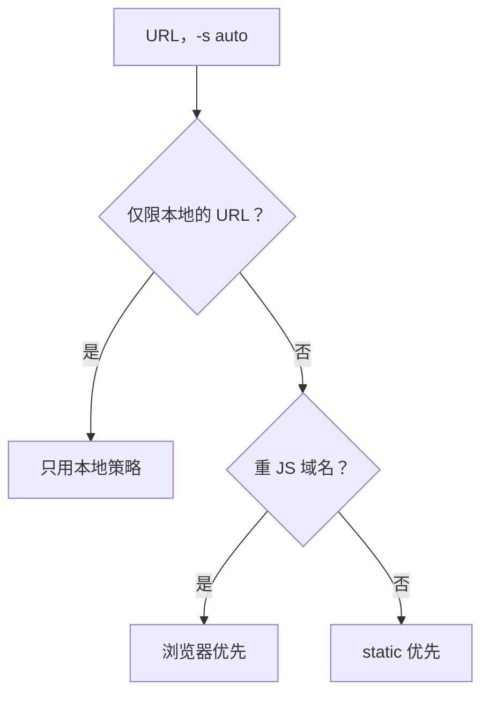
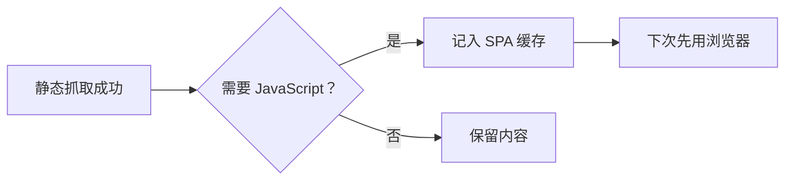

# 抓取策略引擎

给 markitai 一个 URL 时，它按从便宜到昂贵的顺序逐个尝试抓取策略，直到拿到可用的内容。

## 安装

浏览器策略和 curl-cffi 客户端是可选的。安装脚本会询问是否安装 Playwright 浏览器（默认是），装上 Chromium，Linux 上连同系统库；交互式安装也会带上 `browser` 和 `extra-fetch` 两个 extra。

<!--@include: ../../snippets/setup.md-->

::: details 手动安装
```bash
uv tool install "markitai[browser,extra-fetch]" --force
markitai doctor --fix     # 为 Playwright 包安装 Chromium
```
:::

## 策略选择逻辑

- **`-s <策略>`**（`static`、`playwright`、`defuddle`、`jina`、`cloudflare`）：只用那一种策略。远程服务拒绝时（限流、鉴权），markitai 回退到 `auto` 链，在终端里会先询问。`-s` 只代表同意这一个服务，其他服务仍按 `remote_consent`。
- **自定义顺序**：域名配置的 `strategy_priority` 或 `prefer_strategy`，或全局的 `fetch.policy.strategy_priority`。
- **`auto`**（默认）：下面两种顺序之一，最多尝试 `max_strategy_hops` 种策略，第一个通过[校验](#结果校验)的结果胜出：



仅限本地的 URL 指私有地址、带凭据，或匹配 `local_only_patterns`、`NO_PROXY` 的 URL（[见下文](#remote-fallback-and-local-only-urls)），它也优先于自定义顺序。

### 默认顺序（标准域名）

本机优先：内置静态抓取器的质量不输远程阅读服务，而且不把 URL 发给任何人。

<StrategyChain />

### SPA/重 JS 顺序

用于 `fetch.fallback_patterns`（默认 `twitter.com`、`x.com`、`instagram.com`、`facebook.com`、`linkedin.com`、`threads.net`）和[学到的](#spa-学习)域名：

<StrategyChain mode="spa" />

私有或仅限本地的 URL 只保留本地部分：先 static 后 Playwright，重 JavaScript 域名则反过来。

::: details X/Twitter 帖子
允许远程使用时，Playwright 对匿名帖子先尝试 FxTwitter，再尝试 Twitter oEmbed，然后才启动 Chromium；成功时标记为 `playwright(fxtwitter)` 或 `playwright(oembed)`，之后不再请求 defuddle。Cookie、自定义请求头、凭据、持久会话、截图或网络提取失败时仍会打开浏览器。导航返回 HTTP 错误时跳过等待，立即尝试这一补充提取；补充失败或被关掉时报告错误，`auto` 换下一个策略。
:::

### 远程后备与仅限本地的 URL {#remote-fallback-and-local-only-urls}

远程服务有 defuddle.md、Jina、Cloudflare，X/Twitter 帖子还有 FxTwitter 和 Twitter oEmbed。markitai 逐个尝试，URL 只发给正在尝试的那一个。首次使用时在 stderr 显示一行提示，并记在 `~/.markitai/notices/remote-fetch`（VLM OCR 同理）。

无论什么策略都只走本地：

- localhost、私有 IP 和常见的内网主机名
- 带凭据的 URL：userinfo、token、签名、密码、API key、授权码

| 设置 | 效果 | `-s` 能否覆盖 |
|------|------|--------------|
| `remote_consent: always`（默认） | 公开 URL 可远程回退，在 stderr 提示 | — |
| `remote_consent: ask` | 每个进程为所有远程服务问一次；无终端则都不用 | — |
| `remote_consent: never` | 自动和配置的策略只走本地 | 能 |
| `local_only_patterns`、`NO_PROXY` | 匹配的域名在 `auto` 里只走本地 | 能 |
| 私有、内网或带凭据的 URL | 本地 | **不能** |
| `MARKITAI_NO_REMOTE_FETCH=1` | 本地 | **不能** |

配置文件里设的远程 `fetch.strategy` 不算主动选择：仍受 `remote_consent` 管。

::: details 返回 Fake-IP 地址的代理
Clash 等代理返回 Fake-IP 地址（`198.18.0.0/15`、`2001:2::/48`）时，远程抽取会通过 [Cloudflare DNS over HTTPS](https://developers.cloudflare.com/1.1.1.1/encryption/dns-over-https/make-api-requests/dns-json/) 复核域名的公网 A 和 AAAA 记录；只在同意之后进行，DNS 只看到域名。复核失败或结果非公网时拦截远程抽取。非公网 IP 写成的 URL 和本机连接检查（包括未认证的 `serve` 请求）始终拦截。
:::

## 配置

写在 `markitai.json` 里：

```json
{
  "fetch": {
    "policy": { "max_strategy_hops": 5, "local_only_patterns": ["*.corp.example"] },
    "domain_profiles": {
      "app.example.com": { "wait_for": "networkidle", "extra_wait_ms": 2000 },
      "docs.example.com": { "prefer_strategy": "static" }
    },
    "playwright": { "session_mode": "domain_persistent", "session_ttl_seconds": 600 }
  }
}
```

### Policy 选项

| `fetch.policy` | 默认值 | 说明 |
|------|--------|------|
| `enabled` | `true` | 开关策略排序 |
| `max_strategy_hops` | `5` | 最多尝试几种策略（1–6） |
| `strategy_priority` | `null` | 全局策略顺序 |
| `local_only_patterns` | `[]` | 只走本地的域名和 IP（`NO_PROXY` 语法） |
| `inherit_no_proxy` | `true` | `NO_PROXY` 条目也只走本地 |

### 域名配置

| `fetch.domain_profiles.<域名>` | 默认值 | 说明 |
|------|--------|------|
| `wait_for_selector` | `null` | 等待的 CSS 选择器 |
| `wait_for` | `null` | `load`、`domcontentloaded` 或 `networkidle`；不设则继承 `fetch.playwright.wait_for` |
| `extra_wait_ms` | `null` | 额外等待上限，页面稳定即结束；不设则继承 `fetch.playwright.extra_wait_ms` |
| `prefer_strategy` | `null` | 优先尝试的策略 |
| `strategy_priority` | `null` | 完整顺序（覆盖全局顺序和 `prefer_strategy`） |
| `skip_auto_scroll` | `false` | 单内容页面不自动滚动 |
| `reject_resource_patterns` | `null` | 拦截匹配的浏览器请求，如 `["**/analytics/**"]` |

内置配置覆盖 `x.com`、`twitter.com` 和 `github.com`；你的配置只覆盖你设了的字段（`skip_auto_scroll: false` 恢复滚动，`reject_resource_patterns: []` 清空过滤，`null` 继承全局设置）。

### Playwright 会话持久化

| `fetch.playwright` | 默认值 | 说明 |
|------|--------|------|
| `session_mode` | `"isolated"` | `isolated`：每个请求新开上下文；`domain_persistent`：按域名复用 cookie 和存储（重复请求更快） |
| `session_ttl_seconds` | `600` | 持久会话保留时长（60–7200） |

## 静态 HTTP 适配器

静态策略用 httpx：

- 它以 `markitai/<版本> (+https://github.com/Ynewtime/markitai)` 表明身份，维基百科等拒绝库 User-Agent 的站点会响应它。遇到 401 或 403 时用桌面浏览器的请求头重试一次。
- 被 TLS 指纹拦截（403 或空内容）时，`auto` 转到 Playwright 或 Cloudflare。想不开浏览器就通过，用 curl-cffi（`extra-fetch`），它发送所模拟 Chrome 的 User-Agent；没装时静默使用 httpx：

  ```bash
  export MARKITAI_STATIC_HTTP=curl_cffi
  ```

- 不是 HTML 的响应按 `Content-Type`（或 `Content-Disposition` 文件名）像本地文件一样转换。

::: details 字符编码与链接
解码顺序同浏览器：BOM、`Content-Type` 的 charset、前 1024 字节里的 `<meta charset>`，最后检测。旧标签映射到浏览器用的超集（`gb2312`/`gbk` → GB18030，`shift_jis` → Windows-31J，`iso-8859-1` → Windows-1252）。相对链接和图片按重定向后的 URL 解析。
:::

## 工作原理

### 结果校验

内容为空或过短、登录墙、反爬或验证码页面（Geetest、Cloudflare、reCAPTCHA、hCaptcha）校验失败，转到下一个策略。

### SPA 学习



只有这个信号写入缓存（验证码、登录墙、网络错误都不会），且只检查 HTML 页面。域名 30 天未命中即移出；`markitai cache spa-domains` 查看或清除缓存。
