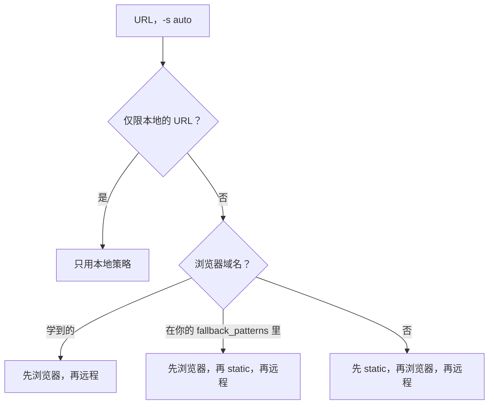
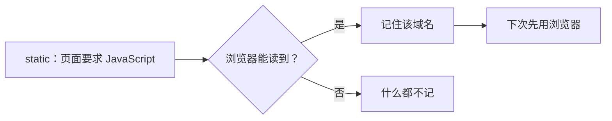

# 抓取策略引擎

给 markitai 一个 URL 时，它本地优先，逐个尝试抓取策略，直到拿到可用的内容。只有你选择了远程阅读服务或明确同意时，URL 才会离开本机发给它。

## 浏览器

需要 JavaScript 的页面和网页截图使用本机的 Chrome、Chromium 或 Edge，由 markitai 自己驱动。找不到浏览器时，安装脚本会提议装一个（可选组件，默认是）：

<!--@include: ../../snippets/setup.md-->

::: details 不用安装脚本
`markitai doctor --fix` 会把 Google 的 Chrome for Testing headless shell 下载到 `~/.markitai/browsers/native`（Windows ARM64 除外）。markitai 按以下顺序查找浏览器：`MARKITAI_BROWSER_EXECUTABLE`、它自己安装的浏览器、`PATH`、macOS 和 Windows 的常见位置（包括 Edge），最后是 Playwright 的浏览器目录（`PLAYWRIGHT_BROWSERS_PATH`，否则用它的默认缓存目录）。
:::

## 策略选择逻辑

- **`-s <策略>`**（`static`、`playwright`、`defuddle`、`jina`、`cloudflare`）：只用那一种策略。选定的远程阅读服务被拒绝或失败时，转换不会就此结束：页面改在本地读取（先 static，再浏览器），也不会去问别的远程服务。
- **自定义顺序**：域名配置的 `strategy_priority` 或 `prefer_strategy`，或全局的 `fetch.policy.strategy_priority`。
- **`auto`**（默认）：下面几种顺序之一，最多尝试 `max_strategy_hops` 种策略，第一个通过[校验](#result-validation)的结果胜出：



仅限本地的 URL 指私有地址、带凭据，或匹配 `local_only_patterns`、`NO_PROXY` 的 URL（[见下文](#remote-readers-and-local-only-urls)），它也优先于自定义顺序。

### 默认顺序

内置静态抓取器不用浏览器就能读取大多数文章，而且不把 URL 发给任何地方：

<StrategyChain />

### 浏览器优先的顺序

你自己写的 `fetch.fallback_patterns` 列表里的域名（及其子域名）从浏览器开始：

<StrategyChain mode="listed" />

markitai [学到](#spa-learning)需要 JavaScript 的域名跳过 static 尝试：

<StrategyChain mode="learned" />

`markitai config list` 显示的内置 `fallback_patterns` 列表不起作用；X 帖子从静态页面读取更快。

::: details X/Twitter 帖子
`auto` 用帖子读取器从 X 自己的静态页面读取帖子，通常只要一两秒。镜像地址（fxtwitter.com、vxtwitter.com、fixupx.com 等）按对应的 `x.com` 帖子读取，`t.co` 链接每个用一次请求解析。X 的地址不会发给任何其他服务。
:::

### 远程阅读服务与仅限本地的 URL {#remote-readers-and-local-only-urls}

远程阅读服务有 defuddle.md、Jina Reader 和 Cloudflare Browser Rendering（用你的账户）。markitai 逐个尝试，URL 只发给正在尝试的那一个。

| `fetch.remote_consent` | `auto` 是否回退到它们 | `-s defuddle/jina/cloudflare` |
|------------------------|-----------------------|-------------------------------|
| 没有写（`config list` 显示 `always`） | 从不；它们可能解决的失败会说明如何允许 | 运行 |
| 你自己写的 `always` | 是；第一次在 stderr 提示一行 | 运行 |
| `ask` | 在终端里每次运行问一次；没有终端（或用了 `--quiet`）则跳过并说明 | 运行 |
| `never`，或 `--no-remote-fetch` | 从不 | 拒绝，改在本地读取 |

```bash
markitai config set fetch.remote_consent always   # 1.x 默认就有的远程回退
```

无论什么策略或设置，下面这些都只走本地：

- localhost、私有 IP 和内网主机名（`.local`、`.internal`、`.lan`、`.home`、`.corp`、单标签主机名），以及解析到这些地址的主机
- 带凭据的 URL：userinfo；名字像机密的查询或片段参数（`token`、`key`、`password`、`pass`、`pw`、`passphrase`、`sig`、`code`、`session`、`apiKey` 等）；JWT 或看起来随机的长路径段；`/reset/`、`/verify/`、`/token/`、`/invite/` 等路由后面的 token（带数字的短码如 `/verify/123456` 也算）
- 设置了 `MARKITAI_NO_REMOTE_FETCH=1` 时的一切

消息、`--json`、frontmatter、报告、历史记录和网页工作台显示这类 URL 时去掉 userinfo，每个机密路径段和机密查询值都显示为 `REDACTED`；日志显示为 `[REDACTED]`，并且不保留查询和片段。`fetch.policy.local_only_patterns` 和 `NO_PROXY` 同样让匹配的域名只走本地；对公网 URL，单次运行的 `-s` 可以覆盖它们。在 `markitai serve` 里，只有你写下的 `always` 才会开启回退，[用户令牌](/zh/guide/serve-reference#user-tokens)的任务从不使用远程阅读服务；MCP 和各语言绑定从不回退到远程阅读服务。

## 配置 {#configuration}

写在 `markitai.json` 里：

```json
{
  "fetch": {
    "remote_consent": "always",
    "policy": { "max_strategy_hops": 5, "local_only_patterns": ["*.corp.example"] },
    "domain_profiles": {
      "app.example.com": { "wait_for": "networkidle", "extra_wait_ms": 2000 },
      "docs.example.com": { "prefer_strategy": "static" }
    }
  }
}
```

### Policy 选项

| `fetch.policy` | 默认值 | 说明 |
|--------|---------|-------------|
| `enabled` | `true` | 开关策略排序 |
| `max_strategy_hops` | `5` | 最多尝试几种策略（1–6） |
| `strategy_priority` | `null` | 全局策略顺序 |
| `local_only_patterns` | `[]` | 只走本地的域名和 IP（`NO_PROXY` 语法） |
| `inherit_no_proxy` | `true` | `NO_PROXY` 条目也只走本地 |

### 域名配置

域名配置只作用于完全相同的 `host[:port]`，不包括子域名。

| `fetch.domain_profiles.<域名>` | 默认值 | 说明 |
|--------|---------|-------------|
| `wait_for_selector` | `null` | 等待的 CSS 选择器 |
| `wait_for` | `null` | `load`、`domcontentloaded` 或 `networkidle`；不设则继承 `fetch.playwright.wait_for` |
| `extra_wait_ms` | `null` | 额外等待上限，页面稳定即结束；不设则继承 `fetch.playwright.extra_wait_ms` |
| `prefer_strategy` | `null` | 优先尝试的策略 |
| `strategy_priority` | `null` | 完整顺序（覆盖全局顺序和 `prefer_strategy`） |
| `skip_auto_scroll` | `false` | 单内容页面不自动滚动 |
| `reject_resource_patterns` | `null` | 拦截匹配的浏览器请求，如 `["**/analytics/**"]` |

内置配置覆盖 `github.com`、`x.com` 和 `twitter.com`（包括它们的 `www.` 和 `mobile.` 主机）；你的配置只覆盖你设了的字段。

### 浏览器会话

| `fetch.playwright` | 默认值 | 说明 |
|--------|---------|-------------|
| `session_mode` | `"isolated"` | `isolated`：每个页面新开一个浏览器上下文；`domain_persistent`：在一次运行内（一次 CLI 运行、一个 serve 任务、一个 MCP 连接）按域名复用 cookie 和存储 |
| `session_ttl_seconds` | `600` | 持久会话保留时长（60–7200） |

两次运行之间什么都不保留。登录用的 cookie 写在 `fetch.playwright.cookies` 里（[配置](/zh/guide/configuration#browser-settings)）。

## 静态抓取

- 它以 `markitai/<版本> (+https://github.com/Ynewtime/markitai)` 表明身份，维基百科等拒绝库 User-Agent 的站点会响应它。遇到 401 或 403 时用桌面浏览器的请求头重试一次；请求发出前连接就被断开时重试两次。超时不重试。
- PDF 响应交给 PDF 读取器；其他文档类型按 URL 的文件扩展名转换。
- CSV、TSV、reStructuredText、Org、LaTeX 和 notebook 文本按同格式本地文件的方式读取（CSV 会变成表格）：依据其类型（`text/csv`、`text/tab-separated-values` 等），或路径以 `.csv`、`.tsv`、`.rst`、`.org`、`.tex`、`.latex`、`.ipynb` 结尾的 `text/plain` 响应（原始文件托管站点就是这样提供它们的）。其他文本保持原样。
- 最多跟随 10 次重定向和 `<meta refresh>`；响应最大 500 MiB。markitai 自己发出的 HTTP 请求（页面、图片、远程服务）不发送 `Referer`，所以重定向不会把来源地址（以及其中的 token）告诉下一个站点。

::: details 字符编码与链接
解码顺序同浏览器：BOM、`Content-Type` 的 charset、前 1024 字节里的 `<meta charset>`，最后检测。旧标签按浏览器的方式映射（`gb2312`/`gbk` → GB18030，`shift_jis` → Windows-31J，`iso-8859-1` → Windows-1252）。相对链接和图片按重定向后的 URL 解析。
:::

## 工作原理

### 结果校验 {#result-validation}

内容为空或过短、登录墙、验证页面（微信、知乎等）以及反爬或验证码页面（Cloudflare、Turnstile、reCAPTCHA、hCaptcha、Geetest、DataDome、PerimeterX、Incapsula、AWS WAF）校验失败，转到下一个策略。错误信息会说明网站做了什么、可以试试什么。

### SPA 学习 {#spa-learning}



只有这个信号写入缓存（验证码、登录墙、网络错误都不会），且只检查 HTML 页面。域名 30 天未命中即移出；`markitai cache spa-domains` 查看或清除这些域名（最多 4,096 个）。

### 页面缓存

抓取到的 HTML 和文本页面缓存 `cache.fetch_ttl_seconds`（24 小时）；带 `ETag` 或 `Last-Modified` 的页面每次运行都会重新验证。`--no-cache` 跳过读取缓存，也会要求 Jina 不使用它的缓存。
