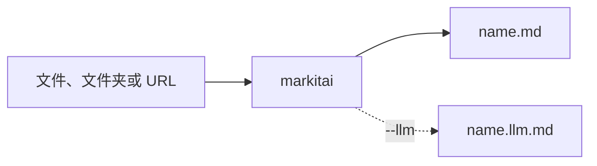

# 快速开始

## 安装

一条命令装好 uv、Python 3.13（找不到 3.11 到 3.13 时）和 markitai，再逐项询问可选组件：

<!--@include: ../../snippets/setup.md-->

| 组件 | 用途 | 默认 |
|------|------|------|
| markitai 及 `browser`、`extra-fetch`、`svg`、`heif`、`legacy`、`mcp` extra | 转换 | 总是安装 |
| 网页工作台（`serve`） | [`markitai serve`](/zh/guide/serve) | 装 |
| 本地 OCR（`ocr`，约 150 MB） | 扫描件和图片的 `--ocr` | 装 |
| Playwright Chromium，Linux 上连同其系统库 | 重 JS 页面、URL 截图 | 装 |
| Claude Code CLI 及 `claude-agent` extra | [Claude 订阅](/zh/guide/subscriptions) | 不装 |
| Copilot CLI 及 `copilot` extra | [Copilot 订阅](/zh/guide/subscriptions) | 不装 |

之后它会在没有配置时写一份默认配置，并预先加载库，第一次转换不必等待。再运行一次可补装没选的组件，已装的 extra 会保留。

没有交互终端时（CI、Dockerfile）只装核心。环境变量：

| 变量 | 作用 |
|------|------|
| `MARKITAI_INSTALL_OPTIONAL=1` | 不询问，装上全部可选组件（包括两个 CLI） |
| `MARKITAI_VERSION=X.Y.Z` | 固定 markitai 版本 |
| `MARKITAI_USE_MIRROR=1` / `0` | 总是选择 / 从不提供 PyPI 镜像（只在 PyPI 响应慢时提供，见[中国大陆用户指南](/zh/guide/configuration#中国大陆用户指南)） |
| `MARKITAI_SETUP_LOG=PATH` | 失败时完整日志的位置 |
| `NO_COLOR=1` | 不用颜色 |

::: details 手动安装
已有 Python 3.11 到 3.13 时：

```bash
uv tool install markitai                 # 推荐
uv tool install "markitai[all]" --force  # 带全部 extra
pipx install markitai
uv pip install markitai                  # 装进当前虚拟环境
```

之后补装某个 extra：`uv tool install "markitai[ocr]" --force`；可用的 extra 有 `markitai[browser]`、`markitai[ocr]`、`markitai[serve]`、`markitai[mcp]`、`markitai[claude-agent]`、`markitai[copilot]`、`markitai[legacy]`、`markitai[heif]`、`markitai[svg]`、`markitai[extra-fetch]` 和 `markitai[all]`。装了 browser extra 后，`markitai doctor --fix` 会装好 Chromium。

安装、升级或添加 extra 之后，运行一次 `markitai doctor` 加载这些库（macOS 上数秒，装了 OCR 时最多一分钟）；否则第一次转换会等待这一步并给出提示。

markitai 1.3.0 要求 `litellm>=1.83.0,!=1.92.0,<1.105` 和 `anthropic>=1.0.0,<2`：更新的 LiteLLM 版本会改变 markitai 依赖的模型价格和 OpenRouter 上限，Anthropic SDK 2 改用 Bearer 令牌发送 API 密钥，读取 `X-Api-Key` 的网关会拒绝 `--llm-batch`。不支持需要这两个包更新版本的环境。
:::

## 第一次转换

转一个真实网页，就是你正在读的这篇：

```bash
mkai https://markitai.dev/zh/guide/getting-started --pure
```

`mkai` 是 `markitai` 的短别名；`--pure` 打印纯 Markdown。想写成文件，给一个输出目录：

```bash
markitai document.docx -o output/
markitai https://example.com/article -o output/
markitai ./docs -o output/                # 批量转换，中断后加 --resume 接着跑
```



### 开启 LLM 增强

导出任意一家提供商的 API key，加上 `--llm`：

```bash
export GEMINI_API_KEY=...    # 或 OPENAI_ / ANTHROPIC_ / DEEPSEEK_ / OPENROUTER_API_KEY
markitai report.pdf -o output/ --llm
```

markitai 按找到的 key 自动选模型；`MODEL=provider/model` 可以自己指定。需要配置文件、订阅或多模型回退时，跑一遍引导配置：

```bash
markitai init
markitai doctor     # 装了什么、配了什么
```

**预设**打包了常用参数：`minimal` 只转换，`standard` 加 LLM 清洗和图片分析，`rich` 再加页面截图。用 `--no-*` 关掉其中一项，例如 `--preset rich --no-desc`。

**URL** 先在本机抓取；公开页面抓不到时可能回退到远程阅读服务（Defuddle、Jina 或 Cloudflare），并在 stderr 提示一次。私有、内网和带凭据的 URL 永远不出本机；`MARKITAI_NO_REMOTE_FETCH=1` 强制全部本地（[抓取策略](/zh/guide/fetch-policy)）。`-s jina` 读 `JINA_API_KEY`，`-s cloudflare` 读 `CLOUDFLARE_API_TOKEN` 和 `CLOUDFLARE_ACCOUNT_ID`。

## 输出结构

```text
output/
├── document.pdf.md          # Markdown（带 --llm 时默认只写 .llm.md，除非 --keep-base）
├── document.pdf.llm.md      # LLM 增强版
└── .markitai/
    ├── assets/              # 源文档里的图片，以及图片描述 images.json
    ├── screenshots/         # 页面、幻灯片或整页截图（--screenshot）
    ├── reports/             # 批量运行的 JSON 报告
    └── states/              # 供 --resume 使用的批量状态
```

输出文件名是完整输入名加 `.md`，所以 `report.pdf` 和 `report.docx` 不会互相覆盖。

## 支持的格式

| 格式 | 扩展名 |
|------|--------|
| Office | `.docx`、`.doc`、`.pptx`、`.ppt`、`.xlsx`、`.xls`、`.odt`、`.ods`、`.numbers`（需要 `-b cloudflare`） |
| PDF | `.pdf` |
| 文本与标记 | `.txt`、`.md`、`.markdown`、`.html`、`.htm`、`.xhtml`、`.xml`、`.csv`、`.tsv`、`.rtf`、`.rst`、`.org`、`.tex` |
| 图片 | `.jpg`、`.jpeg`、`.png`、`.webp`、`.svg`、`.gif`、`.bmp`、`.tiff`、`.tif`、`.heic`、`.heif`、`.avif`（后三种需要 `markitai[heif]`） |
| 其他文档 | `.epub`、`.eml`、`.msg`、`.ipynb` |
| URL | `http://`、`https://` |

旧版 `.doc`、`.ppt` 需要 `markitai[legacy]`，不用装 Office。

## 平台说明

Windows、Linux、macOS 功能一致，以下几点除外：

| 平台 | 说明 |
|------|------|
| EMF/WMF 图片 | 只在 Windows 上转换（格式本身是 Windows 专有的） |
| PPTX 幻灯片截图 | 需要渲染器：Windows 用 Office 或 LibreOffice，Linux 用 LibreOffice（`apt-get install libreoffice`）；macOS 见下文 |
| Windows on Arm | markitai 运行在模拟的 x64 Python 上，安装脚本会选用或安装它；比 x64 电脑慢 |

::: details macOS 幻灯片截图
macOS 优先用 LibreOffice（`brew install --cask libreoffice`），否则调用已装的 PowerPoint，首次会请求一次授权，且需要桌面会话。较新的 macOS 会直接拒绝终端写入 PowerPoint 的容器（`Operation not permitted`，不弹窗）：在「系统设置 → 隐私与安全性 → 完全磁盘访问权限」中为终端 App 授权，或安装 LibreOffice。无头 Mac 上设 `"office": { "macos_fallback": false }`。
:::

::: details Windows on Arm
markitai 依赖的部分库没有 ARM64 版本：每个 PDF 都要用的 pymupdf-layout 完全没有，LLM 库依赖的几个包则需要用 Rust 编译。`setup.ps1` 会选用 x64 Python（没有就用 uv 安装一个）并给出说明。直接用 uv 安装时请指定：`uv tool install markitai --python cpython-3.13-windows-x86_64`。在原生 ARM64 Python 上安装会停在 `pymupdf-layout ... has no wheels with a matching platform tag (e.g., win_arm64)`。
:::

## 下一步

- [配置说明](/zh/guide/configuration)：LLM 提供商与全部设置
- [CLI 命令](/zh/guide/cli)：每个命令和参数
