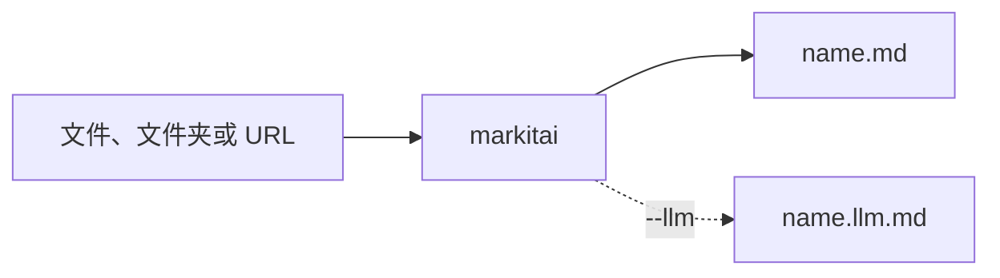

# 快速开始

## 安装 {#install}

一条命令装好 markitai。它是一个原生程序，不需要配置 Python、Node.js 或其他运行时：

<!--@include: ../../snippets/setup.md-->

脚本下载适合你机器的发布包，用该版本的 `SHA256SUMS` 校验，然后安装 `markitai`、它的短别名 `mkai` 和 `markitai-mcp`（供 [MCP 客户端](/zh/guide/mcp)使用）。不需要 root 或管理员权限。

| 内容 | 位置 |
|------|------|
| 命令 | `~/.local/bin`；Windows 为 `%LOCALAPPDATA%\Programs\markitai`，并加入用户 Path |
| 许可声明、离线指南 | `~/.local/share/markitai/current`；Windows 上与命令同一个文件夹 |
| 你的设置和缓存 | `~/.markitai`（`%USERPROFILE%\.markitai`） |

有交互终端时，它接着询问是否准备可选组件（即 `markitai doctor --fix`）：本地 OCR 模型（约 45 MB），以及在找不到 Chrome 或 Chromium 时的 Chrome headless shell（约 280 MB）。首次安装还会运行 `markitai init --yes`，保存它找到的 API key 和订阅对应的模型（从不保存 key 本身；LLM 保持关闭）。从 markitai 1.x 过来？它会替换用 uv 安装的 1.x，见[从 1.x 升级](/zh/guide/upgrading)。

| 变量 | 作用 |
|------|------|
| `MARKITAI_VERSION=X.Y.Z` | 安装这个版本，而不是最新版 |
| `MARKITAI_INSTALL_DIR=DIR` | 换一个文件夹；之后的更新和卸载沿用它。Windows 上请用空文件夹或专用文件夹：已有与安装文件同名文件的文件夹会被拒绝 |
| `MARKITAI_INSTALL_OPTIONAL=1` / `0` | 不询问直接准备可选组件 / 从不准备 |
| `MARKITAI_DOWNLOAD_URL=URL` | 从 GitHub Releases 的镜像下载 |
| `NO_COLOR=1` | 不用颜色 |

再运行一次安装命令即可更新。安装脚本会留一份清单（receipt），记下它装了哪些文件：更新只替换、卸载只删除这些文件；Windows 上只有安装脚本自己加的用户 Path 条目才会被移除。新版本先放到暂存位置再替换，所以 Windows 上更新失败时，旧版本原样保留。卸载（`~/.markitai` 会保留）：

::: code-group
```bash [Linux/macOS]
curl -fsSL https://markitai.dev/setup.sh | sh -s -- --uninstall
```

```powershell [Windows]
& ([scriptblock]::Create((irm https://markitai.dev/setup.ps1))) -Uninstall
```
:::

::: details 其他安装方式
**发布包。** 每个 [GitHub Release](https://github.com/Ynewtime/markitai/releases) 为每个平台提供一个发布包，另有 `SHA256SUMS` 和构建来源证明（provenance）：

| 平台 | 发布包 |
|------|--------|
| macOS，Apple 芯片 | `markitai-v<version>-aarch64-apple-darwin.tar.gz` |
| macOS，Intel | `markitai-v<version>-x86_64-apple-darwin.tar.gz` |
| Linux x86-64 | `markitai-v<version>-x86_64-unknown-linux-gnu.tar.gz` |
| Linux ARM64 | `markitai-v<version>-aarch64-unknown-linux-gnu.tar.gz` |
| Windows x64 | `markitai-v<version>-x86_64-pc-windows-msvc.zip` |
| Windows ARM64 | `markitai-v<version>-aarch64-pc-windows-msvc.zip` |

解压到一个新文件夹，文件放在一起，再把该文件夹加进 `PATH`。用 `sha256sum -c SHA256SUMS --ignore-missing` 校验下载（macOS：`grep <archive> SHA256SUMS | shasum -a 256 -c`），用 `gh attestation verify <archive> --repo Ynewtime/markitai` 核实来源。

**pip 或 uv。** PyPI 上的 `markitai` 包带的是同一个程序，安装同样的三个命令（需要 Python 3.10 或更高版本；附带 [Python API](/zh/guide/python-api)）。PyPI 只有这六个平台的 wheel，没有源码包，所以在其他平台上 pip 会安装或保留 markitai 1.x：

```bash
uv tool install markitai     # 或：pipx install markitai、pip install markitai
```

**从源码构建。** 需要 Rust 1.92 或更高版本，以及 C/C++ 工具链：

```bash
git clone https://github.com/Ynewtime/markitai && cd markitai
cargo build --release --locked -p markitai-cli   # target/release/markitai 和 mkai
```

在没有 wheel 的平台上，可以用该版本的源码包 `markitai-<version>.tar.gz` 在装有 Rust 的机器上构建 Python 包：`pip install markitai-<version>.tar.gz`。
:::

## 第一次转换

转一个真实网页，就是你正在读的这篇：

```bash
mkai https://markitai.dev/zh/guide/getting-started --pure
```

`--pure` 打印纯 Markdown，不带生成的 frontmatter。想写成文件，给一个输出目录：

```bash
markitai document.docx -o output/
markitai https://example.com/article -o output/
markitai ./docs -o output/                # 批量转换，中断后加 --resume 接着跑
```



### 开启 LLM 增强

导出任意一家提供商的 API key，加上 `--llm`：

```bash
export GEMINI_API_KEY=...    # 或 OPENAI_ / ANTHROPIC_ / DEEPSEEK_ / OPENROUTER_API_KEY
markitai report.pdf -o output/ --llm
```

markitai 按找到的 key 和已登录的订阅选模型；`MODEL=provider/model` 可以自己指定。需要配置文件或多个模型时，运行：

```bash
markitai init       # 把检测到的内容写进 ~/.markitai/config.json
markitai doctor     # 装了什么、配了什么、什么已就绪
```

**预设**打包了常用参数：`minimal` 只转换，`standard` 加 LLM 清洗和图片分析，`rich` 再加页面截图。用 `--no-*` 关掉其中一项，例如 `--preset rich --no-desc`。

**URL** 在本机读取：先用普通 HTTP，需要 JavaScript 的页面再用本机的 Chrome 或 Chromium。远程阅读服务（Defuddle、Jina、Cloudflare）只在你用 `-s` 选中或主动开启时才用（[抓取策略](/zh/guide/fetch-policy)）。

## 输出结构

```text
output/
├── document.pdf.md          # Markdown（带 --llm 时只写 .llm.md，除非 --keep-base）
├── document.pdf.llm.md      # LLM 增强版
└── .markitai/
    ├── assets/              # 图片，按内容命名；带 --alt/--desc 时还有 images.json
    ├── screenshots/         # 页面和幻灯片图片（--screenshot）
    ├── reports/             # 批量运行的 JSON 报告
    ├── states/              # 供 --resume 使用的批量状态
    └── ownership/           # markitai 写过哪些文件（内部使用）
```

- 输出文件名是完整输入名加 `.md`，所以 `report.pdf` 和 `report.docx` 不会互相覆盖。再次转换会写成 `report.pdf.v2.md`（`output.on_conflict`：`rename`、`overwrite` 或 `skip`）。
- 不带 `-o` 时，Markdown 输出到 stdout，图片放进 `~/.markitai/assets/blobs/`，以 `file://` URL 链接。
- 单独一张图片需要 `--ocr` 或 `--llm`；没有它们时会跳过（退出码 `0`）。

## 支持的格式

| 格式 | 扩展名 |
|--------|------------|
| Word、OpenDocument 文本、RTF | `.docx`、`.docm`、`.dotx`、`.dotm`、`.doc`、`.dot`、`.odt`、`.ott`、`.rtf` |
| 演示文稿 | `.pptx`、`.pptm`、`.ppsx`、`.ppsm`、`.potx`、`.potm`、`.ppt`、`.pps`、`.pot`、`.odp`、`.otp` |
| 电子表格 | `.xlsx`、`.xlsm`、`.xlsb`、`.xltx`、`.xltm`、`.xls`、`.xlt`、`.ods`、`.ots`、`.numbers`、`.csv`、`.tsv` |
| PDF | `.pdf` |
| 网页与标记 | `.html`、`.htm`、`.xhtml`、`.xml`、`.md`、`.markdown`、`.txt`、`.json`、`.ipynb`、`.rst`、`.org`、`.tex`、`.latex` |
| 图片 | `.jpg`、`.jpeg`、`.png`、`.webp`、`.gif`、`.bmp`、`.tif`、`.tiff`、`.svg`、`.heic`、`.heif`、`.avif` |
| 电子书与邮件 | `.epub`、`.eml`、`.msg` |
| URL | `http://`、`https://`，以及 `.urls` 列表 |

所有读取器都是内置的，包括旧版 `.doc`、`.ppt` 和 `.xls`。有三样东西要用到你机器上的其他程序：

| 需要 | 用于 |
|-------|-----|
| Chrome 或 Chromium（`markitai doctor --fix` 会安装 Chrome 的 headless shell） | 需要 JavaScript 的页面、网页截图 |
| LibreOffice | Office 文件的页面和幻灯片图片（`--screenshot`、幻灯片 OCR）、EMF/WMF 图片 |
| OCR 模型（`markitai doctor --fix`，或第一次 `--ocr`） | 扫描件和图片的本地 OCR |

## 平台说明

| 平台 | 说明 |
|----------|------|
| macOS | 11 或更高版本，Apple 芯片或 Intel。本地 OCR 可以用系统的 Vision 引擎（`MARKITAI_OCR_BACKEND=vision`） |
| Linux | x86-64 或 ARM64，glibc 2.28 或更高版本（RHEL 8、Debian 10、Ubuntu 18.10 及更新版本）；不支持 musl（Alpine） |
| Windows | x64 或 ARM64，都是原生构建 |

::: details macOS：下载的文件提示「Apple 无法验证」
构建没有代码签名，也没有经过公证。安装脚本和 `curl` 下载不受影响；浏览器下载的文件会受影响。确认可信后，清除它的隔离标记：`xattr -d com.apple.quarantine markitai-v<version>-aarch64-apple-darwin.tar.gz`。
:::

## 下一步

- [配置说明](/zh/guide/configuration)：LLM 提供商与全部设置
- [CLI 命令](/zh/guide/cli)：每个命令和参数
- [从 1.x 升级](/zh/guide/upgrading)：如果你用过 Python 版 markitai
