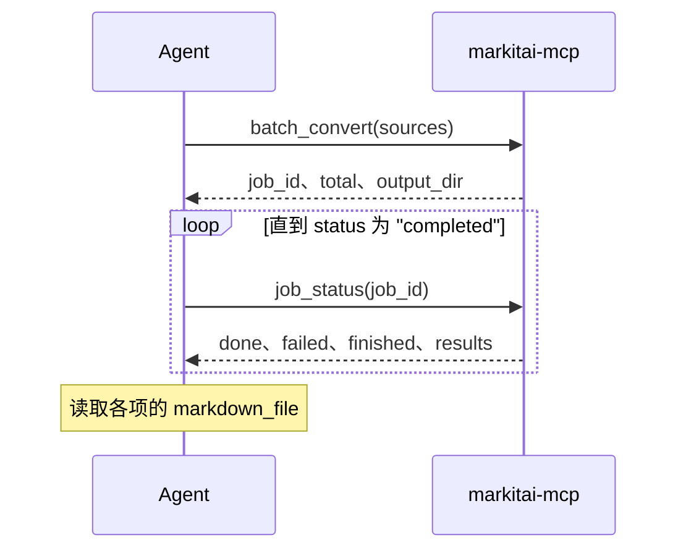

# MCP 服务器

`markitai-mcp` 通过 [Model Context Protocol](https://modelcontextprotocol.io)（stdio）把 markitai 的转换交给 AI Agent，走和 CLI 相同的管线。每种安装方式都自带它；`markitai mcp` 启动的是同一个服务。


## 接入

运行安装脚本后，让客户端指向装好的命令：

<!--@include: ../../snippets/setup.md-->

```bash
# Claude Code
claude mcp add markitai -- markitai-mcp
```

```json
// Claude Desktop：claude_desktop_config.json（其他客户端：command 和参数相同）
{
  "mcpServers": {
    "markitai": { "command": "/home/user/.local/bin/markitai-mcp" }
  }
}
```

填安装脚本打印出的绝对路径（Windows 上是 `%LOCALAPPDATA%\Programs\markitai\markitai-mcp.exe`）：桌面客户端不一定读取你 shell 的 `PATH`。

::: details 不安装：uvx
`uvx` 按需拉取 PyPI 包，里面是同一个程序（限 PyPI 有 wheel 的六个平台；在其他平台上它找不到可运行的包）：

```json
{ "mcpServers": { "markitai": { "command": "uvx", "args": ["--from", "markitai", "markitai-mcp"] } } }
```

[MCP Registry](https://registry.modelcontextprotocol.io) 条目（`io.github.Ynewtime/markitai`）以 `uvx --from markitai==<version> markitai mcp` 启动同一个服务器。
:::

两种命令都和 CLI 一样，先加载 `./.env`，再加载 `~/.markitai/.env`；已设置的变量（客户端的 `env` 块）优先。要单独一套设置，加上 `"args": ["--config", "/abs/path/config.json"]` 或 `"env": {"MARKITAI_HOME": "..."}`。

## 工具

| 工具 | 用途 |
|------|------|
| `convert_document` | 单个本地文件（绝对路径；会展开 `~`） |
| `convert_url` | 单个网页，只取正文；或某个 URL 提供的 PDF |
| `batch_convert` | 多个路径或 URL 后台转换，返回 `job_id` |
| `job_status` | 批量任务的进度和逐项结果 |

| 选项 | 说明 |
|------|------|
| `llm`、`ocr`、`screenshot`、`alt`、`desc` | 省略时由服务的配置决定（默认全部关闭）。`llm: true` 可能产生提供商费用 |
| `output_dir` | 绝对路径；省略时新建一个 `markitai-mcp-*` 临时目录，并保留下来供客户端读取 |
| `profile` | `rag`、`obsidian` 或 `okf`（[输出 Profile](/zh/guide/output-profiles)） |

结果带 `markdown`、写出的路径（`markdown_file`、`assets`、`screenshots`）、`cost_usd`、`duration_s` 和 `warnings`，既作为结构化内容，也作为 JSON 文本给出。超过 40,000 个字符时 Markdown 只给 2,000 个字符的预览（`truncated: true`），完整文本在 `markdown_file` 里。

`warnings` 列出没让调用失败、但需要留意的情况：疑似扫描页（加 `ocr: true` 重试）、PDF 隐藏文字（可能是提示注入）、OCR 没识别出文字、没有 LibreOffice 而无法渲染的幻灯片、URL 截图没拍到、图片分析失败，或 LLM 增强失败（返回未增强的结果；设 `llm.on_failure = "fail"` 则调用失败）。

错误会写明原因：文件不存在、传了目录、相对路径（服务的工作目录不是客户端的）、URL 不可达、转换失败、图片既没开 OCR 也没开 LLM，或没配模型却传了 `llm: true`（错误里会说明如何配置）。在 MCP 里，`auto` 从不把 URL 发给远程阅读服务。

### 批量任务



- `done` + `failed` = `finished`，总数为 `total`。某一项失败不影响其他项。
- 各项写入 `output_dir/batch-<job_id>/0001/`、`0002/` 等；`concurrency`（默认 10）限制并行转换数。每个任务最多 10,000 个来源。
- 任务记录只在内存里：重启即丢失（文件仍在），并且只保留最近完成的 100 个任务。

## LLM 增强

模型解析和 CLI 一样：先看 `~/.markitai/config.json` 里的 `llm.model_list`（[与 CLI 共用](/zh/guide/configuration)），再看 `MODEL`，最后是已登录的订阅和检测到的 API key。检测到多个提供商时共用一个模型池；设 `MODEL` 可固定一个。key 也可以写在服务条目里：

```json
{
  "mcpServers": {
    "markitai": {
      "command": "/home/user/.local/bin/markitai-mcp",
      "env": {
        "MODEL": "openai/gpt-6-luna",
        "OPENAI_API_KEY": "sk-..."
      }
    }
  }
}
```

## 可选能力

- **OCR** 已内置；它的模型在第一次 `ocr: true` 时下载，也可以用 `markitai doctor --fix` 提前下载。
- **URL 截图和 JavaScript 页面**需要 Chrome 或 Chromium（`doctor --fix` 会装一个）；Office 页面图片需要 LibreOffice。
