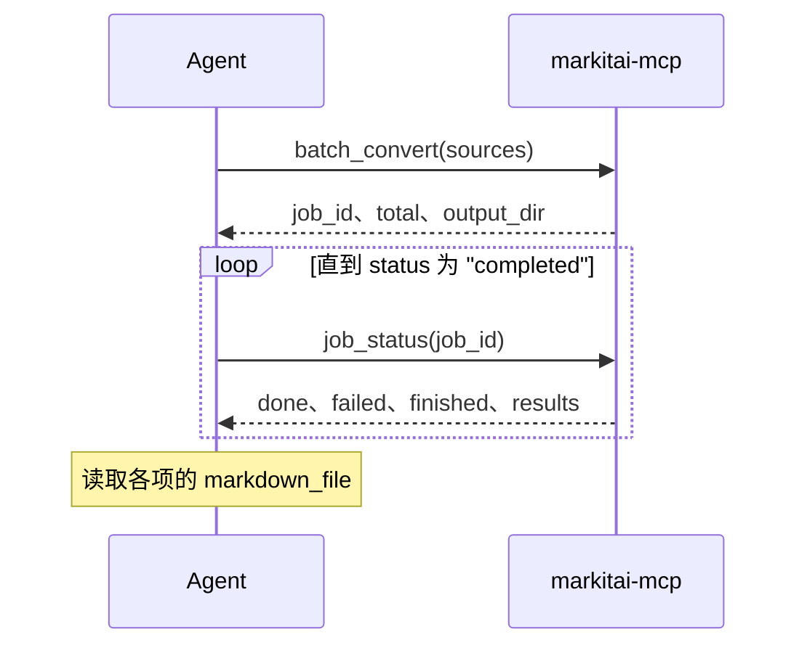

# MCP 服务器

`markitai-mcp` 通过 [Model Context Protocol](https://modelcontextprotocol.io)（stdio）把 markitai 的转换交给 AI Agent，走和 CLI 相同的管线。


## 接入

客户端可以用 `uvx` 启动，它按需拉取 markitai，不用先安装。

```bash
# Claude Code
claude mcp add markitai -- uvx --from "markitai[mcp]" markitai-mcp
```

```json
// Claude Desktop：claude_desktop_config.json（其他客户端：command 和参数相同）
{
  "mcpServers": {
    "markitai": { "command": "uvx", "args": ["--from", "markitai[mcp]", "markitai-mcp"] }
  }
}
```

想长期装着 markitai，安装脚本交互运行时会带上 `mcp` extra（以及 OCR 和浏览器），之后客户端的 command 填 `markitai-mcp`：

<!--@include: ../../snippets/setup.md-->

::: details 手动安装
```bash
uv tool install "markitai[mcp]"   # 或：pip install "markitai[mcp]"
```

`markitai mcp` 启动的是同一个服务，[MCP Registry](https://registry.modelcontextprotocol.io) 条目用的就是这种写法。
:::

两种命令都和 CLI 一样，先加载 `./.env`，再加载 `~/.markitai/.env`。已设置的变量（客户端的 `env` 块）优先；文件夹里的 `.env` 不能设置程序、路径、端点、代理或凭据文件。

## 工具

| 工具 | 用途 |
|------|------|
| `convert_document` | 单个本地文件（绝对路径） |
| `convert_url` | 单个网页，只取正文 |
| `batch_convert` | 多个路径或 URL 后台转换，返回 `job_id` |
| `job_status` | 批量任务的进度和逐项结果 |

| 选项 | 说明 |
|------|------|
| `llm` | 省略时由服务的配置决定（`llm.enabled`，默认关闭）；`true` 可能产生提供商费用 |
| `output_dir` | 绝对路径；省略时新建临时目录 |
| `profile` | `rag`、`obsidian` 或 `okf`（[输出 Profile](/zh/guide/output-profiles)） |

结果带写出的路径（`markdown_file`、`assets`、`screenshots`）、`cost_usd` 和 `warnings`。超过约 40,000 个字符时 Markdown 只给预览（`truncated: true`），完整文本在 `markdown_file` 里。

`warnings` 列出没让调用失败、但需要留意的情况：疑似扫描页（加 `ocr: true` 重试）、PDF 隐藏文字（可能是提示注入）、OCR 没识别出文字、URL 截图没拍到、图片分析失败，或 LLM 增强失败（返回未增强的结果；设 `llm.on_failure = "fail"` 则调用失败）。

错误会写明原因：文件不存在、传了目录、相对路径（服务的工作目录不是客户端的）、URL 不可达、转换失败，或没配模型却传了 `llm: true`（错误里带着下面的配置方法）。

### 批量任务



- `done` + `failed` = `finished`，总数为 `total`。某一项失败不影响其他项。
- 每项写入 `output_dir/batch-<job_id>/<item_number>/`；`concurrency`（默认 10）限制并行数。
- 任务记录只在内存里：重启即丢失（文件仍在），已完成的任务在之后又有 100 个完成时被丢弃。

## LLM 增强

模型解析和 CLI 一样：先看 `~/.markitai/config.json` 里的 `llm.model_list`（[与 CLI 共用](/zh/guide/configuration)），再看 `MODEL`，最后是检测到的 API key（比如 `markitai init` 写进 `~/.markitai/.env` 的）和已登录的订阅。检测到多个提供商时共用一个模型池；设 `MODEL` 可固定一个。key 也可以写在服务条目里：

```json
{
  "mcpServers": {
    "markitai": {
      "command": "uvx",
      "args": ["--from", "markitai[mcp]", "markitai-mcp"],
      "env": {
        "MODEL": "openai/gpt-6-luna",
        "OPENAI_API_KEY": "sk-..."
      }
    }
  }
}
```

## 可选能力

- OCR：`ocr` extra；URL 截图：`browser` extra。uvx 场景：`"args": ["--from", "markitai[mcp]", "--with", "markitai[ocr]", "markitai-mcp"]`。
