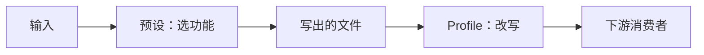

# 输出 Profile

[预设](./configuration.md#预设)决定跑哪些功能；profile 为某个消费者改写写出的文件。不设 profile 时不改写任何内容。



| Profile | 改动 |
|---|---|
| `rag` | 图片移到可见的 `assets/`、`<!-- page: N -->` 页码标记、表格检查 |
| `obsidian` | 图片移到可见的 `assets/`，可选 wikilink |
| `okf` | frontmatter 改用 OKF 字段 |

## 启用 profile

```bash
# CLI
markitai document.pdf --profile rag -o out/
```

```json
// markitai.json
{ "output": { "profile": "rag" } }
```

```python
# Python API
import markitai

out = markitai.convert("document.pdf", output_dir="out/", profile="rag")
```

## `rag` — 检索管道

LlamaIndex 的 `SimpleDirectoryReader` 等摄取器会跳过隐藏路径，比如默认的 `.markitai/assets/`。`rag`：

- **可见资源**：图片移到 `assets/`，引用同步改写。
- **页码标记**：PDF 真实分页处写 `<!-- page: N -->`（替代 `<!-- Page number: N -->`）。
- **表格检查**：列数与表头不一致的行会报警告；带 `--llm` 时提示词要求各行列数一致。

```text
out/
├── document.pdf.md          # 引用形如 
└── assets/
    ├── document.pdf-0001-10.jpg
    └── images.json          # 带 --llm --desc 时生成
```

页面截图留在 `.markitai/screenshots/`，不进语料。

## `obsidian` — 导入 vault

- **可见资源**，同 `rag`：vault 里不会出现隐藏文件夹。
- **Wikilink**：设 `output.wikilinks: true` 后写成 `![[assets/x.png]]`，alt 文本保留为显示文本。
- markitai 的 frontmatter（`title`、`source`、`tags`）在 Obsidian 里显示为 Properties。

```bash
markitai note.docx --profile obsidian -o vault/inbox/
markitai note.docx --profile obsidian --config-json '{"output":{"wikilinks":true}}' -o vault/inbox/
```

## `okf` — Open Knowledge Format

把 frontmatter 映射到 [Open Knowledge Format](https://github.com/GoogleCloudPlatform/knowledge-catalog/blob/main/okf/SPEC.md) 规范（v0.2）；资源位置不变。

| markitai 字段 | OKF 字段 |
|---|---|
| — | `type: Document`（OKF 唯一的必填字段；每个文件都会加上） |
| `source` | `resource` |
| `markitai_processed` | `generated: {by: markitai/<version>, at: <UTC 时间戳>}` |
| `title`、`description`、`tags` 及其他 | 不变（OKF 读取方接受未知字段） |

```yaml
---
type: Document
title: Quarterly report
resource: report.pdf
generated:
  by: markitai/1.3.0
  at: '2026-08-25T01:42:13Z'
---
```

## images.json schema（已冻结）

带 `--llm --desc` 时，每个资源目录会生成一份 `images.json`。schema 冻结在 1.0 版本。

顶层：

| 字段 | 类型 | 说明 |
|---|---|---|
| `version` | string | `"1.0"` |
| `created` | string | ISO 8601，首次写入（合并时保留） |
| `updated` | string | ISO 8601，最近一次写入 |
| `images` | array | 每张图片一条 |

`images` 里的每一条：

| 字段 | 类型 | 说明 |
|---|---|---|
| `path` | string | 图片绝对路径 |
| `alt` | string | 短标题（alt 文本） |
| `desc` | string | 详细描述 |
| `text` | string | 图片里的文字（可能为空） |
| `created` | string | ISO 8601，分析时间 |
| `source` | string | 源文档绝对路径 |

## Recipe：LlamaIndex 摄取

用了 `rag`，Markdown 和图片都进入语料：

```python
import markitai
from llama_index.core import SimpleDirectoryReader

out = markitai.convert("report.pdf", output_dir="corpus/", profile="rag")
print(out.frontmatter["title"])  # 可直接当元数据
print([p.name for p in out.assets])  # 图片现在在 corpus/assets/ 下

# 读取器能看到全部文件：markdown、图片、images.json
documents = SimpleDirectoryReader("corpus/").load_data()
print(len(documents))
```

## 注意

- Profile 只改写本次运行写出的文件：别在同一个目录里混用带 profile 和不带 profile 的运行。
- stdout 模式（不带 `-o`）不写文件，profile 不起作用。
- 批量报告和 `--resume` 状态留在 `.markitai/`；嵌套批量时每个子目录各有一个 `assets/`。
