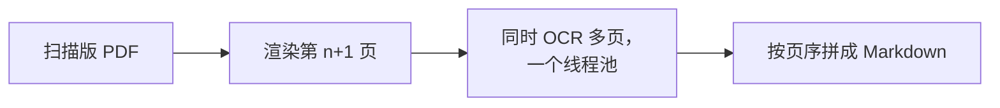
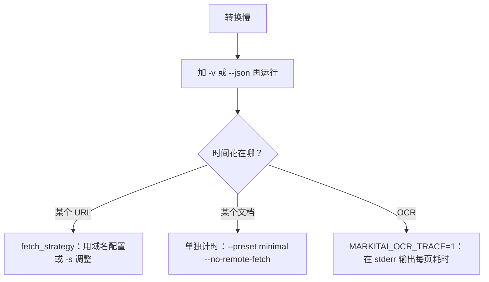

# 转换性能

## 转换为什么快

- **一个原生程序**：没有要启动的解释器，也没有工作进程；读取器、OCR 和浏览器驱动都在 markitai 内部运行（需要时 Chrome 在旁边单独运行）。
- **URL 本地优先**：大多数文章在 static 策略内完成，不启动浏览器；X 帖子从 X 的静态页面读取，一两秒即可（[抓取策略](./fetch-policy)）。
- **三个独立的上限**，慢速的模型调用不会挤占文件转换：

| 上限 | 默认 | 设置方式 |
|-------|---------|----------|
| 同时转换的文件数 | 10 | `-j`、`batch.concurrency` |
| 同时转换的 URL 数 | 5 | `--url-concurrency`、`batch.url_concurrency` |
| 同时进行的 LLM 请求数 | 10 | `--llm-concurrency`、`llm.concurrency` |

- **缓存**应对重复：模型应答（包括图片分析）存在 `cache.db`，抓取过的页面存在 `fetch_cache.db`，[学到的浏览器域名](./fetch-policy#spa-learning)会跳过 static 尝试。

| 工作 | 运行方式 |
|------|-------------|
| PDF 解析 | 256 KiB 及以上的文件每核一个线程；更小的文件用一个线程 |
| 本地 OCR | 一个与可用核数等大的线程池（`MARKITAI_OCR_THREADS` 可设置）；扫描件的页面两到四页同时识别，同时渲染下一页 |
| OCR 内存 | 同时最多两页处于文字检测（最占内存的一步） |
| 首次 OCR | 只加载一次模型；模型已安装时，`markitai serve` 启动即加载，第一个任务不必等待 |
| macOS Vision | 首次使用时编译系统模型（约 20 秒） |

OCR 引擎单线程和多线程给出的文字相同。

## 排查慢速转换

- `--json` 报告每一项的 `duration_s` 和最终胜出的 `fetch_strategy`；Markdown 的 frontmatter 也会写明策略。
- 第一次 `--ocr` 会下载模型，第一个浏览器页面会启动 Chrome：请以第二次运行计时。
- `--no-cache` 跳过 markitai 自己的缓存，并请 Jina 跳过它的缓存；defuddle.md 仍可能返回最多五分钟前的读取结果。
- 评估实际工作流时，保留平时的增强与 OCR 选项再测。
