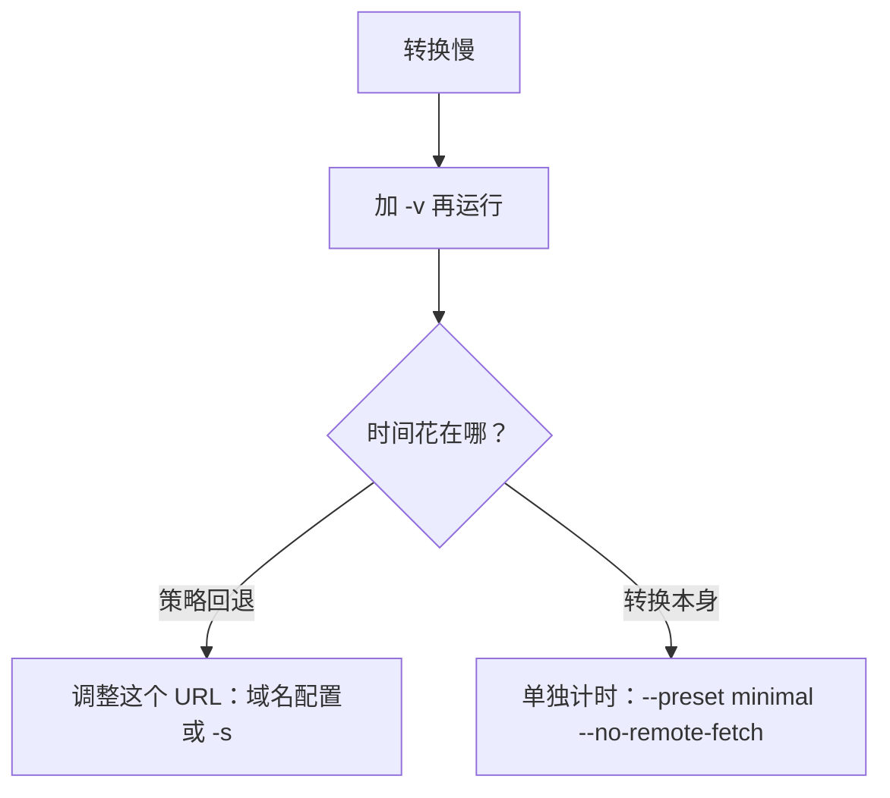

# 转换性能

## 转换为什么快

- **URL 本地优先**：短文和中日韩正文通常在 static 策略内完成，不启动浏览器（见[抓取策略](./fetch-policy)）。
- **文件只加载其格式的后端**：普通 Office 文档走专用路径；复杂内容、公式和含歧义的表格值保留回退读取器。
- **长 PDF 交给工作进程**（CLI、`markitai serve`、MCP 服务器；Python 脚本用 [`enable_worker_processes()`](./python-api#并行提取-pdf) 启用）。
- **LLM 批处理重叠进行**：文件转换完成、等待模型时，就把转换名额让给下一个文件。

| PDF 工作进程 | 规则 |
| --- | --- |
| 数量 | 每个可用核一个，最多 12 个，合计不超过可用内存的四分之一（每个约 450 MB） |
| `MARKITAI_PDF_WORKERS` | 设置数量（上限相同）；`0` 或 `1` 留在本进程 |
| 用于 | 12 页及以上的 PDF，或同时转换的多个 PDF |
| 排队 | 每个进程一个任务外加一个排队：另一个 PDF 只等一个任务，不等整篇 |
| OCR | 每个进程识别一页扫描页，4 页起启用；模型每进程只加载一次；同时进行的页数不超过可用内存的一半（每页约 400 MB） |
| 截图 | 在工作进程里渲染（PyMuPDF 渲染时持有 GIL） |

输出与在单个进程里提取完全一致。

## 实测结果

### 提速审计（2026-09-14）

macOS、Python 3.12.14，相对冻结的优化前源码快照，综合提速 **6.01×**（三组等权负载的几何平均，49 个固定样例，每个三个新进程；关闭模型增强、远程抓取和缓存）。

| 负载 | 提速 |
| --- | ---: |
| 通过本地回环 HTTP 获取的五个 URL 页面 | 5.83× |
| DOCX、XLSX、PPTX、PDF 的冷 CLI 转换 | 5.61× |
| 30 个 TXT/HTML/DOCX 文件的批处理 | 6.64× |

产物保持一致：40 项转换器/API 快照、23 个复杂表格、208 个网页样例。这是冷启动 CLI 的聚合结果，不是单个文档的保证值；URL 计时不含公网时延和远端缓存，基线已含 Fake-IP 与中日韩修复（不是已发布版本）。记录：[`2026-09-14.json`](https://github.com/Ynewtime/markitai/blob/python/scripts/benchmarks/results/2026-09-14.json)；复现：[基准指南](https://github.com/Ynewtime/markitai/blob/python/scripts/benchmarks/README.md)。

### PDF 工作进程与 LLM 批处理（2026-09-25）

每个工作进程单线程运行版面模型，每页的 CPU 时间约为原来的三分之一。与 1.1.0 对比冷启动 CLI，18 核 Mac，交替各跑三次取中位数，缓存关闭：

| 工作负载 | 1.1.0 | 1.2.0 | 提速 |
| --- | ---: | ---: | ---: |
| 一个 300 页的纯文本 PDF | 16.6 秒 | 4.0 秒 | 4.1× |
| 40 个 PDF（每个 5 页） | 12.1 秒 | 2.9 秒 | 4.1× |
| 240 个混合文件（PDF、DOCX、PPTX、XLSX、HTML、CSV） | 12.9 秒 | 3.9 秒 | 3.3× |
| 30 个文档，`--llm --alt`，模型延迟 0.5 秒 | 7.0 秒 | 4.7 秒 | 1.5× |

`markitai serve`：240 个文件放进一个任务（最多 1000 个条目；1.1.0 要拆成五个）12.8 秒 → 4.0 秒；30 个文档用 `standard` 预设 6.2 秒 → 3.7 秒；转换 300 页 PDF 期间 API 响应的 95 分位 295 毫秒 → 3 毫秒。单个小文件、OCR 和 URL 批处理耗时不变；核数和页数越多，提速越明显。

### 扫描版 PDF 的 OCR（2026-10-15）

识别器占每页 80% 以上的时间，多核收益很小，所以每个工作进程识别一页。一本虚构的 490 页扫描书（中文夹杂英文和代码，六个空白页），`--preset minimal --ocr`，18 核机器同时被其他任务占用（负载 18–42）：

| 运行方式 | 之前 | 现在 |
| --- | ---: | ---: |
| 工作台任务 | 497 秒 | 294 秒 |
| CLI | 510 秒 | 288 秒 |
| CLI 的 CPU 时间 | 6655 秒 | 约 2600 秒 |
| 内存 | 2.1 GB | 约 6 GB（12 个工作进程） |

工作台的结果含一处 Markdown 清理修复（在完成的书上花 50 秒，期间服务器无响应）。页面以 150 dpi 渲染：120 和 200 dpi 识别并不更好，而分辨率只影响占比很小的检测步骤。

### PDF 提取用上所有核（2026-10-20）

工作进程原来是 CPU 核数减二（4 核机器只用两个核）。虚构的 PDF，冷启动 CLI，4 核 Linux 机器同时有其他任务（交替运行；第一行以提高的优先级运行）：

| 工作负载 | 之前 | 现在 |
| --- | ---: | ---: |
| 409 页文字 PDF | 53–55 秒 | 29–32 秒 |
| 它的 CPU 时间 | 约 100 秒 | 约 103 秒 |
| 它的峰值内存（所有进程，PSS） | 0.8 GB | 1.3 GB |
| 在它开始 3 秒后启动的 5 页 PDF | 55–65 秒 | 1.4–4.7 秒 |
| 166 页带图片的 PDF，`--screenshot`：主进程 CPU | 6.3 秒 | 1.0 秒 |

单个进程里（onnxruntime 用满所有核）这 409 页需要 101 秒、276 秒 CPU 时间。14 核及以上的机器原本就有 12 个工作进程。输出逐字节相同。

## 排查慢速转换

- `-v` 打印选中的策略和每次回退的原因。
- `--no-cache` 够不到远端服务的缓存：预热过的远端读取器对比刚启动的本地进程，衡量的是不同的工作。
- 评估实际工作流时，保留平时的增强与 OCR 选项再测。
