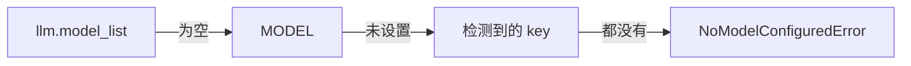

# Python API

`markitai.convert()` 和它的异步版本 `markitai.aconvert()` 跑 CLI 的管线（包括 LLM 增强），返回类型化的结果。

::: warning API 稳定性
Python API 尚未定型：签名和字段在小版本里仍可能变化。请固定精确版本；CLI 才是稳定接口。
:::

把它加进你的项目（[安装脚本](/zh/guide/getting-started)装的是命令，不是可导入的库）。extras 和 CLI 一样，例如 `uv add "markitai[ocr]"`：

```bash
uv add markitai   # 或：pip install markitai
```

## 基础转换

```python
import markitai

# 内存模式：直接拿到 Markdown 字符串
out = markitai.convert("report.pdf")
print(out.markdown)

# 写入目录，同时保留抽取的图片
out = markitai.convert("report.pdf", output_dir="out/")
print(out.output_path)  # out/report.pdf.md
print(out.assets)  # 图片在 out/.markitai/assets/ 下

# URL 用法相同
out = markitai.convert("https://example.com/article")
```

- 不传 `output_dir` 时，转换在用完即删的临时目录里进行：Markdown 在内存里返回，路径字段为 `None`，图片链接保持 `.markitai/assets/...`。
- 一次调用转一个文件或 URL，目录批量仍由 CLI 负责。
- `stdout` 保持干净；[loguru](https://github.com/Delgan/loguru) 输出到 stderr（`logger.disable("markitai")` 可静音）。

## LLM 增强转换

`llm=True` 增加清洗和 frontmatter，并同时返回两个版本：

```python
import os
import markitai

os.environ["MODEL"] = "openai/gpt-6-luna"  # 或配置 llm.model_list

out = markitai.convert("report.pdf", output_dir="out/", llm=True)
print(out.llm_markdown)  # 增强后的正文
print(out.frontmatter["title"])  # 解析后的 YAML frontmatter
print(out.usage.cost_usd)  # 这次转换的 LLM 花费
```



模型的选择和 CLI 一样（[配置](/zh/guide/configuration)，然后是[检测到的](/zh/guide/configuration#markitai-自动选用的默认模型) API key 和已登录的订阅）；检测到多个提供商时共用一个模型池，每个进程记录一次。和 CLI 不同，库不读取 `.env` 文件：先导出 key。默认加载 CLI 的配置文件，除非传入 `MarkitaiConfig`：

```python
from markitai import MarkitaiConfig

cfg = MarkitaiConfig()  # 纯默认值，忽略配置文件
cfg.llm.pure = True  # 只做 LLM 清洗，不生成 frontmatter
out = markitai.convert("notes.docx", config=cfg, llm=True)
```

关键字 `llm`、`ocr`、`screenshot`、`alt`、`desc` 和 `profile`（[输出 Profile](./output-profiles.md)）对应 CLI 参数；`None` 沿用配置值。

## 异步用法

在事件循环里用 `aconvert`；CPU 密集的工作在线程池里跑：

```python
import asyncio
import markitai


async def main() -> None:
    results = await asyncio.gather(
        markitai.aconvert("a.pdf", output_dir="out/"),
        markitai.aconvert("https://example.com/b", output_dir="out/"),
    )
    for out in results:
        print(out.source, "->", out.output_path or len(out.markdown))


asyncio.run(main())
```

- 在运行中的事件循环里调用同步的 `convert()` 会抛出 `RuntimeError`。
- 长期运行的应用在退出时调用 `await markitai.fetch.close_shared_clients()`。

::: details 脚本以退出码 134 结束
onnxruntime 卸载时的小问题可能让一次性脚本在转换成功后以 134 结束。在末尾加 `from markitai.utils.shutdown import finalize_process; finalize_process(0)`；长期运行的宿主不要用，它会结束整个进程。
:::

## 并行提取 PDF

CLI、`markitai serve` 和 MCP 服务器把长 PDF 或同时转换的 PDF 交给工作进程按页提取（包括 OCR）：输出不变，速度快好几倍。脚本这样启用：

```python
import markitai


def main() -> None:
    markitai.enable_worker_processes()
    for name in ("a.pdf", "b.pdf"):
        markitai.convert(name, output_dir="out/")


if __name__ == "__main__":
    main()
```

工作进程会重新导入 `__main__`，所以要把工作放在 `if __name__ == "__main__":` 下面。`MARKITAI_PDF_WORKERS` 设置进程数。

## ConversionOutput

| 字段 | 类型 | 说明 |
|------|------|------|
| `source` | `str` | 传入的路径或 URL |
| `markdown` | `str` | 基础正文，不含 frontmatter |
| `llm_markdown` | `str \| None` | 增强后的正文，或 `None` |
| `frontmatter` | `dict` | 解析后的 frontmatter |
| `output_path` | `Path \| None` | 写出的基础 `.md` 文件 |
| `llm_output_path` | `Path \| None` | 写出的 `.llm.md` 文件 |
| `assets` | `list[Path]` | 抽取出的图片 |
| `screenshots` | `list[Path]` | 截图文件 |
| `images` | `list[dict]` | 每张图片的 LLM 分析 |
| `usage` | `ConversionUsage` | `cost_usd`、token、按模型明细 |
| `skip_reason` | `str \| None` | 被跳过时为 `"exists"` |
| `duration` | `float` | 耗时（秒） |
| `warnings` | `list[str]` | 提示（见下） |
| `page_sources` | `list[dict]` | PDF 每页文字来源（见下） |

`warnings`（按调用收集，也写进日志）：疑似扫描页（加 `ocr=True` 重试）、PDF 隐藏文字（可能是提示注入）、OCR 没识别出文字、幻灯片无法渲染、URL 截图没拍到、图片分析失败，或 LLM 增强失败（`llm_markdown` 为 `None`；设 `llm.on_failure = "fail"` 则抛出 `ConversionError`）。

`page_sources`：每页一条 `{"page", "source", "reason"}`；`source` 为 `"text"`、`"ocr"` 或 `"mixed"`，`reason` 是简短说明，例如 `"no text layer"`。

### 异常

失败时抛异常；markitai 自己的异常从 `markitai.api` 导入：

| 异常 | 何时 |
|------|------|
| `ConversionError` | 管线失败或无内容 |
| `FetchError` | URL 不可达 |
| `NoModelConfiguredError` | 开了 LLM 却没有可用模型（`ValueError` 子类；不发请求） |
| `ConfigFileError` | 配置文件无效 |
| `FileNotFoundError`、`IsADirectoryError` | 路径不对 |
