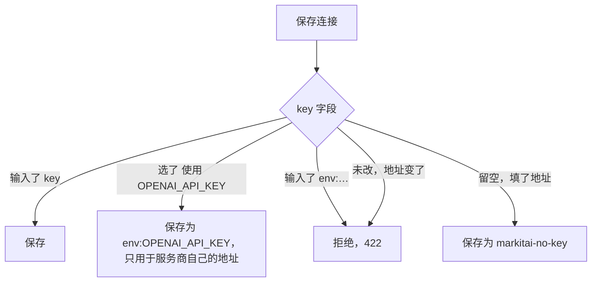
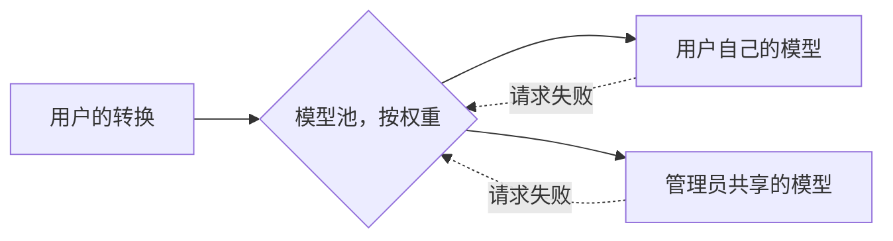

# 网页工作台参考

[网页工作台指南](/zh/guide/serve)背后的细节：访问规则、用户令牌及其模型、设置页面和 API。

## 访问令牌 {#access-tokens}

| 调用者 | 能转换 | 能看到 | 系统设置 |
|--------|--------|--------|----------|
| 服务器（管理员）令牌 | 文件和 URL | 所有转换 | 全部 |
| 用户令牌 | 文件和公网 URL，不用远程服务 | 自己的转换 | 外观、自己的模型及其编辑配置 |
| 不带令牌，本机也一样 | 无（401） | 无 | 无 |
| 本机，`--no-auth` | 文件和 URL | 所有转换 | 全部 |
| 其他设备，`--no-auth` | 只有文件，不能提交 URL | 所有转换 | 无 |

- **本机也需要令牌**：本机任何程序、另一个 `localhost` 端口上的网页同样是从本机连进来的。使用 `--no-auth` 时，从本机直接发起的连接（不带代理请求头）可以使用全部功能，其他设备始终进不了设置和令牌相关的接口；服务端看不到客户端地址的请求按其他设备对待。
- **没带令牌的标签页**会在需要时提示输入；**系统设置 → 访问令牌**为该标签页保存令牌。**退出此标签页**只清除该标签页保存的令牌。
- **下载**：浏览器发起的下载使用一分钟内有效、只能用一次的 `?ticket=` 链接，令牌本身不会出现在 URL、浏览历史或下载列表里。
- **重新生成令牌…**（**系统设置 → 访问令牌**）会替换令牌：其他所有标签页和设备（包括本机）都要重新登录，尚未使用的下载链接也随之失效。新令牌只显示一次，附带登录链接和二维码；和启动时的令牌一样，它在服务器停止前有效。要让令牌在重启后不变，改用 `MARKITAI_SERVE_TOKEN`。
- **其他网站来源**无法改动任何东西：来自其他来源的状态变更请求一律拒绝，所以随便一个网页没法借你的浏览器操作它。

## 用户令牌 {#user-tokens}

**系统设置 → 访问令牌 → 用户令牌**可以为其他人或设备单独发放令牌：填写名称后点**创建令牌**。令牌只显示一次，附带复制、登录链接和二维码，之后在列表中按末尾几位字符显示，并显示最近使用时间。

- **转换**文件和 URL，仅限公网地址：它的 URL 和它的文档引用的图片不会从服务器所在的网络抓取。
- **从不经由远程服务**，不论 `fetch.remote_consent` 怎么设：既不用 defuddle.md、Jina Reader 或 Cloudflare（不能选为抓取策略或后端，也不作为回退）。服务器的远程默认策略对它按 `auto` 运行，跳过远程回退时该条目会说明。
- **查看、下载、停止、重试和删除**只限自己的转换。管理员能看到所有人的转换。
- **系统设置**：模型、访问令牌和编辑配置需要服务器的令牌。用用户令牌登录的标签页在这些页面会说明这一点，系统设置里显示外观和[它自己的模型](#users-models-and-shared-models)及其编辑配置。
- **撤销**会立即让用户令牌失效，连同它的下载链接和实时进度。
- **存储**：每个用户令牌只保存 SHA-256 摘要，存放在 `~/.markitai/serve/access.json`（只有你的用户可读，从不写入配置文件），因此重启和重新生成管理员令牌后依然有效。服务器日志只记令牌名称，从不记录令牌本身。

## 工作台细节 {#workspace-details}

**侧栏。** 点它的按钮或按 Ctrl+B（Mac 上为 ⌘B）可收起为图标栏或展开；正在输入或有窗口打开时该快捷键不起作用。

**构建信息。** 侧栏底部说明服务器的构建：**文档**旁是版本，**GitHub** 旁是提交（构建含未提交改动时带 `-dirty`），下面一行是按你所在时区显示的 `Build: 20261017 19:54`（悬停可看完整时间）。在手机上，**文档**和 **GitHub** 是顶栏右端的两个图标，系统设置页末尾是一行 `2.3.1 · b73d56f7 · 20261024 18:38`（版本、提交、构建时间）。

**转换。** 文件先暂存并显示上传进度，按下**转换**才提交，可以和 URL 合成一次提交。**上传**的下拉菜单可选文件夹。URL 在发送前就会校验。

**选项。** 从服务器的默认值开始：`config.json` 叠加内置默认值，命令行读取的也是这些键：

`llm.enabled`、`ocr.enabled`、`image.alt_enabled`、`image.desc_enabled`、`screenshot.enabled`、`screenshot.screenshot_only`、`llm.pure`、`cache.no_cache`、`image.compress`、`output.profile`、`fetch.strategy`、`output.format`、`ocr.lang`、`ocr.per_page_routing`、`output.page_markers`

- **选项**在对话框中打开：预设，然后每组一行并显示当前值（增强、图片、输出及在 Markdown 旁另写[文档 JSON](/zh/guide/cli#format) 的 **JSON**，以及「高级」下的 URL、文件、页面、其它）。点一行在原处打开该组的选项，选择立即生效。OCR 不开 LLM 时，本机 OCR 的语言在「增强」中。
- 以正常亮度显示的值以及**选项**上的圆点，表示当前选择与默认设置不同。对话框底部是命令行、**恢复默认**和**设为默认**。
- 管理员保存的选择写入 `config.json`，立即用于下一次转换；用户令牌的选择保存在它自己的文件里（**改用服务器的默认设置**可撤销）。Cloudflare 永远不会成为默认值。

**转换任务。** 提交以来源文件夹或 `.urls` 列表命名。**新建转换**回到转换页。要一次删除多个条目，用行或提交标题左侧的勾选框选中（筛选行开头的勾选框可全选当前列出的条目），再点出现的底部栏里的**删除**并确认；仍在转换的条目不能勾选。

| 按键 | 在列表中 |
|------|----------|
| 空格 | 勾选当前行 |
| Shift | 扩展选择 |
| Ctrl/⌘+A | 勾选所有列出的行 |
| Esc | 清除选择 |

手机上先点**选择**；**停止剩余**在全屏窗口的标题栏里。被停下的条目之后可以重试，已在转换的条目照常完成。提交在后台标签页完成时会发通知。

**转换窗口。** 点击条目或在条目上按 Enter。

- 标题栏的箭头或 ↑/↓ 切换条目；放大按钮（或 **F**）让窗口占满浏览器并还原，每个浏览器记住这个选择。
- 标题栏有**下载**（下载 Markdown；旁边的下拉箭头提供 Markdown、PDF…、JSON、全部文件打包的 .zip 和**查看文件列表**），能解决问题时还有**重试**、**添加模型**或**启用 OCR 并重试**；“⋯”里有**复制 Markdown**、**重新转换…**（打开选项，预先填好这次转换的选项，包括 LLM；结果是新的一次提交）、**不用 LLM 重试**和删除。手机上“⋯”按同样顺序列出，下载在前。
- 状态行下方的**查看请求参数**（展开与否由浏览器记住）以等效命令行显示选项（带复制按钮），没有对应参数的设置（`image.format webp`）以标签列出：只列出与默认值不同的项，包括服务器自己的配置。使用 LLM 的转换还会保存 LLM 处理前的 Markdown，因此其命令行带有 `--keep-base`。标签中的设置没有对应参数：要完全重复这次转换，请把它们写入运行该命令处的配置（或用 `--config-json` 传入）。2.1.0 之前的任务显示其请求中指定的选项。
- 详情还显示保留期限和结果开头，可选**渲染**或**源码**（前 12 行，带行号，并显示结果的总行数）；点击它会以同一视图打开预览。操作失败时会显示一条错误，直到你关闭它；重新运行失败而保留了之前的结果时，详情里会说明。

**预览。** **PDF…** 打印文档，页眉页脚可选。**文件**先列出原件，再列出每个结果文件，各自可下载，并提供**下载全部 .zip**，包含结果和原件。

- 绝对 `https://` 地址的网络图片直接显示，且不发送来源页信息；其他地址显示为带说明的占位符。
- 以带链接的封面图写出的视频（``；`.mp4`、`.m4v`、`.webm`、`.mov`、`.ogv`）可以直接播放：播放前不加载任何内容，无法播放时恢复为链接。
- 单元格里残留的换行打断的表格行会被重新拼好（源码视图保持原文）。大表格先显示前 500 行（**显示全部行**加载其余），代码块带语法高亮。

**对照。** 在 Markdown 旁显示原件：

| 原件 | 显示为 |
|------|--------|
| PDF | 它的页面；鼠标移到 Markdown 里的标题或表格上，页面上会框出对应位置 |
| 图片、HTML、文本 | 文档本身 |
| Office 文件 | 转换时保存的页面截图 |
| 网页 | 服务器抓取到的页面，放在沙箱框架中，保存了截图时可与截图切换 |
| 其他格式 | **下载原件** |

对照中的网页：

- 带有网站自己的图片、样式表和字体（由浏览器经 HTTPS 从网站加载），不运行它的脚本，链接在新标签页打开；
- 在任一侧悬停标题、段落、列表项、表格或图片，另一侧对应的部分会被框出，网页和截图上都是如此；
- 浏览器加载过的网页即使没有要求截图也会保留一份截图：对照用的副本，不属于输出，也不会发送给模型；
- 网站返回验证检查或空白页时，会说明原因并提供打开原网页；
- 经 Jina、Defuddle 或抓取缓存得到的页面不保存，改用截图。

**提示。** 计入条目并在详情里列出；每个条目只收到自己的提示，任务进入历史后也会保留。同一种提示合并显示，页码以区间列出（`pages 3–5, 9`）。包括：

- 页面疑似扫描件：不少于九成页面没有可读文字的 PDF 提示 "This PDF is scanned: turn on OCR and convert again"；否则列出没有文字的页（"Pages 3–5, 9 (4 of 120) have no readable text…"）；
- PDF 隐藏文字可能是提示注入、OCR 没识别出文字；
- 幻灯片无法渲染、URL 截图没拍到；
- 图片分析失败而保留了原来的 alt 文本、LLM 增强失败而保留了未增强的结果；
- 遗漏或改动了文档太多内容的模型回答（保留转换得到的 Markdown）。

模型回答重新请求后得到可用回答时不算提示：内容没有缺失，费用已计入两次请求。

**下载。** 单个文件、一次提交的 zip，或用转换任务“⋯”里的**下载全部 .zip**打包所有内容。

## LLM 设置规则 {#llm-settings-rules}

**服务商选择器。** 可按名称或模型前缀搜索；常用服务商以卡片列出，其余按分组筛选（云平台、推理服务、网关、本地、订阅、模型厂商）。每个服务商标明所用地址和读取的 key 变量。服务商不公开模型列表时手动输入模型 ID。

**环境变量里的 key。** 服务器设置了某个服务商的 key 变量（`OPENAI_API_KEY`、`DEEPSEEK_API_KEY`、`GROQ_API_KEY`、`MOONSHOT_API_KEY` 等，选择器里的任何服务商都可以）时，选择器会把它和已保存的连接列在一起（“使用 OPENAI_API_KEY”）。

- 已在服务商自己的端点使用该变量的连接（例如配置里没写 key 的手写模型）会代表它：每个服务商只占一行，常用服务商卡片标为**已添加**。
- 它的模型用这个 key 从服务商自己的端点列出。从它添加的模型只保存引用 `env:OPENAI_API_KEY`，不保存 key 本身；之后由这个已保存的连接代替这张卡片。
- 这个 key 只发往它所属服务商的端点。要用别的地址，请输入 key 来连接该服务商。

**测试结果。** API 用 `reason` 给出同样的类别，缺少 key 时用 `key_variable` 给出变量名。服务商自己的原话放在“服务商原文”下。

| `reason` | 含义 |
|----------|------|
| `no_key` | 服务器上没有设置 key 变量，什么都不会发送。在运行 `markitai serve` 的地方设置并重启，或者给这个连接填入 key |
| `key_rejected` | HTTP 401/403 |
| `model_not_found` | 服务商没有这个模型 |
| `rate_limited` | 限流或额度不足 |
| `network` | 连不上服务商 |
| `timeout` | 服务商没有及时响应 |
| `provider_error` | 其他错误 |

**修改已保存的 key 或地址。** key 只显示打码形式（`sk…7890`；`env:` 引用原样显示）：不动这个字段就保留，输入新 key 即替换，清空则删除。已保存的 API 基础地址显示时不含凭据（`https://…@proxy.example/v1?api_key=…`）：保持原样即沿用已保存的地址，要修改请输入完整地址。

**key 和保存时的地址绑定在一起**，所以设置页面不会把你没输入过的 key 发到你指定的服务器：

- 需要被拒绝的组合时，要么连同新地址直接输入 key 本身，要么在配置文件里写好这一对（用 `markitai config edit` 或手动编辑，见[自定义 API 端点](/zh/guide/configuration#custom-api-endpoint)）。配置文件里已有的组合在设置页面照常可用。
- **`markitai-no-key`** 是任何服务器都不会当作凭据的占位 key。没有它，markitai 会把服务器自己的 key 变量（`OPENAI_API_KEY`、`GROQ_API_KEY` 等）发往那个地址。不校验 key 的服务器（LM Studio、vLLM、llama.cpp）照常可用；设置页面把这样的连接显示为没有 key。
- 已有 key 的连接不能改成指向另一个地址的无 key 连接（422）：请为那台服务器新建一个连接。
- 你在配置文件里自己写的条目不受影响：没有 `api_key` 的条目仍从环境变量读取该提供商的 key。

**云登录。** Vertex AI 用服务器自己的 Google 登录凭据认证（`gcloud auth application-default login`、`GOOGLE_APPLICATION_CREDENTIALS`），这些凭据会发往条目指定的任何地址，所以设置页面只在 Google 自己的端点保存和测试它（带地址时返回 422）。**添加模型**不为它显示地址栏；私有端点请写在配置文件里。Amazon Bedrock 可以带地址：没有 key 时它发往那里的是占位 key，从不发送服务器的 AWS 凭据。

## 用户的模型与共享模型 {#users-models-and-shared-models}

**用户自己的模型。** 用户令牌在**系统设置 → 模型**中管理（同一个页面，没有配置文件那一行，也没有检测到的模型）：添加模型、测试、编辑、删除和设置权重。

- **权重**在每个已保存行上直接修改（管理员的行也一样）：点击它，输入 0 到 100 的整数，按 Enter 或离开输入框即保存，Esc 取消。
- **存储**：`~/.markitai/serve/user-models/<令牌 id>.json`，只有你的用户可读，从不写入配置文件，所以编辑配置和命令行都看不到。只用于该用户的转换，密钥只以打码形式显示。
- **允许**：带用户自己 API key 的模型，或不需要 key 的服务器地址（保存为 `markitai-no-key`）；最多 50 个模型。
- **拒绝**：用服务器自身账号或云登录认证的服务商（Claude Code、Copilot 和 ChatGPT 订阅、Vertex AI、不带 key 的 Bedrock）、`env:` 引用，以及指向服务器本机的地址（`localhost`、`127.0.0.1`、`::1`、`0.0.0.0`；所以 Ollama 或 LM Studio 需要用户自己的地址）。
- **只到公网地址**：为用户自己的模型发出的每个请求（它的转换、模型发现和测试）在建立连接时才解析域名，公网以外的地址（回环、内网、云元数据这类链路本地地址、唯一本地地址）一律拒绝，所以指向服务器本机或其网络的域名同样会失败。不跟随重定向，也不经过代理。管理员共享的模型不受此限制。

**共享模型。** 管理员保存的模型默认是**私有**；设为**共享**后，所有用户的转换都可以使用它（在配置文件中保存为 `"model_info": {"share": "shared"}`）。改回私有对下一个请求立即生效。

- 用户在**由管理员共享**下只能看到共享模型的模型 ID、服务商和权重：它的 key 和地址留在服务器上，用户看到的失败信息也不会说出它在哪里提供服务。
- 用户的转换使用一个模型池：自己的模型和共享的模型按权重选择，请求失败时换用池中另一个模型。任务会显示用了哪个模型和费用。
- 两者都没有的用户没有 LLM 选项，请求 LLM 会被拒绝（`llm_unavailable`）：服务器的环境变量 key 和检测到的模型从不为用户服务。
- **用户对共享行的权重**只作用于该用户自己的转换：设为 0 表示该用户不再使用它；**改用管理员的 N** 恢复跟随管理员的权重（保存在用户自己的文件中，字段为 `shared_weights`）。
- 共享行的**测试**在服务器上用管理员的密钥和地址进行，只说明是否通过，未通过时请用户告诉管理员是哪个模型失败，绝不透露服务商的原话、地址或密钥。因为费用由管理员的密钥承担，每个用户同一时间只能运行一个这样的测试，每分钟最多六次。

**用户的编辑配置**以文本形式编辑它自己的模型，打码、校验、审阅和冲突处理与[管理员的页面](#edit-config)相同：

- 一份 JSON 文档：`models` 和 `providers`（形式与 `llm.model_list`、`llm.providers` 相同）以及 `shared`（每个共享模型及该用户为它设的权重）；
- 服务器的配置文件绝不会向用户显示，也不会被用户修改；用户保存的内容同样受上述规则约束；
- **系统设置 → 访问令牌**显示每个用户有几个模型；撤销令牌会连同 key 删除这些模型（删除时服务器若被停止，下次启动时会删除）。

## 编辑配置 {#edit-config}

**系统设置 → 编辑配置**以文本形式显示服务读取的配置文件（也就是 `markitai config` 编辑的那个）。

- **密钥打码**，规则同 `markitai config list`：API key、令牌、密码、cookie 等密钥类键名下的值，以及所有 HTTP 请求头的值，都显示为 `sk…7890` 的形式；`env:` 引用照原样显示；已保存的地址不显示其中的凭据。留在原处的打码值会保留已保存的密钥；要修改，请输入完整的新值或一个 `env:` 引用。
- **保存**：输入时检查 JSON（报告行和列），**查看修改**以逐行差异显示，**保存配置**原样写入查看过的文本，保留排版、键的顺序和换行符（Windows 上写的文件仍是 CRLF，页面会说明）。
- **冲突**：如果页面读取之后文件被改动过，保存会被拒绝，**加载当前文件**会重新读取。
- 模型和连接立即生效；其他改动需要重启时页面会说明。

## API {#api}

错误响应是 JSON `{"detail", "code", "reason"}`：`detail` 是英文说明，`reason` 是稳定的原因代码，例如 `llm_unavailable`、`file_too_large`。OpenAPI 文档位于 `GET /api/openapi.json`，与其他 API 一样需要令牌。

| 代码 | 何时出现 |
|------|----------|
| 400 `host_not_allowed` | 服务器不应答的 `Host`（加上 `--allowed-host`） |
| 401 `token_required` | 没有有效令牌：完全没带，或令牌已撤销、已重新生成 |
| 401 `ticket_invalid` | 下载链接无效、已过期或已用过 |
| 422 `invalid_options` | 未知的任务选项或类型不对的值（重试时为 `invalid_retry_body`） |
| 422 `invalid_url`、`unsupported_url_scheme` | 提交时 URL 被拒绝 |
| 403 `remote_processing_forbidden` | 用户令牌选择 `jina`、`defuddle` 或 `cloudflare`；管理员以外的任何人使用 Cloudflare |
| 403 `remote_url_forbidden` | 使用 `--no-auth` 时来自其他机器的 URL |
| 403 `settings_forbidden` | 用户令牌，或使用 `--no-auth` 时的其他设备，访问设置和令牌路由 |
| 403 `origin_not_allowed` | 来自其他网站来源的状态变更请求 |
| 403 `user_token_required` | 用户令牌以外的调用者访问 `/api/me/…` |
| 404 `job_not_found` | 未知或已过期的任务，或不是该用户令牌创建的任务 |
| 409 `token_disabled` | 使用 `--no-auth` 时访问令牌路由 |
| 409 `batch_pending` | 重试或增强仍在 `--llm-batch` 中的条目 |
| 413 `file_too_large` | 文件超过 100 MB |
| 422 `llm_unavailable` | 任务要求 LLM 处理却没有可用模型（增强单个条目时为 409） |

Cloudflare 处理（`strategy` 或 `backend` 为 `"cloudflare"`）还要求同一请求的选项里带 `"remote_processing": "cloudflare"`（工作台在你确认后发送）；它计入服务器的账户，所以只有管理员能用。`GET /api/capabilities` 会说明调用者是谁（`access.role`：`admin` 或 `user`）。

| 端点 | 说明 |
|------|------|
| `GET /api/capabilities` | 服务版本与构建（`build: {version, commit, built_at, dirty}`）、预设、支持的功能、OCR 语言、限制以及调用者是谁 |
| `POST /api/jobs` | 创建任务（multipart 表单：`files`、`urls` JSON 数组、`options` JSON，可选 `label`）。`.urls` 文件展开为 URL 条目。要求 LLM 处理却没有可用模型时直接拒绝（`llm_unavailable`） |
| `GET /api/jobs/{job_id}` | 任务状态与条目（每个条目带 `warnings`、`error_code`、`page_sources`（PDF 每页文字的来源，其他条目为空），用过模型时还有 `pricing`） |
| `GET /api/jobs/{job_id}/events` | 实时进度流（SSE） |
| `POST /api/jobs/{job_id}/cancel` | 停下尚未开始的条目 |
| `POST /api/jobs/{job_id}/items/{item_id}/retry` | 重试条目（JSON 请求体可选：`operation`、`options`；不带 `options` 时沿用该条目自己的选项），或以 `operation: "enhance"` 做 LLM 增强：除非 `options` 写明 `"llm": false`，它总会开启 LLM |
| `DELETE /api/jobs/{job_id}/items/{item_id}` | 永久移除条目，连同其上传原件、输出、图片与截图 |
| `GET /api/jobs/{job_id}/items/{item_id}/result` | 条目结果（`?max_bytes=N` 只取开头：N 至少为 1024，否则返回 422 `invalid_max_bytes`；最多 N 字节，附近有行尾时在行尾截断，并给出 `truncated` 和完整的 `markdown_bytes`；完整结果超过 64 MiB 时返回 413 `result_too_large`）；配套资源经 `GET /api/jobs/{job_id}/files/{path}` 获取 |
| `GET /api/jobs/{job_id}/items/{item_id}/document` | 条目的[文档 JSON](/zh/guide/cli#format)，无论任务要求的 `format` 是什么，每个完成的条目都会保留（失败、跳过或未完成的条目返回 404 `result_unavailable`）。`"format": "json"` 的任务另在条目的 Markdown 旁写 `<name>.json`，列在它的文件里 |
| `GET /api/jobs/{job_id}/items/{item_id}/assets/{path}` | 条目自身提取出的一张图片（PNG、JPEG、GIF、WebP、AVIF），以内联方式返回供显示 |
| `GET /api/jobs/{job_id}/items/{item_id}/archive` | 单个条目打包为 zip 下载：结果文件和原件 |
| `GET /api/jobs/{job_id}/items/{item_id}/original` | 条目原件能显示什么（网页还包括其副本和截图是否可用，`capture`）；`/original/file`、`/original/view`、`/original/pages/{n}?width=`、`/original/pages/{n}/text`、`/original/outline`（PDF 的书签）与 `/original/blocks`（网页各区块在截图上的位置）提供内容 |
| `GET /api/jobs/{job_id}/archive` | 整个任务打包为 zip 下载 |
| `POST /api/download-tickets` | 为一次下载换取一分钟内有效、只能用一次的 `?ticket=` 链接 |
| `GET /api/history` | 列出历史条目（`?include=items` 附带全部条目） |
| `GET /api/history/archive` | 全部历史打包为一个 zip 下载 |
| `DELETE /api/history/{job_id}` | 删除单条历史 |
| `POST /api/history/delete` | 一次请求删除多个任务和条目（`{"jobs": [...], "items": [{"job_id", "item_id"}]}`，最多 1000 项），每项按对应的单个路由处理，应答列出每项结果 |
| `/api/settings/llm*` | LLM 提供商、模型与部署管理 |
| `GET`/`PUT /api/convert-defaults` | 新建转换的选项默认值（所有调用者可读；`PUT` 为 `{"expected_revision", "defaults"}`：管理员的写入 `config.json`，用户令牌的写入它自己的文件，`null` 表示删除） |
| `GET`/`PUT /api/settings/config` | 配置文件文本（密钥已打码）；按其 `revision` 原样保存 |
| `POST /api/access-token/regenerate` | 替换服务器令牌（仅管理员） |
| `GET`/`POST /api/access-tokens`、`DELETE /api/access-tokens/{id}` | 用户令牌（仅管理员；列表给出每个令牌的 `model_count`） |
| `/api/me/models*` | 用户令牌自己的模型，后缀和规则与 `/api/settings/llm*` 相同；`PATCH /api/me/models/shared/{id}` 设置它对某个共享模型的权重，`POST /api/me/models/test` 带 `{"shared_id"}` 测试共享模型 |
| `GET`/`PUT /api/me/config` | 用户令牌自己的模型，作为一份打码后的 JSON 文档（`models`、`providers`、`shared`），按模型页的 `revision` 保存 |
