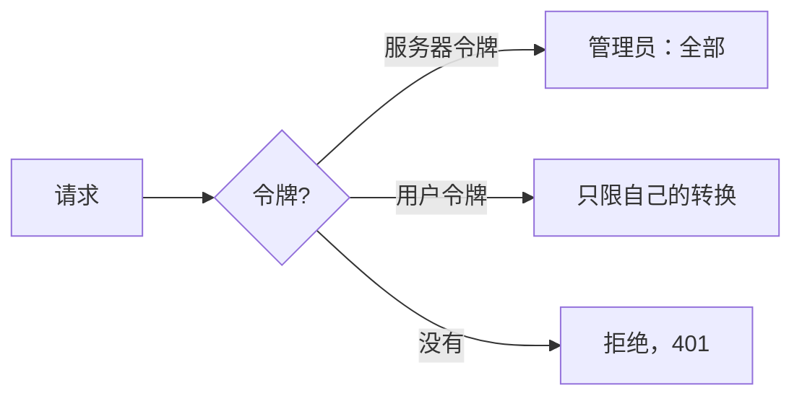
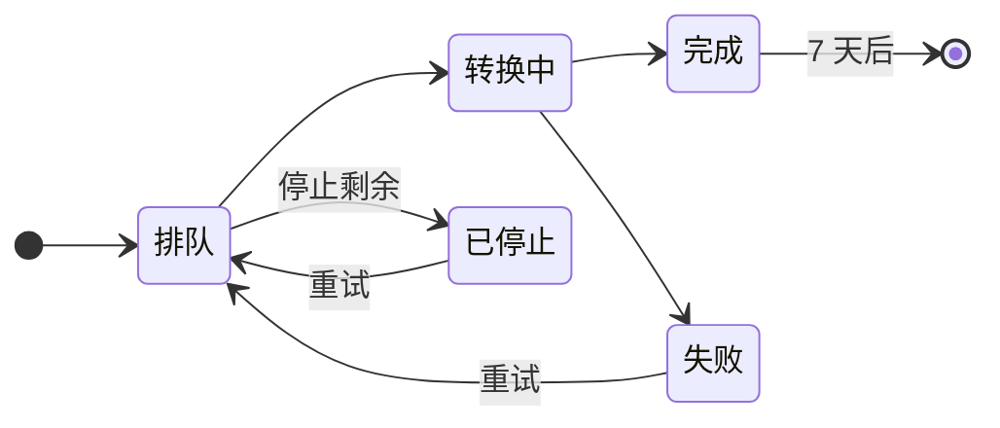

# 网页工作台

`markitai serve` 在本机打开一个网页工作台：拖入文件或文件夹、粘贴链接、看进度，把每个结果和原件对照查看，再下载全部输出。支持中文、英文和日文，手机上也能用。

任务和历史保存在磁盘上。除了发给你配置的抓取策略和 LLM 提供商的内容，不会有任何东西离开本机。

{.light-only}
{.dark-only}

## 启动服务

工作台内置在 `markitai` 里，不需要再装别的东西。

<!--@include: ../../snippets/setup.md-->

```bash
markitai serve
```

浏览器会带着访问令牌打开 `http://127.0.0.1:3600`。

| 参数 | 默认值 | 说明 |
|------|--------|------|
| `--host` | `127.0.0.1` | 绑定的网卡。`0.0.0.0` 允许其他设备访问 |
| `--port` | `3600` | 监听端口（`0`：任意空闲端口） |
| `--no-open` | 关闭 | 启动后不打开浏览器 |
| `--no-auth` | 关闭 | 禁用访问令牌 |
| `--allowed-host <hostname>` | — | 通过域名而非 IP 访问时，额外放行的主机名（可重复） |
| `-c, --config <path>` | — | 另一个配置文件，与转换时相同 |
| `--config-json <json>` | — | 叠加在配置文件之上的覆盖项 |

每个 `~/.markitai` 只运行一个服务；它会打印自己的地址和存放任务的文件夹。

## 访问令牌 {#access-token}

启动时服务会打印一个以 `#token=…` 结尾的 URL，自动打开的浏览器用的就是它。每个客户端都需要令牌，本机也不例外：打开这个 URL，脚本则以 `Authorization: Bearer <token>` 发送令牌。



- **`MARKITAI_SERVE_TOKEN`** 让令牌在重启后保持不变（设在环境变量里，不要写进 `.env`）。
- **`--no-auth`** 去掉令牌：本机可以使用全部功能；其他设备能上传、下载和查看历史，但不能提交 URL，也进不了系统设置。
- **系统设置 → 访问令牌**可以重新生成令牌、退出某个标签页，并为其他人创建**用户令牌**：用户令牌能转换文件和公网 URL，只能看到自己的转换，也可以用自己的模型。

下载使用一分钟内有效、只能用一次的链接，令牌不会留在浏览历史里。详见[访问令牌](/zh/guide/serve-reference#access-tokens)和[用户令牌](/zh/guide/serve-reference#user-tokens)。

## 从其他设备访问

绑定全部网卡，再在手机或另一台电脑上打开打印出来的令牌 URL：

```bash
markitai serve --host 0.0.0.0
```

用域名而不是 IP 访问时，加上 `--allowed-host convert.example.com`。服务会拒绝未知主机名，挡住恶意网页的 DNS 重绑定攻击。

::: warning
令牌 URL 就是凭据。拿到它的人可以用你的 LLM 提供商发起转换，还能查看、下载和删除历史。只分享给你信任的设备。
:::

## 工作台功能

| 位置 | 用途 |
|------|------|
| **转换** | 粘贴 URL（每行一个），拖入文件或文件夹，或用**上传**。按下**转换**之前什么都不会发送。`.urls` 文件按 URL 列表读取，与命令行一致 |
| **选项** | 一个对话框（手机上从底部弹出）：预设、增强（LLM、OCR 及其语言）、图片、输出（profile、[文档 JSON](/zh/guide/cli#format)）、高级（URL、文件、页面、其它），以及可直接复制的等价命令行。**选项**上的圆点表示当前选择与默认设置不同；**设为默认**保存你的选择 |
| **转换任务** | 所有条目按提交分组，实时更新。可按名称、失败或有提示筛选；勾选多行一起**重新转换…**或删除；**停止剩余**停下尚未开始的条目；“⋯”里有**下载全部 .zip**和**重试失败** |
| **转换窗口** | 点击条目打开：**预览**（渲染：含表格、公式和图表；源码；文件；差异）、**对照**（原件与 Markdown 并排，对应部分会被框出）、**详情**（状态、大小、模型、费用、以命令行显示的请求参数、提示、结果开头） |
| **系统设置** | 外观与语言、模型、访问令牌、编辑配置 |

窗口里 ↑/↓ 切换条目，**C** 打开对照，**F** 占满浏览器，Esc 关闭。在手机上这些位置移到底部栏，窗口占满屏幕。

- **费用**只在确知时显示：没有定价的模型显示“未知”，而不是 `$0`；只有部分请求有价格时显示“至少”多少。
- **提示**标出没有失败但值得一看的情况：页面疑似扫描件、PDF 隐藏文字、OCR 没识别出文字、幻灯片无法渲染、LLM 步骤失败而保留了未增强的结果。
- **限制**：每个任务最多 1000 个条目，单个文件最大 100 MB，一次上传最多 5 GB。

各处的细节见[工作台细节](/zh/guide/serve-reference#workspace-details)。

### 预设、覆盖与命令

预设和 CLI 一致：

| 预设 | LLM | alt | desc | screenshot | OCR |
|------|:---:|:---:|:----:|:----------:|:---:|
| `minimal` | – | – | – | – | – |
| `standard` | ✓ | ✓ | ✓ | – | – |
| `rich` | ✓ | ✓ | ✓ | ✓ | – |

没有预设会开 OCR，要你自己勾选。选一个预设会重置这五个开关；单独改一个则保留其余，并显示为**自定义**。

## LLM 设置 {#llm-settings}

**系统设置 → 模型**编辑的就是 `markitai config` 那套配置，同时作用于网页任务和之后的 CLI 运行。**添加模型**打开约 95 个服务商的选择器：填入 key（自建服务器还要填地址），再从服务商的模型列表里挑选，或手动输入模型 ID。服务器上已设置的 key 变量（`OPENAI_API_KEY` 等）会显示为现成的连接；key 输入框旁的 (i) 会写出对应的变量名。Kimi 开放平台和 Kimi Code 合为一张 **Kimi** 卡片：粘贴任一种 key，模型会保存在接受它的那个服务下。已保存的 key 只以打码形式显示（`sk…7890`）。

**测试**会说明模型失败的原因：没有 key、key 被拒绝、没有这个模型、被限流、连不上、超时或其他服务商错误，并附上服务商的原话。

设置页面不会把 key 发到保存它时以外的地址，也不会把服务器自己的登录凭据发往任何地方：见 [key 与地址规则](/zh/guide/serve-reference#llm-settings-rules)。订阅通过服务器所在机器上的 CLI 运行；缺少某个 CLI 时，选择器会给出安装或登录它的命令（[Claude 与 Copilot](/zh/guide/subscriptions)、[ChatGPT](/zh/guide/subscription-chatgpt)）。

**系统设置 → 编辑配置**以文本形式编辑配置文件，密钥打码，保存前显示逐行差异：见[编辑配置](/zh/guide/serve-reference#edit-config)。

## 历史记录 {#history}



- 完成的任务在**转换任务**里保留 7 天（详情显示具体日期），刷新页面或重启服务后仍在，存放在 `~/.markitai/serve/jobs/`。到期的文件在一小时内删除。
- 用 [`--record-history`](/zh/guide/cli#record-history) 启动的 CLI 运行也会出现在这里，详情显示“记录来源：命令行”。其中的 URL 条目可以重试或增强；文件条目不行，因为 CLI 只保留了输出。
- `--llm-batch` 运行如果停止了等待，尚未完成的条目显示为已跳过（pending batch）。请用那次运行打印的 `markitai --llm-batch-collect` 命令收取结果；工作台不允许重试它们，否则会付两次费。

## 更新 {#updating}

有新版本时，启动信息里会写出来；工作台 Build 行末的 ↻（手机上在设置的版本行）可立即检查。`markitai update` 更新程序，并询问是否重启服务：它先让进行中和排队的转换完成，再以同样的地址和访问令牌回来。新版本起不来时会换回旧版本。

## API

工作台建立在一套 REST + SSE API 之上，脚本可以带同一个令牌直接调用：`POST /api/jobs` 提交，`GET /api/jobs/{job_id}/events` 看进度，`GET /api/jobs/{job_id}/archive` 下载 zip。OpenAPI 文档位于 `GET /api/openapi.json`。路由和主要错误代码见 [API 参考](/zh/guide/serve-reference#api)。

```bash
curl -H "Authorization: Bearer $MARKITAI_SERVE_TOKEN" \
  -F files=@note.txt -F 'options={}' http://127.0.0.1:3600/api/jobs
```
