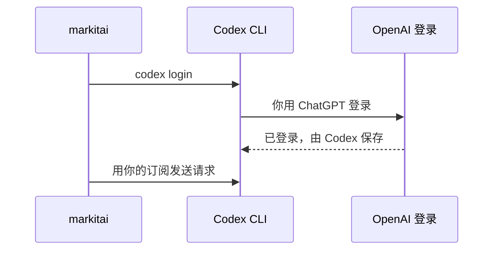

# ChatGPT 订阅

markitai 可以通过 OpenAI 官方的 Codex CLI，用你的 ChatGPT 订阅代替 API 密钥发送请求。模型名为 `chatgpt/<模型>`，例如 `chatgpt/gpt-6-luna`。

## 安装 {#install}

在 markitai（或 `markitai serve`）运行的机器上执行：

```sh
npm install -g @openai/codex@0.159.0   # Codex CLI 0.159.0 或更新
```

## 登录 {#sign-in}

```sh
markitai auth chatgpt login            # 运行 Codex 自己的登录
```



登录状态由 Codex 保存；markitai 从不读取或复制它，1.x 的 ChatGPT 登录也不会沿用。`markitai auth chatgpt status` 显示账户（脚本用 `--json`）；之后在工作台重新加载模型列表。Codex 用 API 密钥登录不算数。`CODEX_CLI_PATH` 可以指定另一个 Codex。

| | |
|---|---|
| 模型 | 已安装的 Codex 列出的任意模型（`codex debug models`）；其他模型在发出请求前就被拒绝 |
| 默认 | Codex 列出的最轻量模型：目前是 `chatgpt/gpt-6-luna` |
| 费用 | 统计 token，价格未知；`llm.max_cost_per_document_usd` 为正数时拒绝这条路线 |
| 限制 | 限流或服务器错误会重试；套餐用量上限会让运行停止 |

## 仍然失败时 {#troubleshooting}

登录后工作台仍提示 ChatGPT“未登录”，说明登录已过期：再运行一次登录命令。`markitai auth chatgpt status` 显示找到的 Codex 版本和账户；比[安装](#install)中更旧的 Codex 会被拒绝，不在 `PATH` 中的 Codex 需要设置 `CODEX_CLI_PATH`。
