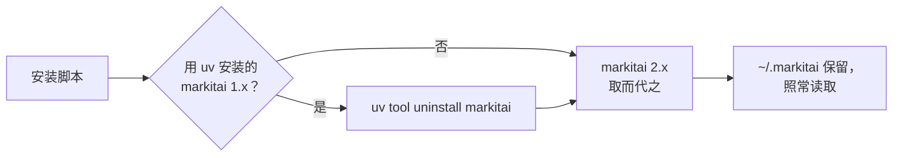

# 从 1.x 升级

markitai 2.0 是用 Rust 重写的 Python 版 markitai 1.x：一个原生程序，不用安装 Python。命令（`markitai`、`mkai`、`markitai-mcp`）、配置文件及其中的键、输出布局都保持不变；本页列出你会注意到的变化。

## 替换 1.x

运行安装脚本。它会移除用 uv 安装的 Python 版 markitai，装上 2.0，并原样保留 `~/.markitai`（配置、`.env`、缓存、历史记录）：

<!--@include: ../../snippets/setup.md-->

| 1.x 的安装方式 | 升级 |
|--------------------|---------|
| 1.x 安装脚本、`uv tool install` | 运行安装脚本（见上） |
| `pipx install` | `pipx upgrade markitai`，或 `pipx uninstall markitai` 后运行安装脚本 |
| 在项目里用 `pip` / `uv add` | `pip install -U markitai`：2.0 的 wheel 带有 CLI 和 [Python API](/zh/guide/python-api) |

暂时留在 1.x：`uv tool install "markitai<2"`。它的历史见[更新日志](/zh/changelog)。

## 变化一览

| | 1.x | 2.0 |
|---|---|---|
| 运行时 | Python 3.11–3.13 加 extra | 一个可执行文件；wheel 只需要 Python 3.10+ |
| Extra | `ocr`、`serve`、`mcp`、`browser`…… | 已内置；`markitai[serve]` 等仍可安装，但不再添加任何东西 |
| 本地 OCR | RapidOCR（`markitai[ocr]`） | 内置：PaddleOCR 模型（由 `markitai doctor --fix` 下载），或 macOS Vision |
| 浏览器 | Playwright 及其 Chromium | markitai 自己驱动 Chrome 或 Chromium；`doctor --fix` 会安装 Chrome 的 headless shell |
| PDF 引擎 | PyMuPDF（AGPL-3.0 或商业许可） | 原生 Rust 读取器；不再有任何 AGPL 组件（[NOTICE](https://github.com/Ynewtime/markitai/blob/main/NOTICE)） |
| Office 页面图片 | LibreOffice、Microsoft Office 或 PowerPoint | 只用 LibreOffice，所有系统都一样 |
| ChatGPT 订阅 | markitai 自己的设备码登录 | 官方 Codex CLI（[ChatGPT](/zh/guide/subscription-chatgpt)）；需要重新登录 |
| Windows on ARM | 模拟的 x64 Python | 原生 ARM64 构建 |

### 命令行

| 情况 | 1.x | 2.0 |
|-----------|-----|-----|
| 用法错误（未知选项、缺少取值） | 退出码 `0` 或 `1` | 退出码 `2` |
| 不带 `--ocr` 或 `--llm` 的单张图片 | 失败，退出码 `1` | 跳过并给出警告，退出码 `0` |
| `--llm` 但没有可用模型 | 输出基础 Markdown，退出码 `0` | 转换前就停止，退出码 `1`（`--dry-run` 只警告） |
| `✓ Wrote out/a.md` 这一行 | stdout | stderr：stdout 只放文档本身 |
| `doctor --timings`、`doctor --suggest-extras` | 可用 | 已移除（`--suggest-extras` 会被拒绝） |

新增：`--text-only`（只输出图片和 PDF 中识别出的文字）和 `--page-markers`。

### 输出

| | 1.x | 2.0 |
|---|---|---|
| `<!-- Page number: N -->`、`<!-- Slide number: N -->` | 总是写入 | 默认关闭；`--page-markers` 或 `output.page_markers` 保留它们 |
| 图片名 | `report.docx.0001.png` | 按内容命名：`.markitai/assets/510f5d9476ab159c03ccda77.jpg`；`image.compress` 开启时 PNG 和 HEIC 会变成 `.jpg` |
| 幻灯片图片 | `deck.pptx.slide0001.jpg` | `deck.pptx.page0001.jpg` |
| 文件夹批量转换中的符号链接 | 跟随 | 跳过（`skip_reason: "symlink"`）；`output.allow_symlinks: true` 时跟随 |
| `.markitai/ownership/` | — | 新增：记录 markitai 写过哪些文件，重跑时不会替换你自己的文件 |

图片名请从 Markdown、`images.json` 或 `-f json` 中读取，不要猜。`rag` Profile 的 `<!-- page: N -->` 标记不变。

### 配置

还是同样的 `~/.markitai/config.json`、`./markitai.json` 和键。以下设置的行为有变化（其中三个不再生效，`markitai config validate` 会给出警告）：

| 设置 | 在 2.0 中 |
|---------|--------|
| `fetch.remote_consent` | 内置的 `always` 不再在本地抓取失败时把 URL 发给 Defuddle、Jina 或 Cloudflare。想保留 1.x 的回退，自己写上：`markitai config set fetch.remote_consent always` |
| `fetch.fallback_patterns` | 内置列表（x.com、instagram.com……）不再起作用；你自己写的列表仍会让这些域名先走浏览器 |
| `office.macos_fallback`、`batch.heavy_task_limit`、`image.stdout_fetch_external` | 不起作用；第二项改用 `-j` / `batch.concurrency` |
| `MARKITAI_PDF_WORKERS`、`MARKITAI_STATIC_HTTP` | 不再读取：PDF 在本进程内读取，只用一个 HTTP 客户端 |
| `MARKITAI_USE_MIRROR`、`MARKITAI_SETUP_LOG`、`MARKITAI_SETUP_MODE` | 已从安装脚本移除；`MARKITAI_DOWNLOAD_URL` 接受发布包的镜像地址 |

### 网页工作台、MCP 和 Python API

- **`markitai serve`** 要求每个客户端都带上访问令牌，本机也不例外（1.x 允许本地脚本免令牌访问）。脚本发送 `Authorization: Bearer <token>`；`MARKITAI_SERVE_TOKEN` 让令牌在重启后保持不变（[网页工作台](/zh/guide/serve#access-token)）。
- **MCP 客户端**启动 `uvx --from markitai markitai-mcp`，或已安装的 `markitai-mcp`（[MCP 服务器](/zh/guide/mcp)）。
- **Python**：`convert()`、`aconvert()`、`ConversionOutput` 和各个异常的名称与字段都不变。`MarkitaiConfig` 不再是 Pydantic 模型（取值错误时抛出 `ValueError`）；`enable_worker_processes()` 和关闭相关的辅助函数仍然保留，但什么也不做；markitai 不再通过 loguru 记录日志，提示改走 `warnings`（[Python API](/zh/guide/python-api)）。
