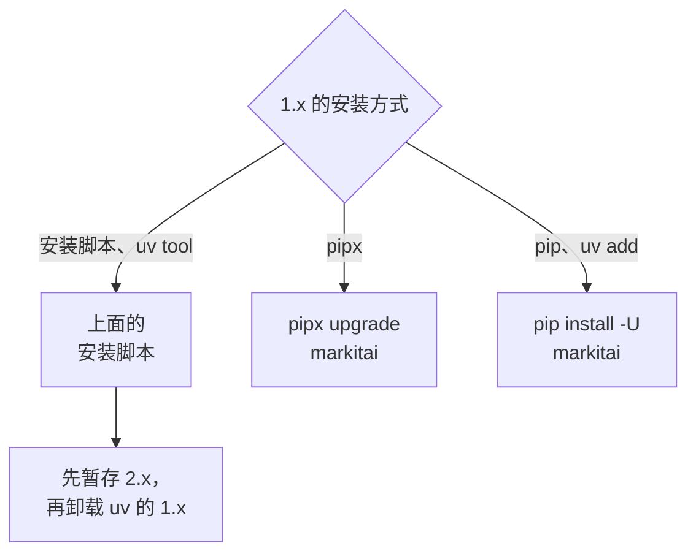

# 从 1.x 升级

markitai 2.0 是用 Rust 重写的 1.x：一个原生程序，不用 Python，也没有 extra。命令、`~/.markitai`（配置、`.env`、缓存、历史记录）和输出布局都保持不变。

## 替换 1.x

<!--@include: ../../snippets/setup.md-->



pip、pipx 和 uv 只在有 [wheel](/zh/guide/getting-started#install) 的平台上装到 2.0；在其他平台上它们无包可装（PyPI 已不再有 1.x），已安装的 1.x 保持不动。

### 退回 1.x {#going-back-to-1x}

先[卸载](/zh/guide/getting-started#install) 2.0，再从 Git tag 安装 1.2.0，即 `MARKITAI_VERSION` 指定 1.x 时安装脚本给出的命令（pymupdf4llm 2 会让它的 PDF 出错）：

```bash
uv tool install "git+https://github.com/Ynewtime/markitai@v1.2.0#subdirectory=packages/markitai" --with "pymupdf4llm<2"
```

## 需要留意的变化

### 组件

- extra 已内置（`markitai[ocr]` 等仍可安装，但不再添加任何东西）。`markitai doctor --fix` 下载 OCR 模型（PaddleOCR，不再是 RapidOCR），找不到 Chrome 或 Chromium 时还会安装 Chrome 的 headless shell（不再用 Playwright）。
- PyMuPDF 及其 AGPL 许可已不复存在（[NOTICE](https://github.com/Ynewtime/markitai/blob/main/NOTICE)）；Office 页面图片只来自 LibreOffice。
- ChatGPT 订阅：用 Codex CLI 重新登录（[ChatGPT](/zh/guide/subscription-chatgpt)）。

### 命令行

- 用法错误退出码为 `2`，对目录以外的输入用 `--llm-batch` 也是（[退出码](/zh/guide/cli#exit-codes)）。
- 在不适用的场合用 `--resume`、`-g`、`--max-depth`、`--llm-batch-timeout` 会让运行停止，而不是被忽略：`--resume` 退出码 `1`，其他为 `2`（[批量选项](/zh/guide/cli#batch-options)）。
- `--llm` 但没有可用模型时停止（退出码 `1`）；不带 `--ocr` 或 `--llm` 的单张图片会跳过（退出码 `0`）。
- `✓ Wrote out/a.md` 写到 stderr：stdout 只放文档本身。
- 已移除：`doctor --timings`、`doctor --suggest-extras`。新增：`--text-only`、`--page-markers`。

### 输出

- 页码和幻灯片编号注释默认关闭；`--page-markers` 保留它们（`rag` Profile 的 `<!-- page: N -->` 不变）。
- 图片按内容命名（`.markitai/assets/<hash>.jpg`），幻灯片图片为 `deck.pptx.page0001.jpg`：图片名请从 Markdown、`images.json` 或 `-f json` 中读取。
- 文件夹批量转换会跳过符号链接，除非设置 `output.allow_symlinks: true`。
- 新增：`.markitai/ownership/` 让重跑不会替换不是 markitai 写的文件。

### 配置

- `fetch.remote_consent`：只有执行过 `markitai config set fetch.remote_consent always`，本地抓取失败后才会交给 Defuddle、Jina 或 Cloudflare。
- `fetch.fallback_patterns`：只有你自己写的列表才起作用。
- [不再生效](/zh/guide/configuration#settings-without-effect)（`markitai config validate` 会警告）：`office.macos_fallback`、`batch.heavy_task_limit`、`image.stdout_fetch_external`。
- 不再读取：`MARKITAI_PDF_WORKERS`、`MARKITAI_STATIC_HTTP`，以及安装脚本的 `MARKITAI_USE_MIRROR`（改用 `MARKITAI_DOWNLOAD_URL`）、`MARKITAI_SETUP_LOG`、`MARKITAI_SETUP_MODE`。

### 网页工作台、MCP、Python

- `markitai serve` 要求每个客户端都带上[访问令牌](/zh/guide/serve#access-token)，本地脚本也不例外（`Authorization: Bearer <token>`）。
- MCP 客户端启动 `uvx --from markitai markitai-mcp` 或已安装的 `markitai-mcp`。
- [Python](/zh/guide/python-api)：`convert()`、`aconvert()`、`ConversionOutput` 和各个异常都不变。`MarkitaiConfig` 不再是 Pydantic 模型（取值错误时抛出 `ValueError`）；`enable_worker_processes()` 和关闭相关的辅助函数什么也不做；提示改走 `warnings`，不再用 loguru。
