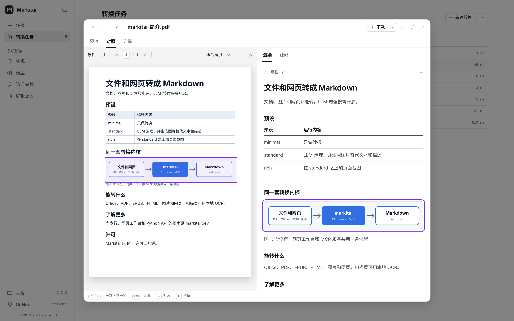
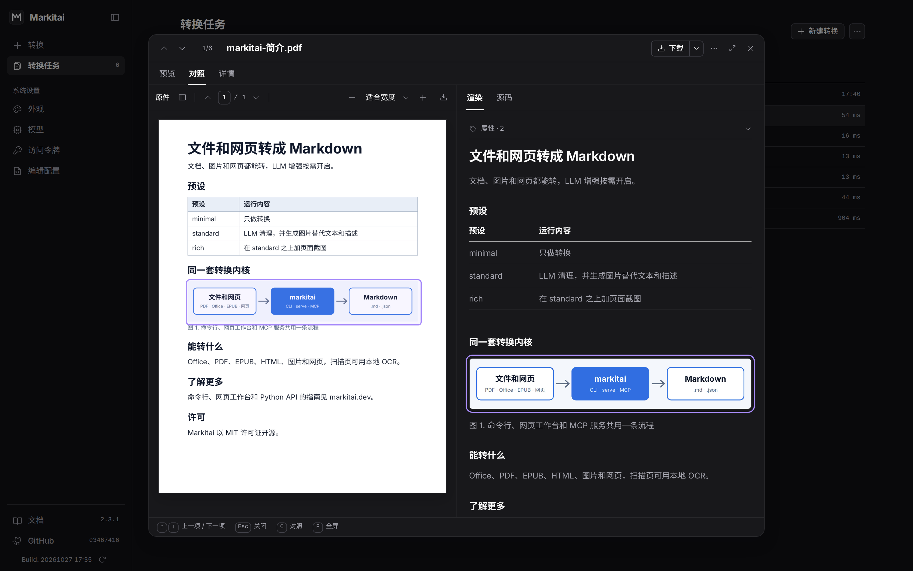

<!-- 功能卡片由主题的 home-features-before 插槽渲染（见 .vitepress/theme/index.ts）。 -->
<section class="home-shot" aria-labelledby="shot-title">
  
网页工作台

  <h2 id="shot-title">不想敲命令时，有个工作台</h2>
  
<code>markitai serve</code> 把同一套转换内核放进本地网页界面。拖入文件、粘贴 URL、看进度，对照原件逐条检查结果，再全部下载。

  <picture class="home-shot-light">
    <source srcset="../images/workbench.zh.webp" type="image/webp" />
    
  </picture>
  <picture class="home-shot-dark">
    <source srcset="../images/workbench.zh.dark.webp" type="image/webp" />
    
  </picture>
  
<a href="/zh/guide/serve">了解网页工作台 →</a>

</section>

<section class="home-quickstart" aria-labelledby="quickstart-title">
  

    
快速上手

    <h2 id="quickstart-title">60 秒，转成 Markdown</h2>
    
无需 API 密钥。

    <a href="/zh/guide/getting-started">快速开始 →</a>
  

  

    

      1
      

        
安装（macOS / Linux）

        <code class="platform-install-command non-windows-only">curl -fsSL https://markitai.dev/setup.sh | sh</code>
        
安装（Windows）

        <code class="platform-install-command windows-only">powershell -ExecutionPolicy ByPass -c "irm https://markitai.dev/setup.ps1 | iex"</code>
        <noscript>
          
Windows（PowerShell）：

          <code>powershell -ExecutionPolicy ByPass -c "irm https://markitai.dev/setup.ps1 | iex"</code>
        </noscript>
        

          
其他平台和手动安装方式

          

            macOS 或 Linux
            <code>curl -fsSL https://markitai.dev/setup.sh | sh</code>
          

          

            Windows
            <code>powershell -ExecutionPolicy ByPass -c "irm https://markitai.dev/setup.ps1 | iex"</code>
          

          

            通过 Python
            <code>uv tool install markitai</code>
          

          

            发布包
            <a href="https://github.com/Ynewtime/markitai/releases">GitHub Releases</a>
          

        

      

    

    

      2
      

转换网页
<code>markitai https://github.com/Ynewtime/markitai --pure</code>

    

    

      3
      

        
得到 Markdown

        <code># Markitai</code>
      

    

  

</section>
